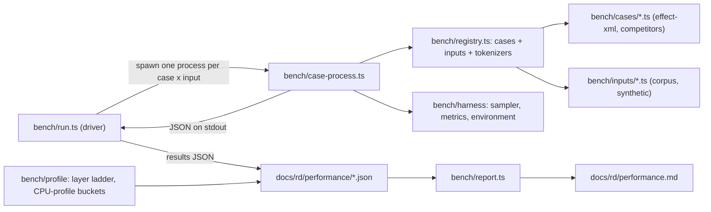

# Goal: performance analysis and optimization

Status: closed 2026-11-08, stopped by owner decision. Parity with `@computis/effect-xml` was not reached: with the Schema JIT off, as shipped, typed decode costs 1.66-2.44 times computis's CPU per operation and typed encode 1.84-2.66 times, at `bank-16k` and `bank-4m` on Bun and Node (`docs/rd/performance.md`, "Phase 3: stop and final status", `3229536`). Two levers were not tried: a custom tokenizer, and a fused tokenizer-to-record pipeline (the step-2 work). They are recorded as want `7af66787` for later work. The one streaming memory cell over the guardrail (Node positioned-stream peak heap at `bank-4m`, 1.111 of the phase-3 start) was investigated by the spike `perf3-sp-stream-heap` (`docs/rd/perf3b-spikes/stream-heap.md`). Nothing was held alive longer: the live heap is 1.000 of the phase-3 start's. The peak counted garbage: each positioned record's position tree, kept in the `recordTrees` `WeakMap`, was pretenured and sat in the old generation until a mark-compact, a mechanism the phase-3 start shares. `48d4bcf` and `9beee49` forget each positioned record's tree once it has decoded. Re-measured on Node at `bank-4m`, JIT off, 12 rounds, against the phase-3 start: positioned-stream peak heap 0.409 (0.363-0.442), peak RSS 0.607 (0.583-0.649), CPU 0.547 (0.532-0.552); the plain stream is unchanged against unfixed HEAD (1.000 peak heap, 0.999 CPU). Bun, `bank-16k` and `bank-64m` were not re-measured (`docs/rd/performance.md`, "Streaming guardrail", `8d31ad2`). Phase 3 stopped by owner ruling under its stop rule (`phase-3.md`, "The stop rule"). Landed in phase 3: step 1, the plan-driven builder plus one structural Schema codec and its encode mirror (code at `390bdca`; full ladder green at `aa39c12`, 1169 passed, 2 skipped), then `fromString` option B (`efea83e`), the collision-group encode (`f1870a1`), the precompiled builder (`7f1cff8`), the attribute writer (`659480f`), the resolver rewrite (`07240f0`), and the fused resolve-and-collect machine for document decode (`7e280b3`) and record streams (`6eb5420`). The library keeps the Schema JIT off by default (`docs/rd/decisions.md`); a public `jit` opt-in stays a non-blocking option. Step 2, the custom tokenizer, was not built: its rule does not fire under the amended `K` (`0acc9db`; re-evaluation `a310ba3`), and the owner chose not to build it as a cost decision. Final ratios, CPU per operation on a loaded machine, JIT off, `bank-16k` and `bank-4m` (`docs/rd/performance.md`, "Phase 3: what shipped, measured (HEAD A/B)" and "Phase 3: stop and final status"): against the phase-3 start `bd60a0e`, typed decode 0.29-0.48, record stream 0.41-0.54 (0.59-0.69 with positions), and typed encode 0.13-0.22; against step 1 `ee496cc`, typed decode 0.55-0.68, record stream 0.74-0.80, and typed encode 0.50-0.62; against computis, as stated above. The remaining decode gap at Node `bank-4m` (`T / C` 2.200) lives mostly in the upstream tokenizer (about 0.82 `C`) and the fused resolve and collect (about 0.57-0.60 `C`), then the structural decode (0.55 `C`) and the builder (0.22 `C`). An idle-machine run for absolute throughput is a separate, later task. The frozen oracle `test/oracle/` and its vocabulary copies are deleted (`e35151d`; harness `3b2cb50`, suites merged in `049265d`); the differential suites now compare the fast path with the standard path, and the derivation outputs are pinned by 260 per-key digests (`a620c4d`). Accepted loss: the standard path is no longer guarded against drift from `a7a93d5` (plan `docs/rd/perf3-oracle-removal.md`, loss L1). Owner decisions settled: the `fromString` second pass took option B (`efea83e`), the owner keeps `Schema.is` on a `fromString` codec fail-open (`2b82985`), and D1 is ruled (`phase-3.md`, "The step-2 decision rule"). Close-out audit `ee3a512f` returned residual; its findings are closed or recorded (`phase-3.slices.md`, Audits and Residuals). Earlier: phase 2 complete 2026-11-06 at `1808735`.

## Summary

Measure `@aidenzepp/effect-xml` against the strongest JavaScript XML libraries on the same inputs, profile it layer by layer, then make it as fast as or faster than the best of them in each like-for-like class without weakening any correctness gate. The library's own layers are optimized first. A custom tokenizer is pre-approved when the measurements show the upstream tokenizer is the bottleneck. The record of all of it is `docs/rd/performance.md`.

## Problem

The library has never been measured against another parser. The only numbers are quiet single-run measurements from the codec goal (`docs/goals/xml-schema-codec/GOAL.md`, Status, "Quiet measurements at `f61be31`"): 151.96 B per empty element; 160,080 streamed records in 4,032 ms, and 41,671 ms with `positions: true` (the README's "about ten times", `README.md` Positions section). Those numbers have no competitor, no latency distribution, no CPU or GC data, one runtime label, and no per-layer split, so nobody can say where time goes or whether the upstream tokenizer is the ceiling.

## Goals

1. A reproducible benchmark harness that runs on Bun and on Node and swaps tokenizers by providing `XmlSchema.Tokenizer`.
2. Competitor results in like-for-like classes, with each competitor's capabilities stated plainly.
3. A per-layer profile of the library's decode and encode paths.
4. Optimizations of the library's own layers, each with before and after numbers.
5. When the decision rule below fires, an in-house tokenizer behind the `Tokenizer` service, held to upstream's behavior.
6. `docs/rd/performance.md` recording all of the above.

## Non-goals

- Changing any public schema, codec shape, or error shape for speed. A speedup that needs one is reported to the Mind, not made.
- Weakening, skipping, or narrowing any test, limit, or security property to make a number better.
- Publishing, tagging, or bumping the package version.
- Runtime dependencies. Benchmark libraries are devDependencies only.
- Benchmarking browsers, Deno, or bundled builds.
- Validation against XSD (a competitor's XSD feature is listed, not benchmarked).
- Byte-identical round trip; the round-trip promise stays equivalent XML (`docs/rd/decisions.md`).

## The owner's metric set (verbatim, `85f587a7` item 2)

> Measure more than speed. For every benchmark, record:
>
> - throughput and latency (median, p95, p99);
> - CPU time (user and system);
> - memory: peak RSS, heap used, allocation rate, and GC count and pause time;
> - time to first record when streaming;
> - the scaling curve as input size grows.
>
> Record all of it on both Bun and Node, with the machine, versions, and method stated, so the runs reproduce.

A metric a runtime cannot report is recorded as unavailable with the reason, never estimated silently. Probed on this machine at `28a045b`: both runtimes expose `process.resourceUsage()` (`userCPUTime`, `systemCPUTime`, `maxRSS`), `process.memoryUsage()`, `node:v8` `GCProfiler`, and `--cpu-prof` (Chrome `.cpuprofile` format). Node lists the `gc` performance entry type; Bun does not, and whether Bun's `GCProfiler` reports real collector events is unverified (open question 3).

## Competitors

| Library                      | Version on npm (2026-11-05) | Classes it enters               |
| ---------------------------- | --------------------------- | ------------------------------- |
| `fast-xml-parser`            | 5.12.0                      | tree, encode-tree, typed-decode |
| `saxes`                      | 6.0.0                       | events, stream                  |
| `sax` (+ `@types/sax` 1.2.7) | 1.6.1                       | events                          |
| `txml`                       | 6.0.3                       | tree, encode-tree               |
| `@rgrove/parse-xml`          | 5.1.0                       | tree                            |
| `libxml2-wasm`               | 0.7.2                       | tree, encode-tree               |
| `@computis/effect-xml`       | 0.4.0                       | typed-decode, encode-typed      |

`@computis/effect-xml` decodes and encodes XML with Effect Schema and validates with `libxml2-wasm` (its README, `npm view @computis/effect-xml readme`); it is the closest like-for-like competitor for typed decode. Its `@effect/platform-*` peers are optional (`peerDependenciesMeta`). What each library does and does not do (well-formedness strictness, namespace resolution, entity handling, DOCTYPE handling, positions, streaming, schema typing) is recorded by probe in the harness, not from memory, and printed in `docs/rd/performance.md`.

## Like-for-like comparison classes

| Class          | What is timed                                      | effect-xml entry                                                   |
| -------------- | -------------------------------------------------- | ------------------------------------------------------------------ |
| `events`       | text to a flat event sequence, no tree             | the provided tokenizer's `decodeString` through `Stream`           |
| `tree`         | text to an in-memory element tree                  | `XmlSchema.ElementFromString` (namespaces resolved to Clark names) |
| `typed-decode` | text to a typed, validated value                   | `XmlSchema.fromString(Def)`                                        |
| `encode-tree`  | a library's own tree to text                       | `XmlSchema.ElementFromString` encode                               |
| `encode-typed` | a typed value to text                              | `XmlSchema.fromString(Def)` encode                                 |
| `stream`       | chunked text to records, with time to first record | `XmlSchema.decodeSchemaString(Def, path)`, `positions` off and on  |

A competitor enters only the classes it can do natively; a class result names what each entry does beyond the class minimum (for example effect-xml resolves namespaces in `tree` and most competitors do not).

## Per-layer profile targets

| Layer                        | Code                                                                                                                      |
| ---------------------------- | ------------------------------------------------------------------------------------------------------------------------- |
| upstream tokenizer           | `effect/encoding/Xml` via `defaultTokenizer` (`src/tokenizer.ts:114`)                                                     |
| namespace resolver           | `resolveEvents` (`src/resolve.ts:527`)                                                                                    |
| collector                    | `collect` (`src/resolve.ts:934`)                                                                                          |
| Schema decode                | the plan and codec under `fromString` (`src/document.ts:79`) and `decodeSchemaString` (`src/channel.ts:392`)              |
| error and position machinery | `decodeStringWithPositions` (`src/positions.ts:386`), `locate` (`src/positions.ts:253`), the failure path of `fromString` |
| Effect / Stream / Channel    | chunk transport and channel composition with no XML work                                                                  |

The profile is differential (each layer added to the pipeline in turn, timed) and cross-checked by CPU-profile self time bucketed by source file.

## Ground truth researched

- Tokenizer seam: `src/tokenizer.ts` (`Tokenizer` interface `:47`, `defaultTokenizer` `:114`, `Tokenizer` reference `:131`); exported as `XmlSchema.Tokenizer` (`src/xml-schema.ts:36`). The interface carries `decode`, `decodeString`, `encode`, `encodeString`, and `positions`; it has no `elements` channel.
- Conformance suite: `conformance(name, tokenizer)` (`test/tokenizer/conformance.ts:142`); fakes `spyTokenizer` (`test/tokenizer/fakes.ts:35`), `honestNativeTokenizer`, `shiftedNativeTokenizer`. Upstream test copy: `work/upstream-Xml.test.ts` (machine-local) and `test/upstream-xml.test.ts`.
- Corpus: 15 XML files under `spikes/fixtures/qti/` (33,148 bytes total; `wc -c spikes/fixtures/qti/*.xml`). `AssessmentItem` (`test/qti/vocabulary.ts:365`) decodes the four acceptance fixtures listed in `test/qti/vocabulary.test.ts:22-27`.
- Streaming vocabulary: `ItemRef` (`test/streaming/vocabulary.ts:67`), `itemRefPath` (`:92`); synthetic 50 MiB generator `test/streaming/synthetic.ts`; GC helper `forceGc` (`test/streaming/heap.ts:34`).
- Every effect-xml decode and encode path used by the classes runs under `Effect.runSync` on both runtimes, and Node 26.13.0 imports `src/index.ts` with no flags (type stripping); probed at `28a045b`.
- Default record budgets: `defaultMaxElementSize` 16 MiB, `defaultMaxElementNodes` 1,000,000 (`src/resolve.ts:639`, `:650`); a whole-document decode of a larger input needs `maxElementSize: Infinity` and `maxElementNodes: Infinity`.
- Lint binds benchmark code: `workspace/no-built-in-try-catch`, `no-await-in-loop`, kebab-case paths (`vite.config.ts`); `no-console` is off. `tsconfig.json:13` includes `src`, `test`, `tools`, `vite.config.ts` only.
- Upstream: Effect-TS/effect#10406 (positions on `StartElement`) is merged and unreleased; npm latest `effect` is 4.1.2 (mind, 2026-11-05).

## Reference list

- `vivi want show 86a9ce88` (want and amendments)
- `src/tokenizer.ts`, `src/resolve.ts`, `src/channel.ts`, `src/document.ts`, `src/positions.ts`
- `test/tokenizer/conformance.ts`, `test/tokenizer/fakes.ts`, `test/round-trip.test.ts`, `test/upstream-xml.test.ts`
- `test/streaming/vocabulary.ts`, `test/streaming/synthetic.ts`, `test/streaming/heap.ts`, `test/qti/vocabulary.ts`
- `docs/goals/xml-schema-codec/GOAL.md` (earlier measurements), `README.md` (Positions, Tokenizer)
- `node_modules/effect/AGENTS.md`, `.agents/skills/effect-design/SKILL.md`, `.agents/skills/document-code/SKILL.md`

## Constraints and invariants

- No runtime dependencies. Every benchmark library is a devDependency pinned to an exact version, with its reason stated in the delivery that adds it; adding them needs the Mind's approval.
- Benchmark code lives in `bench/` (kebab-case files), is linted, formatted, and type-checked with the repository, and is never part of `vp pack` (`src/index.ts` stays the only entry).
- `src/` and `test/` never import `bench/` (except `test/bench/`, which tests it). `bench/` never imports `spikes/`; it reads the corpus by path. `bench/` may import `src/` internals and these test modules read-only: `test/qti/vocabulary.ts`, `test/streaming/vocabulary.ts`, `test/streaming/heap.ts`.
- Benchmark files run unmodified under `bun` and `node` (Node strips types: `import type` for type-only imports, `.ts` extensions, no `enum`, no value `namespace`, no parameter properties).
- Each benchmark case runs in its own process so peak RSS belongs to that case; cases run one at a time, never in parallel with each other or with any other heavy process.
- A case proves it did the work: its output is checked against a reference count once per process, outside the timed loop; a mismatch fails the run.
- Benchmarks swap tokenizers only by providing `XmlSchema.Tokenizer` (`54fece78`); the upstream tokenizer stays selectable in benchmarks and tests (`85f587a7` item 1).
- Correctness gates stay green at every commit: `bun run check`, `bun run build`, `bun run test` (the full ladder, which includes the round-trip comparator over the corpus `test/round-trip.test.ts`, the error-path and position tests, and the tokenizer conformance suite). A speedup that weakens a test does not count.
- Results report Bun and Node separately, each with machine, OS, runtime and package versions, git commit, and method.

## Architecture direction

- The harness owns timing and metrics; a case owns only "prepare once, then a synchronous run function" plus its check. Every class entry used here runs synchronously (`Effect.runSync` for effect-xml), so the timed loop is a plain loop with no per-sample Effect or promise overhead; its floor (a no-op case) is recorded.
- The tokenizer is a run parameter (`--tokenizer upstream` in phase 1); effect-xml cases provide it with `Effect.provideService(XmlSchema.Tokenizer, tokenizer)`. A later in-house tokenizer adds one entry to `bench/tokenizers.ts`.
- Optimizations (phase 2 on) change library layers behind unchanged public signatures; each lands with the benchmark numbers before and after, measured by the same harness at the same settings.
- An in-house tokenizer, if built, is a new internal module that is a drop-in for the upstream module as `85f587a7` item 1 defines it, provided through `XmlSchema.Tokenizer`, and must pass `conformance(...)`, upstream's own `Xml.test.ts` cases, and differential tests against upstream over the corpus, large synthetic documents, and fuzzed inputs (events and errors); it keeps upstream's security properties (no external resources, no DOCTYPE entity expansion, enforced limits).

## The custom-tokenizer decision rule (`85f587a7` item 1, quoted)

> If profiling shows the upstream effect/encoding/Xml tokenizer is the bottleneck, build an in-house tokenizer with its own internal approach behind the same interface. No further owner ruling is needed.

Operational default (planner's, open question 1): evaluate after the phase-2 library-layer optimizations land. The rule fires when, on both runtimes, the upstream tokenizer is the largest single layer of the differential profile for the `stream` and `typed-decode` classes at the two largest synthetic sizes, and effect-xml is slower than the fastest competitor in the `events` class at those sizes. The numbers and the verdict are written into `docs/rd/performance.md` either way.

## Implementation shape

- Phase 1 (measurement only, no optimization): harness, inputs, competitor adapters, metric collectors, per-layer profile, and the first `docs/rd/performance.md` baseline. Cut in `phase-1.slices.md`. Done when the baseline is committed and no file under `src/` changed.
- Phase 2 (library layers): one slice per measured hotspot in the resolver, collector, Schema decode, position machinery, and Effect/Stream/Channel glue, ordered by measured share. Cut from phase 1's profile.
- Phase 3 (conditional): the decision rule; if it fires, the in-house tokenizer with its correctness bar; if not, the recorded reason. The upstream release of #10406, when it lands, is evaluated here (owner ruling 5 in `docs/goals/effect-native-api/GOAL.md`).
- Phase 4: final runs on both runtimes and the closing `docs/rd/performance.md` (optimizations with before and after numbers, owner decisions the ceiling forced).

## Release posture

Not user-visible until publish: the package stays `private: true` at 0.0.0. Benchmark devDependencies change `package.json` and `bun.lock` only.

## Exit strategy

Every optimization is one revertible commit. An in-house tokenizer is selected only through `XmlSchema.Tokenizer`; while it is not the default, removing it is deleting its module and its `bench/tokenizers.ts` entry. Making it the default is a separate, revertible commit.

## Acceptance criteria

- `docs/rd/performance.md` records: the harness and how to run it on Bun and Node; machine, OS, runtime and package versions, commit, and method; per-class competitor results with every metric in the owner's set or a stated reason it is unavailable; each competitor's capabilities; the scaling curve; the per-layer profile; the optimizations landed with before and after numbers; and the decision-rule verdict with its numbers.
- Every result row's case passed its output check.
- The full ladder is green at the goal's last commit, and no test was removed, skipped, or weakened by this goal (`git diff` of `test/` shows additions only, outside the in-house tokenizer's new tests). Phase 3's exceptions: the frozen oracle and its vocabulary copies, test-only and added in `bd60a0e`, were deleted in `e35151d` after the differential suites were retargeted to compare the fast path with the standard path (`049265d`), with loss L1 accepted (`docs/rd/perf3-oracle-removal.md`); its edits to existing tests are the reviewed exceptions in `phase-3.slices.md`, "Gate-owned validation".

## Done when (want `86a9ce88`, quoted)

> docs/rd/performance.md records a reproducible benchmark harness, competitor results, a per-layer profile, the optimizations landed with before and after numbers, and any owner decisions the ceiling forces.

`85f587a7` replaced "owner decisions the ceiling forces" for the tokenizer with the pre-approved decision rule above; the document still records its verdict.

## Validation

- `bun run check`, `bun run build`, `bun run test` at every accepted slice (gate seats).
- `bun bench/run.ts --smoke` and `node bench/run.ts --smoke` exit 0 (every case runs once and passes its check on the smallest inputs).
- `git diff --name-only 28a045b..HEAD -- src` prints nothing at the end of phase 1.

## Open questions (each with the planner's default)

1. Decision-rule operationalization: default as stated above. Mind may replace it.
2. Synthetic shapes: default one family, a flat `qti-item-bank` of `qti-assessment-item-ref` records (attribute-heavy, decoded by `ItemRef`), at 16 KiB, 256 KiB, 4 MiB, 64 MiB; the corpus covers text and mixed content. A text-heavy synthetic family is added in phase 2 only if the profile asks for it.
3. Bun GC fidelity: default record Bun's `GCProfiler` output labeled with its source and a note that its fidelity is unverified; if it reports nothing, GC count and pause are unavailable on Bun with that reason.
4. Typed-decode competitors: default `@computis/effect-xml` (native Effect Schema codec) and `fast-xml-parser` followed by `Schema.decodeUnknownSync` over its object (the hand-rolled path a user would write), on the synthetic bank only; corpus typed decode is effect-xml only.
5. Committed results: default commit per-runtime summary JSON under `docs/rd/performance/` (no raw samples); raw output stays under `work/bench/` (gitignored).
6. Input form: default text input for every class; the byte entry (`decodeSchema`) is measured in phase 2 only if the profile shows UTF-8 decoding matters.

## Stop conditions

- Stop and report if a case cannot pass its output check against the reference.
- Stop before adding any dependency that is not in the competitor table, and before any runtime dependency.
- Stop if a speedup would change a public schema, codec, or error shape, or needs a test changed.
- Stop if a competitor's install pulls a non-optional peer or a postinstall script beyond its own build.
- Stop before publishing, tagging, or changing the `effect` pin (the #10406 bump is a phase-3 decision).

## Mind rulings on the planner's decisions (2026-11-05)

Decisions 1-9 from the phase-1 cut (handle `16aad56b`) take the planner's defaults. The devDependency list in decision 1 is approved: these are the competitors the owner named in want `86a9ce88`, installed as devDependencies only, and the runtime dependency surface does not change.

## Mind rulings on the phase-2 cut (2026-11-06)

G1-G5 from the phase-2 cut (handle `d0b3419c`) take the planner's defaults: the time-to-first-record fix lives in the library (`records` in `src/channel.ts` handles each input string on its own pull); optimization slices are cut after the `perf2-4` inventory; A/B numbers come from the exclusive witness rows on clean worktrees; a gain under 5% on both runtimes is reported as no gain for a Mind revert decision; the class-level "before" is the phase-1 data with its shared-machine caveat.

## Phase 3

Phase 3 (Schema-decode layer: a plan-driven builder plus one structural Schema codec, the encode mirror, a JIT policy, then the conditional step-2 tokenizer) is specified in `docs/goals/performance/phase-3.md`, under the Mind's brief `work/perf3-mind-brief.md`. In phase 3 the custom tokenizer is governed by the brief's step-2 rule, operationalized in `phase-3.md`. Phase 3 stopped on 2026-11-08 under the owner's stop rule (`phase-3.md`, "The stop rule"); step 2 was not built. The guardrail slices (frozen oracle, differential suites, derivation invariance) and, after the spikes `docs/rd/perf3-spikes/{builder,errors,jit,encode}.md` reported, the codec-shape slices were cut in `docs/goals/performance/phase-3.slices.md`. The guardrail compared the fast path with the frozen oracle until `e35151d` deleted it; the differential suites now compare the fast path with the standard path (`049265d`), with loss L1 accepted (`docs/rd/perf3-oracle-removal.md`).
