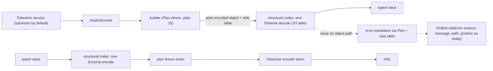

# Phase 3: typed decode and encode through one structural codec

Status: spec drafted 2026-11-06 at `a7a93d5` (task `83ce75cc`). Guardrail track lowered in `phase-3.slices.md` cut 1 and revised after delivery audit `ea39772d`; the spikes reported and head-cto ruled (task `8aa826d9`), so the codec track is designed in [Design](#design-settled-2026-11-06) and lowered in `phase-3.slices.md` cut 2 (task `6c66e48a`). Revised under task `d390991c` (perf3-plan-rev2) after head-cto's merit ruling `16f993dd` (M1-M7) and delivery audits `5d57e2b4` (codec track) and `e2d82410` (guardrail amendments): the library enables no Schema JIT, encode always goes through the tokenizer, and the fallback runs only after a refusal or a Schema failure.

Stopped 2026-11-08 by owner ruling under [The stop rule](#the-stop-rule); step 2 was not built. Final numbers: `docs/rd/performance.md`, "Phase 3: stop and final status". The performance goal closed with this stop, without computis parity; the untried levers and the streaming-heap spike are in `GOAL.md`, Status.

State at `aa39c12`: step 1 has landed (`phase-3.slices.md`, "Landed receipts"). Swap gate items 1 to 3 are green at `2643757` (gate `3a7444f9`), and item 4 is satisfied by the under-load A/B witness. The step-2 rule does not fire in the shipped mode, so step 2 is not started; the re-evaluation on the optimized code (`a310ba3`, `K` amended by `0acc9db`) confirms it ("The step-2 decision rule"). The close-out audit `ee3a512f` returned `residual` on 2026-11-07; its findings are closed or recorded (`phase-3.slices.md`, "Audits" and "Residuals"). See [Validation](#validation).

Parent goal: `docs/goals/performance/GOAL.md` (want `86a9ce88` and amendments `85f587a7`, `54fece78`). Phase authority: `work/perf3-mind-brief.md` (machine-local; Step 1, Step 2, Guardrails, Process). This document restates that brief as a durable spec; where they differ, the brief and the owner's words win and the difference is a defect here.

## Summary

Make typed decode and encode substantially faster while schemas keep defining everything. Step 1 replaces the per-element Schema transformation inside each element codec with a plain-JavaScript builder driven by the existing Plan, whose walk uses no Schema and no Effect, plus one structural Schema codec that decodes the reshaped object in one Schema call; encode is the mirror. The library runs that codec interpreted; an application that imports Effect's global JIT gets it compiled as well. Step 2, a custom tokenizer, is built only if, after step 1, the per-layer profile shows the tokenizer and resolver are what stands between effect-xml and matching `@computis/effect-xml` on typed decode. The public API, every error, every position, every streaming property, and every Schema derivation of an element codec stay exactly as they are. Differential tests held this against a frozen copy of the implementation at `a7a93d5` until that oracle was deleted in `e35151d`; since `049265d` they compare the fast path with the standard path, and the standard path is no longer guarded against drift from `a7a93d5` (loss L1, [`docs/rd/perf3-oracle-removal.md`](../../rd/perf3-oracle-removal.md)).

## Problem

Schema decode is the largest layer of the record path. Phase-2 layer ladder, `docs/rd/performance.md` "Per-layer profile" (`docs/rd/performance/phase-2-layers-*.json`), deltas in ms:

| Layer     | Bun `bank-4m` | Node `bank-4m` | Bun `bank-64m` | Node `bank-64m` |
| --------- | ------------- | -------------- | -------------- | --------------- |
| tokenizer | 15.835        | 21.425         | 250.667        | 444.389         |
| resolver  | 13.828        | 25.92          | 209.747        | 333.572         |
| collector | 4.681         | 4.087          | 75.095         | 103.624         |
| schema    | 54.72         | 52.287         | 772.665        | 789.803         |

On typed decode of `bank-4m` (`docs/rd/performance.md`, "typed-decode: bank-4m"), `@computis/effect-xml` takes 21.142 ms median on Bun and 23.679 ms on Node; effect-xml takes 121.547 ms and 124.966 ms (5.75x and 5.28x). On `encode-typed` `bank-4m` the ratio is 16.62x (Bun) and 11.78x (Node). computis rejects malformed XML but does not stream and gives no positions (same document, "Libraries and what they do").

The cause, per the brief: `compile` (`src/compile.ts:714`) builds each element as `wireElement(...).pipe(Schema.decodeTo(target, { decode: SchemaGetter.transformEffect(decodeElement(plan)), encode: SchemaGetter.transformEffect(encodeElement(plan)) }))` (`src/compile.ts:741-761`). Every element runs many small Effect steps, and the `transformEffect` getter is opaque to the Schema JIT. The operator's probe (`work/jit-probe/probe.ts`, `Schema.decodeUnknownSync(XmlSchema.fromString(ItemBank))` on `bank-4m`, Bun) measured 226 ms with the JIT off and 191 ms with `effect/schema/SchemaJITCompiler/enable` imported, about 15%. computis instead builds one plain encoded object from tokens with a plan, decodes it with a single `Schema.decodeUnknownEffect(exactDecoder(schema))`, and enables the JIT on that one AST (`node_modules/@computis/effect-xml/dist/{index,decoder,decoder-plan,exact-decoder}.js`).

## Goals

1. **Step 1, decode.** A plan-driven builder (plain JavaScript; the builder walk uses no Schema and no Effect) turns resolved input into the plain encoded object the schema expects, with values still raw strings, only reshaped, for example `{ "max-choices": "1", choices: [{ identifier: "A", $text: "First" }] }`. One structural Schema codec (Struct, Array, Union, and the user's leaf schemas through `Schema.toCodecStringTree`) derived from the same declarations decodes a document or record in one Schema call. "No Schema and no Effect" covers the builder walk and the writer only: the structural decode is a Schema call, and when `fromString` is composed into a user's Schema it runs inside that Schema's getter (F3).
2. **Step 1, encode.** The mirror: one structural Schema encode to a plain object, then a plan-driven writer to events and XML.
3. **Step 1, errors.** The same errors as today, produced by today's decode or encode on fallback (F1 (a)), which maps them through `src/issue.ts` unchanged. A fast attempt that ends in a refusal or a Schema failure re-runs today's path, so errors are today's by construction; a defect or an interruption propagates without a rerun (M2; see [Design](#design-settled-2026-11-06)).
4. **Step 1, JIT policy.** A recorded, evidence-backed policy for Schema JIT compilation that does not impose an unjustified process-wide side effect; measured in no-eval environments too, with `effect/schema/SchemaAOTCompiler` evaluated for them. Ruled (task `16f993dd` M3): the library installs no process-wide state and no `src/` module imports `effect/schema/SchemaJITCompiler` or its `/enable` module. The JIT is the application's opt-in: an application that imports `effect/schema/SchemaJITCompiler/enable` compiles every Schema AST lazily, the library's internal structural codecs included, and owns that process-wide choice. No-eval environments get the library default, the interpreter.
5. **Step 2, conditional.** The custom tokenizer, built only if the decision rule below fires.
6. **Record.** Before and after numbers for every change in `docs/rd/performance.md`, with the full owner metric set on Bun and Node in each JIT mode.

## Non-goals

- Any public API change: `src/index.ts` exports, `XmlSchema.*` signatures, codec Type and Encoded shapes, error classes and reasons, options. `XmlSchema.Element(...)` still returns a `Schema.Codec` that composes with Schema (R1, R2); only its internals change. A speedup that needs an API change is reported to the Mind, who takes it to the owner.
- Any regression in streaming (record emission, time to first record, bounded memory), positions, or well-formedness rejection. A stream-class or positions metric whose median worsens by more than 5% on either runtime at `bank-4m` or `bank-64m` is reported to the Mind before its slice is accepted.
- Weakening, skipping, narrowing, or editing any existing test assertion, limit, or security property.
- Any process-wide state installed by the library, including any import of `effect/schema/SchemaJITCompiler` or `effect/schema/SchemaJITCompiler/enable` from `src/`. Schema JIT compilation is the application's opt-in through Effect's global import (M3; recorded in `docs/rd/decisions.md`, "Phase-3 policy revised").
- Publishing, tagging, version bumps, pushing, or GitHub activity. Changing the `effect` pin, except through `work/owner-directive-api-followups.md` item 5 if a release with Effect-TS/effect#10406 appears.
- Byte-identical round trip of input documents (the round-trip promise stays equivalent XML, `docs/rd/decisions.md`).
- The bench JIT selector: task `280175c8` (`perf3-bench-jit`) owns it.

## Guardrails (non-negotiable; brief "Guardrails")

1. **Differential tests against the current implementation.** Until `e35151d`, the new decode and encode were held to the same values, the same errors (reason, message, path), and the same positions as the implementation at `a7a93d5` on:
   - the QTI corpus (`spikes/fixtures/qti/*.xml`, plus `test/fixtures/edge-cases.xml`);
   - the synthetic bank inputs (`bench/inputs/synthetic.ts`: `bank-16k`, `bank-256k`, `bank-4m`, and the `-bad-last` variants);
   - fuzzed and property-generated documents and values.

   A divergence failed the slice. The reference was a frozen, test-only copy of `a7a93d5`'s `src/` (decision in `phase-3.slices.md`, `perf3-oracle`), landed in `bd60a0e`; `src/` could change after the freeze, the oracle could not (Mind ruling O1 on audit `ea39772d`). After the owner stopped phase 3, the suites were retargeted to compare the fast path with the standard path at the same commit (`049265d`; harness `3b2cb50`), and the oracle and its vocabulary copies were deleted (`e35151d`; [`docs/rd/perf3-oracle-removal.md`](../../rd/perf3-oracle-removal.md), ruling O1). A divergence between the two paths still fails the suite. Accepted loss L1 (the plan's ruling O4): the standard path is no longer compared with `a7a93d5`, and the surfaces that never take the fast path (the raw-tree and direct surfaces of the corpus, fuzz, generated, and wrapped suites, their fingerprint mirrors, and every fallback outcome) compare the standard path with itself; `phase-3.slices.md` gap D3 lists them.

2. **Schema-observable behavior unchanged**, including JSON Schema and every other derivation of element and document codecs. Phase 2 shows how easily this drifts: the wire fast path of `7c88ef5` made the encoded side's `attributes` and `children` opaque declarations, so `Schema.toJsonSchemaDocument` and `Schema.toStandardJSONSchemaV1` gave `{}` for both and `toFormatter`, `toRepresentation`, `toCodecJson`, and the arbitrary failure path changed; `6dc514f` reverted it because no public annotation could restore `toRepresentation`. `test/wire-fast-path.test.ts` pins the direct element codecs' derivations and issue trees as literals; phase 3 adds a differential derivation test over the vocabularies and document codecs. That test compared the derivations with the oracle's until the oracle's deletion; since `a620c4d` it pins them by 260 per-key digests inline in `test/differential/derivations.test.ts` (the oracle plan's ruling O2, revised by Mind mail `ac13cc7f` from a committed file snapshot to inline digests). That commit took the file from 14 tests (1 plus 13 per subject) to 2; the 260 keys, 13 subjects by 20 derivations, keep the coverage.
3. **The existing suite stays green and unweakened**: the full ladder (`bun run check`, `bun run build`, `bun run test`), the round-trip comparator (`test/round-trip.test.ts`), the error-path and position tests, the tokenizer conformance suite, and `test/wire-fast-path.test.ts`, whose 474 captured direct outcomes include issue trees with AST tags (`grep -c 'tree: "' test/wire-fast-path.test.ts`). No existing test is weakened, judged per diff: no phase-3 slice commit deletes or edits a line of an existing test file (`git show --numstat <commit> -- test 'src/*.test.ts' | awk '$2>0'` prints nothing for it), and the phase-wide `git diff --numstat a7a93d5..HEAD -- test 'src/*.test.ts' | awk '$2>0 {print $3}'` lists only reviewed exceptions. The first exception was `test/bench/run.test.ts` (`3184848`, the Mind-approved bench JIT selector renamed and extended one case); the full reviewed list at the phase's end is in `phase-3.slices.md`, "Gate-owned validation".
4. **Measure everything.** For every change, the owner's metric set (parent goal, "The owner's metric set"): throughput and latency (median, p95, p99); CPU user and system; peak RSS, heap used, allocation rate, GC count and pause; time to first record when streaming; the scaling curve. On Bun and on Node, each in the three JIT modes `off`, `on`, and `noeval` (task `280175c8`), before and after, recorded in `docs/rd/performance.md`. A metric a runtime cannot report is recorded as unavailable with the reason.

## Ground truth researched (at `a7a93d5`)

- At the cut (`a7a93d5`) `src/` was unchanged since phase 2 closed. Since then `6e7724a` changed `src/positions.ts` (JSDoc only: no non-comment line differs) and added cases to `src/channel.test.ts`; behavior is the same, and the Mind ratified the oracle frozen at `a7a93d5` (ruling O1). The codec track changes `src/` from here on; the oracle stays pinned.
- The element codec: `compile` (`src/compile.ts:714`), `decodeElement` (`:479`), `encodeElement` (`:520`), `wireElement` (`:564`), the `transformEffect` pair (`:757-758`), the `XML` marker annotation (`:761`; key `"effect-xml"`, `src/plan.ts:15`).
- Public runtime surface (`bun -e 'import("./src/xml-schema.ts").then((m) => console.log(Object.keys(m).sort().join(" ")))'`): `Array DecodeError DefinitionError Element ElementFromString EncodeError EncodeSchemaFailure InvalidEvent Limit SchemaFailure Tokenizer UndeclaredPrefix UnmappedNamespace Unsupported WellFormedness clark decodeErrorOf decodeSchema decodeSchemaString elements encodeErrorOf equivalence fromString isDecodeError isEncodeError mixed namespaces optionalKey suspend text`.
- Schema derivations Effect 4.1.2 offers (`grep -nE '^export (const|function|declare function) to[A-Z]' node_modules/effect/src/Schema.ts`): `toStandardSchemaV1`, `toStandardJSONSchemaV1`, `toType`, `toEncoded`, `toTaggedUnion`, `toFormatter`, `toEquivalence`, `toRepresentation`, `toJsonSchemaDocument`, `toCodecJson`, `toCodecIso`, `toCodecStringTree`, `toCodecArrayFromSingle`, `toCodecGoJson`, `toEncoderXml`, `toIso`, `toIsoSource`, `toIsoFocus`, `toDifferJsonPatch`; plus `Arbitrary.schema` (`node_modules/effect/src/Arbitrary.ts:423`).
- Property testing: `fast-check` is not installed (`ls node_modules/fast-check` fails). Effect ships its own generator and runner, `effect/Arbitrary` (`schema`, `sampleEffect`, `checkEffect` with seeds and shrinking), already used by `test/wire-fast-path.test.ts:11`. Phase 3 uses it and adds no dependency.
- Import rule (parent goal, Constraints): `src/` and `test/` never import `bench/`, except `test/bench/`. The bank generator (`loadInput`, `bench/inputs/synthetic.ts:150`) and `ItemBank` (`bench/vocabulary.ts:18`) are therefore reachable from `test/bench/` only.
- The layer ladder's `schema` rung decodes through the public `XmlSchema.decodeSchemaString(ItemRef, bankPath)` (`bench/profile/layers.ts:166-181`), so it measures whatever path ships; its `resolver` and `collector` rungs call `resolveEvents` and `collect` directly (`:30`).
- JIT modules: `node_modules/effect/src/schema/SchemaJITCompiler.ts` (with `SchemaJITCompiler/enable`), `SchemaAOTCompiler.ts`, `SchemaCompiler.ts`.
- At `ea23128` no `src/` module imports the JIT: `src/jit.ts` (`aa8309a`) was removed by `perf3-revert-jit` (task `f7f7a062`), and the import-specifier grep of the swap gate (`phase-3.slices.md` receipt C6) prints nothing.

## Reference list

- `work/perf3-mind-brief.md`; `vivi task show 86a9ce88` (want and amendments); `work/owner-directive-parallelism.md`; `work/owner-directive-api-followups.md`.
- `docs/rd/decisions.md`, `docs/rd/effect-native-api-review.md`, `docs/rd/performance.md`.
- `src/compile.ts`, `src/plan.ts`, `src/codec.ts`, `src/document.ts`, `src/channel.ts`, `src/issue.ts`, `src/record-path.ts`, `src/positions.ts`, `src/resolve.ts`.
- `test/wire-fast-path.test.ts`, `test/round-trip.test.ts`, `test/qti/`, `test/streaming/`, `test/tokenizer/conformance.ts`.
- `bench/vocabulary.ts`, `bench/inputs/synthetic.ts`, `bench/profile/layers.ts`, `work/jit-probe/probe.ts`.
- `node_modules/@computis/effect-xml/dist/`, `node_modules/effect/src/schema/`, `node_modules/effect/AGENTS.md`, `.agents/skills/effect-design/SKILL.md`.

## Constraints and invariants

- Every parent-goal constraint holds (no runtime dependencies; `bench/` conventions; one process per case; outputs checked; correctness gates green at every commit).
- The frozen oracle (`test/oracle/`) is byte-identical to `src/` at its freeze commit and changes only by a Mind-approved re-freeze commit (ended: deleted in `e35151d`).
- The upstream tokenizer stays selectable in benchmarks and tests (`85f587a7` item 1).
- A custom tokenizer, if built, plugs in only through `XmlSchema.Tokenizer` and meets `85f587a7` item 1 in full: same interface, upstream's `Xml.test.ts` cases, differential tests over corpus, large synthetic, and fuzzed inputs (events and errors), and upstream's security properties; plus the conformance suite (`54fece78`).
- Encode keeps the `XmlSchema.Tokenizer` encode seam exact: the current tokenizer's `encodeString()`, default or provided, writes all XML text, on the fast path too. There is no direct text writer and no tokenizer identity check (M5).

## Architecture direction

The builder and writer own shape; the structural codec owns values; the Plan owns the mapping both ways. This diagram is the pre-spike direction; the settled design in [Design](#design-settled-2026-11-06) replaces its error branch (no side table, no translation: a failure re-runs today's path), reads collected records rather than events, and keeps direct Schema use on today's codec. The architecture is a clean break inside the library: one fast path ships per surface. The ruled fallback (F1 (a), F4 (a), F5) is today's path, kept because `XmlSchema.Element` must still return today's composable codec (R1, R2), not as a compatibility layer.

## The step-2 decision rule

The owner's rule (brief, Step 2): build the custom tokenizer only if, after step 1, the tokenizer and resolver are what stands between effect-xml and matching or beating computis on typed decode.

Evaluation (Mind ruling, 2026-11-07; gap D1 closed: the owner left the wording to the Mind). Build the custom tokenizer only if, after step 1, effect-xml's typed decode costs more CPU than computis's (`T > C`) and would not without the tokenizer and resolver (`T - K <= C`), measured as CPU per operation in the interleaved A/B on both Bun and Node at `bank-4m` and `bank-64m` with the Schema JIT off (the shipped default).

- `T` = CPU per operation of `effect-xml/typed-decode`, `C` = CPU per operation of `computis-effect-xml/typed-decode`, from the same interleaved A/B rounds;
- `K` = the CPU per operation of the tokenizer plus the resolver as the shipped decode path runs them (since `7e280b3` the fused resolve-and-collect; measured by the bench rung `typed/resolve-fused`, `30169e6`), from the same rounds.

The rule asks whether the tokenizer and resolver the library actually runs stand between it and computis; the pre-fusion separate resolver no longer runs, so `K` is cut from the shipped path. (Mind ruling amending `60805e4`, after the re-evaluation `a310ba3`; the first evaluation used the pre-fusion `K`, the `resolver` rung minus the `transport` rung of the `bench/profile/layers.ts` ladder.)

The rule does not fire when `T <= C` (target met) or when `T - K > C` (another layer is still in the way; that is more step-1 work, not a tokenizer). The verdict and `T`, `C`, `K`, and `T - K` per cell are recorded in `docs/rd/performance.md`: "Phase 3 step-2 evaluation" (first evaluation, pre-fusion `K`, with JIT `on` reported beside it) and "Phase 3: step-2 rule re-evaluated on the optimized code" (the current verdict).

Verdict on the optimized code (`a310ba3`): does not fire. At Node `bank-4m`, `(T - K) / C` is 1.146 (1.051–1.225) with `T` from the case harness and 1.171 (1.070–1.292) with `T` from the rung harness. The Bun cells fire or straddle 1, and the rule needs both runtimes. With the literal pre-fusion `K` (the `resolver` rung minus `transport`, through the separate `resolveEvents` channel), the rule would fire at `bank-4m` on both runtimes but stays inconclusive at `bank-64m`: Node in both harnesses (0.953 (0.708–1.106) and 0.608 (0.408–1.241)) and Bun in the rung harness (0.944 (0.489–1.192)). The rule needs all four cells, so overruling the definition of `K` alone gives "inconclusive pending more `bank-64m` rounds", not "fires" (`docs/rd/performance.md`, "Caveats and what would settle it").

Fact that shapes the choice: today `K` alone already exceeds `C` (Bun `bank-4m`: resolver rung median 29.664 ms against 21.142 ms; Node: 47.346 ms against 23.679 ms), so a literal reading of "stand between" is already true before step 1. The ruling keeps the brief's intent that step 1 runs first and the tokenizer is built only when it is the remaining obstacle.

## The stop rule

Owner ruling, 2026-11-08 (Mind memo; option 1 of the stop decision): phase 3 stops when no lever other than the tokenizer is projected to save at least 0.1 `C` on Node `bank-4m`, JIT off, where `C` is computis's CPU per operation for the same operation.

It fired on three consecutive spikes, none of them implemented:

- tokenizer encode (`b3e9a3e`, updated to all rounds in `47b7cd0`): no library lever on upstream's encoder pays at `bank-4m`;
- effect overhead (`e431665`): the Effect runtime costs about 0.04 `C` of decode and 0.09 `C` of encode, inside Schema's interpreter, and the prototype changes no end-to-end ratio;
- schema nodes (`f41b43b`): one node per boolean or number leaf saves 0.02-0.05 `C` of decode and 0.09-0.13 `C` of encode, unresolved end to end at Node `bank-4m`.

As applied, "projected" means a saving that resolves end to end in typed decode or typed encode `T / C` at Node `bank-4m`, JIT off. The schema-nodes encode lever measured 0.131 `C` (0.094-0.135) on its structural rung, but end to end typed encode `T / C` was 2.513 (2.476-2.621) with the prototype against 2.543 (2.489-2.581) without it (`docs/rd/performance.md`, "Why the stop rule fired"). Three layers have no separate lever projection: the fused resolve-and-collect (0.57-0.60 `C`, from the resolver spike's prototype), the builder (0.22 `C`), and the encode layers after the attribute writer `659480f`, which no layer split measured. The owner ruled with these numbers (memo `74d464d6`); this paragraph states how the rule was applied and does not override it.

Step 2 was not built. Its rule does not fire under the amended `K` ([The step-2 decision rule](#the-step-2-decision-rule)), and the owner chose not to build it as a cost decision. The remaining decode gap and the final ratios are in `docs/rd/performance.md`, "Phase 3: stop and final status".

## Implementation shape

- Guardrail track (lowered now, `phase-3.slices.md` cut 1): the frozen oracle, the differential harness, differential suites (corpus, bank, generated values, fuzzed documents), and the derivation-invariance test. All land before any step-1 `src/` change and pass at `a7a93d5`'s code.
- Step-1 track (`phase-3.slices.md` cut 2, revised by `d390991c`): structural-slot predicate, structural codec, builder, writer to events, fast decode, fast encode, the wiring of each surface with its fallback, the acceptance-parity suite, the checks carry-over (`perf3-checked-wrappers`, M4), the decisions record, then the witness and the re-profile with the step-2 evaluation. The JIT helper landed and was reverted (M3); the direct text writer was dropped (M5). First useful milestone: `fromString(ItemBank)` decode through builder plus structural codec with every differential suite green and the bank-4m numbers in all three JIT modes on both runtimes.
- Check-in after step 1 (brief): new numbers, the JIT policy, and the step-2 rule's result.
- Step-2 track (conditional): cut only if the rule fires.

## Release posture

Not user-visible until publish (`private: true`, 0.0.0). The JIT policy adds no option and installs nothing: the library runs its structural codecs interpreted, and an application that imports Effect's global JIT gets them compiled (M3, recorded in `docs/rd/decisions.md`). A public `jit` opt-in or an AOT hook would be public API and stays an owner decision, non-blocking (defaults: none in phase 3; a `jit` opt-in only if Node encode parity with computis matters; AOT a later option).

## Exit strategy

The guardrail track is test-only. Each step-1 slice is one revertible commit. Until a surface's wiring commit (`perf3-wire-decode-string`, `perf3-wire-channels`, `perf3-wire-encode`) lands, that surface keeps today's path, and reverting the wiring commit alone restores it; the internal modules it calls are then unused. The oracle and its vocabulary copies were deleted in one commit, `e35151d`, after the owner stopped phase 3; the differential suites were retargeted to compare the fast path with the standard path instead of being deleted ([`docs/rd/perf3-oracle-removal.md`](../../rd/perf3-oracle-removal.md); gap D3 superseded by ruling O1).

## Acceptance criteria

- Every differential suite and the derivation test pass at the phase's last commit, and each reports a non-zero count of compared cases. Their reference was the oracle frozen at `a7a93d5`'s `src/` (or a Mind-approved re-freeze) until `e35151d` deleted it; since then the suites compare the fast path with the standard path (`049265d`) and the derivation test checks 260 per-key digests (`a620c4d`), with loss L1 accepted ([`docs/rd/perf3-oracle-removal.md`](../../rd/perf3-oracle-removal.md)).
- The full ladder is green; no existing test is weakened, judged per diff as Guardrail 3 states; until `e35151d` deleted it, `test/oracle/` was held byte-identical to `a7a93d5`'s `src/` (the verbatim loop in `phase-3.slices.md` receipt R2); the criterion ended with the deletion.
- The acceptance-parity suite (`perf3-acceptance`) holds both hard rules on decode and on encode: the oracle rejects, so the fast attempt gives `None`; the fast attempt gives `Some`, so the oracle accepts the same value (Invariant 3). Since the oracle's deletion the standard path takes the oracle's place in both rules (`test/differential/acceptance.test.ts`). Its accepted counts are non-zero, its rejected counts are non-zero where a suite has rejecting inputs that reach the fast path, and its false-reject list is empty on the corpus and bank valid inputs.
- The JIT-parity suite (`perf3-diff-noeval`, re-scoped by M3) gives equal fingerprints in the library default and with the application's global JIT import preloaded, and the JIT run reports more than zero generated functions.
- No `src/` module imports `effect/schema/SchemaJITCompiler` or its `/enable` module (swap gate item 3 prints nothing).
- `docs/rd/performance.md` records, for every step-1 change, before and after numbers for `typed-decode`, `encode-typed`, and `stream` (positions off and on) on Bun and Node in JIT modes `off`, `on`, `noeval`, with the full metric set; the JIT policy with its evidence; the `SchemaAOTCompiler` evaluation; and the step-2 verdict with `T`, `C`, `K` per cell.
- `src/index.ts` exports are unchanged (`bun -e` command above prints the same list).

## Validation

- Gate seats: `bun run check`, `bun run build`, `bun run test` at every accepted slice.
- Guardrail suites: `bun x vp test test/differential/` and `bun x vp test test/bench/bank-differential.test.ts`.
- Benchmarks: `bun bench/run.ts` and `node bench/run.ts` with `--jit off|on|noeval` (task `280175c8`), and `bench/profile/layers.ts`, on a quiet machine for witness rows. Superseded by the owner directive of 2026-11-06 (`work/owner-directive-perf3-loaded.md`): measure under load with interleaved A/B rounds, CPU time per operation as the primary metric, and decide on per-round ratios (`bench/ab.ts`, `97bd29e`). The quiet-machine baseline (task `048d51ee`) was superseded.
- State at `aa39c12`: swap gate items 1 to 3 green at `2643757` (gate `3a7444f9`: check, build, and test green with 1161 passed and 2 skipped; differential 113 and bench 135 passed; JIT parity equal; `test/wire-fast-path.test.ts` unedited; no JIT import; no export change; oracle byte-identical; no test weakened). Item 4 is satisfied by the A/B witness: no `stream` or `stream/positions` regression, worst JIT-off median NEW / OLD 0.769 (`docs/rd/performance.md`, "Phase 3 under load (A/B)", "Witness verdict").
- Step-2 verdict: does not fire under the amended `K` (`0acc9db`: the tokenizer plus the fused resolver of the shipped path). On the optimized code (`a310ba3`), JIT off, Node `bank-4m` has `T > C` but `(T - K) / C` 1.146 (1.051–1.225) with `T` from the case harness and 1.171 (1.070–1.292) from the rung harness; the Bun cells fire or straddle 1, Node `bank-64m` is inconclusive, and the rule needs all four cells. Numbers: `docs/rd/performance.md`, "Phase 3: step-2 rule re-evaluated on the optimized code". History: the first evaluation (`perf3-measure`, `10d347f`, pre-fusion `K`) found `(T - K) / C` from 1.283 to 2.288 ("Phase 3 step-2 evaluation"). Step 2 is not started. D1 is closed: the owner left the wording to the Mind, which ruled on 2026-11-07 ("The step-2 decision rule").
- Audits: aggregate `7aa62827` (`block_range` on B1, repaired by `dae32dd`), head-cto `ae30d930` (N1, repaired by `5d5e049`), re-review `b5643b60` (`residual`; its items closed by `6aa5ea7`, `390bdca`, and `perf3-measure`), close-out `ee3a512f` (`residual`, returned 2026-11-07; its findings closed or recorded). Residuals and owners: `phase-3.slices.md`, "Residuals".

## Design (settled 2026-11-06)

The four spikes reported (`docs/rd/perf3-spikes/builder.md` at `3ca760c`, `errors.md` at `cae1912`, `jit.md` at `1d425f7`, `encode.md` at `3ec8e6d`), and head-cto ruled the forks on task `8aa826d9` (rulings F1-F9, guards F7.1-F7.7). The Mind adopted the ruling as written (task `6c66e48a`). Two hostile design reads followed, and head-cto's merit ruling on task `16f993dd` (M1-M7), adopted by the Mind, revised it: F8 is re-ruled to no library JIT, F5's direct text writer is dropped, F1 (a)'s trigger narrows to a refusal or a Schema failure, F4 gains a checks carry-over follow-up, and "same value" is defined. The tables below state the rulings as revised; [Merit ruling M1-M7](#merit-ruling-m1-m7-task-16f993dd) lists what changed. The owner questions take their defaults and are not sliced: no public `jit` option in phase 3, and no AOT install hook now (recorded as a later option). The step-1 slices are cut in `phase-3.slices.md`, "Cut 2", revised by task `d390991c`.

### Shape

```mermaid
flowchart TB
  subgraph decode["decodeString, decodeSchema, decodeSchemaString"]
    r["readRoot / collect (records stay; F6)"] --> el["ResolvedElement"]
    el --> p{"root passes the F4 predicate?"}
    p -->|yes| b["builder: plain JS over the record, compile.ts rule sources (F6, F9, M1)"]
    b -->|"plain object"| sd["structural decode: one Schema call, interpreted (F3, M3)"]
    sd -->|success| v["value"]
    b -->|"refuses (no user code ran)"| fb["today's decode: Schema.decodeUnknownEffect(def)(element, parseOptions)"]
    sd -->|"Schema failure (Fail)"| fb
    sd -.->|"defect or interruption"| die["propagates unchanged, no rerun (M2)"]
    p -->|"no (opaque root)"| fb
    fb --> out["today's outcome, success or error (authoritative, F1a)"]
  end
  subgraph encode["encodeString (fromString encode)"]
    tv["typed value"] --> q{"root passes the F4 predicate?"}
    q -->|yes| se["structural encode on the flipped AST"]
    se --> w["plan-driven writer to events"]
    w --> ev["events into the current tokenizer's encodeString() (M5)"]
    ev -->|text| tx["XML text"]
    se -->|"Schema failure (Fail)"| fe["today's encode"]
    w -->|"refuses: non-string leaf, spellAttributes error, non-element in an element position"| fe
    ev -->|"XmlError"| fe
    q -->|no| fe
  end
```

The builder and writer own shape, the structural codec owns values, and the Plan drives both. Errors are not translated: a refusal or a Schema failure re-runs today's path, so every error, message, path, position, record ordinal, `errors: "all"` result, and `reason.cause` tree is today's by construction. This supersedes the side-table translation drawn in the architecture direction above (errors spike option (b), not adopted).

### Rulings

| Ruling                  | Decision                                                                                                                                                                                                                                                                                                                                                                                                                           | Consequence for the slices                                                                                                                                                                                                                                                                                                                                                                                                                                                                                                                                                                                                                                                                                                                                                                                                                                                                                                                                                                                                                                                                      |
| ----------------------- | ---------------------------------------------------------------------------------------------------------------------------------------------------------------------------------------------------------------------------------------------------------------------------------------------------------------------------------------------------------------------------------------------------------------------------------- | ----------------------------------------------------------------------------------------------------------------------------------------------------------------------------------------------------------------------------------------------------------------------------------------------------------------------------------------------------------------------------------------------------------------------------------------------------------------------------------------------------------------------------------------------------------------------------------------------------------------------------------------------------------------------------------------------------------------------------------------------------------------------------------------------------------------------------------------------------------------------------------------------------------------------------------------------------------------------------------------------------------------------------------------------------------------------------------------------- |
| F1 (a)                  | Fast path on success. On a builder or writer refusal, or a Schema failure (`Fail`) of the structural decode or encode, re-run today's path (`Schema.decodeUnknownEffect(def)(element, parseOptions)` on the same collected root; today's `encodeString` body on encode) and return exactly its outcome, including a success. A defect or an interruption in the fast attempt propagates unchanged, with no rerun (narrowed by M2). | A fast-path false reject costs time only; a fast-path false accept has no safety net, so acceptance parity is a guardrail (F7.1). Builder messages are never shown, so the builder returns a refusal, not an error. The fast attempt runs inside the caller's Effect with the caller's services and environment; an async leaf suspends as today. The spans report the fallback's outcome: `xml.fallback` (`"success"` or `"failure"`) beside `xml.codec` on `xml.decodeString` and `xml.encodeString`, and `xml.records.fallback.accepted` beside `xml.records.fallback` on the channel run span (M2).                                                                                                                                                                                                                                                                                                                                                                                                                                                                                         |
| F2                      | `reason.cause` is a caller-observable contract (`SchemaFailure.cause`, `src/issue.ts:42-45`; `src/document.test.ts:193`).                                                                                                                                                                                                                                                                                                          | The harness compares the cause strictly (tree with AST tags, the StandardSchemaV1 leaf list, and the leaf count). Settles E5; under F1 (a) it holds by construction.                                                                                                                                                                                                                                                                                                                                                                                                                                                                                                                                                                                                                                                                                                                                                                                                                                                                                                                            |
| F3                      | The fast path lives only in `decodeString` (and so `fromString` decode), `decodeSchema` and `decodeSchemaString`, and `encodeString` (and so `fromString` encode).                                                                                                                                                                                                                                                                 | `compile()` output and every public AST stay as today. The structural codec is cached per Plan in a module `WeakMap` and is never annotated onto or reachable from a public AST. A direct `Schema.decode`/`encode` of an element codec, or an element codec used as a field of a user's Schema, runs today's codec at today's speed with identical derivations. `fromString(def)` inside a user Schema keeps its AST and gets the fast path, because only its getter body changes.                                                                                                                                                                                                                                                                                                                                                                                                                                                                                                                                                                                                              |
| F4 (a)                  | A slot whose element codec the user wrapped is an opaque field at today's speed.                                                                                                                                                                                                                                                                                                                                                   | The structural-slot predicate decides: a slot is structural only when its schema's AST is unmodified `compile()` output modulo annotations (marker on the top node, no `checks`, the encoding chain is `compile`'s own single link). `.annotate` and `Schema.brand` stay structural; `.check`, `decodeTo`, and any transformation are opaque, and the builder passes that slot the raw `ResolvedElement`. A predicate of `planOf(slot) !== undefined` is wrong: `planOf` sees through `.check` and `decodeTo` (`src/plan.ts:138-187`). A wrapped root makes the whole decode or encode opaque. Follow-up (M4, `perf3-checked-wrappers`): top-node checks, `Schema.fromBrand` included (`.check(...ctor.checks)` then `brand`, `node_modules/effect/src/Schema.ts:5343-5352`), are carried onto the structural node with the same `Filter` objects: a checked root's checks run on the structural Type value, and a checked slot's checks go onto that child's structural node. `decodeTo` and every transformation stay opaque. `perf3-slot-predicate` ships strict first (checks mean opaque). |
| F5 (superseded by M5)   | Encode always emits the writer's events into the current `Tokenizer`'s `encodeString()`, default or provided. There is no direct text writer and no tokenizer identity check.                                                                                                                                                                                                                                                      | The R9 seam stays exact for every tokenizer, and the writer duplicates no upstream escaping or name rule. Today's `encodeString` runs for the exact error on a non-string leaf, any `spellAttributes` error (an unmapped attribute namespace among them), a non-element in an element position, a Schema failure of the structural encode, or an `XmlError` from `encodeString`. A direct writer is revisited only with the JIT on and a fresh measurement.                                                                                                                                                                                                                                                                                                                                                                                                                                                                                                                                                                                                                                     |
| F6                      | The builder reads collected `ResolvedElement` records.                                                                                                                                                                                                                                                                                                                                                                             | The collector rung stays on the shipped path (it owns record budgets, `Limit` positioning, and record emission, and F1 (a) re-runs on the collected root). Fusing the builder into the collector is a step-2-era option, judged on the post-step-1 layer ladder.                                                                                                                                                                                                                                                                                                                                                                                                                                                                                                                                                                                                                                                                                                                                                                                                                                |
| F7                      | Seven guards.                                                                                                                                                                                                                                                                                                                                                                                                                      | Lowered into guardrail amendments and codec slices; see the table below.                                                                                                                                                                                                                                                                                                                                                                                                                                                                                                                                                                                                                                                                                                                                                                                                                                                                                                                                                                                                                        |
| F8 (re-ruled OFF by M3) | The library enables no Schema JIT and imports no `effect/schema/SchemaJITCompiler` module; the structural codecs run interpreted. An application that imports `effect/schema/SchemaJITCompiler/enable` gets them compiled, because the global compiler resolves every AST lazily (`jit.md`).                                                                                                                                       | `aa8309a` (`src/jit.ts`) is reverted by `perf3-revert-jit` (`ea23128`). On the shipped path the JIT is worth about 3% (Bun) and 6% (Node) end to end on decode (`builder.md`: Schema layer 13.3 to 11.8 ms and 14.2 to 10.5 ms, against 47.5 and 63.6 ms); the builder and writer win does not depend on it. A per-AST enable writes shared registry entries for user leaf ASTs (`node_modules/effect/src/internal/schema/compilerRegistry.ts:222-235`), flips a process-wide adapter flag, imports an `@stability unstable` module, and fires a CSP probe, with no opt-out; a 3-6% gain does not justify that. No-eval environments get the same default, and `--jit off` keeps its meaning across the swap.                                                                                                                                                                                                                                                                                                                                                                                   |
| M1                      | The builder consumes the same per-Plan rule sources as `decodeElement` (the declared attribute map, `slotsOf`, `isData`, `isBlank`, `GENERIC`, exported from `src/compile.ts`) and re-derives none of them. A Schema-native single path is rejected: a sync getter has no failure channel (`SchemaGetter.ts:45-52`), an element codec never inlines (`codegen.ts:757-834`), and the per-element codec must stay for direct use.    | The builder's refusal list is derived by command from `decodeElement`'s failure sites (`phase-3.slices.md`, receipt C7), not paraphrased.                                                                                                                                                                                                                                                                                                                                                                                                                                                                                                                                                                                                                                                                                                                                                                                                                                                                                                                                                       |
| M6                      | Same value: Vitest `toStrictEqual` plus equal own-key order at every depth; reference identity excluded; encode sameness is byte-identical text and events equal by `JSON.stringify`.                                                                                                                                                                                                                                              | Invariant 3. Every comparator (harness summaries, `perf3-acceptance`, the fast-decode and structural-codec rows) adds the recursive key-order check; the builder emits keys in today's order.                                                                                                                                                                                                                                                                                                                                                                                                                                                                                                                                                                                                                                                                                                                                                                                                                                                                                                   |
| F9                      | The builder never emits a key the structural Struct does not declare; the library sets no `onExcessProperty` and adds no `encodingChecks` filter.                                                                                                                                                                                                                                                                                  | Undeclared attributes and children are builder refusals (today's getter rules). Caller parse options (R6) pass through unchanged, including `onExcessProperty` and `errors: "all"`.                                                                                                                                                                                                                                                                                                                                                                                                                                                                                                                                                                                                                                                                                                                                                                                                                                                                                                             |

| Guard                                | Lowered into                                                                                                                                                                                                                                                                                                                                                                                                                                                                                                                                                                                                                                                                                                                                                                                                                                                      |
| ------------------------------------ | ----------------------------------------------------------------------------------------------------------------------------------------------------------------------------------------------------------------------------------------------------------------------------------------------------------------------------------------------------------------------------------------------------------------------------------------------------------------------------------------------------------------------------------------------------------------------------------------------------------------------------------------------------------------------------------------------------------------------------------------------------------------------------------------------------------------------------------------------------------------- |
| F7.1 acceptance parity both ways     | `perf3-acceptance` (codec track) over the corpus, bank, generated, fuzzed, and wrapped inputs; the guardrail suites export their inputs for it (amendments A1, A2, A4, A7, A8; encode inputs through V1)                                                                                                                                                                                                                                                                                                                                                                                                                                                                                                                                                                                                                                                          |
| F7.2 wrapped element codecs          | `perf3-slot-predicate` (the predicate) and `perf3-diff-wrapped` (new guardrail suite, amendment A8)                                                                                                                                                                                                                                                                                                                                                                                                                                                                                                                                                                                                                                                                                                                                                               |
| F7.3 stream witness                  | `perf3-witness`, the swap's acceptance gate                                                                                                                                                                                                                                                                                                                                                                                                                                                                                                                                                                                                                                                                                                                                                                                                                       |
| F7.4 encode differential coverage    | amendment A6 to `perf3-diff-generated` (mixed, open, `data-*`, `suspend`, namespaced attributes, per-feature counts); the corpus suite already encodes every decoded QTI value                                                                                                                                                                                                                                                                                                                                                                                                                                                                                                                                                                                                                                                                                    |
| F7.5 failure-path cost               | recorded by `perf3-reprofile` in `docs/rd/performance.md`: failure is today's path plus the fast attempt; errors.md's cheaper-failure number is not reused                                                                                                                                                                                                                                                                                                                                                                                                                                                                                                                                                                                                                                                                                                        |
| F7.6 leaves may run twice on failure | recorded in `docs/rd/decisions.md` ("Phase-3 policy revised", section "Double runs", superseding `perf3-decisions`' wording) and in the JSDoc the wiring slices touch, with the exact rule. Decode: a builder refusal runs no user code, because the builder runs before the structural decode; leaves run twice only when the structural decode ran and failed, whatever the fallback's outcome. Encode: only the open-`mixed` guard runs before the structural encode, so only its refusal runs no user code; a structural-encode failure, a writer refusal, or a tokenizer `XmlError` (U+0000 among them) comes after the leaf encodes, so the fallback runs them again, whatever its outcome; the tokenizer's `encodeString` can run twice. A leaf whose outcome varies can fail first and succeed second, and the second outcome is returned (recorded risk) |
| F7.7 shared JIT entries              | `perf3-diff-noeval` (amendment A9, re-scoped by M3): the differential inputs run once in the library default (interpreted) and once with the application's global JIT import preloaded; the fingerprints must be equal and the JIT run must report generated functions, so an application's opt-in compiles the structural codec without divergence. With no library JIT, a code-generation-disallowed run equals the default and is not run. The Mind may drop the slice if its cost matters. Settles D5 and J4                                                                                                                                                                                                                                                                                                                                                  |

### How each spike question closed

| Question                | Closed by                                                                                                                                                                      |
| ----------------------- | ------------------------------------------------------------------------------------------------------------------------------------------------------------------------------ |
| B1 builder input        | F6: collected records                                                                                                                                                          |
| B2 coverage             | builder.md coverage map: every Plan feature is handled; wrapped element codecs by F4 (a); open content holds raw `ResolvedElement`s under `ResolvedElementSchema`, interpreted |
| B3 codec shape          | one structural Struct per Plan composed for children, cached per Plan; `suspend` through `Schema.suspend` with the cache seeded before recursion                               |
| B4 public codec routing | F3: direct use keeps today's codec and AST                                                                                                                                     |
| B5 measured gain        | builder.md: Schema layer 70 ms to 11-14 ms on `bank-4m`; enough to proceed                                                                                                     |
| B6 fallback             | F1 (a) and F4 (a): the fallback is today's path, by design                                                                                                                     |
| E1-E4                   | F1 (a): parity by construction; no translation, no side table; `test/wire-fast-path.test.ts` stays unchanged because direct use keeps today's codec                            |
| E5 cause                | F2: compared strictly                                                                                                                                                          |
| J1 user transforms      | jit.md Q8: the JIT compiles around them; a transform demotes only its ancestor chain                                                                                           |
| J2 policy               | F8 re-ruled OFF (M3): no library JIT; the application's global import is the opt-in                                                                                            |
| J3 no-eval and AOT      | jit.md Q7: the interpreter at no extra cost, which is now the default everywhere; AOT needs a public hook, owner later option                                                  |
| J4 suite JIT mode       | F7.7, re-scoped by M3                                                                                                                                                          |
| N1 bytes                | byte-identical required; encode.md found no difference on the shapes it ran; F7.4 extends the differential to every shape                                                      |
| N2 seam                 | events only (M5): every encode goes through the current tokenizer's `encodeString()`                                                                                           |
| N3 encode errors        | by fallback (M5); compared by amendment A5                                                                                                                                     |
| N4 measured gain        | encode.md, events column with the JIT off: Bun 152.4 to 21.0 ms (7.3x) and Node 164.2 to 27.4 ms (6.0x) on `bank-4m`                                                           |

### Invariants the slices preserve

1. **Public ASTs unchanged.** `compile()` output, every element codec, `fromString`, and `ElementFromString` have the same AST as today; `test/wire-fast-path.test.ts` and `perf3-derivations` stay green and unedited. Kept by caching the structural codec in a module `WeakMap` keyed by Plan and registering `compile`'s link in a module `WeakSet`; neither writes an annotation.
2. **The fallback is authoritative after a refusal or a Schema failure.** When the fast attempt ends in a builder or writer refusal, a Schema failure (`Fail`) of the structural decode or encode, or an `XmlError` from the tokenizer's `encodeString`, the result is today's path's result, success or failure. A defect or an interruption in the fast attempt propagates unchanged and is never rerun: Schema checks the encoded type before a getter runs, so a builder bug yields a `Fail`, and a user leaf's defect is today's defect. Kept by the fast functions returning `Option` and mapping only `Fail` to `None`. Double runs (M2): a refusal runs no user code; leaf transformations run twice only when the structural decode or encode itself ran and failed, whatever the fallback's outcome; the tokenizer's `encodeString`, default or provided, can run twice on encode; a leaf whose outcome varies between runs can fail in the fast attempt and succeed in the fallback, and the fallback's outcome is returned (recorded risk, `docs/rd/decisions.md`).
3. **The fast path accepts exactly what today accepts and yields the same value (M6).** Two values are the same when both hold: (1) Vitest `toStrictEqual` (deep equality, prototype or class, own-property presence, so a missing key is not `undefined`, and array sparseness); (2) the own-key order of every object is equal at every depth (`toStrictEqual` ignores order, and consumers snapshot `JSON.stringify`). Reference identity is not part of the contract; open-content `ResolvedElement`s compare by (1) and (2). Encode sameness is byte-identical text, and events equal by `JSON.stringify`. Kept by the builder refusing every shape today's getters reject through their own rule sources (M1) and emitting keys in today's order (attributes in element order, then content keys, as `decodeElement`'s `Object.assign` does), the F4 predicate, and F9; checked by `perf3-acceptance` in both directions and by every harness comparator.
4. **No JIT import.** No `src/` module imports `effect/schema/SchemaJITCompiler` or `effect/schema/SchemaJITCompiler/enable` (M3). The swap gate's import-specifier grep (`phase-3.slices.md` receipt C6) prints nothing.
5. **Records, budgets, and positions stay where they are.** `collect` still builds every record; positions attach on the fallback through today's `toDecodeError`.

### Bench JIT modes (unchanged by the swap, M3)

`bench/harness/jit.ts` keeps its meaning before and after the swap, and its JSDoc needs no correction:

- `off`: the library default, the interpreter everywhere;
- `on`: the application's global import (`bench/harness/jit/on.ts`), which compiles every AST, the library's structural codecs included;
- `noeval`: the global import with `Function` refused, which the JIT turns into the interpreter (the Workers and strict-CSP case).

The step-2 rule's "JIT mode the library ships by default" is `--jit off`, with the same meaning before and after the swap, so `--jit off` witness rows compare like for like with the baseline (task `048d51ee`; superseded by the under-load A/B, whose OLD side is `bd60a0e`).

### Out of step 1

Error translation through a side table (errors spike option (b)); AST surgery for wrapped codecs; an event-fed builder fused into the collector; a public `jit` option (opt-in or opt-out); an AOT hook; a fast path for direct `Schema.decode`/`encode` of an element codec; the JIT on by default (M3); a direct text writer (M5); a `SchemaCompiler.set` fast path for direct use (`node_modules/effect/src/SchemaCompiler.ts:216`, `@stability unstable`, unverified).

Spelling dependence (M4, recorded): the fast path depends on how a caller spells the decode. `fromString(def)` and the channels get it; `ElementFromString(...).pipe(Schema.decodeTo(Root))`, a direct `Schema.decode` of an element codec, and an element codec inside a user's `Struct` run today's codec at today's speed (F3). The consumer JSDoc of the fast entry points states this in plain words, without F-numbers.

### Merit ruling M1-M7 (task `16f993dd`)

| Ruling                       | Disposition                                                                                                                               | Where it lands                                                                                                                              |
| ---------------------------- | ----------------------------------------------------------------------------------------------------------------------------------------- | ------------------------------------------------------------------------------------------------------------------------------------------- |
| M1 Schema-native alternative | rejected, no spike; the builder reuses `compile.ts` rule sources                                                                          | rulings table row M1; `perf3-builder`                                                                                                       |
| M2 fallback semantics        | F1 (a) kept, trigger narrowed to a refusal or a Schema failure; exact double-run rule; `xml.fallback` and `xml.records.fallback.accepted` | F1 (a), Invariant 2, F7.6; `perf3-fast-decode`, `perf3-fast-encode`, the three `perf3-wire-*` slices                                        |
| M3 JIT default               | F8 re-ruled OFF                                                                                                                           | F8, Goal 4, Non-goals, Invariant 4, F7.7; `perf3-revert-jit`, `perf3-diff-noeval`, `perf3-witness`, swap gate item 3                        |
| M4 opacity cliffs            | checks carried onto the structural node as a follow-up; spelling dependence recorded                                                      | F4 (a); `perf3-checked-wrappers`; the paragraph above                                                                                       |
| M5 encode                    | direct text writer dropped; events always into `tokenizer.encodeString()`                                                                 | F5; `perf3-fast-encode` (`perf3-writer-text` dropped)                                                                                       |
| M6 same value                | defined                                                                                                                                   | rulings table row M6, Invariant 3; `perf3-diff-harness`, `perf3-acceptance`, `perf3-fast-decode`, `perf3-structural-codec`, `perf3-builder` |
| M7 doc defects               | fixed                                                                                                                                     | Goals 1 and 3, Non-goals, "Bench JIT modes" (E1-E4)                                                                                         |

## Goal check (planner, task `83ce75cc`)

- Guardrail track: **READY**. The oracle, harness, suites, and derivation test need no step-1 design decision; `phase-3.slices.md` lowers them.
- Step-1 codec track: **NOT READY** at `83ce75cc` (gaps B1-B6, E1-E5, J1-J4, N1-N4). Re-checked under task `6c66e48a`: **READY** for delivery. Every gap is closed by a spike or a ruling ([Design](#design-settled-2026-11-06)); the open items in `phase-3.slices.md`, "Gaps for the Mind", change no slice's architecture.
- Step-1 codec track, revision `d390991c`: **READY** for delivery after folding M1-M7 and audits `5d57e2b4` and `e2d82410`. Every changed slice is marked "needs re-audit" in `phase-3.slices.md` ("Revision rev2"); READY is a readiness verdict, not approval to dispatch.
- Step 2: **NOT READY** by design; it depends on step-1 measurements and gap D1.
- Step 2 after step 1 (`aa39c12`): the rule does not fire in the shipped mode (`docs/rd/performance.md`, "Phase 3 step-2 evaluation"); no step-2 track is cut.

## Open questions (each with the planner's default)

See `phase-3.slices.md`, "Gaps for the Mind": D1-D6 (cut 1; D1 closed by the Mind's ruling of 2026-11-07, the rest ruled or dispatched) and Q1-Q6 (cut 2 and revision `d390991c`).

## Stop conditions

- Stop and report if any differential suite diverges at `a7a93d5`'s code (the oracle or harness is wrong).
- Stop if a step-1 change needs a public API, codec shape, error shape, or existing-test change.
- Stop if any slice finds that keeping `test/wire-fast-path.test.ts` or a derivation unchanged needs a change to a public AST: owner decision (the errors spike's E4 risk, removed by F3 unless a slice proves otherwise).
- Stop and report if the acceptance-parity suite finds a value the fast path accepts and today rejects that the builder cannot refuse without reimplementing a Schema rule.
- Stop and report if `perf3-checked-wrappers` finds a top-node check the structural node cannot carry with the same `Filter` objects (M4's carry-over is not prototyped).
- Stop before any new dependency, including `fast-check`.
- Stop before publishing, pushing, or changing the `effect` pin.
