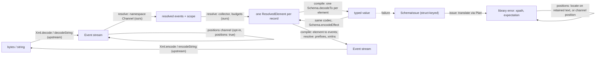

# Goal: xml-schema-codec

## Summary

`effect-xml` becomes a "Zod for XML" on Effect Schema: a consumer writes one definition of an element in an object-form DSL and gets an ordinary `Schema.Codec` whose decode turns a well-formed XML document (or each repeated record of a large one) into an Effect-typed value and whose encode writes that value back as canonically equivalent XML. Every attribute, including `data-*`, is a string on the wire and a Schema-validated value in TypeScript. Namespaces are resolved, mixed content keeps document order, failures name an XPath-like path plus a line and column when one is available, and the whole thing is built on `effect/encoding/Xml` and `Schema.toCodecStringTree` rather than a parser or validator of its own. The library ships the codec; QTI is the proving ground and QTI definitions stay in consuming projects.

## Problem

- `effect@4.1.2` ships the event codec (`effect/encoding/Xml`: tokenise, well-formedness, limits, write) and a one-way generic dump (`Schema.toEncoderXml`), but nothing decodes XML into a Schema value and nothing lets a Schema control attributes, element names, namespaces, order, or mixed content (`docs/onboarding.md` "The gap"; `docs/rd/effect-substrate.md` section 3).
- QTI 3 consumers parse items by hand or with untyped trees. The two problems JSON-style schemas never face, ordered mixed content in XHTML bodies and `xmlns` scoping, are exactly where hand-written code goes wrong (`bpig-mathml.xml` re-binds the default namespace on an inner `<math>` with no prefix change; `bg010-missing-word.xml` interleaves text, ` `, and an inline interaction in one `
`).
- Upstream events and `Element` trees carry no positions and `SchemaIssue` has no slot for one, so a Schema failure on an XML document today says `at ["body"]["children"][3]["max-choices"]` with no line and no XML name (`effect-substrate.md` 1.4; SPIKE-05 evidence 6).

## Goals

- One definition, both directions (criteria C1, gate): `Schema.decodeUnknownEffect(Def)` and `Schema.encodeEffect(Def)` work on the same value with no second declaration and no hand-written mapper.
- Typed attributes including `data-*` (C2, gate): attribute schemas are ordinary Schemas run through `Schema.toCodecStringTree`; `data-*` is a template-literal-keyed record; an unknown attribute is an issue naming the declared set.
- Content modes `empty`, `text`, `elements`, `mixed`; `elements` and `mixed` carry an `open` option (Mind ruling on delivery audit `12e83528`: `open` is a property of the child-bearing modes, `empty` and `text` have no child slot, and an open element with no declared children is `elements({}, { open })` or `mixed([], { open })`); `mixed` is an ordered array over a union indexed by each member's literal element name so one bad member yields one issue; `elements` is named fields; whitespace-only text is kept in `mixed` and dropped in `elements`.
- Namespaces (C4, gate): names resolved to expanded form before any definition sees them; definitions carry a prefix map for authoring and encode; unprefixed attributes are in no namespace; an undeclared prefix is a decode error with the XML path.
- Per-record streaming with tree decode as the single-record case; memory bounded by the largest record under an inherited character limit plus a node budget (C6).
- Every decode failure names an XPath-like path with one-based same-named-sibling indices, the expectation, and a line and column when the text is retained or `positions: true` was requested (C10).
- Round trip is canonical equivalence defined by an exported, executable comparator; the exclusion list is published (C5).
- Public operations emit spans and logs through Effect; the library installs no tracer, logger, or exporter.

## Non-goals

- Non-well-formed HTML. Effect's parser accepts only well-formed XML, which QTI (including its XHTML item bodies) is.
- QTI definitions in this repository. The benchmark subset lives under `test/` as a fixture-driven vocabulary and is never exported (`docs/rd/branches/consumer-story.md`).
- Byte-identical round trip. `Xml.encodeString` never self-closes, normalises quotes and entity forms, and merges CDATA into text; byte identity failed on 16 of 16 fixtures on both upstream paths (SPIKE-03 loss table). Preserving comments or PIs (the parked "preserve" tier) is out unless a consumer asks (D8).
- DTD or XSD validation, default attribute values from a DTD, and entity declarations beyond the five predefined entities and character references (D9).
- Non-UTF-8 input. Upstream fails `encoding="ISO-8859-1"` in byte mode; callers decode bytes to text first.
- A Schema AST rewrite, as core or as an escape hatch for `Schema.Class` bodies (T1, risk R1, severity P1 if re-introduced).
- Event-driven (push) Schema decode. Parked with SPIKE-04's capability-gap table; nothing in 4.1.2 drives `SchemaParser` incrementally.
- `xsi:type` dispatch, camelCase key renaming, the annotated-Struct declaration surface, order validation across different child names in `elements` mode, and comment preservation: recorded wants (R1, R3, R8, R9, R10), not first-milestone work.
- Publishing the package. The name is settled (D10, owner 2026-11-04: the project stays `effect-xml` and publishes later as the scoped `@aidenzepp/effect-xml`); no publish, tag, or registry action happens in this goal.

## Ground Truth Researched

- `docs/rd/decisions.md` (commit `1e68713`): the head-cto ruling on tensions T1 to T5 and decisions D1 to D12, with per-ruling evidence, "not verified" lists, producer facts, recorded risks R1 to R10, owner decisions, and the one-breath architecture quoted below. Treated as the problem lock for this goal; the Mind confirms it.
- `docs/rd/effect-substrate.md`: verified map of `effect@4.1.2` (`node_modules/effect/src`) with probed facts: events carry no positions; `xmlns*` are ordinary attributes; `Xml.elements` drops comments, PIs, and the declaration; `toCodecStringTree` is a bidirectional string-leaf codec that already decodes `"3"` to an `Int` and rejects `"3.5"` with a path; `NumberFromString("x")` succeeds as `NaN`, so attribute numbers go through `toCodecStringTree` (`Int`/`Finite`), never `NumberFromString`.
- `spikes/declaration-dsl/RESULT.md` (SPIKE-05): object-form DSL plus one compiler over a closed `Plan` passes C1 and C2 at 5 on `bpig-hotspot.xml` and `bg007-true-false.xml`, `data-*` included; 19/19 tests, re-run by the CTO; recursion needs a named interface plus `suspend(name, thunk)` (C7 = 3); `Schema.Union` over element codecs reports every member miss without name indexing.
- `spikes/schema-layering/RESULT.md` (SPIKE-06): the Config-style AST rewrite needs `@internal` helpers absent from `dist/SchemaAST.d.ts` and cannot reach encoding chains, index signatures (`data-*`), or `Schema.Class`; issue paths are struct-keyed in every mechanism and XML paths come from a translation pass.
- `spikes/mixed-content/RESULT.md` (SPIKE-01): ordered array with discriminated union is the only shape that holds order in one place (named fields lost order on `bg010-missing-word.xml`); a per-member `name: Schema.Literal` on the Encoded side lets `Schema.Union` index members by element name (17/17).
- `spikes/namespaces/RESULT.md` (SPIKE-02): expanded names resolve `bpig-mathml.xml` correctly where prefix-as-written confuses two vocabularies (C4 A = 5, B = 0); re-prefixed copies decode `toEqual`; resolver is 233 lines over `Xml.decodeString` events; attribute keys are Clark strings.
- `spikes/round-trip/RESULT.md` (SPIKE-03): canonical comparator (`canonical.ts`, 45 non-blank lines) green on 16/16 fixtures and a fixed point after one pass; loss inventory per fixture.
- `spikes/streaming/RESULT.md` (SPIKE-04): full tree fails the default `maxElementSize` on a 55 MB synthetic test and costs about 4x input when raised; per-record streaming holds a flat 1.8 MB live set over 160,080 records; records from `Xml.elements` carry no ancestor `xmlns` or `xml:lang`; equal `maxElementSize` counts retained 122 MB versus 1 MB (122x).
- `spikes/error-positions/RESULT.md` (SPIKE-07): post-hoc locate and the position channel agree on 416/416 start tags across all fixtures plus an edge-case file; 33 hand-checked; the channel costs 2.5x to 3.6x, three quarters of it structural.
- `spikes/fixtures/qti/SOURCES.md`: fifteen QTI 3 files, all synthetic and authored in this repository except one Apache-2.0 PCI example (`pci-shaded-grid.xml`), none with CDATA or undeclared named entities; `bg007-true-false.xml` has a multi-line `xsi:schemaLocation`; `extended-text-postcard.xml` and `pci-shaded-grid.xml` carry `data-*` attributes.
- `docs/onboarding.md` (commit `a234642`): records each decision in brief and the owner-held open decisions; links to this goal.
- `package.json`, `vite.config.ts`, `spikes/README.md`: gates are `bun run check` (`vp check --deny-warnings`: format, lint incl. type-aware rules, type check), `bun run build` (`vp pack` of `src/index.ts`), `bun run test` (`bun test tools` then `vp test` over `src/**/*.test.ts` and `test/**/*.test.ts`); `spikes/` is excluded from lint, type check, test, and pack; `src/index.ts` is empty with a lint override to delete on the first export; `effect` is a pinned dev dependency and a `^4.1.2` peer.
- `work/mind-brief.md` and the Mind's task `72a94efe`: the owner's seed ("Zod for XML", one definition both directions, every attribute Schema-validated, general library, QTI proving ground, no non-well-formed HTML, build on `effect/encoding/Xml`), the package-name hold (since settled by the owner, D10), and the instruction that spike code never enters `src/`.

## Reference Packet

Before editing, inspect:

- `docs/rd/decisions.md`: the rulings this goal lowers; read T1 to T5 in full and the row for the decision a unit touches, including its "not verified" column, which is the unit's first test.
- `docs/rd/effect-substrate.md` sections 1.2 to 1.4 and 2: which Schema and Channel seams are public and stable (`Schema.toCodecStringTree`, `Schema.decodeTo`, `SchemaAST.toEncoded`, `Channel.fromTransform`), and which are `@internal` and forbidden.
- `node_modules/effect/AGENTS.md` and `node_modules/effect/src/encoding/Xml.ts` (`makeChannel` at `:568-616`, `Collector` at `:1723-1789`, `Writer` at `:1869-2037`): the upstream pattern every library channel follows.
- `spikes/declaration-dsl/element-codec.ts`, `xml-dsl.ts`: the compiler and DSL the `plan` and `compile` modules are shaped after (`Plan` at `element-codec.ts:62-70`, `decodeElement` `:138-231`, `encodeElement` `:233-291`, `compile` `:296-338`, `data-*` `:326-330`, mixed tagging `:109-131`). Copy the shape; do not import the files.
- `spikes/namespaces/resolver.ts`: the scope stack, Clark-string attribute keys, `qname(map)`, and the encode prefix chooser the `resolve` module re-implements as a Channel.
- `spikes/round-trip/canonical.ts` and `pipeline.ts` (`elementEvents`, 13 lines): the comparator and the `Element -> Event` walk.
- `spikes/error-positions/locate-c.ts`, `positions-b.ts`, `positions.test.ts` (`handChecked`): the two position sources and the agreement test the suite must keep.
- `spikes/schema-layering/approach-b.ts:336-383` (`translateIssue`): the 50-line issue translation the `issue` module generalises over the `Plan`.
- `spikes/streaming/measure.ts`, `synthetic.ts`: how peak heap and retained bytes were measured; reuse the method for the node-budget default.
- `test/upstream-xml.test.ts`: the upstream canary; extend it with every event shape a library module relies on.
- `.agents/skills/effect-design/SKILL.md`, `error-messages/SKILL.md`, `trace-effect/SKILL.md`, `document-code/SKILL.md`, `conventional-commits/SKILL.md`: repo rulings for Effect code, caller-facing errors, spans, comments, and commits.
- `bun run check && bun run build && bun run test`: the gates; all three must be green before any unit reports done.

## Constraints And Invariants

- Effect error channels only; built-in `try`/`catch` is forbidden by lint (`workspace/no-built-in-try-catch`). No runtime dependencies; `effect` stays a peer at `^4.1.2` and a pinned dev dependency at `4.1.2`.
- `src/index.ts` is the single published entry; internal modules are kebab-case files under `src/` with relative imports so `dist/index.d.ts` resolves. Tests sit beside their module (`src/*.test.ts`) or in `test/` for cross-module and upstream-contract cases; library tests use `@effect/vitest` and `it.effect`.
- Only public, stable (or the already-experimental `encoding/Xml`) upstream symbols. The `@internal` set SPIKE-06 named (`applyToSelfOrLastLinkEncoding`, `replaceEncoding`, `Objects.recur`, `Arrays.recur`, `getIndexSignatureKeys`, `SchemaIssue.defaultFormatter`) is never imported. Read annotations from `ast.annotations` and `ast.context.annotations`, never through `resolveAnnotations` (checks shadow it).
- One producer of truth per element: a definition lowers exactly once to a `Plan`; both getters are generated from it; the consumer never writes a getter. Exactly one `Schema.decodeTo` per element, from the per-element encoded Struct `{ name: Literal, attributes, children }` into the target Struct; child slots are the child codecs so Schema's own nesting decodes each child once and produces the struct-keyed issue path the translator consumes.
- Attribute and text leaves run through `Schema.toCodecStringTree(consumerSchema)` and nothing else. The DSL never substitutes `NumberFromString`.
- Decoded keys are wire names (`"max-choices"`, `"xml:lang"`); no rename map in the first milestone (R8). Optional attributes use `Schema.optionalKey`; the DSL `optional()` wraps child elements only.
- Attribute keys on a resolved element are Clark strings (`{uri}local`, or `local` for no namespace) in a `Record`; `xmlns` and `xmlns:*` are consumed by the resolver and are never data; the `xml` prefix is always bound; `xml:lang` and `xsi:schemaLocation` are ordinary attributes with no inheritance.
- Whitespace: `mixed` and `text` keep whitespace-only runs verbatim; `elements` drops them; no policy option. CDATA is text; comments, PIs, and DOCTYPE are not in the model; the declaration is emitted by default with an option to omit.
- Limits: `maxTokenSize` and `maxDepth` are inherited at the parser; `maxElementSize` (upstream semantics, default 16 MiB) and `maxElementNodes` (element starts plus text runs per collected record, default 1,000,000) are enforced in the in-house collector; both fail with the library's `Limit` reason naming the record's root element, the limit, and the measured value. The default node budget is confirmed by measuring retained bytes per node on the CI runtime before the limits unit closes (R5).
- Error contract (effect-design ruling plus `error-messages`): public decode failures are one tagged library error with a stable `reason` discriminant (`Schema` for a translated issue, `Limit`, `UndeclaredPrefix`, `WellFormedness`), a message of the form `<what> at <xpath> (line L, column C): <expectation>; <repair>`, structured fields (`path`, optional `position`, the translated `SchemaError` or the upstream `XmlError` as `cause`), and no third formatter. Encode failures mirror it (`Schema`, `UnmappedNamespace`, `InvalidEvent` with the upstream cause). Names of the error classes and reasons may be adjusted by delivery; the fields and the rule that every message names path, expectation, and repair are the invariant.
- Positions: never a default cost on the decode path. Locate runs only on failure over retained text; the position channel runs only under `positions: true`. The locate-versus-channel agreement test over `spikes/fixtures/qti` plus the SPIKE-07 edge-case shapes is a permanent member of the suite and re-runs on every `effect` bump (R6).
- Observability (`trace-effect`): the public operations (`decodeString`, `decode` per record, `encodeString`, `encode`) carry stable spans such as `xml.decodeString`; no spans per event or per element; failure diagnostics stay on the error, not in duplicate logs.
- Round trip: the only promise is canonical equivalence by the exported comparator; its exclusion list (attribute order, prefix spelling, quote style, entity forms, self-closing form, CDATA boundaries, comments, PIs, declaration, whitespace outside `mixed`/`text`, attribute-value whitespace normalisation, child order across different element names in `elements` mode since encode writes the declared slot order) is published in the README before the package leaves `private`.
- Spike code never enters `src/` or `test/` by import. Library tests read the fixture corpus by path; the spike directories are retained as evidence until the Mind archives them.
- `test/upstream-xml.test.ts` is the canary for the experimental `encoding/Xml` surface; a module that depends on a new upstream event shape adds the pin there in the same unit.
- The DSL stays generator-shaped: no closures capturing runtime state inside definitions (consumer-story pressure), so an XSD-to-definition generator remains possible in a consumer.

## Architecture Direction

The ruling, quoted verbatim from `docs/rd/decisions.md` "Architecture in one breath":

> effect-xml is a Schema codec whose encoded side is a resolved XML element: upstream `effect/encoding/Xml` tokenises and writes, a library Channel over its events resolves namespaces to expanded names and carries each element's prefix scope, an in-house per-record collector materialises one resolved element at a time under an inherited character limit and a node budget, and each consumer definition, written once in an object-form DSL, lowers to a closed `Plan` from which one compiler generates a single `Schema.decodeTo` per element into a Struct whose attribute and text leaves run through `Schema.toCodecStringTree`, whose child slots are the child codecs, whose `data-*` group is a template-literal `Record`, and whose mixed content is an ordered union indexed by each member's literal element name; decode and encode are the two directions of that one codec, round trip is canonical equivalence defined by an executable comparator, every failure names an XPath-like path translated from the struct-keyed Schema issue through the same `Plan`, and a line and column come from a post-hoc locate when the text is retained or an opt-in position channel when it is streamed.

### Boundary shape (D11)

Six internal modules under `src/`, one entry point. Names may shift in delivery; the boundaries are the ruling.

| Module      | Owns                                                                                                                                                                                                                                                                                                                                                    | Ruling              |
| ----------- | ------------------------------------------------------------------------------------------------------------------------------------------------------------------------------------------------------------------------------------------------------------------------------------------------------------------------------------------------------- | ------------------- |
| `plan`      | The closed IR (`Plan`: name, namespace, attributes incl. the `data-*` group, content mode and children, prefix map) and the object-form DSL that is its only shipped producer: `element`, `text`, `elements`, `mixed`, `optional`, `many`, `suspend`, the namespace map; the single `effect-xml` annotation marking an element codec with its wire name | D5, T1              |
| `compile`   | `Plan` to `Schema.Codec<T, ResolvedElement>`: one `decodeTo` per element, leaves via `toCodecStringTree`, `data-*` via `StructWithRest` + template-literal `Record`, `mixed` via `Schema.Array(Schema.Union)` indexed by `name: Literal`, `elements` as named fields, the `open` member; the `ResolvedElement -> Event` walk for encode                 | D3, D6, D12, T1, T3 |
| `resolve`   | The resolver `Channel` over `Xml.Event` (scope stack, expanded names, Clark attribute keys, in-scope map on each start element, `UndeclaredPrefix`), the in-house per-record collector matching a root-anchored expanded-name path, the `maxElementSize` and `maxElementNodes` budgets, and the encode-side prefix chooser and declaration emission     | D2, D4, T4, T5      |
| `positions` | Post-hoc `locate(text, path)` and the opt-in position `Channel` wrapper around `Xml.decodeString`/`decode`; the agreement test between them                                                                                                                                                                                                             | D7, T2              |
| `issue`     | Translation of a struct-keyed `SchemaIssue` to an XPath-like path through the `Plan` with the input element in hand; the public decode and encode errors                                                                                                                                                                                                | T2                  |
| `canonical` | `canonicalize(element)` and the equality it defines, used by the suite and exported so the round-trip promise is executable by consumers                                                                                                                                                                                                                | D1                  |

### Data and control flow

Decode is left to right; encode is right to left through the same definition. Tree decode is the record path with the root as the record. `Schema.toEncoderXml` stays available to consumers as a generic dump and is not in the path. `Xml.elements` stays available for raw unresolved trees; the core does not route through it.

### Ownership

- The `Plan` is the only carrier of XML shape; the compiler, the issue translator, and the comparator's inline set all read it. No module re-derives shape from the Schema AST.
- The resolver owns namespace meaning; nothing downstream sees a prefix except through the in-scope map it carries for future `xsi:type` work.
- The collector owns memory bounds; the compiler assumes a materialised record.
- The issue module owns the public error surface; the compiler never formats messages.

### Clean-break choices

- No AST rewrite and no `toEncoderXml` as a base (T1, substrate risk table).
- The core does not use `Xml.elements`; the in-house collector replaces it because records need ancestor scope and the node budget (T4, T5, R4 recheck on each `effect` minor).
- The position channel is opt-in, reversing the provisional D7; the agreement test is what licenses a second scanner.
- `elements` mode has no derived view and `mixed` has no custom dispatcher; both use Schema features as designed (D3, T3).

## Supporting Skills

- `.agents/skills/effect-design/SKILL.md`: before every effectful operation, including the resolver and collector channels; name the upstream API checked and the requirement it misses for each custom piece (the C9 table form from the spikes).
- `.agents/skills/error-messages/SKILL.md`: for the `issue` module and every `Limit`, `UndeclaredPrefix`, and `UnmappedNamespace` message.
- `.agents/skills/trace-effect/SKILL.md`: for the span set on the public operations and the rule against per-event spans.
- `.agents/skills/document-code/SKILL.md` and `conventional-commits/SKILL.md`: for every unit.
- `node_modules/effect/AGENTS.md`: Effect structure and style; it wins over local habit.

## Implementation Shape

Milestones in rough order. Each is a theme for delivery to lower into one-logical-change Hands; none is a Hand.

- **Milestone 1, tree-mode codec on real QTI items (the first useful milestone).** `plan`, `compile`, `resolve` (decode-side resolver and the single-record collector over a string, plus the encode prefix chooser), `issue` (path translation, the public errors, positions absent), `canonical`, and the public operations `decodeString(Def)` and `encodeString(Def)` exported from `src/index.ts`. Content modes `empty`, `text`, `elements`, `mixed` with name-indexed dispatch; `data-*`; `suspend`; `open` only if the acceptance fixtures below need it (they did not in SPIKE-05). Acceptance fixture: the benchmark subset from `docs/rd/branches/declaration-dsl.md` written under `test/` with the shipped DSL, decoding and re-encoding `bg007-true-false.xml` and `bpig-hotspot.xml` (as SPIKE-05), rendering the `
` of `bg010-missing-word.xml` in document order, and resolving `bpig-mathml.xml` plus its re-prefixed copy to equal values. The owner can run `bun run test` and read the typed value of a real item.
- **Milestone 2, positions.** `positions`: `locate` as the default source on `decodeString` failures; the opt-in channel; the agreement test over the whole corpus plus the SPIKE-07 edge-case shapes; the error message gains `(line L, column C)`. Closes C10 at 5 for retained text.
- **Milestone 3, per-record streaming and budgets.** `decode(Def, path)` over a byte or text stream with the in-house collector, expanded-name record paths, `maxElementSize` and `maxElementNodes` with the measured default, `positions: true` on the stream path, and a bounded-memory test over the SPIKE-04 synthetic generator (regenerated under `test/`, gitignored). Closes C6 at 5.
- **Milestone 4, promise and package.** README with the DSL, the round-trip exclusion list, the two-row positions table (R7), the limits and their defaults (R5); `open` content mode if milestone 1 deferred it; the canonical comparator documented as exported; `test/upstream-xml.test.ts` extended with every event shape the modules rely on. The package stays `private` pending D10.
- **Later (wants, not scheduled):** `xsi:type` QName attribute codec (R10), camelCase attribute form (R8), the annotated-Struct producer onto the same `Plan` (R1), order validation across child names in `elements` mode (R3), comment preservation tier (D8; the owner confirmed on 2026-11-04 that no consumer needs it), and the upstream feature request for `line`/`column` on `StartElement` events (D7; the owner approved drafting it through the `feature-request-authoring` skill against Effect-TS/effect's feature-request form, citing SPIKE-07's measured 2.5x to 3.6x structural cost; the owner approves the exact draft before anything is filed; the plan does not depend on the outcome).

## First Implementation Path

For the first milestone only. Full sequencing belongs to delivery and slicer.

- `src/plan.ts`: the `Plan` types and the DSL constructors, shaped after `spikes/declaration-dsl/xml-dsl.ts` (type-level `AttributesType`/`ContentType` mapping) with the namespace map and `name` added; the one `effect-xml` annotation key. First edit of the repository: replaces the empty `src/index.ts` override in `vite.config.ts` when the first export lands.
- `src/compile.ts`: `compile(plan)` after `spikes/declaration-dsl/element-codec.ts`, with `ElementSchema` changed from `Schema.declare(isElement)` to the per-element `Schema.Struct({ name: Schema.Literal(plan.name), attributes, children })` so `Schema.Union` indexes `mixed` members by name (T3), and with the `ResolvedElement -> Event` walk from `spikes/round-trip/pipeline.ts`.
- `src/resolve.ts`: the namespace `Channel` after `spikes/namespaces/resolver.ts` rewritten on `Channel.fromTransform` following `Xml.ts:568-616`; the single-record collector; the encode prefix chooser. The `UndeclaredPrefix` error lives in `issue`.
- `src/issue.ts`: the public errors and `translate(plan, element, issue)` generalising `spikes/schema-layering/approach-b.ts:336-383`; first test is a bad `max-choices="x"` inside a `mixed` body yielding one issue at `/qti-assessment-item/qti-item-body/qti-choice-interaction/@max-choices`.
- `src/canonical.ts`: `spikes/round-trip/canonical.ts` with the inline set derived from `Plan` content modes and the name-set form kept for raw trees.
- `src/index.ts`: exports `element`, the content-mode and child combinators, `namespaces`, `decodeString`, `encodeString`, `canonicalize`, the error classes, and the `ResolvedElement` type.
- `test/qti/`: the benchmark subset in the shipped DSL (never exported); `test/round-trip.test.ts` over the corpus; `test/upstream-xml.test.ts` extended with the whitespace `Text`, prefixed-name, and child-order pins.

## Release Posture

Decision: release prep only; publication deferred.

- The package stays `"private": true` and `0.0.0` until the owner publishes. The name is settled (D10, owner 2026-11-04): the project stays `effect-xml` and publishes as the scoped `@aidenzepp/effect-xml`, because unscoped `effect-xml` is taken on npm. Renaming `package.json` `name` is optional and not scheduled here. No npm publish, tag, or registry action is in scope for any milestone here.
- Milestone 4 produces the README promise text and the exclusion list, which is the release-prep artifact the owner needs before choosing to publish.
- `effect/encoding/Xml` is `@stability experimental`; the README states the pinned peer range and that an `effect` minor bump is a canary run (`test/upstream-xml.test.ts`, R4, R6).

## Exit Strategy

Decision: included, by construction.

- Nothing here mutates state outside the repository; rollback is `git revert` of the offending unit.
- Opt-outs are the defaults: positions are off on streams unless `positions: true`; the comparator is a pure function; `Xml.elements` and `Schema.toEncoderXml` remain reachable for consumers who want the upstream behaviour.
- Kill switch for the budget: `maxElementNodes: Infinity` disables the node budget per call, mirroring upstream's `maxElementSize` option shape.

## Acceptance Criteria

Objective checks drawn from `docs/rd/criteria.md`; the three gates are required by the first milestone.

1. C1 (gate): the `test/qti/` benchmark subset decodes `bg007-true-false.xml` and `bpig-hotspot.xml` with `Schema.decodeUnknownEffect(AssessmentItem)` and encodes the result with `Schema.encodeEffect(AssessmentItem)`; the encoded element is canonically equal to the input and decodes again to a deep-equal value. No second declaration exists.
2. C2 (gate): in the same subset `identifier` is a branded string, `max-choices` is `Schema.Int`, `time-dependent` is `Schema.Boolean`, and `data-*` is a template-literal-keyed group; `max-choices="x"` fails with one issue whose path is `/qti-assessment-item/qti-item-body/qti-choice-interaction/@max-choices` and whose expectation names a finite number; an undeclared attribute `foo` fails naming the declared set; `data-patternmask-message` on `extended-text-postcard.xml` decodes typed and re-encodes.
3. C4 (gate): `bpig-mathml.xml` and `imsmanifest.xml` decode; their re-prefixed copies (same URIs, different prefixes, `<math xmlns>` re-spelled as `<mml:math>`) decode to values equal to the originals; deleting the inner `xmlns` on `<math>` changes the resolved vocabulary; an unprefixed attribute under a default namespace is in no namespace; `<foo:bar/>` with no declaration fails with `UndeclaredPrefix` at its path.
4. C3: the `
` of `bg010-missing-word.xml` (text, `br`, text, `qti-text-entry-interaction`, text, `br`, text, `br`, text) decodes to an ordered array whose `_tag` union narrows exhaustively in at most 10 statements and encodes back in the same order; `elements`-mode children drop whitespace-only runs and `mixed` keeps them.
5. T3: one bad attribute inside a `mixed` body produces exactly one issue, not one per union member.
6. C5: `canonicalize(encode(decode(f))) === canonicalize(f)` for all 15 corpus files, and the encoded text is a fixed point on a second pass; the README lists the exclusions.
7. C10: every decode failure message names the XPath-like path with one-based sibling indices and the expectation; after milestone 2 it also names line and column for string input, and the locate-versus-channel agreement test passes on every start tag of every corpus file and the edge-case shapes; after milestone 3 a stream decoded without `positions: true` reports the path with no position, and with it reports the channel's position.
8. C6: after milestone 3, decoding the SPIKE-04 synthetic test (about 55 MB, 160,080 records) per `qti-assessment-item-ref` holds a live heap bounded by the largest record (flat across forced GCs, as SPIKE-04 measured 1.8 MB) and counts 160,080 records; the whole-document tree decode of the same file fails the default `maxElementSize` with the `Limit` reason naming `qti-assessment-test`; a record of 1,000,001 nodes fails `maxElementNodes` while `maxElementNodes: Infinity` admits it.
9. C7: `typeof AssessmentItem.Type` has typed attributes, typed children, an exhaustively narrowable mixed union, and no `unknown`; recursion (`div` in `div`) compiles with one named interface plus `suspend`.
10. C9: every custom piece in `src/` carries the effect-design justification (API checked, requirement missed) in its doc comment; no module imports an `@internal` symbol; the only second tokenizer is `locate`, covered by its agreement test.
11. Spans: `decodeString`, `encodeString`, and the record decoder each run under a named span; a test collector sees the span and its failure, and no span per element or event.
12. `src/index.ts` is the only entry; `bun run build` emits `dist/index.js` and `dist/index.d.ts` that resolve for a consumer importing the DSL and the error types.

## Validation

- `bun run check` should pass with zero warnings (format, lint incl. `workspace/no-built-in-try-catch`, type-aware rules, type check).
- `bun run build` should produce `dist/index.js` and `dist/index.d.ts`.
- `bun run test` should run `bun test tools` and then `vp test`, and the Vitest run must report a non-zero test count that includes, by milestone:
  - M1: `test/qti/*.test.ts` (benchmark subset: C1, C2, C3, C7, T3 one-issue), `test/round-trip.test.ts` (SPIKE-03 comparator over all 15 corpus files, fixed point), `src/resolve.test.ts` (C4 on `bpig-mathml.xml`, `imsmanifest.xml`, their re-prefixed copies, the `xmlns`-deleted variant, unprefixed attribute, undeclared prefix), `src/issue.test.ts` (path translation for attribute, child, and `mixed` positional segments; message form), `src/canonical.test.ts`, and the extended `test/upstream-xml.test.ts`.
  - M2: `src/positions.test.ts` (locate-versus-channel agreement on every start tag of every corpus file plus the SPIKE-07 edge cases: DOCTYPE with internal subset, comment and CDATA containing `<`, a PI, `>` inside an attribute value, start tags spanning lines; the 33 hand-checked positions from `spikes/error-positions/positions.test.ts`; chunking independence at 7-character chunks).
  - M3: the streaming test (record count, bounded live heap, `Limit` on the whole-document path, `maxElementNodes` boundary, positions on and off) against the regenerated synthetic file.
- Manual flow (owner, after M1): `bun run test test/qti`; then open `test/qti/` and read the decoded `bg007-true-false.xml` value printed by the test, change `max-choices` in a copy of the fixture to `x`, and read the one-line error with its XPath.
- Review check before any milestone is called done: the "not verified" column of every `decisions.md` row the milestone touched has a test or an explicit deferral note; no file under `src/` imports from `spikes/`; the error messages pass the `error-messages` review checklist.

## Open Questions

The owner answered the three owner-level decisions (D7, D8, D9, D10) on 2026-11-04; `docs/rd/decisions.md` "Owner decisions" records them and this goal's Non-goals, Implementation Shape, and Release Posture carry them. Everything else is settled by that document; nothing below blocks milestone 1.

Not owner-level, with a default:

1. Where the fixture corpus lives once the spike directories are archived. Default: move `spikes/fixtures/qti/` to `test/fixtures/qti/` in the archival commit and repoint the suite; until then library tests read `spikes/fixtures/qti/` by path. Mind's call at archival time.

## Stop Conditions

- Stop if a unit needs an `@internal` Effect symbol, a Schema AST rewrite, or a custom tokenizer or writer beyond `locate`; report the gap with the API checked instead of adding it (T1, C9).
- Stop if the `Schema.Union` name index does not fire through the tagging `decodeTo` (R2); record the measured case and report, since the fallback (a `Plan`-driven member selector) is a design change the Mind approves.
- Stop if the in-house collector cannot match `Xml.elements` chunk-emission semantics without reading upstream `@internal` state; report the divergence (R4).
- Stop if a required test needs a fixture outside `spikes/fixtures/qti/` that contains student or customer data; the corpus is public spec examples and synthetic items only.
- Stop before any `npm publish`, tag, or version bump; those await an explicit owner go. Renaming `package.json` to `@aidenzepp/effect-xml` is optional (D10) and happens only when the owner asks.
- Stop before adding a runtime dependency or changing the `effect` pin.
- Stop if the first milestone's acceptance fixtures turn out to need `open` content and `open` is not in the unit's scope; report so the Mind reorders rather than widening a Hand.

## Status

complete: all four milestones closed (2026-11-05). The package stays `private: true` at 0.0.0; `package.json` carries the scoped name `@aidenzepp/effect-xml` (m4-14 at `988f3b8`, owner-approved; ladder green, verify `bec6fab9`); publishing waits for the owner.

Build (build Mind, Tugboat Mind mode; owner directive 2026-11-05: the four slice lists dispatched as one dependency graph, each milestone gated when its last slice was accepted).

- Milestone 1 (tree-mode codec on real QTI items): closed. 39 slices (m1-tidy `5029bf4`) plus repairs m1-15r (`465581b`), m1-9r2 (`acded07`), m4-1r (`9df05e5`). Gate audit `6ae2bc03` block_range on `xmlns=""` repaired at `3af5f77` (re-review `300bd2bf`); criterion 10 at `6d7df6d`; T1 pinned at `19ead11`. Strategic review `418740aa`.
- Milestone 2 (error positions): closed. 13 slices (m2-tidy `c308ced`). Gate audit `1d35bfef` residual, repaired at `e3b60c3`, `52a6b08` (re-review `aa2e972d`).
- Milestone 3 (per-record streaming with budgets): closed. 25 slices (m3-tidy `2fcaba0`) plus unblock `87a98d0` and repairs `2fe1c9b` (text streams use the text parser; phase-3 lock 3 over lock 2), `692cbb7`/`988dee0` (Unsupported repair text). Gate ladder `79f4b6f5` green; gate audit `76bdd289` residual, repaired at `f150cf8` (positioned Limit failures, one rule for mixed chunk kinds, span failure assertions) and `9a7ebba` (lock-3 ruling recorded).
- Milestone 4 (published promise and package): closed. 14 slices plus m4-tidy (`f61be31`); m4-14 (package rename) at `988f3b8` on the owner's approval. Public-surface rulings `83b52e42`: `decodeTree` (`0c500d3`), `canonicalize` inline set required and `inlineNames` narrowed (`13a2664`), exports (`f89b3f0`), decisions (`584d7c6`), README round-trip check (`13be0ec`). Goal-close review `5b77400f` (C1: comparator strict by default, Ruling A) and goal audit `f4605a4a` (residual) repaired at `de42006`, `c718b27`, `e1fc199`, `56ae841` (re-review `f662ed54` residual, goal can close).
- Final ladder: green at `56ae841` (verify `ba701b11`: `bun run check`, `bun run build`, `bun run test`; 396 library tests in 20 files, 7 lint-rule tests). Quiet measurements at `f61be31` (verify `b6ee81ab`): 151.96 B per empty element; 160,080 streamed records in 4,032 ms, 41,671 ms with `positions: true`; live heap 0.3 MiB above baseline.

Carried after close: risks R5 (default budgets are public behavior), R11 (one record side table), R13; wants `8ce7c8bd` (normalized-name collision for open elements), `d57d0dca` (declared `data-` with `data-*`), `6e0b1d2e` (test-helper polish); the open `elements` `"*"` slot has no encode guard against declared slot names (low).

Planning closed by the Mind on 2026-11-05. Delivery specs admitted after delivery audit, revision, and scoped re-review: `phase-1.md` (audit `8a3a60b4`, admitted at `261cfdf`), `phase-2.md` (audit `b773b321`, admitted at `ce0a251`), `phase-3.md` (audit `3b7b59ba`, admitted at `71eb95b`), `phase-4.md` (audit `12e83528`, admitted at `235a844`). Slice lists cut and audited together (`f2edd498`, residual, rework on `6418eee3`): `phase-1.slices.md` (39 slices, chain 18), `phase-2.slices.md` (13, chain 7), `phase-3.slices.md` (25, chain 11), `phase-4.slices.md` (15, chain 7). Strategic review `docs/rd/strategic-review.md` (`79c370f`) applied on `237df403` at `1146e5e`. Repository ladder green at `2ca1606` (verify `eef15c1c`).

Problem lock: `docs/rd/decisions.md` (commit `1e68713`), confirmed by the Mind on task `72a94efe`. Goal-forge by planner on handle `72a94efe`; readiness label: Ready for delivery.

Goal-check: **READY** for delivery (milestone 1 lowers first). Evaluator mode: independent cold pass by a fresh planner seat on handle `84e136da`, 2026-11-05, against commit `70bcdbd`. Every spike `file:line` the goal cites was confirmed against the checkout (`element-codec.ts` 38, 62-70, 109-131, 138-231, 233-291, 296-338, 326-330; `Xml.ts` 568-616, 1723-1789, 1869-2037, 272-274; `canonical.ts` 45 non-blank; `resolver.ts` 233 non-blank; `elementEvents` 13 lines; `handChecked` present), every named `effect@4.1.2` API exists, and the goal contradicts no ruling in `decisions.md`. No blocking gaps. Carry into delivery: (1) acceptance criterion 2 reads `data-patternmask-message` from `extended-text-postcard.xml`, which needs `qti-extended-text-interaction` in the `test/qti/` vocabulary beyond the `declaration-dsl.md` benchmark subset; (2) the `issue` unit must state the sibling-index rule (criterion 2 prints `.../qti-choice-interaction/@max-choices` unindexed; T2 prints `p[2]`), so "index only when same-named siblings exceed one" or the alternative is written down; (3) criterion 3's `imsmanifest.xml` decode is at the resolver level (`src/resolve.test.ts`), not through a manifest definition. Cosmetic: `approach-b.ts:336-383` starts with `translatePath` (`translateIssue` is `:364-383`); `choice-feedback.xml` also carries `data-*`; `work/mind-brief.md` is gitignored and its facts are duplicated in `docs/onboarding.md` and `decisions.md`.

Owner answers to D7, D8, D9 and D10 folded on 2026-11-04 from `work/owner-answers-2026-11-04.md` (recorded in `docs/rd/decisions.md` at `373397a`): package name settled, upstream feature request approved for drafting only, D8 and D9 confirmed.

Exclusion list amended on handle `237df403` per the strategic review (`docs/rd/strategic-review.md` at `79c370f`, C3; D1 in `docs/rd/decisions.md` carries the same line): `elements` mode encodes declared slots in declaration order, so child order across different element names is not part of the round-trip promise.
