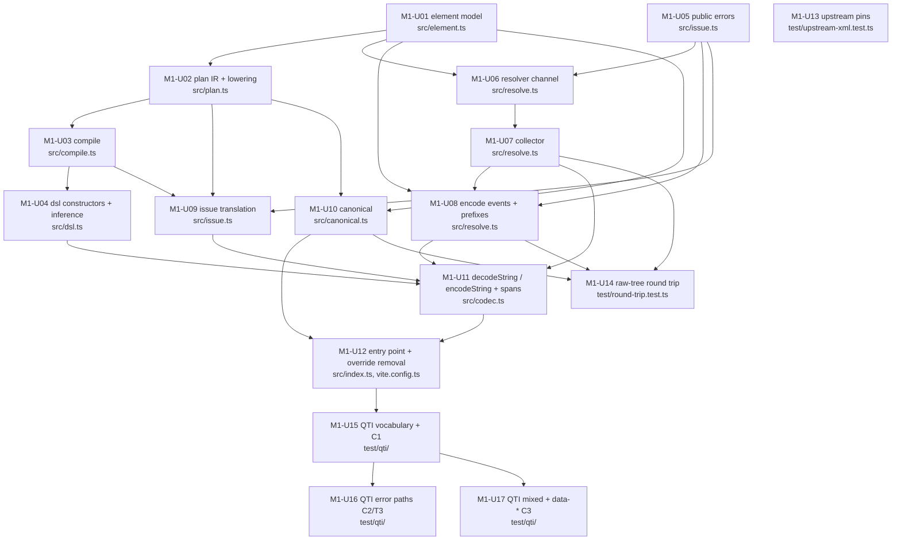

# Delivery: xml-schema-codec, milestone 1 (tree-mode codec on real QTI items)

Lowered from `GOAL.md` (goal-check READY on `160f1db`; owner answers folded on `e63871e`) by the planner on handle `c21f84e2`, 2026-11-05, against commit `e63871e`. Rulings in `docs/rd/decisions.md` are binding and are not reopened here. Every command below was run as written on that checkout and its output pasted. Revised on handle `95f3a393` per delivery audit `8a3a60b4` (nine findings); the one command block added by the revision was run on `8ca681c`. Corrected on handle `237df403` per the strategic review (`docs/rd/strategic-review.md` at `79c370f`; C1, C2, C7): lock 1, M1-U03, M1-U04, M1-U06, M1-U09, M1-U15. No ruling is reopened and no unit id changes.

## Interpreted Unit

Milestone 1 of the goal: a consumer writes one definition of an element in the object-form DSL and gets a `Schema.Codec` that decodes a well-formed XML string into an Effect-typed value and encodes the value back to canonically equivalent XML. The D11 modules M1 needs (`plan`, `compile`, `resolve`, `issue`, `canonical`; `positions` is M2) land under `src/` with three seams D11 lets the planner add rather than merge: `element` (the `ResolvedElement` leaf type that `resolve`, `compile`, `issue`, and `canonical` all import), `dsl` (the constructors are `compile(lower(...))`, and `compile` imports `plan`, so they cannot live in `plan.ts` without an import cycle), and `codec` (the public operations compose five modules; no spike isolated that seam). All are exported from `src/index.ts`, proven on real QTI items under `test/`.

In scope (from `GOAL.md` "Implementation Shape" M1 and "First Implementation Path"):

- content modes `empty`, `text`, `elements`, `mixed` with name-indexed dispatch (T3); `data-*`; `suspend`; wire-name keys; `Schema.optionalKey` attributes; DSL `optional()`/`many()` for children
- namespace resolution to expanded names on decode, prefix map for authoring and encode (D2, T4), single-record collector over a string (tree mode: the root is the record)
- public decode and encode errors with the XPath-like path and the expectation, positions absent (T2 path only; D7 positions are milestone 2)
- `canonicalize` exported, inline set derived from the `Plan`, name-set form kept for raw trees (D1)
- `decodeString(Def)` and `encodeString(Def)` with stable spans and no per-event spans
- acceptance suites: benchmark subset on `bg007-true-false.xml` and `bpig-hotspot.xml`; `bg010-missing-word.xml` `<p>` order; `bpig-mathml.xml` plus its re-prefixed copy (resolver level); `data-*` typing on `extended-text-postcard.xml`; `max-choices="x"` issue path; canonical round trip over the 15-file corpus (resolver level)

Out of scope here: positions (M2), per-record streaming and the `maxElementSize`/`maxElementNodes` budgets (M3), README and the exclusion list (M4), `open` content mode unless an acceptance fixture forces it (D12; the inventory below shows none does), the upstream feature request Hand (owner decision 2; a separate Mind assignment, not a milestone unit), and everything in the goal's Non-goals.

Carry-ins from the goal-check, all present below: (a) the `test/qti/` vocabulary includes `qti-extended-text-interaction` (M1-U15); (b) the `issue` unit states the sibling-index rule (M1-U09); (c) `imsmanifest.xml` is a resolver-level test in `src/resolve.test.ts` (M1-U06), not a manifest definition.

## Normalized Spec

Done means: on the integrated tree, `bun run check`, `bun run build`, and `bun run test` are green; the Vitest run executes `src/*.test.ts` for every module plus `test/qti/*.test.ts`, `test/round-trip.test.ts`, and the extended `test/upstream-xml.test.ts`; `dist/index.js` and `dist/index.d.ts` export the DSL, the two operations, `canonicalize`, the error classes, and the `ResolvedElement` type; and goal acceptance criteria 1, 2, 3, 4, 5, 6 (first clause), 9, 10, 11, 12 hold with the M1 limits stated in each (criterion 7 holds for the path and expectation, without line and column).

Derived locks (consequences of the rulings; a Hand follows them without re-deriving):

1. **Names are Clark strings everywhere past the resolver.** `ResolvedElement.name` and every attribute key are `{uri}local` or `local` (T4). The `Plan` stores the expanded name of its element and of every declared attribute, computed at lowering time from the definition's prefix map (`qname(map)`, `spikes/namespaces/resolver.ts:182-188`): an unprefixed element name takes the map's default binding (`""`) when present, else no namespace; an unprefixed attribute is always in no namespace; the `xml` prefix is always bound to `http://www.w3.org/XML/1998/namespace`. The per-element encoded Struct is therefore `{ name: Schema.Literal(<clark>), attributes, children }`, so the `Schema.Union` name index (`SchemaAST.ts:3506-3573`, sentinel candidates) selects `mixed` members by expanded name. The index never reaches a `suspend` member: `toCandidate` returns `unknown` for a `Suspend` before any sentinel is read (`SchemaAST.ts:3391`), so a `suspend` member is a runtime-type fallback tried on every element child, in declaration order with the indexed candidates (`:3602`, `:3647`). `compile` therefore orders `suspend` members after every other member (M1-U03), and under a union holding one every failure is an `AnyOf` carrying the matched member's issue beside the `suspend` member's `name` mismatch, which `translate` resolves by name match (M1-U09; strategic review C1).
2. **`xmlns` and `xmlns:*` are never declared in a definition.** The resolver consumes them (constraint "never data"). A vocabulary that reads `xsi:schemaLocation` binds `xsi` in its prefix map and declares the attribute as `"xsi:schemaLocation"`; the benchmark subset's `xmlns`/`xmlns:xsi` attribute lines from `spikes/declaration-dsl/benchmark-b.ts:105-106` are dropped.
3. **Resolved events carry scope; the collected element does not.** T4 item 3 puts the in-scope prefix map on each resolved `StartElement` (for the future `xsi:type` codec, R10). The `ResolvedElement` the codec sees is `{ name, attributes, children }` only, which keeps the encoded type equal in both directions.
4. **The `effect-xml` annotation carries the `Plan`.** The marker on an element codec is `{ name: <clark>, wire: <authored>, plan: () => Plan }`, where `wire` is the element name as the consumer wrote it (`"p"`, `"m:math"`) and the only carrier of that spelling past lowering; on a `suspend` node it is the same shape with `plan` forcing the thunk. The `mixed` `_tag` is the member's `wire` (M1-U03), so the runtime tag and U04's type-level `MixedItem` tag are the same literal. `compile`, `translate`, and `inlineNames` read the `Plan` through it (ownership: the `Plan` is the only carrier of XML shape). Read `ast.annotations` directly, never `resolveAnnotations` (constraint).
5. **The public errors follow the reason pattern of the installed guide** (`node_modules/effect/ai-docs/src/01_effect/04_errors/20_reason-errors.ts`): `XmlDecodeError { reason, path, message }` with `reason` a tagged union `Schema | UndeclaredPrefix | WellFormedness` (M3 adds `Limit`), each reason carrying its cause (`Schema.SchemaError`, the prefix, or the upstream `Xml.XmlError`); `XmlEncodeError` mirrors it with `Schema | UnmappedNamespace | InvalidEvent`. Message form: `<what> at <xpath>: <expectation>; <repair>`. Class and reason names are delivery's choice per the goal; the fields and the message rule are the invariant. The `consequences` lens runs on M1-U05 before it lands.
6. **Path printing (carry-in b).** Element segments print the local name. A segment is `local[k]` only when the parent holds more than one child element with the same expanded name; `k` is the one-based position among those same-named siblings (elements only). A text item inside `mixed` prints `text()[j]`, `j` one-based among the parent's text children. Attribute segments print `@local` for no namespace, `@xml:local` for the XML namespace, and `@{uri}local` otherwise. Resolver-level failures (undeclared prefix) print names as written, since no expansion exists yet. So criterion 2 prints `/qti-assessment-item/qti-item-body/qti-choice-interaction/@max-choices` (one interaction) and T2 prints `p[2]` (several `p`).
7. **Encode-side declarations.** The walk keeps a scope stack. For each element: reuse an in-scope prefix bound to its namespace; else declare the definition map's prefix for that namespace on this element; else declare `xmlns="uri"` on this element; an element in no namespace under a default declaration gets `xmlns=""`. An attribute in a namespace with no usable prefix fails with `UnmappedNamespace`. The root declares its definition's whole map (the corpus shape). This is forced by the acceptance corpus: three fixtures re-bind the default namespace on an inner element and two of them bind no prefix for it (inventory below).
8. **Whitespace.** `mixed` and `text` keep whitespace-only runs; `elements` drops them; `empty` admits whitespace-only text (D3; `element-codec.ts:164-198`). No option.
9. **Declaration.** `encodeString` emits `<?xml version="1.0" encoding="UTF-8"?>` by default; `{ declaration: false }` omits it (D8). The comparator ignores it.

## Repo-Aware Baseline

Checkout and gates (`e63871e`):

```text
$ git log --oneline -1
e63871e docs(goals): fold the owner answers
$ bun run check
$ vp check --deny-warnings
pass: All 69 files are correctly formatted (79ms, 14 threads)
pass: Found no warnings, lint errors, or type errors in 8 files (480ms, 14 threads)
$ bun run build
ℹ dist/index.js    0.24 kB │ gzip: 0.19 kB
ℹ dist/index.d.ts  0.01 kB │ gzip: 0.03 kB
✔ Build complete in 215ms
$ bun run test
 7 pass
 0 fail
Ran 7 tests across 2 files. [10.00ms]
 Test Files  1 passed (1)
      Tests  1 passed (1)
```

The Vitest include and the single-file invocation Hands use for sanity (a filter that matches no file exits 1, so a sanity command cannot be green on nothing):

```text
$ grep -n "include" vite.config.ts
91:    include: ["src/**/*.test.ts", "test/**/*.test.ts"],
$ bun x vp test test/upstream-xml.test.ts
 Test Files  1 passed (1)
      Tests  1 passed (1)
$ bun x vp test src/plan.test.ts
No test files found, exiting with code 1
```

`vp check` takes file paths for the format and lint passes (the type check stays program-wide by design), so a Hand whose change needs the lint or type pass names its files (run on `8ca681c`):

```text
$ bun x vp check --help | sed -n '1,6p'
Usage: vp check [OPTIONS] [PATHS]...

Run format, lint, and type checks.

Arguments:
  [PATHS]...  File paths to pass to fmt and lint
$ bun x vp check src/index.ts vite.config.ts
pass: All 2 files are correctly formatted (85ms, 14 threads)
pass: Found no warnings, lint errors, or type errors in 2 files (390ms, 14 threads)
```

The lint override the first exporting unit deletes (`vite.config.ts:35-40`):

```text
$ sed -n '35,40p' vite.config.ts
      {
        // The entry point stays empty until the first public module lands. Delete this
        // override with the first export from src/index.ts.
        files: ["src/index.ts"],
        rules: { "unicorn/no-empty-file": "off" },
      },
```

Installed Effect APIs the units call (all present at `effect@4.1.2`, `node_modules/effect/src`):

```text
$ grep '"version"' node_modules/effect/package.json
  "version": "4.1.2",
$ grep -nE "^export (const|function|class) (toCodecStringTree|decodeTo|StructWithRest|TemplateLiteral|Record|Union|suspend|Literal|optionalKey|Struct|decodeUnknownEffect|encodeEffect|SchemaError|TaggedError|declare|Int|Finite|Boolean)\b" node_modules/effect/src/Schema.ts
590:export function declare<T, Iso = T>(
1219:export class SchemaError extends Data.TaggedError("SchemaError")<{
1535:export function decodeUnknownEffect<S extends Constraint>(schema: S, options?: SchemaAST.ParseOptions) {
1983:export const encodeEffect: <S extends Constraint>(
2406:export const optionalKey: optionalKeyLambda = Struct_.lambda<optionalKeyLambda>((schema) =>
2743:export function Literal<L extends SchemaAST.LiteralValue>(literal: L): Literal<L> {
2872:export function TemplateLiteral<const Parts extends TemplateLiteral.Parts>(parts: Parts): TemplateLiteral<Parts> {
3214:export const Boolean: Boolean = make(SchemaAST.boolean)
3597:export function Struct<const Fields extends Struct.Fields>(fields: Fields): Struct<Fields> {
4024:export function Record<Key extends Record.Key, Value extends Constraint>(
4251:export function StructWithRest<
4994:export function Union<const Members extends ReadonlyArray<Constraint>>(
5180:export function suspend<S extends Constraint>(f: () => S): suspend<S> {
5678:export function decodeTo<To extends Constraint>(to: To): <From extends Constraint>(from: From) => compose<To, From>
5679:export function decodeTo<To extends Constraint, From extends Constraint, RD = never, RE = never>(
5686:export function decodeTo<To extends Constraint, From extends Constraint, RD = never, RE = never>(
7505:export const Finite: Finite = make(SchemaAST.finite)
8010:export const Int: Int = Number.check(isInt())
17926:export const TaggedError: {
18441:export const toCodecStringTree: {
$ grep -nE "^export (const|function|class|interface|type) (decodeString|encodeString|XmlError|StartElement|EndElement|Text|Event|Declaration|Element)\b" node_modules/effect/src/encoding/Xml.ts
51:export class XmlError extends Data.TaggedError("XmlError")<{
87:export interface Declaration {
133:export interface StartElement {
146:export interface EndElement {
164:export interface Text {
206:export type Event =
228:export interface Element {
334:export const decodeString = <IE = never, Done = unknown>(options?: DecodeOptions): Channel.Channel<
511:export const encodeString = <IE = never, Done = unknown>(): Channel.Channel<
$ grep -n "^export const fromTransform" node_modules/effect/src/Channel.ts
294:export const fromTransform = <OutElem, OutErr, OutDone, InElem, InErr, InDone, EX, EnvX, Env>(
413:export const fromTransformBracket = <OutElem, OutErr, OutDone, InElem, InErr, InDone, EX, EnvX, Env>(
1918:export const fromTransformStream = <IE, I, O, E>(options: {
$ grep -nE "^export const (withSpan|fn|fnUntraced|withTracer|catchReason|catchReasons)\b" node_modules/effect/src/Effect.ts
5144:export const catchReason: {
5360:export const catchReasons: {
16970:export const withTracer: {
17815:export const withSpan: {
24100:export const fnUntraced: fn.Untraced = internal.fnUntraced
24225:export const fn: fn.Traced & {
$ grep -nE "^export (const|function) (make)\b" node_modules/effect/src/Tracer.ts
479:export const make = (options: Tracer): Tracer => options
$ grep -nE "^export (const|function) (pipeThroughChannel|runCollect|mkString|make|fromIterable)\b" node_modules/effect/src/Stream.ts
784:export const make = <const As extends ReadonlyArray<any>>(...values: As): Stream<As[number]> => fromArray(values)
999:export const fromIterable = <A>(
16246:export const pipeThroughChannel: {
19384:export const runCollect = <A, E, R>(self: Stream<A, E, R>): Effect.Effect<Array<A>, E, R> =>
20069:export const mkString = <E, R>(self: Stream<string, E, R>): Effect.Effect<string, E, R> =>
$ grep -nE "^export function transformEffect" node_modules/effect/src/SchemaGetter.ts
930:export function transformEffect<T, E, R = never>(
$ grep -nE "^export (interface) (Pointer|Composite|Encoding|AnyOf)\b" node_modules/effect/src/SchemaIssue.ts
313:export interface Encoding extends IssueNode {
394:export interface Pointer extends IssueNode {
581:export interface Composite extends IssueNode {
919:export interface AnyOf extends IssueNode {
```

Upstream channel pattern every library channel follows (`Xml.ts:562-580`): a synchronous `Machine<In, Out>` with `out`, `push`, `end`, wrapped by `makeChannel` over `Channel.fromTransform`. The resolver and collector copy the shape; they do not import `makeChannel` (it is module-private).

Fixture corpus (library tests read it by path; relocation is the goal's open question 1):

```text
$ ls spikes/fixtures/qti/*.xml | wc -l | tr -d ' '
15
$ ls spikes/namespaces/fixtures/*.xml
spikes/namespaces/fixtures/bpig-mathml-reprefixed.xml
spikes/namespaces/fixtures/imsmanifest-reprefixed.xml
$ grep -rn "spikes/" src test || echo none
none
```

Vocabulary the four `test/qti/` acceptance fixtures need (command-derived; `bpig-mathml.xml` and `imsmanifest.xml` are resolver-level and need no definition):

```text
$ cat spikes/fixtures/qti/bg007-true-false.xml spikes/fixtures/qti/bpig-hotspot.xml spikes/fixtures/qti/bg010-missing-word.xml spikes/fixtures/qti/extended-text-postcard.xml | grep -oE "<[A-Za-z][A-Za-z0-9:_.-]*" | sed 's/^<//' | sort -u | tr '\n' ' '; echo
blockquote br div img math mfenced mi mn mo mrow object p qti-assessment-item qti-choice-interaction qti-correct-response qti-default-value qti-extended-text-interaction qti-hotspot-choice qti-hotspot-interaction qti-item-body qti-map-entry qti-mapping qti-outcome-declaration qti-prompt qti-response-declaration qti-response-processing qti-simple-choice qti-text-entry-interaction qti-value
```

Twenty-nine elements, all enumerable, so `open` is not needed (D12, stop condition if a Hand finds otherwise). `data-*` carriers and the fixtures whose inner element re-binds the default namespace (lock 7):

```text
$ grep -oE 'data-[a-z0-9-]+=' spikes/fixtures/qti/*.xml | sort -u
spikes/fixtures/qti/choice-feedback.xml:data-solution-title=
spikes/fixtures/qti/extended-text-postcard.xml:data-patternmask-message=
spikes/fixtures/qti/pci-shaded-grid.xml:data-active=
spikes/fixtures/qti/pci-shaded-grid.xml:data-controls=
spikes/fixtures/qti/pci-shaded-grid.xml:data-render=
spikes/fixtures/qti/pci-shaded-grid.xml:data-selected=
spikes/fixtures/qti/pci-shaded-grid.xml:data-value=
$ for f in spikes/fixtures/qti/*.xml; do n=$(grep -oE '(^|[[:space:]<])xmlns="[^"]+"' "$f" | sort -u | wc -l | tr -d ' '); [ "$n" -gt 1 ] && echo "$(basename $f): $n"; done
bpig-mathml.xml: 2
extended-text-postcard.xml: 2
text-and-media.xml: 2
```

`bpig-mathml.xml` also binds `m:` to MathML on the root; `extended-text-postcard.xml` and `text-and-media.xml` bind no prefix for MathML, so the encoder must declare `xmlns` on the inner element to round-trip them.

Spike seams each unit copies by shape (never by import): `spikes/declaration-dsl/element-codec.ts` (`Plan` 62-70, `decodeElement` 138-231, `encodeElement` 233-291, `compile` 296-338, `data-*` 326-330, mixed tagging 109-131), `xml-dsl.ts` (type-level `AttributesType`/`ContentType` 26-100, `lower` 132-185), `spikes/namespaces/resolver.ts` (scope stack 73-85, `startElement` 87-118, `qname` 182-188, `prefixFor`/`spell`/`toEvents` 190-261), `spikes/round-trip/canonical.ts` (45 non-blank lines), `pipeline.ts` (`elementEvents` 30-40), `spikes/schema-layering/approach-b.ts` (`translatePath` 336-363, `translateIssue` 364-383).

## Unit Graph



Parallel waves (write surfaces disjoint within a wave; `src/resolve.ts` and `src/issue.ts` are serialized by the edges): wave 0 `U01 U05 U13`; wave 1 `U02 U06`; wave 2 `U03 U07 U10`; wave 3 `U04 U08 U09`; wave 4 `U11 U14`; wave 5 `U12`; wave 6 `U15`; wave 7 `U16 U17`. Longest chain: `U01 → U02 → U03 → U09 → U11 → U12 → U15 → U16` (8 units; `U05 → U06 → U07 → U08 → U11 → U12 → U15 → U16` is the same length).

## Implementation Work

Standing requirements inherited by every unit (named once, not copied):

- `AGENTS.md`: Effect error channels only; `bun run check`, `build`, `test` are the gates the verify seat runs, not the Hand; kebab-case files; relative imports inside `src/`.
- `.agents/skills/effect-design/SKILL.md`: every custom piece's doc comment names the Effect API checked and the requirement it misses (criterion 10; the C9 table form of `spikes/declaration-dsl/RESULT.md`). Only public or `encoding/Xml` symbols; the `@internal` set in the goal's constraints is never imported.
- `.agents/skills/document-code/SKILL.md`: multiline JSDoc on every module-scope unit.
- `.agents/skills/conventional-commits/SKILL.md`: one commit per unit, `feat(<module>):` for library behavior, `test:` for test-only units, `build:` for the `vite.config.ts` edit folded into M1-U12's `feat` commit only if the override removal cannot stand alone (it can: the entry export is the behavior).
- Tests beside their module use `@effect/vitest` with `it.effect`; fixtures are read by path from `spikes/fixtures/qti/` via `new URL("../spikes/fixtures/qti/<file>.xml", import.meta.url)` (adjust `..` depth per file); no file under `src/` or `test/` imports from `spikes/`.
- Sanity commands are the Hand's narrow check only. `bun x vp test <file>` exits 1 when the file does not exist, so a sanity that ran nothing cannot pass.

### M1-U01 element model

- id: `M1-U01`
- outcome: the resolved element model shared by `resolve`, `compile`, `issue`, and `canonical`.
- write_scope: `src/element.ts`, `src/element.test.ts`
- edit: new module. `XML_NAMESPACE`; `clark(namespace, local)` and `parseClark(key)` (after `resolver.ts:24-25`, `:226-232`; no namespace is the absent case, represented per the installed guide, not `null`); `ResolvedElement { name: string; attributes: Readonly<Record<string, string>>; children: ReadonlyArray<ResolvedElement | string> }` with Clark names (lock 1, lock 3); `isResolvedElement` guard (after `element-codec.ts:27-33`); `ResolvedElementSchema = Schema.declare(isResolvedElement, { identifier: "ResolvedElement" })` for the children union of the per-element Struct.
- done_when: `parseClark(clark(ns, local))` round-trips for a namespaced and a no-namespace name, including a `}` in the local name; the guard accepts a nested element and rejects a string, an array, and an object without `children`; the module has no runtime import other than `effect`.
- depends_on: none
- sanity: `bun x vp test src/element.test.ts`
- non_goals: the in-scope prefix map on an element (R10), Plan types, any resolution logic.
- risk: low; a leaf type module.
- integrable: yes

### M1-U02 plan IR and lowering

- id: `M1-U02`
- outcome: the closed `Plan` IR, the spec constructors, and `lower`, with expanded names.
- write_scope: `src/plan.ts`, `src/plan.test.ts`
- edit: new module after `element-codec.ts:40-70` (`Plan`, `AttributePlan`, `ChildPlan`, `ContentPlan`) and `xml-dsl.ts:38-122` (`Text`, `Elements`, `Mixed`, `Many`, `Optional`, `Spec`, `text`, `elements`, `mixed`, `many`, `optional`). Changes from the spike: `Plan.name` and `AttributePlan.name` are Clark strings computed by `qname(map)` (lock 1); `Plan.wire` carries the element name as authored and `Plan.prefixes` the definition's prefix map for encode; `ContentPlan` for `mixed` holds `members: ReadonlyArray<{ name: string; wire: string; schema: Schema.Top }>`, `name` and `wire` copied by `lower` from the member codec's marker (compile builds the union, M1-U03); the `effect-xml` annotation key `XML`, `markerOf(schema)`, `elementName(schema)`, `planOf(schema)` read `ast.annotations[XML]` as `{ name, wire, plan: () => Plan }` (lock 4); `lower(name, spec, map): Plan` (after `xml-dsl.ts:132-185`) rejects a `mixed` or `elements` member without a marker with a `SchemaIssue`-free defect message naming the parent and slot (definition-time programming error, not a decode failure). `PrefixMap = Readonly<Record<string, string>>`; `qname` after `resolver.ts:182-188` with `xml` always bound.
- done_when: `lower` on the benchmark `qti-choice-interaction` spec (attributes `response-identifier`, `max-choices`, `min-choices`, `data-*`; content `elements({ prompt: optional(...), choices: many(...) })`) yields a `Plan` whose attribute names are `{http://www.imsglobal.org/xsd/imsqtiasi_v3p0}`-less local names (attributes unprefixed, no namespace), whose element name is the QTI Clark name under `namespaces({ "": QTI })`, whose `data` is the `data-*` schema, and whose children carry `cardinality` `optional` and `many`, and whose `wire` is `"qti-choice-interaction"`; `lower` on a `mixed` spec whose member was authored as `"m:math"` under `namespaces({ "": QTI, m: MATHML })` yields a member entry with `wire` `"m:math"` and `name` the MathML Clark name; `qname(map)("xml:lang")` resolves to the XML namespace with an empty map; `qname(map)("m:math")` resolves through the map; an unprefixed attribute resolves to no namespace under a default binding.
- depends_on: `M1-U01`
- sanity: `bun x vp test src/plan.test.ts`
- non_goals: compiling a codec; `element`, `suspend`, `namespaces` (M1-U04); the annotated-Struct producer (R1).
- risk: low.
- integrable: yes

### M1-U03 compile

- id: `M1-U03`
- outcome: `compile(plan)` producing one `Schema.decodeTo` per element from the per-element encoded Struct into the target Struct.
- write_scope: `src/compile.ts`, `src/compile.test.ts`
- edit: new module after `element-codec.ts:102-338` with the T3 change: the `From` side is `Schema.Struct({ name: Schema.Literal(plan.name), attributes: Schema.Record(Schema.String, Schema.String), children: Schema.Array(Schema.Union([Schema.String, ResolvedElementSchema])) })` instead of `Schema.declare(isElement)` (`:38`), so `Schema.Union` over `mixed` members indexes by the `name` sentinel. Leaves via `Schema.toCodecStringTree` (`:299`, `:306`); `data-*` via `StructWithRest` + `Record(TemplateLiteral(["data-", String]), toCodecStringTree(plan.data))` (`:326-330`); `mixed` as `Schema.Array(Schema.Union([TextItem, ...members.map(memberItem)]))` (`:102-131`) with `_tag` the member's authored wire name (`"p"`, `"m:math"`), read from the member entry's `wire` that `lower` copied from the member codec's marker (lock 4); the Clark `name` selects the union member, the authored `wire` tags the decoded item. A `suspend` member is never indexed (lock 1; `SchemaAST.ts:3391`) and runs as a fallback on every child, so `compile` places `suspend` members (`SchemaAST.isSuspend` on the member schema's AST, a public guard at `:403`) after every other member of the union it builds, keeping author order within each group; a `suspend` member that precedes the matched member costs one failed `name` literal check per child and nothing else. Decode and encode getters after `:138-291` with the whitespace rules (lock 8). The codec is annotated `{ [XML]: { name: plan.name, wire: plan.wire, plan: () => plan } }` (lock 4), so `lower` reads this member's `wire` from the marker when the codec is used as a `mixed` or `elements` member.
- done_when: on hand-built `ResolvedElement` values (no XML parsing): `empty`, `text`, `elements`, `mixed` decode and encode to equal values; `Schema.Int` attribute `"3"` decodes to `3` and `"x"` fails with an issue whose message names a finite number; an undeclared attribute fails with a message naming the declared set; `data-foo="1"` decodes under the `data-*` schema and re-encodes; whitespace-only text is kept in `mixed` and `text`, dropped in `elements`, admitted in `empty`; **R2 recheck**: a `mixed` body over two named members, one carrying an `Int` attribute, with one bad attribute inside that member yields exactly one `SchemaIssue` leaf after `Schema.decodeUnknownEffect`, not one per union member; the same body with a `suspend` member added (a `Schema.suspend` over a compiled plan, annotated with the `XML` marker) yields an issue tree whose only named-member leaf is that same one, with at most the `suspend` member's own `name` mismatch beside it (strategic review C1: a `suspend` member is a fallback the sentinel index never removes; M1-U09 drops that branch); authoring the `suspend` member first or last gives the same decoded value on valid input and the same leaf set on the failing input; if a second named member's issue appears in either run, stop and report the measured case (goal stop condition).
- depends_on: `M1-U01`, `M1-U02`
- sanity: `bun x vp test src/compile.test.ts`
- non_goals: message formatting (issue owns it); the public constructors; `open` (D12).
- risk: medium; R2 is a stop condition and the only unverified Schema behavior on the path; the `suspend` fallback (C1) is a source read until this unit measures it.
- integrable: yes

### M1-U04 DSL constructors and inference

- id: `M1-U04`
- outcome: the consumer-facing `element`, `suspend`, and `namespaces`, with the decoded type inferred from the spec.
- write_scope: `src/dsl.ts`, `src/dsl.test.ts`
- edit: new module; it sits beside D11's six because `element` is `compile(lower(...))` and `compile` imports `plan`, so the constructors cannot live in `plan.ts` without an import cycle. `namespaces(map)` returns `{ element, suspend }` bound to the prefix map; the bare `element` and `suspend` exports are `namespaces({})`'s. `element(name, spec)` is `compile(lower(name, spec, map))` typed as `ElementCodec<Name, Simplify<AttributesType<A> & ContentType<C>>>` with the type-level mapping from `xml-dsl.ts:18-100` (optional attributes via `"~type.optionality"`, `data-*` template-literal keys, `MixedItem` tagged by authored name). `suspend(name, thunk)` after `element-codec.ts:85-92`, annotating `{ name: qname(map)(name), wire: name, plan: () => planOf(thunk()) }` (lock 4); its doc comment states that a `suspend` member of `mixed` is dispatched as a fallback, never by the name index, and that `compile` orders it after the named members, so author order carries no cost (C1). The definition stays generator-shaped: no closures over runtime state (constraint).
- done_when: `expectTypeOf` checks (criterion 9): typed attributes with brand kept, `Int` as `number`, `Boolean` as `boolean`, optional keys optional, `data-*` keys typed, children typed, `mixed` `_tag` union exactly the member names and exhaustively narrowable, no `unknown`; recursion (`div` in `div`) compiles with one named interface plus `suspend`; `elements({ value: Schema.String })` is a type error (`@ts-expect-error`, SPIKE-05 evidence 3). Runtime: `element` under `namespaces({ "": QTI, xsi: XSI })` decodes a hand-built element whose Clark name is the QTI one; a `mixed` body holding a member authored as `"m:math"` under `namespaces({ m: MATHML })` decodes to an item whose `_tag` is `"m:math"` (the authored name, not the Clark name), through both `element` and `suspend`.
- depends_on: `M1-U02`, `M1-U03`
- sanity: `bun x vp test src/dsl.test.ts` (type assertions run under the type check the verify seat's `bun run check` performs; the Hand runs `bun x vp check src/dsl.ts src/dsl.test.ts` only if the type-level tests need confirming and reports that it did; the paths scope fmt and lint, the type check is the only program-wide part)
- non_goals: a fluent facade (C); camelCase keys (R8); `Schema.Class` bodies (R1).
- risk: low; the type-level mapping is copied from a 19/19 spike.
- integrable: yes

### M1-U05 public errors

- id: `M1-U05`
- outcome: the two public error classes with reason unions and the message rule.
- write_scope: `src/issue.ts`, `src/issue.test.ts`
- edit: new module, first half. `XmlDecodeError` with `path: string` (XPath-like), `message: string`, and `reason` as a tagged union of `Schema` (carrying the `Schema.SchemaError`), `UndeclaredPrefix` (prefix, where), `WellFormedness` (the upstream `Xml.XmlError`); `XmlEncodeError` with `Schema`, `UnmappedNamespace` (namespace, what), `InvalidEvent` (`Xml.XmlError`). Built on the installed guide's reason pattern (lock 5); `Schema.TaggedError` where fields are schema-describable, `Data.TaggedError` where a cause is not (as upstream `XmlError`, `Xml.ts:51`); the Hand records the choice in the doc comment. `formatMessage({ what, path, expectation, repair })` producing `<what> at <xpath>: <expectation>; <repair>` (`.agents/skills/error-messages/SKILL.md`: name the invalid value or constraint and a concrete next action; neutral tone). `xpath(segments)` printer for the segment forms in lock 6.
- done_when: each reason constructs and `Effect.catchReason("XmlDecodeError", "UndeclaredPrefix", ...)` selects it; the printer renders `/a/b[2]/@c`, `/a/text()[1]`, `/a/@xml:lang`, and `/a/@{u}x` from segment lists; `formatMessage` output matches the form for a `Schema`, an `UndeclaredPrefix`, and a `WellFormedness` example; messages pass the error-messages review checklist (what, constraint, next action; no "invalid input").
- depends_on: none
- sanity: `bun x vp test src/issue.test.ts`
- non_goals: translation of Schema issues (M1-U09); `position` (M2); `Limit` (M3).
- risk: medium; this is the public contract. Run the `consequences` lens before landing.
- integrable: yes

### M1-U06 resolver channel

- id: `M1-U06`
- outcome: a library `Channel` over `Xml.Event` chunks that resolves names to expanded form and consumes `xmlns*`.
- write_scope: `src/resolve.ts`, `src/resolve.test.ts`
- edit: new module, first part. `ResolvedEvent` = `StartElement { name: clark; attributes: Record<clark, string>; scope: Readonly<Record<string, string>> }` (lock 3) | `EndElement { name }` | `Text { text }`; `Declaration`, `Doctype`, `Comment`, `ProcessingInstruction` are dropped (D8). `resolveEvents(): Channel<NonEmptyReadonlyArray<ResolvedEvent>, XmlDecodeError | IE, Done, NonEmptyReadonlyArray<Xml.Event>, IE, Done>` as a synchronous machine over `Channel.fromTransform` in the shape of `Xml.ts:562-616` (output before failure), with the scope stack and resolution rules of `resolver.ts:73-118` (`xmlns`/`xmlns:*` consumed; unprefixed attribute in no namespace; `xml` always bound; undeclared prefix fails with `XmlDecodeError` reason `UndeclaredPrefix` at the as-written path `/a/b/foo:bar`, message naming the prefix and the repair `declare xmlns:foo on this element or an ancestor`). Clark names are interned per run: a cache keyed by as-written name inside the current scope frame, dropped when a frame changes a binding, returns one string object per distinct expanded element or attribute name, so a 300,000-element tree-mode document does not hold 300,000 copies of the same dozen names (strategic review C7); the resolved `StartElement` stays an additive record so `M3-U03` can stamp the as-written `size` on it (`phase-3.md` lock 4). The effect-design justification: `Xml.decodeString` reports names as written and treats `xmlns*` as attributes (`Xml.ts:301-302`); nothing upstream maps prefixes to URIs.
- done_when: `src/resolve.test.ts` (C4 at the event or tree level, using M1-U07's collector when it lands or `Stream.runCollect` of events before): `bpig-mathml.xml` resolves the inner `<math xmlns=...>` to the MathML namespace and `xml:lang`/`xsi:schemaLocation` to their namespaces as ordinary attributes; `imsmanifest.xml` resolves default, `imsmd`, and `imsqti` vocabularies by URI; `spikes/namespaces/fixtures/*-reprefixed.xml` resolve to event sequences equal to the originals; deleting the inner `xmlns` on `<math>` (string replacement in the test) changes the resolved vocabulary; an unprefixed attribute under a default namespace has a no-namespace key; `<foo:bar/>` with no declaration fails with reason `UndeclaredPrefix` and path `/root/foo:bar`; two sibling elements with the same as-written prefixed name under one scope resolve to `name` strings for which `Object.is` holds (C7, one line).
- depends_on: `M1-U01`, `M1-U05`
- sanity: `bun x vp test src/resolve.test.ts`
- non_goals: collection into a tree (M1-U07); encode (M1-U08); positions (M2); budgets (M3).
- risk: medium; first `Channel.fromTransform` in the repo. Chunk boundaries: one output chunk per input chunk, as upstream.
- integrable: yes

### M1-U07 collector

- id: `M1-U07`
- outcome: the in-house collector that materialises one `ResolvedElement` per matched record; in M1 the record is the root.
- write_scope: `src/resolve.ts`, `src/resolve.test.ts`
- edit: append to the module. `collect(path: ReadonlyArray<string>): Channel<NonEmptyReadonlyArray<ResolvedElement>, XmlDecodeError | IE, Done, NonEmptyReadonlyArray<ResolvedEvent>, IE, Done>` where `path` is a root-anchored list of Clark names or `"*"` (the same contract as `Xml.elements`, `Xml.ts:389-397`, so M3 extends it rather than rewriting); builds frames as `resolver.ts:43-49` and emits the element on the matching `EndElement`; whitespace-only `Text` runs are kept as string children (the compiler decides per content mode). Justification: `Xml.elements` collects unresolved names and drops ancestor scope (`Xml.ts:1742-1757`, T4). No budgets yet (T5 is M3); the frame shape leaves room for a node counter.
- done_when: `collect(["*"])` over the resolved events of `bg007-true-false.xml` yields exactly one element whose Clark root name is the QTI `qti-assessment-item`, whose children include whitespace strings, and whose nested `qti-simple-choice` text is intact; `collect([QTI "qti-assessment-item", QTI "qti-item-body"])` yields exactly one `qti-item-body`; an unmatched path yields no element and no error.
- depends_on: `M1-U06`
- sanity: `bun x vp test src/resolve.test.ts`
- non_goals: `maxElementSize`/`maxElementNodes` (M3); per-record streaming entry points (M3).
- risk: low-medium; R4 recheck (chunk-emission semantics vs `Xml.elements`) is a stop condition only if `@internal` state is needed; the public contract at `Xml.ts:389-397` suffices for M1.
- integrable: yes

### M1-U08 encode events and prefix chooser

- id: `M1-U08`
- outcome: `ResolvedElement` to `Xml.Event` sequence with prefix spelling and namespace declarations.
- write_scope: `src/resolve.ts`, `src/resolve.test.ts`
- edit: append to the module. `toEvents(element, { prefixes, declaration }): Effect<ReadonlyArray<Xml.Event>, XmlEncodeError>` after `resolver.ts:190-261` and `pipeline.ts:30-40`, placed in `resolve` rather than `compile` (where GOAL's D11 table lists the `ResolvedElement -> Event` walk) because the walk is the scope stack and prefix chooser run in reverse and `decisions.md` D11 fixes module boundaries, not this detail; with the complete declaration algorithm of lock 7 (scope stack; reuse, declare map prefix, declare `xmlns` on the element, `xmlns=""` undeclaration; `UnmappedNamespace` only for namespaced attributes without a prefix); emits a `Declaration` event (`Xml.ts:87-91`, `version "1.0"`, `encoding "UTF-8"`) first unless `declaration: false`. Justification: upstream `Writer` writes names as given and knows nothing of namespaces (`Xml.ts:1869-2037`).
- done_when: a resolved tree with a MathML element under a QTI default namespace and an empty prefix map encodes with `xmlns="http://www.w3.org/1998/Math/MathML"` on the inner element; the same tree with `{ m: MathML }` encodes `m:math`; a no-namespace child under a default namespace gets `xmlns=""`; a namespaced attribute with no prefix fails with reason `UnmappedNamespace` naming the namespace and the repair; `declaration: false` omits the `Declaration` event; `Xml.encodeString` accepts every emitted sequence (run it in the test).
- depends_on: `M1-U01`, `M1-U05`, `M1-U07` (same file; serialized)
- sanity: `bun x vp test src/resolve.test.ts`
- non_goals: attribute order (not promised, D1); byte identity.
- risk: medium; the undeclaration and per-subtree placement were "not verified" in T4 and are forced by the corpus.
- integrable: yes

### M1-U09 issue translation

- id: `M1-U09`
- outcome: `translate(plan, element, issue)` turning a struct-keyed `SchemaIssue` into the XPath-like path and expectation of a public error.
- write_scope: `src/issue.ts`, `src/issue.test.ts`
- edit: append to the module. Generalise `approach-b.ts:336-383` over the `Plan` instead of the AST: `Pointer` segments that are attribute keys become `@name` segments; `elements`-mode slot keys become the child's wire name; `mixed`-mode array indices become `local[k]` or `text()[j]` by inspecting the input element's children (lock 6, carry-in b); descend into child plans through `planOf(child.schema)` (forcing `suspend`); `Composite` and `Encoding` recurse; an `AnyOf` at a `mixed` index whose input is an element is resolved by name match: keep the branch of the member whose `Plan` name (`content.members[i].name`) equals the element's Clark name, drop every other branch, and continue into the kept one; when no member matches, whether the `AnyOf` holds zero issues (closed `mixed` with no fallback; `SchemaAST.ts:3904`) or only non-matching ones, emit one issue whose segment is the child's `local[k]` and whose expectation names the child's Clark name and the member set (T2 "not verified" item, now tested; the no-match case is pulled forward from `phase-4.md` lock 4). The index leaves one candidate only when the union has no fallback: a `suspend` member adds its own `name` mismatch to every failure under that union (lock 1; strategic review C1), and the M4 guard adds one more (`phase-4.md` lock 3), so the rule is written for the general case and M4 adds no branch. `toDecodeError(plan, element, schemaError)` builds `XmlDecodeError` reason `Schema` with the translated path, the leaf expectation as the message's expectation, and the repair; `toEncodeError` mirrors it.
- done_when: with definitions built by `compile(lower(...))` in the test: `max-choices="x"` inside a `mixed` body yields one `XmlDecodeError` whose `path` is `/qti-assessment-item/qti-item-body/qti-choice-interaction/@max-choices` and whose message names a finite number; a bad attribute on the second of two `<p>` prints `p[2]`; a bad attribute on a sole `<p>` prints `p` without an index; a text-only expectation in `mixed` prints `text()[1]`; a missing required child prints the parent path and names the missing element; an unknown child in `elements` names the expected set; with `div` as `mixed([P, Blockquote, suspend("div", () => Div)])` and `blockquote` as `mixed([P, suspend("div", () => Div)])` (the `bg010-missing-word.xml` nesting), a bad `Int` attribute `n` on `<p>` under `div > blockquote > p` yields one `XmlDecodeError` whose `path` is `/div/blockquote/p/@n` and `translate` returns one leaf (the `suspend` branch is dropped at each level; C1 recheck); an unknown `<video>` as the third child of a closed `mixed` body yields one `XmlDecodeError` whose path ends in `video[1]` (or `video` under lock 6 when no sibling shares the name) and whose message names `video` and the member set, once with and once without a `suspend` member in the union.
- depends_on: `M1-U02`, `M1-U03`, `M1-U05`
- sanity: `bun x vp test src/issue.test.ts`
- non_goals: positions (M2); formatting beyond the message rule.
- risk: medium; `AnyOf` translation is the one path no spike exercised, and the recursive-`suspend` shape is where the strategic review (C1) found the first rule wrong.
- integrable: yes

### M1-U10 canonical

- id: `M1-U10`
- outcome: `canonicalize(element, options)` and `inlineNames(def)`, the executable round-trip promise.
- write_scope: `src/canonical.ts`, `src/canonical.test.ts`
- edit: new module from `spikes/round-trip/canonical.ts` over `ResolvedElement` (Clark names, so the comparison is namespace-aware: D1 "not verified" item closed); `defaultInline` name-set form kept for raw trees with its names expanded under QTI and XHTML-in-QTI (the corpus authors XHTML in the QTI default namespace); `inlineNames(def)` takes an element codec, reads its `Plan` through `planOf(def)` and the child plans through `planOf(child.schema)` with a visited set, and returns the Clark names of `mixed` and `text` elements (D1 "derived from definitions"); the `Plan` stays a private type, so consumers pass the definition they already hold. Exclusions are the D1 list; the comparator documents them in its doc comment (the README publishes them in M4).
- done_when: the comparator semantics tests from `spikes/round-trip/round-trip.test.ts:87-121` pass on resolved trees (attribute order insignificant; whitespace-only children dropped outside the inline set, kept normalised inside; text whitespace runs normalised; markup escaped; different names or values unequal); two trees differing only in prefix spelling but equal in expanded names are equal; `inlineNames` on a `qti-item-body` definition with `mixed` `p` and `text` `qti-value` (in this test a schema annotated with the `XML` marker over a `lower`ed `Plan`, since `compile` is a sibling unit) returns both Clark names and terminates on a recursive `div`.
- depends_on: `M1-U01`, `M1-U02`
- sanity: `bun x vp test src/canonical.test.ts`
- non_goals: byte identity; comment or PI comparison (D8).
- risk: low.
- integrable: yes

### M1-U11 public operations and spans

- id: `M1-U11`
- outcome: `decodeString(Def)` and `encodeString(Def, options?)`, each under a stable span, composing the modules.
- write_scope: `src/codec.ts`, `src/codec.test.ts`
- edit: new module (a seam the spikes did not isolate; D11 allows adding one). `decodeString(Def)(xml: string): Effect<Def["Type"], XmlDecodeError>`: `Stream.make(xml)` through `Xml.decodeString()`, `resolveEvents()`, `collect(["*"])`, exactly one element, then `Schema.decodeUnknownEffect(Def)` with `SchemaError` mapped by `toDecodeError(planOf(Def), element, error)`, `Xml.XmlError` mapped to reason `WellFormedness` (path `/` when upstream names none). `encodeString(Def, { declaration? })(value)`: `Schema.encodeEffect(Def)` to `ResolvedElement`, `toEvents` with `planOf(Def).prefixes`, `Xml.encodeString()`, `Stream.mkString`; `SchemaError` via `toEncodeError`, `Xml.XmlError` to reason `InvalidEvent`. Spans `xml.decodeString` and `xml.encodeString` through `Effect.fn("xml.decodeString")` or `Effect.withSpan` per the installed guide (`node_modules/effect/AGENTS.md` lines 13-16, 51-66); one span per call, none per element or event (`.agents/skills/trace-effect/SKILL.md`); failure diagnostics stay on the error, no duplicate error log; a `Effect.logDebug` with the root local name after a successful decode is the only log.
- done_when: `decodeString` on `bg007-true-false.xml` text with a minimal in-test definition succeeds; a malformed string fails with reason `WellFormedness` carrying the upstream `XmlError`; an undeclared prefix fails with reason `UndeclaredPrefix`; `encodeString(decodeString(x))` produces text `Xml.decodeString` accepts; with a recording `Tracer.make(...)` installed via `Effect.withTracer` (`Tracer.ts:31-60`, `Effect.ts:16970`) the test sees exactly one span named `xml.decodeString` per decode call, on success and on failure, and exactly one `xml.encodeString` per encode call (criterion 11); the library installs no tracer or logger outside the test.
- depends_on: `M1-U04`, `M1-U07`, `M1-U08`, `M1-U09`
- sanity: `bun x vp test src/codec.test.ts`
- non_goals: `decode` over a stream (M3); positions (M2); exporting from `src/index.ts` (M1-U12).
- risk: medium; integration seam of five modules.
- integrable: yes

### M1-U12 entry point and lint override

- id: `M1-U12`
- outcome: `src/index.ts` exports the public surface; the empty-file lint override is deleted.
- write_scope: `src/index.ts`, `vite.config.ts`
- edit: replace the placeholder comment in `src/index.ts` with named re-exports: `element`, `suspend`, `namespaces`, `text`, `elements`, `mixed`, `many`, `optional`, `decodeString`, `encodeString`, `canonicalize`, `inlineNames`, `XmlDecodeError`, `XmlEncodeError` (and their reason classes), and types `ResolvedElement`, `ElementCodec`, `PrefixMap`; `Plan`, `planOf`, and the marker stay private (closed IR; `inlineNames` takes the definition). Delete the `vite.config.ts:35-40` override block (its own comment says so). Relative imports with the `.ts` extension form the rest of `src/` uses, so `dist/index.d.ts` resolves.
- done_when: `grep -c "no-empty-file" vite.config.ts` prints `0`; `src/index.ts` has no wildcard export and lists every symbol above; after the verify seat's `bun run build`, `dist/index.d.ts` names `decodeString`, `encodeString`, `element`, `XmlDecodeError`, and `ResolvedElement` (criterion 12).
- depends_on: `M1-U10`, `M1-U11`
- sanity: `bun x vp fmt --check src/index.ts vite.config.ts`
- non_goals: README; package rename (D10, owner-only).
- risk: low.
- integrable: yes

### M1-U13 upstream pins

- id: `M1-U13`
- outcome: `test/upstream-xml.test.ts` pins every upstream event shape the M1 modules rely on.
- write_scope: `test/upstream-xml.test.ts`
- edit: add `it.effect` cases to the existing `describe`: whitespace-only `Text` events between elements inside the root are emitted (M1-U07 relies on them for `mixed`); prefixed names arrive as written with `xmlns` and `xmlns:m` as ordinary attributes (M1-U06); text and child events interleave in document order (M1-U07); `encodeString` writes explicit end tags, never `<e/>`, and accepts a `Declaration` event first (M1-U08, D1 exclusion list); `Xml.decodeString` fails an undeclared named entity with an `XmlError` (D9).
- done_when: the file runs at least six tests, each asserting one shape named above, all against literal strings (no fixtures), with a one-line comment naming the module that depends on the shape.
- depends_on: none
- sanity: `bun x vp test test/upstream-xml.test.ts`
- non_goals: pins for M2/M3 shapes (`Xml.decode` bytes, `elements` chunking).
- risk: low.
- integrable: yes

### M1-U14 raw-tree round trip over the corpus

- id: `M1-U14`
- outcome: the C5 proof at the resolver level: `canonicalize(resolve(encode(resolve(f)))) === canonicalize(resolve(f))` for all 15 corpus files and a fixed point on a second pass.
- write_scope: `test/round-trip.test.ts`
- edit: new cross-module test. For each file under `spikes/fixtures/qti/*.xml` (enumerated with `node:fs` `readdirSync` so the count is measured, never written into the test): decode through `Xml.decodeString` + `resolveEvents` + `collect(["*"])`; build the prefix map from the fixture text's `xmlns(:p)?="u"` declarations (test-side regex union, since a raw tree has no `Plan`); `toEvents` + `Xml.encodeString` + `Stream.mkString`; resolve again; compare with `canonicalize` using the expanded `defaultInline` set; assert the second encode equals the first (fixed point). Assert the enumerated file count is greater than zero and that it equals the number of `it.effect` cases run.
- done_when: one passing case per corpus file, all 15 green, plus the fixed-point assertion; a comment names which exclusions the comparator applies (D1 list) and that the typed round trip (through definitions) is M1-U15's C1 test.
- depends_on: `M1-U07`, `M1-U08`, `M1-U10`
- sanity: `bun x vp test test/round-trip.test.ts`
- non_goals: byte identity (SPIKE-03 loss table); comments and PIs.
- risk: low-medium; the two fixtures that re-bind the default namespace without a prefix exercise lock 7.
- integrable: yes

### M1-U15 QTI vocabulary and C1 round trip

- id: `M1-U15`
- outcome: the benchmark subset and its extension in the shipped DSL under `test/qti/`, decoding and re-encoding the four acceptance fixtures through one definition.
- write_scope: `test/qti/vocabulary.ts`, `test/qti/vocabulary.test.ts`
- edit: `vocabulary.ts` imports only from `../../src/index.ts` (consumer-shaped, criterion 12; the test file may additionally import `resolveEvents` and `collect` from `../../src/resolve.ts` for the input tree, as `test/round-trip.test.ts` does) and defines, under `namespaces({ "": QTI, xsi: XSI })` plus `namespaces({ "": MATHML })` for `math`, `mrow`, `mi`, `mn`, `mo`, `mfenced`, the 29 elements in the inventory above: the `declaration-dsl.md` subset (`qti-assessment-item` with `identifier` branded, `title`, `time-dependent: Schema.Boolean`, `xml:lang` optional, `xsi:schemaLocation` optional, `adaptive` optional; `qti-response-declaration`, `qti-correct-response`, `qti-value`, `qti-mapping`, `qti-map-entry`, `qti-outcome-declaration`, `qti-default-value`, `qti-item-body` mixed, `p` mixed with `data-*`, `qti-prompt` mixed, `qti-choice-interaction` with `max-choices: Schema.Int`, `qti-simple-choice`), the SPIKE-05 extension (`img`, `qti-hotspot-choice`, `qti-hotspot-interaction`, `qti-response-processing`, recursive `div`), and the M1 additions the fixtures force: `qti-text-entry-interaction` (empty), `br` (empty), `blockquote` (mixed), `qti-extended-text-interaction` (carry-in a; attributes `response-identifier`, `pattern-mask`, `data-*`, `format`, `expected-length: Schema.Int`, `class`; content `elements({ prompt: optional(Prompt) })`), `object` (attributes `data`, `type`; mixed), and the MathML set with `text` content for `mi`, `mn`, `mo` and `mixed` for the rest. `xmlns`/`xmlns:xsi` are not attributes (lock 2). Keep the `// --- extension beyond the benchmark subset` delimiters so C8 stays measurable.
- done_when (criterion 1): for each of `bg007-true-false.xml`, `bpig-hotspot.xml`, `bg010-missing-word.xml`, `extended-text-postcard.xml`: `decodeString(AssessmentItem)` succeeds, `encodeString(AssessmentItem)` of the value produces text that `decodeString` accepts again to a deep-equal value, and the re-encoded tree is canonically equal to the input tree: the test obtains the input tree with `Xml.decodeString()` + `resolveEvents()` + `collect(["*"])` imported from `../../src/resolve.ts` (test-side, exactly as M1-U14 does; nothing new is exported) and asserts `canonicalize(input, { inline: inlineNames(AssessmentItem) })` equals `canonicalize(Schema.encodeEffect(AssessmentItem)(value), { inline: inlineNames(AssessmentItem) })` (strategic review C2: deep equality after a second decode is blind to an `elements`-mode slot-order difference, since encode writes the declared slot order, `element-codec.ts:272-281`, which is the case criterion 1 exists to catch); for `bg007-true-false.xml` the bare Schema operations are observed directly: `Schema.encodeEffect(AssessmentItem)` on the decoded value yields a `ResolvedElement` whose `name` is the QTI Clark name of `qti-assessment-item`, and `Schema.decodeUnknownEffect(AssessmentItem)` on that element deep-equals the value (criterion 1's "ordinary `Schema.Codec`" clause); the test prints the decoded `bg007-true-false.xml` value once (the owner's manual flow); no second declaration or mapper exists in `test/qti/`.
- depends_on: `M1-U12`
- sanity: `bun x vp test test/qti/vocabulary.test.ts`
- non_goals: exporting anything from `test/qti/`; `open` (stop if needed); `bpig-mathml.xml` through the vocabulary (resolver-level, carry-in c).
- risk: medium; first consumer-shaped use of the whole surface.
- integrable: yes

### M1-U16 QTI error paths (C2, T3)

- id: `M1-U16`
- outcome: the attribute-typing gate and the one-issue rule proven on the vocabulary.
- write_scope: `test/qti/errors.test.ts`
- edit: new test importing `test/qti/vocabulary.ts`: variants of `bg007-true-false.xml` made by string replacement in the test.
- done_when (criterion 2, criterion 5): `max-choices="x"` fails with one `XmlDecodeError`, reason `Schema`, `path` exactly `/qti-assessment-item/qti-item-body/qti-choice-interaction/@max-choices`, message naming a finite number; an undeclared attribute `foo="1"` on the root fails naming the declared set; `time-dependent="maybe"` fails naming a boolean; `identifier` decodes as the branded type and `max-choices` as `1` (number); the `max-choices="x"` failure is exactly one issue, not one per `mixed` member (T3); the error's `message` reads as one line a renderer can show.
- depends_on: `M1-U15`
- sanity: `bun x vp test test/qti/errors.test.ts`
- non_goals: line and column (M2).
- risk: low.
- integrable: yes

### M1-U17 QTI mixed content and `data-*` (C3)

- id: `M1-U17`
- outcome: document-order rendering and typed `data-*` proven on the vocabulary.
- write_scope: `test/qti/mixed.test.ts`
- edit: new test importing `test/qti/vocabulary.ts`.
- done_when (criterion 4; criterion 2 last clause): the `<p>` inside `blockquote` of `bg010-missing-word.xml` decodes to an ordered array of `text`, `br`, `text`, `qti-text-entry-interaction`, `text`, `br`, `text`, `br`, `text` items; a renderer written in the test narrows exhaustively on `_tag` in at most 10 statements (statements, not formatted lines, per `criteria.md` C3) and produces the text in document order; encoding the value back yields the same child order; whitespace-only runs are present in `mixed` children and absent from `elements` children (`qti-item-body`'s surrounding indentation absent from `qti-correct-response`'s `values`); `data-patternmask-message` on `qti-extended-text-interaction` in `extended-text-postcard.xml` decodes under the `data-*` schema and re-encodes with the same value.
- depends_on: `M1-U15`
- sanity: `bun x vp test test/qti/mixed.test.ts`
- non_goals: `open` members; rendering beyond the test.
- risk: low.
- integrable: yes

## Checkpoints And Gates

- **Hand sanity** (per unit, above): one `bun x vp test <file>` or `bun x vp fmt --check <paths>`; never the full gates.
- **Merge/integration gate** (merge seat, named once): every unit is integrable alone, so no aggregate non-integrable gate exists. The merge seat serializes `src/resolve.ts` (U06 → U07 → U08), `src/issue.ts` (U05 → U09), and `src/plan.ts`-dependent units by the graph edges; `src/index.ts` and `vite.config.ts` are written by M1-U12 only.
- **Verify gate** (verify seat, on the integrated tree after each wave and at M1 close): `bun run check && bun run build && bun run test`. The seat reports the Vitest test-file and test counts, which must include `src/element.test.ts`, `src/plan.test.ts`, `src/compile.test.ts`, `src/dsl.test.ts`, `src/issue.test.ts`, `src/resolve.test.ts`, `src/canonical.test.ts`, `src/codec.test.ts`, `test/upstream-xml.test.ts`, `test/round-trip.test.ts`, `test/qti/vocabulary.test.ts`, `test/qti/errors.test.ts`, `test/qti/mixed.test.ts` (13 files) and a non-zero test count per file.
- **Milestone close checks** (verify seat): `grep -rn "spikes/" src` prints nothing that is not a fixture path inside a test (`src/*.test.ts` may read fixtures; `src/*.ts` non-test must print nothing); `grep -rnE "applyToSelfOrLastLinkEncoding|replaceEncoding|Objects\.recur|Arrays\.recur|getIndexSignatureKeys|defaultFormatter|resolveAnnotations" src` prints nothing; the "not verified" column of every `decisions.md` row M1 touched (T1 optionalKey under defaults: deferred note; T2 AnyOf: U09; T3 sentinel through tagging decodeTo, and not through `suspend`: U03; T4 undeclaration: U08; D1 namespace-aware comparison: U10) has a test or an explicit deferral note in the Hand's report.

## Validation

The M1 acceptance suites and the command that observes each (the invocation form is verified in the baseline; the files do not exist yet, so these run at the verify gate, and a filter matching no file exits 1):

| Acceptance (GOAL.md)                                                | Suite                                          | Command                                                     |
| ------------------------------------------------------------------- | ---------------------------------------------- | ----------------------------------------------------------- |
| 1 C1 one definition both directions on `bg007` and `bpig-hotspot`   | M1-U15 `test/qti/vocabulary.test.ts`           | `bun x vp test test/qti/vocabulary.test.ts`                 |
| 2 C2 typed attributes, `max-choices="x"` path, `data-*` on postcard | M1-U16, M1-U17                                 | `bun x vp test test/qti`                                    |
| 3 C4 `bpig-mathml` and `imsmanifest` plus re-prefixed copies        | M1-U06/U07 `src/resolve.test.ts`               | `bun x vp test src/resolve.test.ts`                         |
| 4 C3 `bg010` `<p>` order, whitespace rules                          | M1-U17 `test/qti/mixed.test.ts`                | `bun x vp test test/qti/mixed.test.ts`                      |
| 5 T3 one issue inside `mixed`                                       | M1-U03 (compile), M1-U16 (vocabulary)          | `bun x vp test src/compile.test.ts test/qti/errors.test.ts` |
| 6 C5 canonical round trip over 15 files, fixed point                | M1-U14 `test/round-trip.test.ts`               | `bun x vp test test/round-trip.test.ts`                     |
| 7 C10 path and expectation (no position in M1)                      | M1-U09 `src/issue.test.ts`, M1-U16             | `bun x vp test src/issue.test.ts`                           |
| 9 C7 inference                                                      | M1-U04 `src/dsl.test.ts` under `bun run check` | `bun run check`                                             |
| 10 C9 justification comments, no `@internal`                        | milestone close greps above                    | see Checkpoints                                             |
| 11 spans on the public operations                                   | M1-U11 `src/codec.test.ts`                     | `bun x vp test src/codec.test.ts`                           |
| 12 single entry, `dist` resolves                                    | M1-U12 with `bun run build`                    | `bun run build && grep -c "decodeString" dist/index.d.ts`   |

Manual flow (owner, after M1): `bun x vp test test/qti`; read the decoded `bg007-true-false.xml` value the vocabulary test prints; change `max-choices` to `x` in a copy and read the one-line error with its XPath.

## Review Lenses

- `consequences`: before M1-U05 lands (public error shape and reason names), and before M1-U12 (the exported surface).
- `correctness`: on each `src/` unit at merge, with attention to U03 (R2), U06/U08 (scope stack edge cases: `xmlns=""`, redeclaration of an in-scope prefix to a different URI), U09 (`AnyOf` resolution by name match, with a `suspend` member in the union).
- `cleanliness`: after wave 4 (all `src/` modules present), before the `test/qti/` units, so the public surface the vocabulary consumes is settled.
- `poker-face`: at M1 close against GOAL.md acceptance criteria 1-7, 9-12 with the M1 limits stated in Normalized Spec.
- `trace-effect` and `error-messages` (repo skills) are implementation-time reviews on U05, U09, U11; `error-messages` also on U06 and U08, whose `UndeclaredPrefix` and `UnmappedNamespace` messages are built through U05's `formatMessage` (the form is reviewed once on U05; U06 and U08 are reviewed for the `what`, `expectation`, and `repair` they supply).

## Open Questions

None blocking. Derived locks 1-9 are consequences of the rulings; if the Mind wants any of them reopened, the affected units are: lock 3 (U06, U07), lock 4 (U02, U03, U04, U09, U10), lock 5 (U05, U09, U11), lock 7 (U08, U14).

## Release Posture

`defer-release`. The package stays `"private": true` and `0.0.0`; no publish, tag, rename, or version bump in this milestone (GOAL.md Release Posture, D10 settled 2026-11-04). M4 produces the README promise text.
