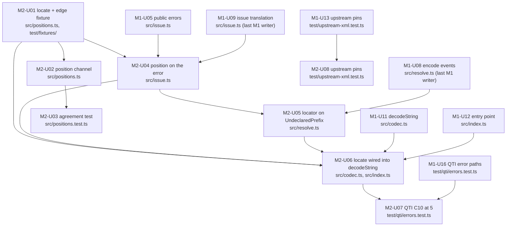

# Delivery: xml-schema-codec, milestone 2 (positions)

Lowered from `GOAL.md` (goal-check READY on `160f1db`; owner answers folded on `e63871e`) by the planner on handle `d0e58bb7`, 2026-11-05, against commit `d20cd96`; revised on handle `71f23076` per delivery audit `b773b321` (six findings) against `261cfdf`. Builds on `phase-1.md` as revised through `261cfdf` (`c6b02d2` per audit `8a3a60b4`, `261cfdf` the wire name on the compile marker): its Normalized Spec locks, module boundaries, and unit ids `M1-U01` to `M1-U17` are predecessors here and are not redefined or widened. Nothing M2 cites moved in those revisions: `M1-U08` is still the last M1 writer of `src/resolve.ts` (the added `M1-U07 → M1-U08` edge keeps it so), `M1-U09` of `src/issue.ts`, the `M1-U11`, `U12`, `U13`, and `U16` write scopes are unchanged, and `Plan`/`planOf` going private touches no M2 export. Rulings in `docs/rd/decisions.md` (T2, D7, R6, R7; owner decision 2) are binding. Every command below was run as written on the `d20cd96` checkout and its output pasted; the three commands added by the revision say they ran on `261cfdf`.

## Interpreted Unit

Milestone 2 of the goal: a decode failure on string input names a line and column. `src/positions.ts` lands with the post-hoc `locate(text, path)` scanner and the opt-in position `Channel` (SPIKE-07 C and B); `locate` is wired as the default position source on `decodeString` failures (M1-U11, `src/codec.ts`); the public decode error gains an optional `position` and its message gains `(line L, column C)`; the locate-versus-channel agreement test over all 15 corpus files plus the SPIKE-07 edge-case shapes joins the suite permanently (R6). Closes criterion 7 (C10) at 5 for retained text.

In scope (from `GOAL.md` "Implementation Shape" M2, T2's table row 1, and the task body):

- `locate(text, path)`: a pure tag scanner over the retained text, exact on start tags, agreeing with upstream on PIs, comments, CDATA, DOCTYPE with internal subset, and `>` inside attribute values
- the opt-in channel re-chunking the input at `<` so every `StartElement`/`EndElement` carries the exact start position of its tag (`Channel.fromTransform` in the shape of `Xml.ts:568-616`; `Channel.toTransform(Xml.decodeString())` inside)
- `position` on `XmlDecodeError`, `(line L, column C)` in the message, a positional locator on the `Schema` and `UndeclaredPrefix` reasons, `WellFormedness` positions copied from the upstream `XmlError`
- the agreement test (every start tag of every corpus file plus the edge cases), chunking independence at 7 characters, event fidelity, the 33 hand-checked positions
- C10 at 5 on the QTI vocabulary: bad attribute value, missing required child, unknown element, each with path, expectation, line and column
- the throughput note from SPIKE-07, recorded and not gated

Out of scope here: `positions: true` on the stream path and forwarding channel positions through the resolver onto streamed records (M3; T2 table row 2), the README two-row positions table (M4, R7), attribute positions inside a start tag and `Text` event positions (D7 and T2 "not verified", deferred with a note in the doc comments), the upstream feature request draft (owner decision 2; a separate Mind assignment), and any upstream Effect change (the plan does not depend on one).

## Normalized Spec

Done means: on the integrated tree, `bun run check`, `bun run build`, and `bun run test` are green; the Vitest run executes `src/positions.test.ts` in addition to the 13 M1 files; `decodeString` failures on string input carry `position` and a message of the form `<what> at <xpath> (line L, column C): <expectation>; <repair>`; and goal acceptance criterion 7 holds through its M2 clause ("for string input it also names line and column, and the locate-versus-channel agreement test passes on every start tag of every corpus file and the edge-case shapes"). Criteria 1 to 6 and 9 to 12 keep their M1 proofs; criterion 10's "only second tokenizer is `locate`, covered by its agreement test" becomes true here.

Derived locks (consequences of the rulings; a Hand follows them without re-deriving):

1. **Position semantics are upstream's.** `Position { line, column }`: one-based line ending at LF, CR, or CRLF; one-based column in UTF-16 code units, as `XmlError` counts them (`Xml.ts:44-45`, `:1037-1045`). The position of an element is the `<` of its start tag. A failure on an attribute, on a text child, or on a missing required child reports the enclosing element's (for a missing child, the parent's) start tag: attribute positions inside a tag and `Text` positions are the D7/T2 "not verified" items and stay deferred, with the deferral named in the doc comments of `locate` and the channel.
2. **The locator is positional, zero-based, and local-name checked.** `ElementStep { local: string; index: number }`, `ElementPath = ReadonlyArray<ElementStep>`: `index` is the zero-based position among the parent's **element** children (text runs, comments, PIs do not count; the root has index 0), `local` is the local part of the name: for the scanner, the text after the first `:` of the as-written name, or the whole name; on the resolved side (M2-U04 (e), M2-U05), the local part of the Clark name, the text after `}`, or the whole name when there is no namespace. The two agree because a prefix never changes the local part; `local` is never the marker's `wire` (phase-1 lock 4), whose prefix can differ from the one the text uses. `locate` descends by `index` and returns no position when the matched start tag's local name differs from `local`, when the path is empty, or when it runs past the document. This is the "zero-based internal convention" T2 calls an implementation detail covered by the agreement test, and it differs on purpose from the printed one-based same-named-sibling XPath (phase-1 lock 6): the printed path carries local names of expanded names while the text carries names as written, so a name-matching scanner would have to resolve namespaces to be correct when two prefixes share a local name under one parent. Positional descent needs no resolution, keeps the scanner a tag counter rather than a second resolver, and the local-name check turns a scanner-versus-parser divergence into an absent position instead of a wrong one.
3. **`position` is an optional key, absent when no source produced one.** Never `null`, never an `undefined`-valued key (AGENTS.md: nullability represents an actual optional value). The message gains ` (line L, column C)` between the path and the colon only when `position` is present; without it the M1 form is unchanged.
4. **Locate runs only on failure, over the retained string, inside `decodeString`.** No scan on success (constraint: never a default cost on the decode path). The channel runs nowhere by default in M2; M3 wires it behind `positions: true` on `decode`. It is not exported from `src/index.ts` until then.
5. **`WellFormedness` positions come from upstream.** The `XmlError` cause carries `line` and `column` on parser failures (`Xml.ts:51-56`); the codec copies them when both are present. `locate` is never run on a document upstream rejected. Upstream's `XmlError.message` already ends ` at line L, column C` (`Xml.ts:1044`), so a message rendered with `position` set drops that suffix from the expectation (the strip rule, `/ at line \d+, column \d+$/`, M2-U04 (d)) and states the position once, in the parenthetical; M2-U08 (b) pins the suffix shape the strip relies on.
6. **The locator is a public structured field; `locate` is not public.** Reasons `Schema` and `UndeclaredPrefix` carry `elementPath: ElementPath` next to their cause: it is the structured locator the goal's error contract permits (`GOAL.md` "Error contract": structured fields, no third formatter; this is a field, not a formatter) and the input the codec hands to `locate` on failure (M2-U06). Its only M2 consumer is the codec; `locate` stays unexported, as does the channel (lock 4), because no consumer path needs it: text is never retained on the stream path, and M3 reports the channel's position carried through the resolver and collector rather than locating after the fact (`phase-3.md` lock 7). The M2 additions to `src/index.ts` are the types `Position` and `ElementPath` only (a consumer reads a step as `ElementPath[number]`); criterion 12 is met by exporting the type of a public field, nothing more. `XmlEncodeError` gains nothing (no text exists on encode).
7. **The agreement test is the C9 licence** (D7, R6): for every start tag of every file under `spikes/fixtures/qti/` plus `test/fixtures/edge-cases.xml`, the channel's position equals `locate` for the channel-derived `ElementPath`; files are enumerated with `readdirSync` so the count is measured, never written; the test's comment names R6 and the rule that it re-runs on every `effect` bump.
8. **The throughput note is a doc comment, not a test.** The channel's doc comment records SPIKE-07's measured 2.5x to 3.6x over plain `decodeString`, three quarters structural (per-piece pulls through the one-output-chunk-per-input-chunk contract), and that this is why the channel is opt-in (T2, D7). A timing assertion in CI gates nothing and flakes; `spikes/error-positions/RESULT.md` keeps the measurement.
9. **The edge-case fixture is hand-written under `test/`.** `test/fixtures/edge-cases.xml` reproduces the six SPIKE-07 shapes (DOCTYPE with internal subset, comment and CDATA containing `<`, a PI, `>` inside an attribute value, start tags spanning lines) with the text of `spikes/error-positions/edge-cases.xml` reproduced verbatim, so the hand-checked positions below (root `7:1`, the fourth `b` `12:5`, `e` `15:16`) hold. Nothing under `src/` or `test/` imports from `spikes/`; the corpus is still read by path (goal open question 1).

## Repo-Aware Baseline

Checkout and gates (`d20cd96`):

```text
$ git log --oneline -1
d20cd96 docs(goals): add the milestone 1 delivery spec
$ bun run check
$ vp check --deny-warnings
pass: All 70 files are correctly formatted (227ms, 14 threads)
pass: Found no warnings, lint errors, or type errors in 8 files (906ms, 14 threads)
$ bun run build
ℹ dist/index.js    0.24 kB │ gzip: 0.19 kB
ℹ dist/index.d.ts  0.01 kB │ gzip: 0.03 kB
ℹ 2 files, total: 0.25 kB
✔ Build complete in 161ms
$ bun run test
 7 pass
 0 fail
Ran 7 tests across 2 files. [8.00ms]
 Test Files  1 passed (1)
      Tests  1 passed (1)
```

The sanity invocation form on a file that does not exist yet (a filter matching no file exits 1, so a Hand sanity cannot be green on nothing):

```text
$ bun x vp test src/positions.test.ts
No test files found, exiting with code 1
$ echo exit=$?
exit=1
```

No M1 module exists on this tip (`ls test` prints only `upstream-xml.test.ts`; `src/` holds the empty `index.ts`). Every M2 unit therefore depends on the M1 unit that creates or last writes each file in its write scope, and the merge seat lands M2 units only after those M1 units.

Installed Effect APIs the units call (all present at `effect@4.1.2`; the M1 set is already pinned in `phase-1.md`):

```text
$ grep -nE "^export (const|function|interface|type) (some|none|Option|isSome|isNone|getOrUndefined|map|match)\b" node_modules/effect/src/Option.ts | head
57:export type Option<A> = None<A> | Some<A>
266:export const none = <A = never>(): Option<A> => option.none
297:export const some: <A>(value: A) => Option<A> = option.some
357:export const isNone: <A>(self: Option<A>) => self is None<A> = option.isNone
385:export const isSome: <A>(self: Option<A>) => self is Some<A> = option.isSome
418:export const match: {
1279:export const getOrUndefined: <A>(self: Option<A>) => A | undefined = getOrElse(constUndefined)
1499:export const map: {
$ grep -nE "^export const (rechunk|pipeThroughChannel|runCollect|fromIterable|make)\b" node_modules/effect/src/Stream.ts
784:export const make = <const As extends ReadonlyArray<any>>(...values: As): Stream<As[number]> => fromArray(values)
999:export const fromIterable = <A>(
12467:export const rechunk: {
16246:export const pipeThroughChannel: {
19384:export const runCollect = <A, E, R>(self: Stream<A, E, R>): Effect.Effect<Array<A>, E, R> =>
$ grep -nE "^export const (chunks)\b" node_modules/effect/src/Stream.ts   # run on 261cfdf for M2-U08 (a)
12432:export const chunks = <A, E, R>(self: Stream<A, E, R>): Stream<Arr.NonEmptyReadonlyArray<A>, E, R> =>
$ grep -nE "^export const (runCollect)\b" node_modules/effect/src/Channel.ts   # run on 261cfdf; the alternative for M2-U08 (a)
11589:export const runCollect = <OutElem, OutErr, OutDone, Env>(
$ grep -nE "^export const (matchEffect)\b" node_modules/effect/src/Pull.ts
438:export const matchEffect: {
$ grep -nE "^export const (done)\b" node_modules/effect/src/Cause.ts
1530:export const done: <A = void>(value?: A) => Effect.Effect<never, Done<A>> = core.done
$ grep -nE "^export const (toTransform|fromTransform)\b" node_modules/effect/src/Channel.ts
294:export const fromTransform = <OutElem, OutErr, OutDone, InElem, InErr, InDone, EX, EnvX, Env>(
451:export const toTransform = <OutElem, OutErr, OutDone, InElem, InErr, InDone, Env>(
$ grep -nE "^export (const|function) (optionalKey|Option|Number|Int|Struct)\b" node_modules/effect/src/Schema.ts | head
2406:export const optionalKey: optionalKeyLambda = Struct_.lambda<optionalKeyLambda>((schema) =>
3192:export const Number: Number = make(SchemaAST.number)
3597:export function Struct<const Fields extends Struct.Fields>(fields: Fields): Struct<Fields> {
8010:export const Int: Int = Number.check(isInt())
16084:export function Option<A extends Constraint>(value: A): Option<A> {
```

Upstream facts the units rely on (`node_modules/effect/src/encoding/Xml.ts`):

- `XmlError` fields `kind`, `message`, `line?: number | undefined`, `column?: number | undefined` (`:51-56`); "Columns count UTF-16 code units, and lines end at LF, CR or CRLF" (`:44-45`); the parser builds `line`, `column`, and the `at line L, column C` message suffix in `error()` (`:1037-1045`).
- `decodeString` docs: "Each output chunk holds the events completed by one input chunk" (`:281-282`) and "Events completed before an error are emitted before the channel fails" (`:287`); the channel machine shape (`:562-616`). The re-chunking channel rests on the first sentence: a piece that holds exactly one `<` completes exactly the start or end tag it opens.
- `StartElement`, `EndElement`, `Text` carry no position (`:133-166`); `Text` normalizes line endings to `\n` (`:172-175`), which is why positions are counted over the raw input, never over `Text` events.

Corpus and spike facts:

```text
$ ls spikes/fixtures/qti/*.xml | wc -l | tr -d ' '
15
$ grep -cvE '^\s*(//.*)?$' spikes/error-positions/locate-c.ts spikes/error-positions/positions-b.ts
spikes/error-positions/locate-c.ts:153
spikes/error-positions/positions-b.ts:104
$ grep -lc $'\r' spikes/fixtures/qti/*.xml spikes/error-positions/edge-cases.xml || echo "no CR in any fixture"
no CR in any fixture
```

No fixture carries CR, so CRLF counting is covered by a test-side variant (`text.replaceAll("\n", "\r\n")`), not by the corpus.

Hand-checked positions reused below (line from the file, column by counting characters on that line; the awk column is `index($0, "<")`, one-based; fixture prose in the printed lines is elided as `…`):

```text
$ awk '{ i=index($0,"<"); if (NR==2||NR==21||NR==22||NR==23) print NR": col "i": "substr($0,1,40) }' spikes/fixtures/qti/bg007-true-false.xml
2: col 1: <qti-assessment-item
21: col 2:  <qti-item-body>
22: col 3:   <p>…</p>
23: col 3:   <qti-choice-interaction max-choices="1
$ awk 'NR==26 { print NR": col "index($0,"<qti-text-entry")": "substr($0,1,60) }' spikes/fixtures/qti/bg010-missing-word.xml
26: col 43:       … <qti-text-entry-in
$ awk 'NR==7||NR==12||NR==15 { print NR": "$0 }' spikes/error-positions/edge-cases.xml
7: <root attr="a > b" other="x &lt; y">
12:   /><b
15:   <d><!-- < --><e/></d>
$ sed -n '1,28p' spikes/fixtures/qti/bg010-missing-word.xml | grep -noE '<[a-z][a-z-]*' | paste -sd ' ' -   # run on 261cfdf
2:<qti-assessment-item 11:<qti-response-declaration 12:<qti-correct-response 13:<qti-value 15:<qti-mapping 16:<qti-map-entry 17:<qti-map-entry 20:<qti-outcome-declaration 21:<qti-item-body 22:<p 23:<div 24:<blockquote 25:<p 25:<br 26:<qti-text-entry-interaction 26:<br 27:<br
```

So in `bg007-true-false.xml`: `qti-assessment-item` `2:1`, `qti-item-body` `21:2`, `p` `22:3`, `qti-choice-interaction` `23:3`; in `bg010-missing-word.xml`: `qti-text-entry-interaction` `26:43`, reached by the positional path `[{qti-assessment-item,0},{qti-item-body,2},{div,1},{blockquote,0},{p,0},{qti-text-entry-interaction,1}]` (from the start-tag listing above: under the root, `qti-response-declaration` 0, `qti-outcome-declaration` 1, `qti-item-body` 2; under `qti-item-body`, `p` 0, `div` 1; `blockquote` is `div`'s only child; `p` is `blockquote`'s only child; under that `p`, `br` 0, `qti-text-entry-interaction` 1, `br` 2, `br` 3; the lines 12-17 descendants of `qti-response-declaration` are not children of the root); in `edge-cases.xml`: `root` `7:1`, the fourth `b` (element index 4 under `root`, after `a`, `<b/>`, `<b></b>`, and the multi-line `<b k="v"/>`) `12:5`, `e` (`root` index 0, `d` index 6, `e` index 0) `15:16`, `a` `9:3`, `c` `14:3`. The 33 SPIKE-07 hand-checked entries are `spikes/error-positions/positions.test.ts:118-200` (`handChecked`, keyed by fixture name and document-order start-tag ordinal).

Spike seams each unit copies by shape (never by import): `spikes/error-positions/locate-c.ts` (`advance` 86-98, `tagEnd` 102-115, `doctypeEnd` 119-137, the scan loop 146-190), `positions-b.ts` (`advance` 68-82, `refill` 84-96, `feed` 98-104, the `pieces` pull 106-124, the `toTransform` wrap 126-132), `positions.test.ts` (`elementsOf` 50-69, `splitEvery` 71-75, tests 1 to 4 at 77-217, `handChecked` 118-200).

## Unit Graph



Parallel waves among M2 units (write surfaces disjoint within a wave; `src/positions.ts` and `src/positions.test.ts` are serialized by the edges): wave 0 `U01 U08`; wave 1 `U02 U04`; wave 2 `U03 U05`; wave 3 `U06`; wave 4 `U07`. Each wave also waits for the M1 predecessors drawn above. Longest M2 chain: `U01 → U04 → U05 → U06 → U07` (5 units).

## Implementation Work

Standing requirements inherited by every unit (named once, not copied; `phase-1.md` "Implementation Work" lists the same set):

- `AGENTS.md`: Effect error channels only; `bun run check`, `build`, `test` are the gates the verify seat runs, not the Hand; kebab-case files; relative imports inside `src/`.
- `.agents/skills/effect-design/SKILL.md`: every custom piece's doc comment names the Effect API checked and the requirement it misses. For this milestone the justification is the same for both pieces and is quoted here once: `Xml.decodeString` events carry no position (`Xml.ts:133-166`), `XmlError` carries one only on parser failure (`:51-56`), and `SchemaIssue` has no position slot (`SchemaIssue.ts:156-163`); nothing public attributes an event to its input except the one-output-chunk-per-input-chunk contract (`:281-282`), which is what the channel uses, and nothing locates after the fact except a scan of the retained text, which is what `locate` is. Only public or `encoding/Xml` symbols.
- `.agents/skills/document-code/SKILL.md`: multiline JSDoc on every module-scope unit.
- `.agents/skills/error-messages/SKILL.md`: every message change keeps what, path, expectation, repair; neutral tone.
- `.agents/skills/conventional-commits/SKILL.md`: one commit per unit, `feat(positions):`, `feat(issue):`, `feat(resolve):`, `feat(codec):` for library behavior, `test:` for test-only units.
- Tests beside their module use `@effect/vitest` with `it.effect`; the corpus is read by path from `spikes/fixtures/qti/` via `new URL("../spikes/fixtures/qti/", import.meta.url)` (adjust `..` depth per file) and enumerated with `node:fs` `readdirSync`; the edge-case fixture from `test/fixtures/edge-cases.xml`; no file under `src/` or `test/` imports from `spikes/`.
- Sanity commands are the Hand's narrow check only; `bun x vp test <file>` exits 1 when the file does not exist.

### M2-U01 locate and the edge-case fixture

- id: `M2-U01`
- outcome: the pure post-hoc scanner `locate(text, path)` and the shared position types, with the edge-case fixture it is first proven on.
- write_scope: `src/positions.ts`, `src/positions.test.ts`, `test/fixtures/edge-cases.xml`
- edit: new module. `Position { readonly line: number; readonly column: number }` (lock 1); `ElementStep { readonly local: string; readonly index: number }`, `ElementPath = ReadonlyArray<ElementStep>` (lock 2); `locate(text: string, path: ElementPath): Option.Option<Position>` after `locate-c.ts:72-191` with three changes: steps are positional (each frame counts element children, `step.index === elementsSeenSoFar`) instead of same-name counted; the matched start tag's local name (after the first `:`) must equal `step.local`, else `Option.none()`; the function is pure and total (no `Effect`, no `LocateError`): an empty path, a path past the document, an unterminated construct, or a mismatch returns `Option.none()`. Keep the skip rules verbatim: `<?...?>`, `<!--...-->`, `<![CDATA[...]]>`, `<!DOCTYPE` with `[...]` subset and quoted literals, quoted attribute values with `>`, self-closing `/>` pushes no frame. `test/fixtures/edge-cases.xml` reproduces `spikes/error-positions/edge-cases.xml` verbatim (lock 9).
- done_when: on `test/fixtures/edge-cases.xml` read by path: `[{root,0}]` is `Some({ line: 7, column: 1 })`; `[{root,0},{a,0}]` is `9:3`; `[{root,0},{b,4}]` is `12:5`; `[{root,0},{c,5}]` is `14:3`; `[{root,0},{d,6},{e,0}]` is `15:16`; `[{root,0},{fake-tag,0}]`, `[{root,0},{not-an-element,0}]`, `[{root,0},{x,6}]` (local mismatch on `d`), `[{root,0},{b,7}]` (past the children), and `[]` are `None`; the same paths on `text.replaceAll("\n", "\r\n")` return the same lines and columns; on `bg010-missing-word.xml` read by path, `[{qti-assessment-item,0},{qti-item-body,2},{div,1},{blockquote,0},{p,0},{qti-text-entry-interaction,1}]` is `26:43` (derived in Repo-Aware Baseline); the doc comment carries the effect-design justification, the C9 licence (D7: acceptable only with the agreement test, M2-U03), and the deferral note for attribute and text positions.
- depends_on: none
- sanity: `bun x vp test src/positions.test.ts`
- non_goals: the channel (M2-U02); any namespace resolution in the scanner (lock 2); attribute positions inside a tag (D7 deferred).
- risk: medium; the scanner is the only second tokenizer the goal allows (criterion 10) and its correctness is licensed by M2-U03, not by this unit's tests alone.
- integrable: yes

### M2-U02 position channel

- id: `M2-U02`
- outcome: the opt-in channel that tags every upstream event with the start position of the input piece that completed it, exact for start and end tags.
- write_scope: `src/positions.ts`, `src/positions.test.ts`
- edit: append to the module. `PositionedEvent { readonly event: Xml.Event; readonly position: Position }`; `decodeStringWithPositions<IE = never, Done = unknown>(options?: Xml.DecodeOptions): Channel.Channel<Arr.NonEmptyReadonlyArray<PositionedEvent>, Xml.XmlError | IE, Done, Arr.NonEmptyReadonlyArray<string>, IE, Done>` after `positions-b.ts:43-134`: `Channel.fromTransform` whose pull re-chunks upstream strings into pieces each starting at `<` (carry the trailing partial piece into the next chunk, flush it at `onDone` via `Cause.done`), counts line and column over fed pieces with the lock 1 rules, runs `Channel.toTransform(Xml.decodeString(options))` over the piece pull, and maps every output chunk to `PositionedEvent`s carrying the most recently fed piece's start. Doc comment: the justification (standing requirement), the exactness claim and its limit (`Text`, `Comment`, `Doctype`, `ProcessingInstruction` get the completing piece's position; deferred per D7), the throughput note (lock 8), and that M3 wires it behind `positions: true` on `decode`. Not exported from `src/index.ts` (lock 4).
- done_when: with `fixtures` = every `*.xml` under `spikes/fixtures/qti/` plus `test/fixtures/edge-cases.xml` (count asserted `> 0`): event fidelity, the channel's events stripped of positions `toEqual` plain `Xml.decodeString()` events for every fixture (spike test 3); chunking independence, positions of every start tag are identical whether the text arrives whole or in 7-character chunks through `Stream.rechunk(1)` (spike test 2); the 33 `handChecked` entries carried over from `positions.test.ts:118-200` (fixture name, document-order ordinal, name, line, column; at least two per corpus file and three for the edge cases) match the channel's `StartElement` positions (spike test 4); the `edge-cases.xml` entries resolve against `test/fixtures/edge-cases.xml`.
- depends_on: `M2-U01`
- sanity: `bun x vp test src/positions.test.ts`
- non_goals: byte input (`Xml.decode`; M3 decides between a byte re-chunker and `Stream.decodeText` first); forwarding positions through the resolver (M3); any public export (lock 4).
- risk: medium; second `Channel.fromTransform` in the repo and the only one that drives another channel through `Channel.toTransform`. The carry buffers an unbounded run with no `<` (upstream's `maxTokenSize` bounds it; note it in the doc comment).
- integrable: yes

### M2-U03 locate-versus-channel agreement test

- id: `M2-U03`
- outcome: the permanent suite member that licenses the second tokenizer (D7, R6, criterion 7 and 10).
- write_scope: `src/positions.test.ts`
- edit: add the agreement case after spike test 1 (`positions.test.ts:77-95`) with the lock 2 path convention: for each fixture, run `decodeStringWithPositions()` over the whole text, build an `ElementPath` for every `StartElement` from a stack of per-depth element counters (`index` = elements already seen under the parent, `local` = the as-written name's local part; the stack pops on `EndElement`), and assert `locate(text, path)` is `Some` of the channel's position; assert each fixture has at least one start tag; print the per-fixture table (`fixture | start tags | agree`) with `console.log` as the spike did, so the verify seat's log shows the measured totals. A leading comment names R6, the C9 licence, and that the case re-runs on every `effect` bump (`test/upstream-xml.test.ts` is the canary; this test is the proof).
- done_when: one agreement assertion per start tag of the 15 corpus files and the edge-case fixture, all green; the test fails on a `None` (not skipped); the printed table lists 16 rows.
- depends_on: `M2-U02`
- sanity: `bun x vp test src/positions.test.ts`
- non_goals: a timing assertion (lock 8); end-tag agreement (`locate` returns start tags only).
- risk: low; the spike agreed 416/416 with a stricter name-matched convention.
- integrable: yes

### M2-U04 position on the public error

- id: `M2-U04`
- outcome: `XmlDecodeError` carries an optional `position` and a positional locator; the message rule gains `(line L, column C)`.
- write_scope: `src/issue.ts`, `src/issue.test.ts`
- edit: extend the M1-U05/U09 module; adapt field and function names to what those units landed, the capabilities below are the lock. (a) `XmlDecodeError` gains `position`, an optional key (`Schema.optionalKey(PositionSchema)` if the class is `Schema.TaggedError`, `readonly position?: Position` if `Data.TaggedError`; lock 3), typed by `Position` imported as a type from `./positions.ts` (`positions.ts` imports nothing from `issue.ts`). (b) Reasons `Schema` and `UndeclaredPrefix` gain `elementPath: ElementPath` (lock 6); `WellFormedness` does not (its position is on the cause). (c) `formatMessage` accepts an optional `position` and renders `<what> at <xpath> (line L, column C): <expectation>; <repair>`; without it, the M1 form. (d) `withPosition(error: XmlDecodeError, position: Position): XmlDecodeError` returns the same reason and path with `position` set and the message re-rendered; for reason `WellFormedness` the re-rendered expectation drops upstream's trailing ` at line L, column C` (`/ at line \d+, column \d+$/` on the `XmlError` message; lock 5, shape pinned by M2-U08 (b)) so the position appears once, in the parenthetical. (e) `translate` records, for each element segment, the zero-based index among the parent's element children alongside the one-based same-name index it already computes for printing (it inspects the input element's children for lock 6 in phase-1), and `toDecodeError` fills `elementPath` from those segments, each step's `local` being the local part of the resolved element's Clark name (`parseClark`, M1-U01; lock 2), never the plan's `wire`; an attribute or `text()` leaf contributes no step (the path ends at the enclosing element); a missing required child ends at the parent; a root-level issue is `[{ local: <root local>, index: 0 }]`.
- done_when: `formatMessage` with `position` renders exactly one ` (line 23, column 3)` between the path and the colon, and without it renders the M1 form; `withPosition` on an M1-shaped error keeps `reason` and `path`, sets `position`, and its message matches `/ at \S+ \(line \d+, column \d+\): /`; `withPosition` on a `WellFormedness` error built from an `XmlError` whose message ends `at line 1, column 8` renders ` (line 1, column 8)` and the string `line 1` occurs exactly once in the message; a namespaced element (`{u}p`) yields a step with `local` `p`; with `compile(lower(...))` definitions as in the M1-U09 tests: the `max-choices="x"` case yields `elementPath` `[{qti-assessment-item,0},{qti-item-body,i},{qti-choice-interaction,j}]` with `i` and `j` the positional indices of those children in the hand-built element; a bad attribute on the second of two `<p>` preceded by one other element child yields a last step `{ p, 2 }` while the printed path says `p[2]` (positional and same-name indices differ by design); a sole `<p>` yields `{ p, k }` with `k` its position and prints `p` unindexed; a missing required child yields the parent's step last; `UndeclaredPrefix` constructs with `elementPath` and `Effect.catchReason` still selects it; messages pass the error-messages checklist.
- depends_on: `M1-U05`, `M1-U09`, `M2-U01`
- sanity: `bun x vp test src/issue.test.ts`
- non_goals: calling `locate` (the codec wires it, M2-U06); encode errors; `Limit` (M3).
- risk: medium; public contract change. Run the `consequences` lens before landing (fields added to a reason are read by `Effect.catchReason` handlers consumers may already have written against M1).
- integrable: yes

### M2-U05 locator on the resolver's `UndeclaredPrefix`

- id: `M2-U05`
- outcome: the resolver's `UndeclaredPrefix` failure carries the positional `elementPath` of the element being started, so the codec can locate it.
- write_scope: `src/resolve.ts`, `src/resolve.test.ts`
- edit: in `resolveEvents()` (M1-U06), each scope-stack frame keeps a count of element children started under it; on `StartElement` the resolver computes `{ local: <as-written local part>, index: <parent count before increment> }` and, when it fails with `UndeclaredPrefix` (undeclared prefix on the element name or on an attribute name), passes the full `elementPath` (root to this element) to the reason alongside the as-written printed path. No other behavior changes; the counter is dropped on `EndElement` with the frame.
- done_when: `<root><a/><b><foo:bar/></b></root>` fails with reason `UndeclaredPrefix`, `path` `/root/b/foo:bar`, and `elementPath` `[{root,0},{b,1},{bar,0}]`; `<root><x foo:k="1"/></root>` fails with `elementPath` `[{root,0},{x,0}]`; the M1-U06 and M1-U07 cases in `src/resolve.test.ts` are unchanged and green.
- depends_on: `M1-U08` (last M1 writer of `src/resolve.ts`), `M2-U04`
- sanity: `bun x vp test src/resolve.test.ts`
- non_goals: forwarding channel positions on resolved events (M3); budgets (M3).
- risk: low; one counter per frame.
- integrable: yes

### M2-U06 locate wired into `decodeString`

- id: `M2-U06`
- outcome: every `decodeString` failure on string input carries a position when one exists: `locate` for `Schema` and `UndeclaredPrefix`, the upstream `XmlError` for `WellFormedness`.
- write_scope: `src/codec.ts`, `src/codec.test.ts`, `src/index.ts`
- edit: in `decodeString(Def)` (M1-U11) add one failure-path step after the error is built, `attachPosition(xml)`: reason `Schema` or `UndeclaredPrefix`, `locate(xml, reason.elementPath)` and `withPosition` on `Some`, the error unchanged on `None`; reason `WellFormedness`, `withPosition` with `{ line, column }` from the `XmlError` cause when both are numbers (lock 5), unchanged otherwise. The success path is untouched (lock 4). The `xml.decodeString` span still wraps the whole call including the locate step; no new span, no log. The `WellFormedness` message carries the position once: `withPosition` strips upstream's suffix (M2-U04 (d), lock 5); review it under `error-messages` here. `src/index.ts` adds `export type { Position, ElementPath } from "./positions.ts"` and nothing else: `locate`, `ElementStep`, and the channel stay unexported (lock 6, lock 4). `src/codec.test.ts` extends the M1-U11 in-test definition (in scope; phase-1 U11 requires only a definition that decodes `bg007-true-false.xml`) so that `qti-item-body` declares `qti-choice-interaction` with `max-choices: Schema.Int`, which the position cases below need.
- done_when: with the in-test definition so extended, on `bg007-true-false.xml` text: `max-choices="x"` (string replacement on line 23) fails with `position` `{ line: 23, column: 3 }` and a message containing `at /qti-assessment-item/qti-item-body/qti-choice-interaction/@max-choices (line 23, column 3):`; `<foo:bar/>` inserted immediately after `<qti-item-body>` on line 21 fails with reason `UndeclaredPrefix` and `position` `{ line: 21, column: 17 }` (`<qti-item-body>` is 15 characters starting at column 2); a malformed document (`<a><b></a>`) fails with reason `WellFormedness` whose `position` equals the cause's `line` and `column` and whose message carries the parenthetical and does not end in upstream's `at line L, column C` (the position appears once); a valid document decodes to the same value as in M1 (no behavior change on success); the M1-U11 span test still sees exactly one `xml.decodeString` span per call on success and on failure; `dist/index.d.ts` names `Position` after the verify seat's build.
- depends_on: `M1-U11`, `M1-U12`, `M2-U01`, `M2-U04`, `M2-U05`
- sanity: `bun x vp test src/codec.test.ts`
- non_goals: `positions: true` option on `decodeString` (none; string input always locates); the stream path (M3).
- risk: medium; integration seam. If `elementPath` on the landed M1 error does not reach this unit in the shape M2-U04 names, stop and report rather than re-deriving a path from the printed XPath string.
- integrable: yes

### M2-U07 QTI C10 at 5

- id: `M2-U07`
- outcome: criterion 7's M2 clause proven on the shipped vocabulary for the three C10 breakages.
- write_scope: `test/qti/errors.test.ts`
- edit: extend the M1-U16 file (variants of `bg007-true-false.xml` by string replacement in the test) with position assertions. Check-first: confirm with `grep -n` that lines 2, 21, 22, 23 of the fixture still read as in the baseline before pinning positions.
- done_when: (a) bad attribute value, `max-choices="x"`: `position` `23:3`, message `… at /qti-assessment-item/qti-item-body/qti-choice-interaction/@max-choices (line 23, column 3): …` naming a finite number; (b) missing required child, the whole `<qti-item-body>…</qti-item-body>` block removed: path `/qti-assessment-item`, expectation naming `qti-item-body`, `position` `2:1`; (c) unknown element, `<em>x</em>` inserted immediately after `<p>` on line 22: path ending in `p/em`, expectation naming the declared `mixed` members, `position` `22:6`; each message is one line a renderer can show and passes the error-messages checklist. If (c) cannot print `em` because M1-U09 did not translate an unmatched `mixed` member, report the measured path and stop; the repair belongs to `issue`, not to this test.
- depends_on: `M1-U16`, `M2-U06`
- sanity: `bun x vp test test/qti/errors.test.ts`
- non_goals: new vocabulary; positions on encode.
- risk: low-medium; (c) depends on the `AnyOf` translation M1-U09 listed as its one unspiked path.
- integrable: yes

### M2-U08 upstream pins

- id: `M2-U08`
- outcome: `test/upstream-xml.test.ts` pins the three upstream facts the M2 modules rely on.
- write_scope: `test/upstream-xml.test.ts`
- edit: add `it.effect` cases to the existing `describe`, each with a one-line comment naming the dependent module: (a) one output chunk per input chunk, `Stream.fromIterable(["<a>", "<b/>", "</a>"])` through `Stream.rechunk(1)`, `Stream.pipeThroughChannel(Xml.decodeString())`, then `Stream.chunks` (`Stream.ts:12432`) before `Stream.runCollect`, so chunk boundaries survive collection (`Stream.runCollect` alone flattens; `Channel.runCollect`, `Channel.ts:11589`, over the channel is the equivalent), yields exactly three chunks `[StartElement a]`, `[StartElement b, EndElement b]`, `[EndElement a]` (M2-U02; `Xml.ts:281-282`); (b) a malformed document fails with an `XmlError` whose `line` and `column` are numbers and whose `message` ends with `at line L, column C` with the same numbers, matched by `/ at line (\d+), column (\d+)$/` (M2-U04 (d) strips exactly this suffix when it sets `position`, M2-U06 copies the numbers; `Xml.ts:51-56`, `:1044`); (c) `XmlError` positions count raw input, a CRLF document whose error is on its second line reports `line: 2` (M2-U01 lock 1; `Xml.ts:44-45`).
- done_when: the file runs at least three more tests than before this unit, all against literal strings, each asserting one fact above.
- depends_on: `M1-U13` (same file)
- sanity: `bun x vp test test/upstream-xml.test.ts`
- non_goals: M3 pins (`Xml.decode` bytes, `elements` chunking).
- risk: low.
- integrable: yes

## Checkpoints And Gates

- **Hand sanity** (per unit, above): one `bun x vp test <file>`; never the full gates.
- **Merge/integration gate** (merge seat, named once): every unit is integrable alone, so no aggregate non-integrable gate exists. The merge seat serializes `src/positions.ts`/`src/positions.test.ts` (U01 → U02 → U03) and lands each M2 unit only after the M1 unit that last writes any file in its scope (`src/issue.ts` after M1-U09, `src/resolve.ts` after M1-U08, `src/codec.ts` after M1-U11, `src/index.ts` after M1-U12, `test/qti/errors.test.ts` after M1-U16, `test/upstream-xml.test.ts` after M1-U13). Do not dispatch an M2 Hand into a file an M1 Hand holds uncommitted.
- **Verify gate** (verify seat, on the integrated tree after each wave and at M2 close): `bun run check && bun run build && bun run test`. The seat reports the Vitest test-file and test counts, which must include `src/positions.test.ts` in addition to the 13 M1 files, with a non-zero test count per file, and quotes the agreement table the suite prints (16 rows, every row agreeing).
- **Milestone close checks** (verify seat): `grep -rn "spikes/" src test` prints only fixture-path reads inside test files, never an import; `grep -rnE "applyToSelfOrLastLinkEncoding|replaceEncoding|Objects\.recur|Arrays\.recur|getIndexSignatureKeys|defaultFormatter|resolveAnnotations" src` prints nothing; `grep -nE "decodeStringWithPositions|\blocate\b|ElementStep" src/index.ts` prints nothing (lock 4, lock 6: only the types `Position` and `ElementPath` join the entry); the "not verified" column of every `decisions.md` row M2 touched has a test or a deferral note in the Hand's report: T2 `AnyOf` translation (M1-U09, exercised again by U07 (c)), T2 and D7 attribute positions inside a start tag (deferred, doc comment in U01), D7 `Text` event positions (deferred, doc comment in U02), D1/D7 agreement test (U03), R6 (U03 comment), R7 (deferred to M4 README).

## Validation

The M2 acceptance suites and the command that observes each (the invocation form is verified in the baseline; the files do not exist yet, so these run at the verify gate, and a filter matching no file exits 1):

| Acceptance (GOAL.md)                                                                                       | Suite                                                          | Command                                               |
| ---------------------------------------------------------------------------------------------------------- | -------------------------------------------------------------- | ----------------------------------------------------- |
| 7 C10, string input names line and column (bad value, missing child, unknown element)                      | M2-U07 `test/qti/errors.test.ts`                               | `bun x vp test test/qti/errors.test.ts`               |
| 7 C10, agreement on every start tag of every corpus file plus edge cases                                   | M2-U03 `src/positions.test.ts`                                 | `bun x vp test src/positions.test.ts`                 |
| Validation M2, 33 hand-checked positions and 7-character chunking                                          | M2-U02 `src/positions.test.ts`                                 | `bun x vp test src/positions.test.ts`                 |
| Validation M2, edge-case shapes (DOCTYPE subset, comment/CDATA `<`, PI, `>` in attribute, multi-line tags) | M2-U01 `src/positions.test.ts`, `test/fixtures/edge-cases.xml` | `bun x vp test src/positions.test.ts`                 |
| Constraint, message form with position; `position` absent when unknown                                     | M2-U04 `src/issue.test.ts`, M2-U06 `src/codec.test.ts`         | `bun x vp test src/issue.test.ts src/codec.test.ts`   |
| Constraint, `UndeclaredPrefix` names its tag                                                               | M2-U05, M2-U06                                                 | `bun x vp test src/resolve.test.ts src/codec.test.ts` |
| 10 C9, the only second tokenizer is `locate`, covered by its agreement test                                | M2-U03 plus the close greps                                    | see Checkpoints                                       |
| 11 spans unchanged on failure with positions                                                               | M2-U06 (M1-U11's span test)                                    | `bun x vp test src/codec.test.ts`                     |
| 12 `dist` exports `Position`                                                                               | M2-U06 with `bun run build`                                    | `bun run build && grep -c "Position" dist/index.d.ts` |

Manual flow (owner, after M2): `bun x vp test test/qti`; change `max-choices` to `x` in a copy of `bg007-true-false.xml` and read the one-line error ending in `(line 23, column 3): …`.

## Review Lenses

- `consequences`: before M2-U04 lands (fields added to the public error and to two reasons; `Effect.catchReason` handlers written against M1 keep working, new fields are additive).
- `correctness`: on M2-U01 at merge (quoted `>` inside a tag, DOCTYPE subset with quoted `]`, CRLF, self-closing tags pushing no frame, local-name mismatch) and on M2-U02 (carry across a chunk boundary inside a tag, inside a comment, and at end of input; one-output-chunk-per-input-chunk preserved).
- `error-messages` (repo skill): implementation-time review on M2-U04 and M2-U06, including the lock 5 strip rule (a `WellFormedness` message names its position once).
- `trace-effect` (repo skill): M2-U06, confirm no new span or log on the failure path.
- `poker-face`: at M2 close against criterion 7's M2 clause and criterion 10, with the deferrals (attribute and `Text` positions) stated as deferrals, not as covered.

## Open Questions

None blocking. Two choices the Mind may reverse, with the affected units: lock 6 makes `elementPath` a public structured field on two reasons with `locate` kept private (U04, U05, U06; the alternative is an internal carrier read only by the codec, which would keep the public reasons M1-shaped at the cost of a second, non-public error shape or a side table keyed by error instance; the opposite move, exporting `locate` and `ElementStep` so a consumer can self-locate, has no consumer today and stays a want); lock 8 records the throughput note as a doc comment rather than a printed benchmark in the suite (U02).

## Release Posture

`defer-release`. The package stays `"private": true` and `0.0.0`; no publish, tag, rename, or version bump in this milestone (GOAL.md Release Posture, D10 settled 2026-11-04). M4 publishes the two-row positions table (R7).
