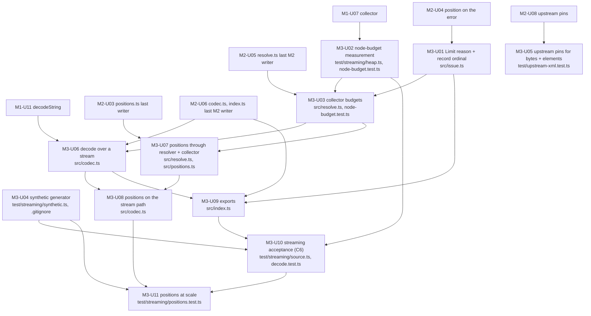

# Delivery: xml-schema-codec, milestone 3 (per-record streaming and budgets)

Lowered from `GOAL.md` (goal-check READY on `160f1db`) by the planner on handle `f05ee481`, 2026-11-05, against commit `261cfdf`; revised on handle `24f19ea5` per delivery audit `3b7b59ba` (twelve findings; Mind rulings on locks 4 and 8) against `235a844`, where every command this revision changed or added was re-run and its output re-pasted. Builds on `phase-1.md` (`d20cd96`, revised `c6b02d2` and `261cfdf`) and `phase-2.md` (`a591d01`, revised `ce0a251`): their Normalized Spec locks, module boundaries, and unit ids `M1-U01..U17` and `M2-U01..U08` are predecessors here and are not redefined or widened. Rulings in `docs/rd/decisions.md` (T4, T5, D4, D7, R4, R5) are binding and are not reopened. Every command below was run as written on that checkout and its output pasted.

## Interpreted Unit

Milestone 3 of the goal: a consumer calls `decode(Def, path)` on a byte or text `Stream` of a large well-formed XML document and receives a `Stream` of Effect-typed values, one per element matching the root-anchored expanded-name `path`, with memory bounded by the largest record under two budgets (`maxElementSize`, inherited character semantics; `maxElementNodes`, the library's node budget with a measured default), with the public error gaining the `Limit` reason, and with `positions: true` reusing the milestone 2 position channel on the stream path. Tree decode stays the single-record case: the root as the record.

In scope (from `GOAL.md` "Implementation Shape" M3, "Constraints and invariants" Limits and Positions, acceptance criteria 7 (M3 clause), 8, and 11, T2's table row 2, and the task's milestone-specific requirements):

- `decode(Def, path, options?)` over a `Stream<Uint8Array>` or a `Stream<string>` (one kind per run) through the M1 resolver (`M1-U06`) and collector (`M1-U07`), one `Schema.decodeUnknownEffect(Def)` per record, errors translated by `M1-U09` with the record ordinal
- record paths in expanded (Clark) names with the `Xml.elements` path contract (`"*"` wildcard), `clark` exported so consumers can spell them
- `maxElementSize` (default 16 MiB, upstream semantics) and `maxElementNodes` (default 1,000,000 pending the measurement unit, R5) enforced in the in-house collector; `Infinity` disables either; `Limit` reason naming the record's root element, the limit, and the measured value (T5)
- the same two options on `decodeString` so tree mode exposes the kill switch (`GOAL.md` Exit Strategy)
- `positions: true` on the stream path: bytes decoded to text, the M2 channel (`M2-U02`) over `Xml.decodeString`, its positions forwarded through the resolver and the collector onto each record, and `M2-U04`'s `elementPath` resolved against them (D7, T2 row 2; `phase-2.md` lock 4 and `M2-U02` non-goals name this as M3's)
- the SPIKE-04 synthetic generator rewritten under `test/streaming/` (runtime-neutral), output gitignored; the bounded-memory test, the whole-document `Limit`, the `maxElementNodes` boundary, positions on and off (criterion 8; `GOAL.md` Validation M3)
- spans per `trace-effect`: one `xml.decode` span per stream run carrying the record path, the limits, and the record count; none per record or event
- upstream pins for the byte decoder and `elements` chunk emission (`test/upstream-xml.test.ts`, R4)

Out of scope here: `locate` and the channel themselves (M2); the README limits table and the two-row positions table (M4, R5, R7; `phase-4.md` reads the shipped default from `src/resolve.ts`); a per-record `Either` variant of `decode` (want, derived lock 6); `FileSystem.stream` from a platform layer (`spikes/streaming/source.ts` note: no platform dependency); the upstream feature request draft (`8ca681c`, a separate Mind assignment); exporting the position channel (`phase-2.md` lock 4; the `positions: true` option is the surface); everything in the goal's Non-goals.

Closes C6 at 5 (`docs/rd/criteria.md`: live set flat across forced GCs over the 55 MB synthetic; the default budgets fail the whole-document tree decode).

## Normalized Spec

Done means: on the integrated tree, `bun run check`, `bun run build`, and `bun run test` are green; the Vitest run executes `test/streaming/*.test.ts` plus the extended `src/issue.test.ts`, `src/resolve.test.ts`, `src/positions.test.ts`, `src/codec.test.ts`, and `test/upstream-xml.test.ts`; `dist/index.d.ts` names `decode`, `clark`, the `Limit` reason, and the two default constants; goal acceptance criteria 7 (M3 clause), 8, and 11 (`decode` span) hold; and the `maxElementNodes` default is the measured one (R5).

Derived locks (consequences of the rulings and of `phase-1.md`/`phase-2.md`; a Hand follows them without re-deriving):

1. **Public shape.** `decode(Def, path, options?)` returns `<E, R>(input: Stream<Uint8Array, E, R> | Stream<string, E, R>) => Stream<Def["Type"], XmlDecodeError | E, R>`: a byte stream or a text stream, never chunks of both, so the input kind is a static fact of the call site and lock 3's byte-mode rules apply to byte streams exactly (a per-chunk union would make "the input was bytes" meaningless and cannot be piped through `Channel.decodeText`, audit `3b7b59ba` finding 3). `path` is a root-anchored `ReadonlyArray<string>` of Clark names or `"*"`, the contract `M1-U07`'s `collect` already shares with `Xml.elements` (`Xml.ts:438-460`); an empty path is a programming error and a defect, as upstream throws (`Xml.ts:449-451`). Tree decode is `decode` with the root as the record (one record), and `decodeString` (`M1-U11`) stays the retained-text form.
2. **Input kind is normalised once, by branch.** Upstream has two parsers keyed by input kind (`Xml.decode` over bytes with `Utf8Input`, `Xml.ts:368-376`, `:1640`; `Xml.decodeString` over text, `:334`) and no mixed one. Without `positions`, every chunk becomes bytes (strings through one module-level `TextEncoder`, as `Stream.encodeText` does, `Stream.ts:16923-16927`) and the pipeline is `Xml.decode(parserOptions)` → `resolveEvents()` → `collect(path, limits)`. With `positions: true`, every chunk becomes text: string chunks pass, byte chunks go through one per-run `TextDecoder("utf-8", { fatal: true })` created inside `Stream.suspend` and applied per chunk as `decoder.decode(bytes, { stream: true })` under `Effect.try` in `Stream.mapEffect` (`Effect.ts:2503`; a typed failure, never a defect), with the decoder's final `decode()` flush appended through `Stream.concat` of a `Stream.fromEffect` filtered for non-empty output (`Stream.ts:3904`, `:358`, `:6309`); the pipeline is then `decodeStringWithPositions(parserOptions)` (`M2-U02`) → `resolveEvents()` accepting positioned events → `collect(path, limits)` recording positions. `Channel.decodeText` (`Channel.ts:9214`) is the same streaming decoder behind a channel whose input is `NonEmptyReadonlyArray<Uint8Array>` only, and `Stream.decodeText` takes no `fatal` option (`Stream.ts:16877`); since a `Stream` carries no runtime kind tag, both branches dispatch per chunk on `typeof chunk === "string"`, which lock 1 makes constant for a run, and the per-run decoder is what lets the positions branch do that in one place. Each chunk is converted at most once.

   Amendment: under `positions: false`, a text stream is parsed by `Xml.decodeString`, not re-encoded to bytes; lock 3 wins over the `TextEncoder` route (ruling recorded in `docs/rd/decisions.md`, implemented at `2fe1c9b`).

3. **Byte-mode encoding parity on the positions branch.** `Xml.decode` fails a `Declaration` naming an encoding other than UTF-8 or US-ASCII (`Xml.ts:1475-1480`, `isUtf8` at `:734-737`) and invalid UTF-8 (`:1680-1700`); `Xml.decodeString` ignores the declared encoding (`:285-286`). When the input is a byte stream and `positions: true`, the library keeps the byte-mode rules: a non-UTF-8 `Declaration.encoding` fails with reason `WellFormedness` carrying an `Xml.XmlError` of kind `Unsupported` with upstream's message text, and the fatal decoder's `TypeError` (caught by `Effect.try`, lock 2) is mapped to `WellFormedness` carrying an `Xml.XmlError` of kind `Syntax` with message `invalid UTF-8` and no position. Two byte-mode behaviors differ after text decoding and are stated, not pinned: a UTF-16 byte order mark fails as a parser `Syntax` error with a different message, and a `Declaration` naming US-ASCII followed by a non-ASCII byte, which byte mode rejects (`Xml.ts:1010`, `Syntax`, `invalid US-ASCII byte`), decodes as UTF-8 text. Text streams are never checked (as `decodeString`).
4. **Budgets count the record in upstream's units.** `maxElementSize` counts UTF-16 code units of the as-written input a record spans, exactly as upstream's `Collector` does (`Xml.ts:1752-1754`, `:1769`): the as-written element name, every as-written attribute key and value (`xmlns` declarations included, since upstream sees them as attributes), and every text run; same default 16 MiB (`Xml.ts:550`). Clark expansion is internal and is never counted (Mind ruling on audit `3b7b59ba` finding 4: T5's "inherited semantics" and `GOAL.md`'s "upstream semantics" mean upstream's number for the same input; the README's "16 MiB per record" row is upstream's). The resolver has the as-written event in hand and stamps upstream's formula, `name.length` plus each `key.length + value.length`, as `size` on every resolved `StartElement` it emits (an additive key in the same pattern `M3-U07` uses for `position`); the collector sums the stamps and the text lengths. `maxElementNodes` counts element starts plus text runs in one collected record; a text run is counted when a new string child is pushed, not when adjacent text is appended (upstream merges adjacent text per event, `Xml.ts:1769-1772`). Both are per record; the record is the whole document in tree mode (T5). `Infinity` disables either; a value that is not a positive number is a defect when the returned stream or effect runs (`collect` is built inside `Stream.suspend`), mirroring `checkLimit` (`Xml.ts:552-558`).
5. **A `Limit` is fatal to the stream**, as it is for `Xml.elements`: records completed before the failing one are emitted first (output before failure, the machine shape of `Xml.ts:562-616`), then the stream fails with reason `Limit`. Fields: `limit: "maxElementSize" | "maxElementNodes"`, `max: number`, `measured: number` (the count at the moment it exceeded), `element: string` (the record root's Clark name), `record: number` (1-based ordinal of the record being collected), with `path` record-relative like every error raised inside a collected record (lock 6, and tree mode): `/` plus the record root's local name. The matched record path with its `*` segments is the `xml.path` span attribute (lock 8), not an error path, because `*` is not an XPath step. Message, per `error-messages`: `element <qti-assessment-test> exceeds maxElementNodes at /qti-assessment-test of record 1: counted 1000001 nodes, limit 1000000; raise maxElementNodes, pass Infinity to disable it, or decode a smaller record path`.
6. **A Schema failure on record `k` fails the stream** (fail-fast, as `decodeString`). The error's `path` is relative to the record root (`/qti-assessment-item-ref/@href`), and `XmlDecodeError` gains `record?: number` (an optional key, never `null`, as `phase-2.md` lock 3), present when the failure is inside a collected record (`Schema`, `Limit`), absent for parser and resolver failures, which run before the collector so no ordinal exists. The message form gains the clause `of record <k>` between the path and `M2-U04`'s position clause: `<what> at <xpath> of record <k> (line L, column C): <expectation>; <repair>`. A per-record `Either` form is a want, not a unit.
7. **Positions on the stream path are the channel's, resolved through `elementPath`.** The channel (`M2-U02`) stamps each event; the resolver copies the stamp onto the resolved `StartElement` it emits; the collector builds, per record, a tree of element start positions mirroring the record's element children (`PositionTree { position: Position; local: string; children: ReadonlyArray<PositionTree> }`, element children only, text runs excluded, exactly the index convention of `phase-2.md` lock 2; `local` is the Clark name's local part, so the tree can check a step's `local` as `locate` does) and keeps it beside the record without changing the record's type (`phase-1.md` lock 3: a `ResolvedElement` is `{ name, attributes, children }`). On a `Schema` failure the codec resolves `reason.elementPath` (`M2-U04` lock 6) against that tree by `index`, checking `local` as `locate` does, and sets `position` with `withPosition`; an `UndeclaredPrefix` raised by the resolver takes the failing start tag's stamp directly; a `Limit` takes the record root's stamp; `WellFormedness` copies the upstream `XmlError` position (`phase-2.md` lock 5) on both branches, since the parser always has it. Without `positions: true`, `Schema`, `UndeclaredPrefix`, and `Limit` stream failures have no `position` (criterion 7); `locate` never runs on a stream (no retained text).
8. **Observability.** One named span `xml.decode` per `decode` run through `Stream.withSpan` (`Stream.ts:18889`; `Channel.withSpan` provides it as `ParentSpan` to the whole pipeline, `Channel.ts:10935`), covering consumption. Attributes at creation: `xml.path` (the printed record path), `xml.maxElementSize`, `xml.maxElementNodes`, `xml.positions`; at exit, `xml.records` (records emitted) through `Effect.annotateCurrentSpan` (`Effect.ts:17326`) in `Stream.onExit` (`Stream.ts:17658`), so a `Limit` or `Schema` failure leaves the count on the span and the detail on the error. Per-record detail is at most `Effect.logDebug`, never a span: no span per record or per event (Mind ruling on audit `3b7b59ba` finding 9, reading `GOAL.md` criterion 11's "each run" and the "decode per record" row as one span per run; `trace-effect`: a span per record would be 160k spans on the synthetic and 1e6 on a document of that size). Failure diagnostics stay on the error. `decodeString`'s span set (`M1-U11`, `M2-U06`) is unchanged.
9. **Parser options pass through.** `maxTokenSize` and `maxDepth` (`Xml.DecodeOptions`, `Xml.ts:253-256`) are accepted on `decode` and forwarded to the upstream channel in use (`Xml.decode`, or `decodeStringWithPositions`, which takes the same options, `M2-U02`); they stay inherited at the parser (goal constraint).
10. **Test runtime.** Vitest workers run on Node (`node_modules/.bin/vp` shebang `#!/usr/bin/env node`; vitest `5.1.0` forks inherit `process.execPath`), so `test/streaming/` helpers are runtime-neutral: file I/O through `node:fs`, forced GC through `Bun.gc(true)` when `Bun` is defined and otherwise `v8.setFlagsFromString("--expose-gc")` plus `vm.runInNewContext("gc")` (probed below). Measuring tests use `it.live` (`@effect/vitest`, `src/index.ts:268`) so `Effect.timed` reads the wall clock, with the third-argument timeout.

## Repo-Aware Baseline

Checkout and gates (`261cfdf`):

```text
$ git log --oneline -1
261cfdf docs(goals): carry the wire name on the compile marker
$ bun run check
$ vp check --deny-warnings
pass: All 74 files are correctly formatted (79ms, 14 threads)
pass: Found no warnings, lint errors, or type errors in 8 files (463ms, 14 threads)
$ bun run build
ℹ dist/index.js    0.24 kB │ gzip: 0.19 kB
ℹ dist/index.d.ts  0.01 kB │ gzip: 0.03 kB
ℹ 2 files, total: 0.25 kB
✔ Build complete in 150ms
$ bun run test
 7 pass
 0 fail
 Test Files  1 passed (1)
      Tests  1 passed (1)
```

No M1 or M2 module exists yet (`src/` holds the empty `index.ts`; `test/` holds `upstream-xml.test.ts`), so every M3 unit depends on the M1 and M2 ids it names and the units below are admissible only after those land:

```text
$ ls docs/goals/xml-schema-codec/
GOAL.md
phase-1.md
phase-2.md
phase-3.md
phase-4.md
$ grep -rn "spikes/" src test || echo none
none
```

Installed Effect APIs the units call (all present at `effect@4.1.2`, `node_modules/effect/src`):

```text
$ grep "\"version\"" node_modules/effect/package.json
  "version": "4.1.2",
$ grep -nE "^export (const|function|interface|class) (decode|decodeString|elements|DecodeOptions|ElementsOptions|XmlError|Declaration)\b" node_modules/effect/src/encoding/Xml.ts
51:export class XmlError extends Data.TaggedError("XmlError")<{
87:export interface Declaration {
253:export interface DecodeOptions {
272:export interface ElementsOptions {
334:export const decodeString = <IE = never, Done = unknown>(options?: DecodeOptions): Channel.Channel<
368:export const decode = <IE = never, Done = unknown>(options?: DecodeOptions): Channel.Channel<
438:export const elements = <IE = never, Done = unknown>(
$ grep -nE "^(const (defaultMaxTokenSize|defaultMaxDepth|defaultMaxElementSize|checkLimit|isUtf8)|class (Collector|Utf8Input|Parser))" node_modules/effect/src/encoding/Xml.ts
548:const defaultMaxTokenSize = 10 * 1024 * 1024
549:const defaultMaxDepth = 1024
550:const defaultMaxElementSize = 16 * 1024 * 1024
552:const checkLimit = (name: string, value: number | undefined, defaultValue: number): number => {
734:const isUtf8 = (encoding: string): boolean => {
949:class Parser {
1640:class Utf8Input implements Machine<Uint8Array, Event> {
1723:class Collector implements Machine<Event, Element> {
$ sed -n "552,560p" node_modules/effect/src/encoding/Xml.ts
const checkLimit = (name: string, value: number | undefined, defaultValue: number): number => {
  const limit = value ?? defaultValue
  if (!(limit > 0)) {
    throw new Error(`Xml: ${name} must be positive, got ${limit}`)
  }
  return limit
}

// The per-run state of a channel. `push` and `end` add output to `out`, and
$ grep -nE "^export const (decodeText|encodeText|fromAsyncIterable|pipeThroughChannel|withSpan|mapEffect|zipWithIndex|runFold|runCount|runDrain|catchCause|suspend|make)\b" node_modules/effect/src/Stream.ts
784:export const make = <const As extends ReadonlyArray<any>>(...values: As): Stream<As[number]> => fromArray(values)
826:export const suspend = <A, E, R>(stream: LazyArg<Stream<A, E, R>>): Stream<A, E, R> => {
1340:export const fromAsyncIterable = <A, E>(
2153:export const mapEffect: {
5670:export const zipWithIndex = <A, E, R>(self: Stream<A, E, R>): Stream<[A, number], E, R> => map(self, (a, i) => [a, i])
7573:export const catchCause: {
16246:export const pipeThroughChannel: {
16877:export const decodeText: <
16923:export const encodeText = <E, R>(self: Stream<string, E, R>): Stream<Uint8Array, E, R> =>
18889:export const withSpan: {
19418:export const runCount = <A, E, R>(self: Stream<A, E, R>): Effect.Effect<number, E, R> =>
19473:export const runFold: {
20012:export const runDrain = <A, E, R>(self: Stream<A, E, R>): Effect.Effect<void, E, R> => Channel.runDrain(self.channel)
$ grep -nE "^export const (fromTransform|decodeText|pipeTo)\b" node_modules/effect/src/Channel.ts
294:export const fromTransform = <OutElem, OutErr, OutDone, InElem, InErr, InDone, EX, EnvX, Env>(
9214:export const decodeText = <Err, Done>(
9296:export const pipeTo: {
$ grep -nE "^export const (concat|onExit|filter|fromEffect)\b" node_modules/effect/src/Stream.ts
358:export const fromEffect = <A, E, R>(effect: Effect.Effect<A, E, R>): Stream<A, E, R> =>
3904:export const concat: {
6309:export const filter: {
17658:export const onExit: {
$ grep -nE "^export const withSpan\b" node_modules/effect/src/Channel.ts
10935:export const withSpan: {
$ grep -nE "^(export const annotateCurrentSpan|const try_)\b" node_modules/effect/src/Effect.ts
2503:const try_: {
17326:export const annotateCurrentSpan: {
$ grep -nE "^export const (withSpan|withTracer|catchDefect|die|logDebug)\b" node_modules/effect/src/Effect.ts
2501:export const die: (defect: unknown) => Effect<never> = internal.die
5871:export const catchDefect: {
16970:export const withTracer: {
17815:export const withSpan: {
24462:export const logDebug: (...message: ReadonlyArray<any>) => Effect<void> = internal.logWithLevel("Debug")
$ grep -nE "^export const (effect|live)\b" node_modules/@effect/vitest/src/index.ts
259:export const effect: Vitest.Tester<Scope.Scope> = internal.effect
268:export const live: Vitest.Tester<Scope.Scope> = internal.live
```

Upstream facts the locks rest on, read at the lines named: `Utf8Input` carries split multi-byte sequences across chunks and fails invalid UTF-8 with `Syntax` (`Xml.ts:1640-1700`); the parser fails a non-UTF-8 `encoding` only in byte mode (`:1475-1480`); `Collector` counts `name.length` plus attribute key and value lengths per start element and text length per `Text` event, fails `Limit` with a positionless `XmlError` naming `this.stack[0].name` (`:1752-1754`, `:1769-1773`, `:1783-1788`), resets `size` when a record opens (`:1747`), and emits an element on the `EndElement` that empties its stack (`:1758-1765`); `Channel.decodeText` uses a streaming `TextDecoder` and flushes on done but accepts byte chunks only (`Channel.ts:9214-9238`); `Stream.decodeText` takes only an `encoding` (`Stream.ts:16877`), so the positions branch builds its own fatal `TextDecoder` (lock 2).

M2 seams this milestone consumes, by id (`phase-2.md`): `decodeStringWithPositions(options?: Xml.DecodeOptions)` emitting `PositionedEvent { event, position }` chunks, unexported (`M2-U02`, lock 4); `Position`, `ElementStep { local, index }`, `ElementPath` with the zero-based element-children index convention (`M2-U01`, lock 2); `XmlDecodeError.position` as an optional key, `withPosition(error, position)`, `formatMessage(..., position?)`, and `elementPath` on reasons `Schema` and `UndeclaredPrefix` (`M2-U04`, locks 3 and 6); the resolver's per-frame element-child counter and `elementPath` on `UndeclaredPrefix` (`M2-U05`); `attachPosition(xml)` on `decodeString` (`M2-U06`). Last M2 writers per shared file: `src/positions.ts` and `src/positions.test.ts` `M2-U03`; `src/issue.ts` `M2-U04`; `src/resolve.ts` `M2-U05`; `src/codec.ts` and `src/index.ts` `M2-U06`; `test/upstream-xml.test.ts` `M2-U08`.

Test runtime and forced GC (lock 10):

```text
$ node --version
v26.13.0
$ bun --version
1.4.2
$ head -1 node_modules/.bin/vp
#!/usr/bin/env node
$ grep "\"version\"" node_modules/vitest/package.json
  "version": "5.1.0",
$ node -e "const v8=require(\"node:v8\");v8.setFlagsFromString(\"--expose-gc\");const gc=require(\"node:vm\").runInNewContext(\"gc\");gc();console.log(typeof gc, process.memoryUsage().heapUsed > 0)"
function true
$ grep -n include vite.config.ts
91:    include: ["src/**/*.test.ts", "test/**/*.test.ts"],
$ grep -n "\"include\"" tsconfig.json
13:  "include": ["src", "test", "tools", "vite.config.ts"]
```

`test/streaming/*.ts` helpers are type-checked and linted by `bun run check` (tsconfig includes `test`) and only `*.test.ts` files run under Vitest, so a generator or heap helper beside the tests is in the program without being a test.

Synthetic source fixture (the SPIKE-04 generator's input; `spikes/streaming/synthetic.ts:11-26` splits at the first `<qti-test-part` and at `<qti-outcome-processing>`, repeats the two test parts with per-repetition `identifier` prefixes, and writes a file of at least 50 MiB; fixture-specific `identifier`, `href`, `category`, and `target` values in the printed lines are elided as `…`):

```text
$ wc -c spikes/fixtures/qti/test-features.xml
    4888 spikes/fixtures/qti/test-features.xml
$ grep -c "<qti-assessment-item-ref" spikes/fixtures/qti/test-features.xml
6
$ grep -n "<qti-test-part\|<qti-outcome-processing>" spikes/fixtures/qti/test-features.xml
18:  <qti-test-part identifier="…" navigation-mode="nonlinear" submission-mode="individual">
34:  <qti-test-part identifier="…" navigation-mode="linear" submission-mode="simultaneous">
54:  <qti-outcome-processing>
$ grep -o "<qti-assessment-item-ref[^>]*>" spikes/fixtures/qti/test-features.xml | head -2
<qti-assessment-item-ref identifier="…" href="…" category="…"/>
<qti-assessment-item-ref identifier="…" href="…" category="…" fixed="true"/>
$ grep -o "<qti-weight[^>]*>" spikes/fixtures/qti/test-features.xml | head -1
<qti-weight identifier="…" value="2.0"/>
$ grep -nE "required=|qti-branch-rule|qti-match|qti-variable|qti-correct" spikes/fixtures/qti/test-features.xml
28:      <qti-assessment-item-ref identifier="…" href="…" required="true">
37:        <qti-variable identifier="…"/>
43:        <qti-branch-rule target="…">
44:          <qti-match>
45:            <qti-variable identifier="…"/>
46:            <qti-correct identifier="…"/>
47:          </qti-match>
48:        </qti-branch-rule>
64:          <qti-variable identifier="…"/>
66:            <qti-variable identifier="…"/>
$ cat spikes/streaming/.gitignore
synthetic-test.xml
$ grep -c "^test/" .gitignore || true
0
```

The item refs the generator repeats (lines 26-51) are not uniform: the third carries `required="true"` and a `qti-weight` child, the fourth holds a `qti-branch-rule` subtree (`qti-match` over `qti-variable` and `qti-correct`), the first, fifth, and sixth are empty, and the second carries `fixed`. In `elements` mode `M1-U09` fails an unknown child and `M1-U03` fails an undeclared attribute, so every item-ref vocabulary in this milestone (`M3-U06`, `M3-U10`) declares `required?`, `fixed?`, `category?`, and both child shapes; audit `3b7b59ba` finding 1 found the first draft failing on record 4 of every repetition. The audit also measured, through the collector on this fixture, 1452 as-written characters (2622 as Clark) and 64 nodes per repetition, and 27 as-written characters per `<qti-weight identifier="W" value="1"/>` (10 + 11 + 6); `M3-U10` cites those as the reason its cases pass the options they pass, not as asserted numbers.

SPIKE-04 measured on this fixture (Bun 1.4.2, Apple Silicon; `spikes/streaming/RESULT.md` "Deciding evidence"): 26,680 repetitions, 55,063,873 bytes, 160,080 `qti-assessment-item-ref` records; per-record live heap after forced GC flat at 1.8 MB over the document; full tree 209 to 240 MB and a `Limit` at the default `maxElementSize`; 128 bytes retained per empty-element node versus 1 per text character at equal counted size. The M3 tests pin the commands and invariants, not these numbers (verification discipline rule 4); the record count is derived from the generator's own `repetitions × refsPerRepetition`.

Spike seams each unit copies by shape (never by import): `spikes/streaming/synthetic.ts` (split and repeat, 18-46), `measure.ts` (`retained`, 59-66; sampler, 27-52), `source.ts` (byte source and record path, 19-37), `streaming.test.ts` (whole-document `Limit`, 32-43; live heap after forced GC every 20,000 records, 217-242; counted size versus shape, 169-206), `spikes/error-positions/positions-b.ts` (the channel M2 ships; header 1-16 for the Effect APIs checked).

## Unit Graph



Parallel waves among M3 units (write surfaces disjoint within a wave; `src/codec.ts` is serialized by `U06 → U08`, `src/resolve.ts` by `U03 → U07`, `test/streaming/node-budget.test.ts` by `U02 → U03`): wave 0 `U01 U02 U04 U05`; wave 1 `U03`; wave 2 `U06 U07`; wave 3 `U08 U09`; wave 4 `U10`; wave 5 `U11`. Each wave also waits for the M1 and M2 predecessors drawn above. Longest M3 chain: `U02 → U03 → U06 → U09 → U10 → U11` (6 units).

## Implementation Work

Standing requirements inherited by every unit (named once, not copied; `phase-1.md` "Implementation Work" standing list applies in full):

- `AGENTS.md`: Effect error channels only; `bun run check`, `build`, `test` are the gates the verify seat runs, not the Hand; kebab-case files; relative imports inside `src/`.
- `.agents/skills/effect-design/SKILL.md`: every custom piece's doc comment names the Effect API checked and the requirement it misses (criterion 10). For M3 the recurring justifications are: `Xml.elements` collects unresolved names, drops ancestor scope, and has no node budget (`Xml.ts:1723-1789`, T4, T5); `Xml.decode`/`Xml.decodeString` are keyed by input kind with no mixed-chunk form (lock 2); `Stream.decodeText` cannot request a fatal decoder and `Channel.decodeText` accepts byte chunks only (locks 2 and 3); upstream events carry no position and `Xml.elements` keeps none (`phase-2.md` standing justification; lock 7).
- `.agents/skills/trace-effect/SKILL.md`: one span per public operation run, none per record or event.
- `.agents/skills/error-messages/SKILL.md`: `Limit` and the record clause name the constraint, the measured value, and a concrete next action.
- `.agents/skills/document-code/SKILL.md`, `conventional-commits/SKILL.md`: one commit per unit; `feat(<module>):` for library behavior, `test(streaming):` for `test/streaming/` units, `test(upstream):` for pins; the `.gitignore` line lands in `M3-U04`'s `test(streaming):` commit.
- Tests beside their module use `@effect/vitest`; measuring tests use `it.live` with an explicit timeout (lock 10); fixtures are read by path (`spikes/fixtures/qti/test-features.xml`); no file under `src/` or `test/` imports from `spikes/`; `test/streaming/` imports the public surface from `../../src/index.ts` except where a unit names an internal seam (`src/resolve.ts` for the measurement, as `test/round-trip.test.ts` does in M1).
- Sanity commands are the Hand's narrow check only. `bun x vp test <file>` exits 1 when the file does not exist, so a sanity that ran nothing cannot pass. The Hand reports the number of tests the sanity ran.

### M3-U01 `Limit` reason and record ordinal

- id: `M3-U01`
- outcome: `XmlDecodeError` gains the `Limit` reason and the optional `record` ordinal; the message rule gains the record clause.
- write_scope: `src/issue.ts`, `src/issue.test.ts`
- edit: extend the reason union of `phase-1.md` lock 5 (`M1-U05`) with `Limit { limit: "maxElementSize" | "maxElementNodes"; max: number; measured: number; element: string }` built in the same reason pattern as the existing members (`Schema.TaggedError` or `Data.TaggedError`, matching `M1-U05`'s recorded choice); add `record` to `XmlDecodeError` as an optional key in the same form `M2-U04` used for `position` (lock 6); extend `formatMessage` so `of record <k>` follows the path and precedes `M2-U04`'s ` (line L, column C)` when `record` is given. Add a `limitMessage({ element, limit, max, measured, path, record })` producing the lock 5 text: `element <local> exceeds <limit> at <path> of record <k>: counted <measured> <nodes|characters>, limit <max>; raise <limit>, pass Infinity to disable it, or decode a smaller record path`, where `<local>` is the Clark name's local part. `withPosition` (`M2-U04`) must keep `record` when it re-renders.
- done_when: `Effect.catchReason("XmlDecodeError", "Limit", ...)` selects a constructed `Limit`; `formatMessage` renders the lock 5 example string exactly for `maxElementNodes` and the `characters` form for `maxElementSize`; an error with `record` and `position` renders `at <xpath> of record 3 (line 23, column 3):`; an error without `record` renders the `phase-1.md`/`phase-2.md` forms unchanged (existing tests stay green); `withPosition` on an error with `record` keeps it; messages pass the error-messages checklist (what, constraint with the measured value, next action; no "invalid input").
- depends_on: `M1-U05`, `M2-U04` (last M2 writer of `src/issue.ts`)
- sanity: `bun x vp test src/issue.test.ts`
- non_goals: enforcing the budgets (`M3-U03`); any position source (`M3-U07`, `M3-U08`); the stream operation (`M3-U06`).
- risk: medium; public contract change (additive fields, as `M2-U04`'s were). Run the `consequences` lens before landing.
- integrable: yes

### M3-U02 node-budget measurement

- id: `M3-U02`
- outcome: retained bytes per collected node measured on the test runtime; the rule that fixes the `maxElementNodes` default (R5).
- write_scope: `test/streaming/heap.ts`, `test/streaming/node-budget.test.ts`
- edit: `heap.ts` (runtime-neutral, lock 10): `forceGc(): void` (`Bun.gc(true)` when `"Bun" in globalThis`, else `v8.setFlagsFromString("--expose-gc")` once and `vm.runInNewContext("gc")`), `retained<A>(build: () => A): { value: A; retainedBytes: number }` after `spikes/streaming/measure.ts:59-66` (GC, read `heapUsed`, build, GC, read again), `liveHeapBytes(baseline: number): number` (GC then `heapUsed - baseline`). `node-budget.test.ts` (`it.live`, timeout 120 s): for `N` in `[200_000, 400_000]`, build the text `<r>` + `<a/>` × N + `</r>`, run it through `Stream.make(text)` → `Xml.decodeString()` → `resolveEvents()` (`M1-U06`) → `collect(["r"])` (`M1-U07`; `M3-U03` later passes `{ maxElementSize: Infinity, maxElementNodes: Infinity }` to both `collect` calls inside its own write scope, so this measurement never depends on the default it fixes) → `Stream.runCollect`, hold the element inside `retained`, and compute `bytesPerEmptyElement = (retained(400k) - retained(200k)) / 200_000` (the slope cancels the fixed cost of the pipeline). Repeat with `<a>x</a>` × N for `bytesPerTextRun` (two nodes per repetition). Print both as `node-budget: <bytes> B per empty element, <bytes> B per text run, runtime <process.versions.bun ?? process.version>`.
- done_when: the test asserts the invariant that fixes the default: `bytesPerEmptyElement * 1_000_000 <= 256 * 1024 * 1024` (worst case at a default of 1,000,000 stays under 256 MiB retained on this runtime) and `bytesPerEmptyElement > 0`; the printed line appears in the test output; the Hand's report carries both numbers and the runtime string. If the assertion fails, the Hand does not lower the default here: it reports the measured value and the largest round default (`10^n` or `5 × 10^n`) whose worst case fits 256 MiB, and `M3-U03` writes that number.
- depends_on: `M1-U06`, `M1-U07`
- sanity: `bun x vp test test/streaming/node-budget.test.ts`
- non_goals: the default constant itself (`M3-U03`); the README limits table (M4); Bun numbers (SPIKE-04 already has them: 128 B per empty element).
- risk: low-medium; first forced-GC measurement under Vitest. The slope method tolerates runtime noise; a 2x margin on the ceiling absorbs the rest.
- integrable: yes

### M3-U03 collector budgets

- id: `M3-U03`
- outcome: `collect(path, limits)` enforces `maxElementSize` and `maxElementNodes` per record and fails with reason `Limit`.
- write_scope: `src/resolve.ts`, `src/resolve.test.ts`, `test/streaming/node-budget.test.ts`
- edit: extend `M1-U07`'s `collect` with a second parameter `limits?: { maxElementSize?: number; maxElementNodes?: number }`; export `defaultMaxElementSize = 16 * 1024 * 1024` and `defaultMaxElementNodes` (1,000,000 if `M3-U02` confirmed it, else the number `M3-U02` reported; the constant's doc comment records the measured bytes per node and the runtime; `phase-4.md` reads this constant for the README); validate both as `checkLimit` does (`Xml.ts:552-558`) with a defect at channel creation, not a decode failure; count per lock 4: in `resolveEvents()` stamp `size = event.name.length + Σ(key.length + value.length)` over the as-written upstream `StartElement` (the formula at `Xml.ts:1752-1753`, computed before `xmlns*` are consumed) as an additive key on the resolved `StartElement`; in `collect`, sum the stamps and the text lengths for `maxElementSize` and count element starts plus new text children for `maxElementNodes`; reset on each record start as upstream resets `size` (`Xml.ts:1747`); fail as upstream `grow` does (`:1783-1788`) but with `XmlDecodeError` reason `Limit` carrying `element` (record root Clark name), `measured`, `max`, `record` (records emitted so far plus one), and `path` `/` plus the record root's local name (lock 5). Keep one output chunk per input chunk and output before failure. The per-frame element-child counter `M2-U05` added to the resolver is untouched. In `test/streaming/node-budget.test.ts` (`M3-U02`), pass `{ maxElementSize: Infinity, maxElementNodes: Infinity }` to the two `collect` calls, nothing else.
- done_when: `src/resolve.test.ts`: `collect(["r"], { maxElementNodes: 3 })` over `<r><a/><a/></r>` (3 nodes) yields the element and over `<r><a/><a/><a/></r>` fails with `Limit` whose `limit` is `maxElementNodes`, `measured` 4, `max` 3, `element` `r`, `record` 1; the same with text runs `<r>x<a/>y</r>` counts 4 nodes (root, text, `a`, text) and `<r>xy</r>` counts 2; `maxElementSize: 5` fails `<r>` + `abcdef` with `limit` `maxElementSize` and `measured` greater than 5 while `Infinity` admits a one-million-character text; the failure's `path` is `/r`; through `collect(["{u}r"], { maxElementSize })`, `<r xmlns="u"/>` counts 7 characters (as-written `r`, `xmlns`, `u`) and `<p:r xmlns:p="u"/>` counts 11, upstream's numbers for the same input (lock 4): `6` fails and `7` admits the first, `10` fails and `11` admits the second, and in the same test `Xml.elements(["r"], { maxElementSize: 6 })` fails on the first text while `7` admits it; with a path of depth two over two records where the second exceeds, the first record is in the output and the failure names `record` 2; two input chunks observed with `Stream.chunks` (as `M2-U08` (a)) give one output chunk per input chunk, and a record completed in the first chunk is emitted before the second chunk's `Limit` fails the stream; `maxElementNodes: 0` and `NaN` are defects at construction; `test/streaming/node-budget.test.ts` stays green with the two options passed; the `M1-U07`, `M1-U08`, and `M2-U05` cases in `src/resolve.test.ts` stay green with the defaults.
- depends_on: `M1-U07`, `M1-U08` and `M2-U05` (same file; serialized), `M3-U01`, `M3-U02` (its measurement and the test file this unit edits)
- sanity: `bun x vp test src/resolve.test.ts test/streaming/node-budget.test.ts`
- non_goals: the stream operation (`M3-U06`); position forwarding (`M3-U07`); budgets on the encode side (none exist upstream either).
- risk: medium; the counting must agree with upstream's number and with the chunk-boundary behavior (`R4` recheck: `M3-U05` pins upstream's one-output-chunk-per-input-chunk and positionless `Limit`; the `Xml.elements` comparison above pins the size).
- integrable: yes

### M3-U04 synthetic generator under `test/`

- id: `M3-U04`
- outcome: the SPIKE-04 synthetic `qti-assessment-test` regenerated under `test/streaming/`, gitignored, with a self-check.
- write_scope: `test/streaming/synthetic.ts`, `test/streaming/synthetic.test.ts`, `.gitignore`
- edit: `synthetic.ts` after `spikes/streaming/synthetic.ts:18-46` on `node:fs` (`existsSync`, `statSync`, `readFileSync`, `writeFileSync`) and `Effect.fnUntraced`: source `new URL("../../spikes/fixtures/qti/test-features.xml", import.meta.url)`, output `test/streaming/synthetic-test.xml` beside the module, `targetBytes = 50 * 1024 * 1024`, export `syntheticParts(): { header: string; parts: string; footer: string }`, the fixture text split at the first `<qti-test-part` and at `<qti-outcome-processing>` (read, never written; `M3-U11` builds an injected document from it); `ensureSynthetic()` repeats `parts` `ceil((targetBytes - header.length - footer.length) / parts.length)` times with `identifier="r<i>-` prefixes, writes once, and returns `{ path, bytes, repetitions, refsPerRepetition }` where `refsPerRepetition` is counted from the fixture text (`<qti-assessment-item-ref` occurrences in the parts slice), and reuses an existing file whose size is within `[targetBytes, targetBytes * 1.1)` by re-deriving `repetitions` from the same arithmetic (no stored state). Add the line `test/streaming/synthetic-test.xml` to `.gitignore` (the repository has no `test/` ignore today; baseline). `synthetic.test.ts` (`it.live`, timeout 120 s): calls `ensureSynthetic()` twice.
- done_when: `syntheticParts()` concatenated in order equals the fixture text and its `parts` contains six `<qti-assessment-item-ref`; the first `ensureSynthetic()` call writes a file with `bytes >= targetBytes && bytes < targetBytes * 1.1`, `repetitions * refsPerRepetition > 100_000`, `refsPerRepetition === 6` derived (matches the fixture count in the baseline); the second call returns the same `path`, `bytes`, and `repetitions` without rewriting (the file's `mtimeMs` is unchanged); `git check-ignore -q test/streaming/synthetic-test.xml` exits 0 after the `.gitignore` edit (the Hand runs it once and pastes the exit status in the report); `git status --porcelain test/streaming` shows no `synthetic-test.xml`.
- depends_on: none
- sanity: `bun x vp test test/streaming/synthetic.test.ts`
- non_goals: the byte source and the decode run (`M3-U10`); any dependency on `Bun.file` or `@effect/platform-*`.
- risk: low; a port of a 46-line generator to `node:fs`.
- integrable: yes

### M3-U05 upstream pins for the byte decoder and `elements`

- id: `M3-U05`
- outcome: `test/upstream-xml.test.ts` pins the upstream shapes M3 relies on (R4).
- write_scope: `test/upstream-xml.test.ts`
- edit: add `it.effect` cases to the existing `describe`, each with a one-line comment naming the depending unit: `Xml.decode` over byte chunks that split a multi-byte character (`é` as `[0xC3]`, `[0xA9]` in two chunks) yields the same events as one chunk (`M3-U06` lock 2); `Xml.decode` fails a `Declaration` with `encoding="ISO-8859-1"` with `kind: "Unsupported"` while `Xml.decodeString` of the same text succeeds and reports `encoding` on the `Declaration` event (`M3-U08` lock 3); `Xml.decode` fails bytes `[0xFF]` with `kind: "Syntax"` (`M3-U08`); `Xml.elements(["r"])` emits one output chunk per input chunk, so three records in one input chunk arrive together and records split across chunks arrive with the chunk that completes them (`M3-U03`, `M3-U06` chunk semantics); `Xml.elements(["r"], { maxElementSize: 4 })` fails with `kind: "Limit"` and `line`/`column` `undefined` after emitting the records completed before it (`M3-U03` output-before-failure); `Xml.elements` throws synchronously on an empty path and on a non-positive `maxElementSize` (`M3-U03`, `M3-U06` defects mirror it; assert with `expect(() => ...).toThrow()`).
- done_when: the file runs at least six more tests than at `M2-U08`'s close, each asserting one shape above against literal strings and byte arrays (no fixtures), all green.
- depends_on: `M1-U13`, `M2-U08` (same file; serialized)
- sanity: `bun x vp test test/upstream-xml.test.ts`
- non_goals: pins M2 already holds (one chunk per chunk on `decodeString`, `XmlError` positions); any library module.
- risk: low.
- integrable: yes

### M3-U06 `decode` over a stream

- id: `M3-U06`
- outcome: `decode(Def, path, options?)` streaming typed records with one `xml.decode` span; `decodeString` gains the two limit options.
- write_scope: `src/codec.ts`, `src/codec.test.ts`
- edit: in the module `M1-U11` created and `M2-U06` extended, add `LimitOptions { maxElementSize?: number; maxElementNodes?: number }` and `DecodeStreamOptions extends LimitOptions, Xml.DecodeOptions { positions?: boolean }` (the `positions` flag is accepted here and wired in `M3-U08`; until then `positions: true` is a defect naming `M3-U08`). `decode(Def, path, options?)` per lock 1 and lock 2 (no-positions branch): `Stream.suspend` → map each chunk to `Uint8Array` (`typeof chunk === "string"` through one module-level `TextEncoder`, bytes as they are) → `Stream.pipeThroughChannel(Xml.decode({ maxTokenSize, maxDepth }))` → `resolveEvents()` → `collect(path, limits)` → `Stream.zipWithIndex` (`Stream.ts:5670`) → `Stream.mapEffect` (sequential, order preserved) running `Schema.decodeUnknownEffect(Def)` per record with `SchemaError` mapped by `toDecodeError(planOf(Def), element, error)` plus `record: index + 1` (lock 6), `Xml.XmlError` mapped to reason `WellFormedness` with the upstream position copied as `M2-U06` does (lock 7), and `Limit` from the collector passed through → `Stream.onExit` annotating `xml.records` with the count the `zipWithIndex` stage reached → `Stream.withSpan("xml.decode", { attributes: { "xml.path": <printed path>, "xml.maxElementSize": ..., "xml.maxElementNodes": ..., "xml.positions": false } })` (lock 8; no per-record log above debug level). Empty path, a non-positive limit, and `positions: true` before `M3-U08` are defects raised when the returned stream runs (everything is built inside `Stream.suspend`), which is what the done_when's `Effect.exit` assertions observe. `decodeString(Def, options?)` gains the same `LimitOptions` fields forwarded to `collect(["*"], limits)`; `M2-U06`'s `attachPosition` step is untouched. Doc comments carry the effect-design justifications named in the standing list.
- done_when: `src/codec.test.ts` with a minimal in-test `qti-assessment-item-ref` definition covering every attribute and child the fixture puts under an item ref (lines 26-51, baseline): attributes `identifier`, `href`, optional `category`, optional `fixed: Schema.Boolean`, optional `required: Schema.Boolean`; `elements({ weights: many(Weight), rules: many(BranchRule) })` with `Weight` (`qti-weight`: `identifier`, `value: Schema.Finite`), `BranchRule` (`qti-branch-rule`: `target`; `elements({ match: Match })`), `Match` (`qti-match`; `elements({ variable: Variable, correct: Correct })`), `Variable` and `Correct` (`qti-variable`, `qti-correct`: `identifier`; empty): `decode(ItemRef, [QTI test, QTI part, QTI section, QTI itemRef])` over `Stream.fromArray` of `test-features.xml` text in 7-character chunks (a text stream) and over the same text encoded to bytes in 7-byte chunks (a byte stream) yields 6 equal typed values in document order with `fixed` `true` on `q2`, `required` `true` on `q3`, and one rule targeting `q6` on `q4`; the same path with `["*", "*", "*", QTI itemRef]` yields the same 6; a stream whose third record has `value="x"` fails with reason `Schema`, `path` `/qti-assessment-item-ref/qti-weight/@value`, `record` 3, no `position`, message containing `of record 3`, and the two earlier records were emitted; a malformed trailing chunk fails with reason `WellFormedness`, no `record`, and `position` equal to the cause's `line` and `column`; `decodeString(ItemRef, { maxElementNodes: 2 })` on the `q3` item ref text (fixture lines 28-30: root, whitespace run, `qti-weight`, whitespace run = 4 nodes; `q1` is one node and would pass) fails with reason `Limit`, `measured` 3, `path` `/qti-assessment-item-ref`, and `decodeString(ItemRef, { maxElementNodes: Infinity })` on it succeeds; with a recording tracer (`Effect.withTracer(Tracer.make(...))`, as `M1-U11`) one run of `decode` over 6 records produces exactly one span named `xml.decode` with attributes `xml.path`, `xml.maxElementSize`, `xml.maxElementNodes`, `xml.positions`, and `xml.records` equal to 6, the failing-third-record run produces one span with `xml.records` equal to 2, and no run produces any other span; `decode(Def, [])` and `decode(Def, path, { maxElementNodes: 0 })` fail with a defect (`Effect.exit` + `Exit.isFailure` with a die cause) rather than a typed error.
- depends_on: `M1-U11`, `M2-U06` (last M2 writer of `src/codec.ts`), `M3-U03`
- sanity: `bun x vp test src/codec.test.ts`
- non_goals: `positions: true` (`M3-U08`); exports (`M3-U09`); the 55 MB run (`M3-U10`).
- risk: medium; the integration seam of the stream path. Run the `consequences` lens on the public signature before landing.
- integrable: yes

### M3-U07 positions through the resolver and the collector

- id: `M3-U07`
- outcome: channel positions ride on resolved events and are kept per record as a position tree the codec can resolve an `elementPath` against.
- write_scope: `src/resolve.ts`, `src/resolve.test.ts`, `src/positions.ts`, `src/positions.test.ts`
- edit: (a) `src/positions.ts`: `PositionTree { readonly position: Position; readonly local: string; readonly children: ReadonlyArray<PositionTree> }` and `positionAt(tree: PositionTree, path: ElementPath): Option.Option<Position>`, descending by `step.index` through `children` and returning `None` when a step runs past the children or when `step.local !== node.local` (the collector has the Clark name in hand, so the tree carries the local part and the check lives here, as in `locate`; no locals parameter, no codec-side check); step 0 is the tree root (`phase-2.md` lock 2 and `M2-U04` (e): the record root is `{ local, 0 }`). Doc comment: this is `locate` over a tree the collector built from channel stamps instead of over text, so the two position sources share one path convention. (b) `src/resolve.ts`: widen `resolveEvents()`'s input element type to `Xml.Event | PositionedEvent` (`M2-U02`; existing callers passing `Xml.Event` chunks still type-check), unwrap at `push`, and stamp `position` as an optional key on the resolved `StartElement` when the input carried one (beside the `size` stamp `M3-U03` added); when the resolver fails with `UndeclaredPrefix` on a stamped event, apply `withPosition` (`M2-U04`) with that stamp. (c) `collect`: when the record root's start event carries `position`, build the `PositionTree` alongside the record (element children only, in order, each node's `local` from its Clark name) and keep it in a module-level `WeakMap<ResolvedElement, PositionTree>` exposed as `recordPositions(element): PositionTree | undefined`, so the record type stays `{ name, attributes, children }` (`phase-1.md` lock 3) and the tree lives exactly as long as the record; a `Limit` raised while the root is stamped carries `position` of the root. No stamp, no tree, no cost: the no-positions path allocates nothing new.
- done_when: `src/positions.test.ts`: `positionAt` on a hand-built three-level tree with locals `r`, `a`, `b`, `c` returns the expected `Position` for `[{r,0},{b,1},{c,0}]`, `None` for an index past the children, and `None` for `[{r,0},{x,1}]` (local mismatch at the second step); `src/resolve.test.ts`: `Stream.make(text)` → `decodeStringWithPositions()` → `resolveEvents()` → `collect(["r"])` over `<r>\n  <a/>\n  <b><c/></b>\n</r>` yields one element whose `recordPositions` tree has root `{ line: 1, column: 1 }`, children `a` at `{ 2, 3 }` and `b` at `{ 3, 3 }`, and `b`'s child `c` at `{ 3, 6 }`; the same text through plain `Xml.decodeString()` yields `recordPositions(element) === undefined`; `<r><foo:bar/></r>` through the channel fails `UndeclaredPrefix` with `position` `{ 1, 4 }`; `collect(["r"], { maxElementNodes: 1 })` through the channel on `<r><a/></r>` fails `Limit` with `position` `{ 1, 1 }`; all `M1-U06`, `M1-U07`, `M1-U08`, `M2-U05`, `M3-U03` cases stay green.
- depends_on: `M3-U03` (same file; serialized), `M2-U02`, `M2-U03` (last M2 writer of `src/positions.ts` and its test), `M2-U04`, `M2-U05`
- sanity: `bun x vp test src/resolve.test.ts src/positions.test.ts`
- non_goals: the codec branch (`M3-U08`); exporting the channel or the tree (`phase-2.md` lock 4); positions for text runs or attributes (D7 deferral stands).
- risk: medium; two modules in one unit because the tree type crosses them. The `WeakMap` side table is the choice that keeps `collect`'s output type; the Mind may instead widen `collect` to emit `{ element, positions? }` (then `M1-U11`'s and `M1-U14`'s call sites change, which this document does not authorise).
- integrable: yes

### M3-U08 `positions: true` on the stream path

- id: `M3-U08`
- outcome: `decode(Def, path, { positions: true })` reports the channel position on a record failure, with byte-mode encoding parity.
- write_scope: `src/codec.ts`, `src/codec.test.ts`
- edit: the positions branch of lock 2: when `options.positions` is true, map chunks to text inside the existing `Stream.suspend`: strings pass; bytes go through one per-run `TextDecoder("utf-8", { fatal: true })`, `Stream.mapEffect` with `Effect.try` around `decoder.decode(bytes, { stream: true })` whose `catch` yields `XmlDecodeError` reason `WellFormedness` carrying `new Xml.XmlError({ kind: "Syntax", message: "invalid UTF-8", line: undefined, column: undefined })` (lock 3; a typed failure, so no `Stream.catchCause`), followed by `Stream.concat(Stream.fromEffect(Effect.try(() => decoder.decode())))` filtered for a non-empty flush; then `decodeStringWithPositions({ maxTokenSize, maxDepth })` (`M2-U02`) → `resolveEvents()` → `collect(path, limits)` (`M3-U07`) → the same per-record `Schema.decodeUnknownEffect` step as `M3-U06`, followed by `attachStreamPosition`: reason `Schema`, `positionAt(recordPositions(element), reason.elementPath)` and `withPosition` on `Some`; `UndeclaredPrefix` and `Limit` already carry their stamp (`M3-U07`); `WellFormedness` as in `M3-U06`. When the input is a byte stream (a per-run flag set by the first chunk's kind, constant under lock 1), a `Declaration` with a non-UTF-8, non-US-ASCII `encoding` fails with reason `WellFormedness` carrying `new Xml.XmlError({ kind: "Unsupported", message: "encoding <name> is not supported for byte input, decode the bytes to text first", ... })` (upstream text at `Xml.ts:1477-1478`), checked once on the first `Declaration` event before resolution. The span gains `xml.positions: true`; otherwise lock 8 as `M3-U06`. Remove the `M3-U06` defect for `positions: true`.
- done_when: `src/codec.test.ts`: the failing-third-record stream of `M3-U06`, fed as text in 7-character chunks with `positions: true`, fails with `record` 3, the `M1-U09` path, and `position` equal to the line and column of that record's `<qti-weight` start tag (computed in the test by `indexOf` on the text, as `spikes/error-positions/positions.test.ts` hand-checks); the same stream as bytes in 7-byte chunks gives the same `position`; without `positions` the same failure has no `position`; a byte stream whose declaration says `encoding="ISO-8859-1"` fails with reason `WellFormedness` and an `XmlError` of kind `Unsupported` under both `positions: false` (upstream's own) and `positions: true` (lock 3), and the same text as string chunks succeeds under both; bytes `[0xFF]` fail under `positions: true` with reason `WellFormedness`, kind `Syntax`, no `record`, as a typed failure (`Exit.isFailure` with a fail cause, not a die); a byte stream whose last chunk ends inside a multi-byte sequence fails the same way from the flush; one `xml.decode` span per run as in `M3-U06`, with `xml.positions` `true`.
- depends_on: `M3-U06`, `M3-U07`
- sanity: `bun x vp test src/codec.test.ts`
- non_goals: the position rule itself (M2 lock 1); the 55 MB positions run (`M3-U11`); `locate` on streams (never: text is not retained).
- risk: medium; the second integration seam. If `elementPath` on the landed error does not reach this unit in `M2-U04`'s shape, stop and report rather than re-deriving a path from the printed XPath string (the same stop `M2-U06` names).
- integrable: yes

### M3-U09 exports

- id: `M3-U09`
- outcome: `src/index.ts` exports the stream operation, the path helper, the `Limit` reason, and the default constants.
- write_scope: `src/index.ts`
- edit: add named re-exports to the list `M1-U12` created and `M2-U06` extended: `decode`, types `DecodeStreamOptions` and `LimitOptions`, `clark` (`M1-U01`, so consumers spell record paths), the `Limit` reason class (alongside the existing reason classes), `defaultMaxElementSize`, `defaultMaxElementNodes`. No wildcard export; `decodeStringWithPositions`, `PositionTree`, and `recordPositions` stay unexported (`phase-2.md` lock 4).
- done_when: `grep -cE "\b(decode|clark|defaultMaxElementNodes|defaultMaxElementSize|Limit)\b" src/index.ts` is at least 5; `grep -cE "decodeStringWithPositions|recordPositions|PositionTree" src/index.ts` prints `0`; after the verify seat's `bun run build`, `grep -c "decode" dist/index.d.ts` is greater than 0 and `dist/index.d.ts` names `clark` and `defaultMaxElementNodes`.
- depends_on: `M1-U12`, `M2-U06` (last M2 writer of `src/index.ts`), `M3-U01`, `M3-U06`
- sanity: `bun x vp fmt --check src/index.ts`
- non_goals: README (M4).
- risk: low.
- integrable: yes

### M3-U10 streaming acceptance over the synthetic (C6)

- id: `M3-U10`
- outcome: criterion 8 proven end to end through the shipped DSL on the regenerated synthetic.
- write_scope: `test/streaming/vocabulary.ts`, `test/streaming/source.ts`, `test/streaming/decode.test.ts`
- edit: `vocabulary.ts` imports only from `../../src/index.ts` and defines, under `namespaces({ "": QTI, xsi: XSI })`, every shape the fixture puts under an item ref (lines 26-51, baseline): `ItemRef` (`qti-assessment-item-ref`: `identifier`, `href`, optional `category`, optional `fixed: Schema.Boolean`, optional `required: Schema.Boolean`; `elements({ weights: many(Weight), rules: many(BranchRule) })`), `Weight` (`qti-weight`: `identifier`, `value: Schema.Finite`), `BranchRule` (`qti-branch-rule`: `target`; `elements({ match: Match })`), `Match` (`qti-match`; `elements({ variable: Variable, correct: Correct })`), `Variable` and `Correct` (`qti-variable`, `qti-correct`: `identifier`; empty), and a minimal `AssessmentTest` root definition for the whole-document case (attributes `identifier`, `title`; `elements({})` is enough because the `Limit` fires in the collector before any Schema runs). `source.ts` (not a test file, so Vitest never registers it) exports `ReadError` and `byteSource(path): Stream.Stream<Uint8Array, ReadError>` = `Stream.fromAsyncIterable(createReadStream(path), (cause) => new ReadError({ path, cause }))` (`node:fs`; `Stream.ts:1340`; the element type is annotated because `createReadStream`'s iterator is typed `any`). `decode.test.ts` (`it.live`, timeout 120 s each) over `byteSource`, calling `ensureSynthetic()` first (`M3-U04`): (a) **count and order**: `decode(ItemRef, [QTI test, QTI part, QTI section, QTI itemRef])` folded with `Stream.runFold` to `{ count, last }`; (b) **live heap**: the same decode with a `Stream.tap` that every 20,000 records runs `forceGc()` and records `liveHeapBytes(baseline)` (`M3-U02` helper; baseline taken after a GC before the run), as `spikes/streaming/streaming.test.ts:217-242`; (c) **whole document**: `decode(AssessmentTest, [QTI test])` over the same bytes; (d) **node boundary**: `decode(ItemRef, [QTI itemRef])` over `Stream.make` of an in-memory `<qti-assessment-item-ref xmlns="..." identifier="x" href="x">` holding 1,000,000 `<qti-weight identifier="W" value="1"/>` children with no whitespace between them (1,000,001 nodes; a text run between children would add nodes), once with `{ maxElementSize: Infinity }` and once with `{ maxElementSize: Infinity, maxElementNodes: Infinity }`, because the weights alone count 27,000,000 as-written characters (baseline) and the default `maxElementSize` would fire near weight 621k, before the node budget; criterion 8 asks for the node boundary, not for both defaults at once; (e) a `Stream.take(3)` over (a)'s stream to show early termination releases the file (the stream completes without reading the whole document: wall time under one tenth of (a)'s, recorded, not asserted).
- done_when: (a) `count === repetitions * refsPerRepetition` from `ensureSynthetic()`'s return (expected 160,080 on the fixture; derived, not written), `last.identifier` starts with the last repetition's prefix `r<repetitions-1>-` (`r26679-` followed by the last item ref's `identifier` on the fixture), and the test prints `streaming: <count> records, wall <ms> ms`; (b) at least eight live samples, every sample at most 16 MiB above baseline, and the maximum sample exceeds the first by at most 4 MiB (bounded by the record, not the document; SPIKE-04 read 1.8 MB flat); (c) fails with reason `Limit`, `limit` `maxElementSize`, `element` the QTI Clark name of `qti-assessment-test`, `path` `/qti-assessment-test`, `record` 1, and `max` equal to `defaultMaxElementSize` (at 1452 as-written characters and 64 nodes per repetition, baseline, 16 MiB fires near repetition 11.5k and 1,000,000 nodes near 15.6k, so the size budget fires first); (d) `{ maxElementSize: Infinity }` fails with reason `Limit`, `limit` `maxElementNodes`, `measured` 1,000,001, `max` equal to `defaultMaxElementNodes`, and both `Infinity` yield one value with 1,000,000 weights; (e) completes with 3 values. The Hand's report carries the printed count and wall time (T4 "not verified": resolver throughput on the 55 MB synthetic) and a note that retention when a consumer keeps every record (D4 and T5 "not verified") is deferred to the README (M4), as the test folds to a count.
- depends_on: `M3-U02`, `M3-U04`, `M3-U09`
- sanity: `bun x vp test test/streaming/decode.test.ts`
- non_goals: positions (`M3-U11`); exporting anything from `test/streaming/` through `src/`; Bun-specific APIs.
- risk: medium; the first 55 MB run under Node. If (b) exceeds the bound, the Hand reports the samples and stops (a bounded-memory failure is a `block_range` on `M3-U03`/`M3-U06`, not something to tune in the test).
- integrable: yes

### M3-U11 positions at scale

- id: `M3-U11`
- outcome: the positions branch holds its contract on the 55 MB synthetic and its cost is recorded.
- write_scope: `test/streaming/positions.test.ts`
- edit: `it.live` (timeout 180 s): `decode(ItemRef, path, { positions: true })` over `byteSource` from `test/streaming/source.ts` (`M3-U10`) and `ItemRef` from `vocabulary.ts`, folded to a count, timed with `Effect.timed`; a second run over an in-memory document built from `syntheticParts()` (`M3-U04`): `header`, enough prefixed repetitions of `parts` to pass 2 MiB, one more repetition with `value="x"` on its `q3` `qti-weight`, then `footer`, fed as a text stream, asserting the failure carries `record`, the path, and a `position` whose line equals the count of `\n` before that start tag plus one (computed in the test).
- done_when: the count equals `M3-U10`'s expected count; the printed line `positions: <count> records, wall <ms> ms` appears; the injected failure's `position` matches the computed line and column; the Hand's report states the wall-time ratio to `M3-U10` (a) (SPIKE-07 measured 2.5x to 3.6x; recorded for R7's README row, not asserted).
- depends_on: `M3-U04` (`syntheticParts`), `M3-U08`, `M3-U10` (`byteSource`, `vocabulary.ts`)
- sanity: `bun x vp test test/streaming/positions.test.ts`
- non_goals: asserting a time bound; `locate` (not applicable to streams).
- risk: low-medium; cost only.
- integrable: yes

## Checkpoints And Gates

- **Hand sanity** (per unit, above): one `bun x vp test <file>` or `bun x vp fmt --check <path>`; never the full gates.
- **Merge/integration gate** (merge seat, named once): every unit is integrable alone. The merge seat lands each M3 unit only after the M1 and M2 unit that last writes any file in its scope (`src/issue.ts` after `M2-U04`, `src/resolve.ts` after `M2-U05`, `src/positions.ts` and its test after `M2-U03`, `src/codec.ts` and `src/index.ts` after `M2-U06`, `test/upstream-xml.test.ts` after `M2-U08`), and within M3 serializes `src/resolve.ts` (`U03 → U07`), `src/codec.ts` (`U06 → U08`), and `test/streaming/node-budget.test.ts` (`U02 → U03`). `.gitignore` is written by `M3-U04` only; `test/streaming/source.ts` and `vocabulary.ts` by `M3-U10` only. Do not dispatch an M3 Hand into a file an M1 or M2 Hand holds uncommitted.
- **Verify gate** (verify seat, on the integrated tree after each wave and at M3 close): `bun run check && bun run build && bun run test`. The seat reports the Vitest test-file and test counts, which must include `test/streaming/synthetic.test.ts`, `test/streaming/node-budget.test.ts`, `test/streaming/decode.test.ts`, `test/streaming/positions.test.ts`, the extended `src/issue.test.ts`, `src/resolve.test.ts`, `src/positions.test.ts`, `src/codec.test.ts`, and `test/upstream-xml.test.ts`, each with a non-zero test count; the seat also pastes the `node-budget:`, `streaming:`, and `positions:` lines the tests print.
- **Milestone close checks** (verify seat): `git check-ignore -q test/streaming/synthetic-test.xml` exits 0 and `git status --porcelain` lists no `synthetic-test.xml`; `grep -rn "spikes/" src` prints only fixture paths inside `src/*.test.ts`; the `@internal` grep from `phase-1.md` Checkpoints prints nothing; `grep -cE "decodeStringWithPositions|recordPositions|PositionTree" src/index.ts` prints `0`; the "not verified" column of every `decisions.md` row M3 touched has a test or an explicit deferral note in a Hand's report: T4 "resolver throughput on the 55 MB synthetic" (`M3-U10` wall time), T4 "collector matches `Xml.elements` chunk-emission semantics" (`M3-U05` pins plus `M3-U03`'s two-chunk `Stream.chunks` case and its `Xml.elements` size comparison), T5 "per-node retained size on runtimes other than Bun" (`M3-U02` on Node), T5 "events retaining their input chunk when a consumer keeps every record" and D4 "retention when every record is kept" (deferral note in `M3-U10`, README in M4), D7 attribute and `Text` positions (M2's deferral stands; `M3-U07` adds none); `defaultMaxElementNodes`'s doc comment names the `M3-U02` measurement and runtime (R5).

## Validation

The M3 acceptance suites and the command that observes each (files do not exist yet, so these run at the verify gate; a filter matching no file exits 1):

| Acceptance (GOAL.md)                                                             | Suite                                                                         | Command                                                                |
| -------------------------------------------------------------------------------- | ----------------------------------------------------------------------------- | ---------------------------------------------------------------------- |
| 7 (M3 clause) stream without `positions` has no position; with it, the channel's | `M3-U08` `src/codec.test.ts`; `M3-U11` `test/streaming/positions.test.ts`     | `bun x vp test src/codec.test.ts test/streaming/positions.test.ts`     |
| 7 positions ride the resolver and collector onto records                         | `M3-U07` `src/resolve.test.ts`, `src/positions.test.ts`                       | `bun x vp test src/resolve.test.ts src/positions.test.ts`              |
| 8 C6 bounded live heap, record count, whole-document `Limit`, node boundary      | `M3-U10` `test/streaming/decode.test.ts`                                      | `bun x vp test test/streaming/decode.test.ts`                          |
| 8 C6 budget defaults measured (R5)                                               | `M3-U02` `test/streaming/node-budget.test.ts`; `M3-U03` `src/resolve.test.ts` | `bun x vp test test/streaming/node-budget.test.ts src/resolve.test.ts` |
| 11 `decode` under one `xml.decode` span, none per record                         | `M3-U06` `src/codec.test.ts`                                                  | `bun x vp test src/codec.test.ts`                                      |
| 12 `dist` names `decode`, `clark`, the defaults                                  | `M3-U09` with `bun run build`                                                 | `bun run build && grep -c "decode" dist/index.d.ts`                    |
| R4 upstream shapes pinned                                                        | `M3-U05` `test/upstream-xml.test.ts`                                          | `bun x vp test test/upstream-xml.test.ts`                              |
| Limits message rule (`error-messages`)                                           | `M3-U01` `src/issue.test.ts`                                                  | `bun x vp test src/issue.test.ts`                                      |

Manual flow (owner, after M3): `bun x vp test test/streaming/decode.test.ts`; read the printed `streaming: 160080 records, wall <ms> ms` line and the `node-budget:` line from `bun x vp test test/streaming/node-budget.test.ts`; then, in a scratch script importing from `src/index.ts`, call `decode(ItemRef, path)` over `createReadStream("test/streaming/synthetic-test.xml")` with `{ maxElementNodes: 3 }` and read the one-line `Limit` error naming the record.

## Review Lenses

- `consequences`: before `M3-U01` lands (error shape: `Limit`, `record`, message clause) and before `M3-U06` (the public `decode` signature and the `decodeString` option growth).
- `correctness`: on each `src/` unit at merge, with attention to `M3-U03` (reset per record, count before emit, output before failure, the as-written `size` stamp matching upstream's number), `M3-U06` (chunk normalisation, order preservation under `mapEffect`, defect versus typed failure boundaries), `M3-U07` (tree built only when stamped; index convention identical to `M2-U04` (e); `WeakMap` lifetime), `M3-U08` (encoding parity, the typed mapping of the fatal decoder and its end-of-stream flush, no double conversion).
- `cleanliness`: after wave 3 (`M3-U08` and `M3-U09` landed), before the `test/streaming/` acceptance units, so the stream surface they consume is settled.
- `poker-face`: at M3 close against GOAL.md acceptance criteria 7 (M3 clause), 8, and 11, and against C6 at 5 in `docs/rd/criteria.md`.
- `trace-effect` and `error-messages` (repo skills) are implementation-time reviews on `M3-U01`, `M3-U03`, `M3-U06`.
- `red-green`: the budget tests in `M3-U03` and the failing-record tests in `M3-U06`/`U08` are written against the failing case first (the record that exceeds, the record that is malformed) before the enforcing edit.

## Open Questions

None blocking. Two choices the Mind may reverse, with the affected units: lock 7 keeps the position tree in a `WeakMap` side table so `collect`'s output type is unchanged (`M3-U07`, `M3-U08`; the alternative widens `collect` to `{ element, positions? }` and touches `M1-U11`'s and `M1-U14`'s call sites); lock 2 converts bytes to text on the positions branch rather than re-chunking bytes at `<` (`M3-U08`; `M2-U02`'s non-goals left the choice to M3, and a byte re-chunker would duplicate the channel for a path whose cost is already 2.5x to 3.6x). Settled by this revision and not open: lock 4 counts as-written characters (Mind ruling), lock 8 is one span per run with the record count (Mind ruling), lock 1 takes one stream kind per run, lock 5's `Limit.path` is record-relative.

Derived locks 1 to 10 are consequences of the rulings; if the Mind wants any reopened, the affected units are: lock 2 and 3 (`M3-U06`, `M3-U08`), lock 4 (`M3-U03`, `M3-U10` (c)), lock 5 and 6 (`M3-U01`, `M3-U03`, `M3-U06`), lock 7 (`M3-U07`, `M3-U08`), lock 8 (`M3-U06`), lock 10 (`M3-U02`, `M3-U04`, `M3-U10`).

## Release Posture

`defer-release`. The package stays `"private": true` and `0.0.0`; no publish, tag, rename, or version bump in this milestone (GOAL.md Release Posture, D10 settled 2026-11-04). The measured `maxElementNodes` default and the positions cost recorded here feed M4's README limits table (R5) and two-row positions table (R7), which is the release-prep artifact; `phase-4.md` `M4-U08` reads the default from `src/resolve.ts`.
