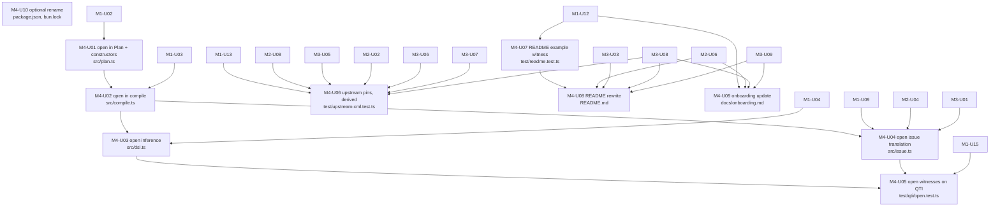

# Delivery: xml-schema-codec, milestone 4 (promise and package)

Lowered from `GOAL.md` (goal-check READY on `160f1db`; owner answers folded on `e63871e`) by the planner on handle `6006a350`, 2026-11-05, against commit `d20cd96`; revised on handle `b76273c5` per delivery audit `12e83528` (eleven findings and one Mind ruling, F6) against `ce0a251`. Builds on `phase-1.md` as revised through `261cfdf` (`inlineNames(def)`, `Plan`/`planOf` private), `phase-2.md` as revised through `ce0a251` (units `M2-U01` to `M2-U08`), and `phase-3.md` at `5766156` (units `M3-U01` to `M3-U11`), none of which it redefines or widens. Rulings in `docs/rd/decisions.md` are binding. Every command below was run as written on `ce0a251` and its output pasted. Corrected on handle `237df403` per the strategic review (`docs/rd/strategic-review.md` at `79c370f`; C1, C3, C8): lock 3, lock 4, M4-U04, M4-U08, and the exclusion list with its check loop (the loop was re-run on `79c370f`). Corrected on handle `6418eee3` per aggregate slice audit `f2edd498` (F1): M4-U05 obtains the input tree for its canonical check through `src/resolve.ts` in the test file, as M1-U15 does. No ruling is reopened and no unit id changes.

## Interpreted Unit

Milestone 4 of the goal: the promise text and the package posture. The library's public claims become durable, verified documents, the one content-mode option milestone 1 deferred lands, and the upstream canary covers every event shape the modules rely on. Nothing is published.

In scope (from `GOAL.md` "Implementation Shape" M4, "Release Posture", and the Mind's assignment):

- `README.md` rewritten per the `readme-authoring` skill (with its `references/examples.md` and `references/exemplars.md`): the DSL with one real QTI-shaped example, the round-trip exclusion list (D1, C5), the two-row positions table (T2, R7), the limits and their defaults (T5, R5), the canonical comparator as exported, the pinned peer range and the canary rule
- `open` content mode (D3, D12): milestone 1 deferred it (`phase-1.md` "Interpreted Unit": the four acceptance fixtures enumerate 29 elements and need no `open`); it lands here on `elements` and `mixed` only (Mind ruling on audit `12e83528`, F6: `open` is a property of the child-bearing modes; `empty` and `text` have no child slot), proven on real fixtures that carry elements outside the M1 vocabulary
- `test/upstream-xml.test.ts` extended with every upstream event shape a `src/` module relies on, the list command-derived from `src/` imports
- `docs/onboarding.md` source map and status updated to the shipped tree
- `package.json`: stays `"private": true` at `0.0.0`; renaming `name` to `@aidenzepp/effect-xml` is one optional unit the owner can skip (D10)

Out of scope here: any publish, tag, version bump, or registry action (D10, goal stop condition); comment or PI preservation (D8); the upstream feature request (owner decision 2, a separate Mind assignment); corpus corrections in `docs/rd/` (`decisions.md` "Corpus corrections" list, a docs Hand outside this milestone); `AGENTS.md` (no claim in it changes); the fixture-corpus relocation (goal open question 1, Mind's call at archival); `xsi:type`, camelCase keys, the annotated-Struct producer, `elements`-mode order validation (R10, R8, R1, R3).

Sequencing against milestones 2 and 3: `phase-2.md` (`a591d01`, revised `ce0a251`) and `phase-3.md` (`5766156`) are committed, so the four units that share a file with, or document, an M2 or M3 unit carry those unit ids as `depends_on` edges: `M4-U04` (`src/issue.ts` after `M2-U04` and `M3-U01`), `M4-U06` (`test/upstream-xml.test.ts` after `M2-U08` and `M3-U05`; the symbols it derives from `src/positions.ts`, `src/resolve.ts`, and `src/codec.ts` land in `M2-U02`, `M3-U06`, `M3-U07`, and `M3-U08`), `M4-U08` and `M4-U09` (positions in `decodeString` from `M2-U06`, `defaultMaxElementNodes` in `src/resolve.ts` from `M3-U03`, the stream path from `M3-U08`, and the `decode`, `Limit`, and `defaultMaxElementNodes` exports from `M3-U09`). No prose precondition remains; the edges are in the graph.

## Normalized Spec

Done means: on the integrated tree, `bun run check`, `bun run build`, and `bun run test` are green; `README.md` passes the readme-authoring ownership test and the checks in "Checkpoints And Gates"; `open` decodes and re-encodes `bg011-media.xml` (mixed) and `conformance-adaptive-absent.xml` (elements) through definitions built from the M1 vocabulary; `test/upstream-xml.test.ts` names, in a comment per pin, the `src/` module that relies on each shape, and the set of `Xml.*` symbols used by non-test `src/` is a subset of the shapes pinned; `docs/onboarding.md` describes the shipped tree; `package.json` is still private at `0.0.0`. Goal acceptance criterion 6 closes in full (the README lists the exclusions, so C5 = 5); criterion 10 extends to the `open` member (effect-design justification in its doc comment); R5 and R7 are discharged by the README.

Derived locks (consequences of the rulings plus the verified union semantics below; a Hand follows them without re-deriving):

1. **`open` is an option on `elements` and `mixed` only (Mind ruling on audit `12e83528`, F6; `head-cto` confirms at the strategic review).** `elements(fields, { open: true })` and `mixed(members, { open: true })`. `open` is a property of the child-bearing content modes; `empty` and `text` have no child slot and carry no flag. An author who wants an open element with no declared children writes `elements({}, { open: true })` or `mixed([], { open: true })`; D12 defines `open` as "a generic resolved-element member to a `mixed` union or `elements` group", and those two forms are exactly that. `GOAL.md` line 17 is amended in this revision to say so; D3's "each with an `open` option" wording in `docs/rd/decisions.md:107` is superseded by the ruling and is a corpus correction outside this spec's write scope. The `Plan`'s `ContentPlan` for both modes carries `open: boolean`. No `open` for attributes: an unknown attribute stays an issue naming the declared set (goal C2), and `data-*` is the pattern group.
2. **Decoded shape of the generic member.** In `mixed`, an unknown child decodes to the item `{ _tag: "*", element: ResolvedElement }`; in `elements`, unknown children decode to the slot `"*"` holding `ReadonlyArray<ResolvedElement>` in document order among themselves. `*` is not an XML `NameStartChar`, so it can collide with no authored member name or slot key, and it is the wildcard `collect` already uses for a record path (`phase-1.md` M1-U07). The element is the `ResolvedElement` the collector produced (Clark names, whitespace children intact); nothing inside it is validated. On encode, open `elements` writes the declared slots in slot order as M1 does (`phase-1.md` M1-U03: slot order, not document order) and then the `"*"` slot's elements in their stored order, after every declared slot; open `mixed` writes items in array order, the `*` items among them.
3. **Encoded side of the generic `mixed` member is guarded and last.** The member's `From` is `Schema.Struct({ name: Schema.String.check(<not a declared member name>), attributes: Schema.Record(Schema.String, Schema.String), children: Schema.Array(Schema.Union([Schema.String, ResolvedElementSchema])) })`, appended after every named member. A union holding both a `suspend` member and the guard has two fallbacks, tried in declaration order: `compile` orders `suspend` members after the named ones (`phase-1.md` M1-U03) and the guard after them, so the guard stays last (strategic review C8). This is forced by `effect@4.1.2`'s union dispatch, read at `SchemaAST.ts:3515-3647` and `:3928-3950`: a member without a literal sentinel is a runtime-type fallback that is selected for every object input (`:3602`), an unknown sentinel value selects only the fallbacks (`:3613`), candidates are tried in declaration order and the first success wins (`:3647`, `parseUnion` `step`). Without the guard a declared member that fails (bad `max-choices`) would fall through to the generic member and the failure would vanish. With it, an unknown name reaches the generic member alone (one candidate, no `AnyOf`), and a declared name that fails produces an `AnyOf` holding the declared member's issue plus the guard's, which M1-U09's name-match rule drops (lock 4). The check's filter is the public `Schema.makeFilter` (`Schema.ts:6761-6765`; `SchemaAST.makeFilter` at `SchemaAST.ts:4231` is `@internal` and C9 forbids it) applied through `Schema.String.check` (`Schema.ts:212`), with an `expected` annotation (`Annotations.Filter`, `Schema.ts:19137`) that names the declared set so the issue is recognisable.
4. **Issue translation under `open` (M1-U09's rule, proven under the guard).** `translate` (M1-U09 as corrected by strategic review C1) already resolves an `AnyOf` at a `mixed` index whose input is an element by name match: it keeps the branch of the member whose `Plan` name equals the element's Clark name, drops every other branch (a `suspend` member's mismatch, the guard's `expected` issue), and when no member matches emits one issue naming the child's Clark name and the member set (the closed-`mixed` unknown-child case, `SchemaAST.ts:3904`, lives in M1 now; an unknown child in closed `elements` keeps M1's message naming the expected set). Under `open` the guard's issue is one more non-matching branch the same rule drops, and an unknown child reaches the generic member alone and is not an issue, so U04 adds no translation rule: it proves the M1 rule with the guard in the union and under `open`, and edits the `AnyOf` branch only if the measurement shows the guard's issue is not attributed to the generic member. The sibling-index rule is unchanged: an unknown element counts among same-named siblings for `local[k]` like any other.
5. **`elements` mode under `open` needs no union.** The compiler's child grouping (the seam at `spikes/declaration-dsl/element-codec.ts:199-208`, where an unknown child fails today) routes an unknown child to the `"*"` slot instead. Whitespace rules are unchanged: whitespace-only text is still dropped in `elements` and kept in `mixed` (`phase-1.md` lock 8).
6. **Encode of a generic member is verbatim.** `toEvents` (M1-U08) walks the `ResolvedElement` as it walks any other; namespaces of unknown elements are Clark names resolved on decode, so the prefix chooser declares `xmlns` on the element when nothing in scope binds the namespace (`phase-1.md` lock 7), and a namespaced attribute with no prefix fails `UnmappedNamespace` as today. The canonical comparator treats unknown elements as outside the inline set (whitespace-only children dropped on both sides), so `canonicalize(encode(decode(f))) === canonicalize(f)` holds for the two open fixtures.
7. **README owns the promise, not the mechanism.** Per the readme-authoring ownership test, the README states what a consumer relies on from outside: install, the first call, the contract surface, the round-trip exclusions, the two position sources, the limits and defaults, the error shape in one sentence, the peer range and the canary rule, where agents start. It has no module map, no diagram of the pipeline, no `Plan` or `Channel` vocabulary, no status table. 200 to 600 words of paragraph prose outside code blocks, tables, and list items (the readme-authoring budget; the exclusion list and the facts list are bullets and are counted by their own checks, not by the word budget).
8. **The README example is a test first, and it runs.** `test/readme.test.ts` holds the example between `// readme:start` and `// readme:end` as top-level statements that run the three calls and print their results; the file's imports sit above the region (the test imports `../src/index.ts`, a consumer imports `effect-xml`). The README's first `ts` code block is the consumer import lines (`from "effect-xml"`, `from "effect"`) followed by that region byte for byte; the diff command in "Checkpoints And Gates" strips the block's `^import ` lines before comparing, and a second command checks that every import line in the block names `effect-xml` or `effect`. The example is a `qti-choice-interaction` with a prompt and two `qti-simple-choice` children decoded from a literal string under `namespaces({ "": QTI })`, re-encoded, and failed once with `max-choices="x"` so the printed path appears in the README.
9. **Package posture.** `"private": true` and `"version": "0.0.0"` are invariants of every M4 commit; no `publish`, `prepublishOnly`, or `release` script is added. The optional rename changes `name` only and refreshes `bun.lock`'s root workspace entry in the same commit.

## Repo-Aware Baseline

Checkout and package posture (`ce0a251`):

```text
$ git log --oneline -1 HEAD
ce0a251 docs(goals): revise the milestone 2 spec per delivery audit
$ grep -n '"name"\|"version"\|"private"' package.json
2:  "name": "effect-xml",
3:  "version": "0.0.0",
4:  "private": true,
$ grep -c "publish" package.json
0
$ sed -n '5,6p' bun.lock
    "": {
      "name": "effect-xml",
$ ls LICENSE 2>&1; grep -c '"license"' package.json
ls: LICENSE: No such file or directory
0
```

No `LICENSE` file and no `license` field exist, so the README has no License section (readme-authoring: leave out any part with nothing true to say); choosing a license is an owner decision before publishing and is recorded under "Open Questions".

The README as it stands (141 words of prose, no list items; a stub that says the API is undesigned and the name is open, both now false):

````text
$ awk '/^```/{f=!f;next} !f && !/^\|/ && !/^- /' README.md | wc -w | tr -d ' '
141
$ grep -cE "\b(Plan|Channel|resolver)\b|[Ii]nternally|[Uu]nder the hood" README.md
0
$ for t in "attribute order" "prefix" "slot order" "quote" "entity" "self-closing" "CDATA" "comment" "processing instruction" "declaration" "whitespace" "DOCTYPE" "@aidenzepp/effect-xml" "positions: true" "maxElementNodes" "canonicalize"; do printf '%-24s %s\n' "$t" "$(grep -ci -- "$t" README.md)"; done
attribute order          0
prefix                   0
slot order               0
quote                    0
entity                   0
self-closing             0
CDATA                    0
comment                  0
processing instruction   0
declaration              0
whitespace               0
DOCTYPE                  0
@aidenzepp/effect-xml    0
positions: true          0
maxElementNodes          0
canonicalize             0
````

The same loop is the README's close check: every count is at least 1 after M4-U08. The red-flag grep uses word boundaries (`\b`) on the capitalised vocabulary words and case variants on the two phrases, so `explanatory` and `planned` do not count; it prints `0` before and after.

The exclusion list the README publishes, assembled from the three rulings it must cover (a Hand copies the union, not one source): `GOAL.md` "Constraints And Invariants" (attribute order, prefix spelling, quote style, entity forms, self-closing form, CDATA boundaries, comments, PIs, declaration, whitespace outside `mixed`/`text`, attribute-value whitespace normalisation, and child order across different element names in `elements` mode, since encode writes the declared slot order: D1 as amended by the strategic review, C3); `spikes/namespaces/RESULT.md:81` (where `xmlns` declarations sit); `spikes/round-trip/RESULT.md:11,76` (whitespace outside the root, intra-tag whitespace of multi-line start tags, DOCTYPE). Evidence for the reader lives in the SPIKE-03 loss table (`spikes/round-trip/RESULT.md:53-70`: 0 of 16 fixtures byte-identical on either path; `Xml.encodeString` never self-closes, `Xml.ts:471-472`) and in upstream's attribute normalisation (`Xml.ts:730`, XML 1.0 3.3.3; `bg007-true-false.xml:5` carries the multi-line `xsi:schemaLocation` that loses its line break):

```text
$ grep -n "xsi:schemaLocation" spikes/fixtures/qti/bg007-true-false.xml
5:xsi:schemaLocation="http://www.imsglobal.org/xsd/imsqtiasi_v3p0
```

The two-row positions table the README reproduces (T2; R7 names the README as its owner):

```text
$ sed -n '42,45p' docs/rd/decisions.md
| Entry point                                                   | Text retained? | Position source                              | Default                |
| ------------------------------------------------------------- | -------------- | -------------------------------------------- | ---------------------- |
| Decode from a string (tree mode or `elements` over a string)  | yes            | post-hoc locate (SPIKE-07 C) on failure only | on                     |
| Decode from a byte or chunk stream (`Xml.decode`, per-record) | no             | opt-in position channel (SPIKE-07 B)         | off, `positions: true` |
```

The limits and defaults the README states (T5; R5 names the README as the place the measured default is published). The inherited three are upstream constants; `maxElementNodes` is the value M3 ships after its measurement, read from `src/resolve.ts` at the time, never from this document:

```text
$ grep -n "^const defaultMax" node_modules/effect/src/encoding/Xml.ts
548:const defaultMaxTokenSize = 10 * 1024 * 1024
549:const defaultMaxDepth = 1024
550:const defaultMaxElementSize = 16 * 1024 * 1024
```

Upstream pins today, and the derivation M4-U06 runs once `src/` exists (empty now because `src/index.ts` is the only module; the invariant is "every symbol the command prints has a pin whose comment names the module"):

```text
$ grep -c "it.effect" test/upstream-xml.test.ts
1
$ grep -rhoE "Xml\.[A-Za-z]+" src --include="*.ts" --exclude="*.test.ts" | sort | uniq -c | sort -rn
$ bun x vp test test/readme.test.ts; echo exit=$?
No test files found, exiting with code 1
exit=1
```

(The `vp test` output above is trimmed to its verdict lines; a filter matching no file exits 1, so no sanity command below can be green on nothing.)

Onboarding sentences that become false when M1 lands and M4 fixes:

```text
$ grep -nE "not yet implemented|currently empty|being written concurrently" docs/onboarding.md | cut -c1-80
3:`effect-xml` is an Effect-native library for reading and writing XML. This page
58:| `src/index.ts`             | The single published entry point (currently empty)
118:The evidence trail lives in two places. `docs/rd/` holds the R&D corpus: `README
```

Fixtures that carry elements outside the 29-element M1 vocabulary (`phase-1.md` "Repo-Aware Baseline"), which is what makes them the `open` witnesses. `bg011-media.xml` holds `video` (with `source` and `track`) as a direct child of the `mixed` `qti-item-body`; `conformance-adaptive-absent.xml` holds `qti-set-outcome-value`, `qti-sum`, `qti-base-value`, `qti-variable` under `qti-response-processing`, which the M1 vocabulary declares attribute-only, and has no `qti-item-body` (fixture attribute values in the printed lines are elided as `…`):

```text
$ M1="blockquote br div img math mfenced mi mn mo mrow object p qti-assessment-item qti-choice-interaction qti-correct-response qti-default-value qti-extended-text-interaction qti-hotspot-choice qti-hotspot-interaction qti-item-body qti-map-entry qti-mapping qti-outcome-declaration qti-prompt qti-response-declaration qti-response-processing qti-simple-choice qti-text-entry-interaction qti-value"; for f in bg011-media conformance-adaptive-absent; do echo "$f: $(grep -oE '<[A-Za-z][A-Za-z0-9:_.-]*' spikes/fixtures/qti/$f.xml | sed 's/^<//' | sort -u | grep -vxF -f <(echo $M1 | tr ' ' '\n') | tr '\n' ' ')"; done
bg011-media: source track video
conformance-adaptive-absent: qti-base-value qti-set-outcome-value qti-sum qti-variable
$ grep -nE "<(video|qti-item-body|qti-response-processing)[ >]" spikes/fixtures/qti/bg011-media.xml spikes/fixtures/qti/conformance-adaptive-absent.xml
spikes/fixtures/qti/bg011-media.xml:13: <qti-item-body>
spikes/fixtures/qti/bg011-media.xml:18:  <video …>
spikes/fixtures/qti/conformance-adaptive-absent.xml:8:  <qti-response-processing>
```

Union dispatch facts lock 3 rests on (`effect@4.1.2`, `node_modules/effect/src/SchemaAST.ts`):

```text
$ grep -nE "^export function getCandidateIndex|Non-discriminated candidates are runtime-type fallbacks|if \(!match\) return getFallback|return Array.from\(selected\).sort|^const parseUnion = iterateEager|^export function collectSentinels|^export function makeFilter<" node_modules/effect/src/SchemaAST.ts
3453:export function collectSentinels(ast: AST): ReadonlyArray<Sentinel> {
3515:export function getCandidateIndex(types: ReadonlyArray<AST>): CandidateIndex {
3602:      // Non-discriminated candidates are runtime-type fallbacks and are never removed by sentinel checks.
3613:          if (!match) return getFallback(runtimeType)
3647:      return Array.from(selected).sort((a, b) => a - b)
3928:const parseUnion = iterateEager<UnionParserState, number>()({
4231:export function makeFilter<T>(
$ sed -n '3903,3905p' node_modules/effect/src/SchemaAST.ts
  if (!eff) {
    if (state.out) return state.out
    return Effect.fail(new SchemaIssue.AnyOf(ast, state.issues ?? [], input, options))
$ grep -nE "^export const makeFilter" node_modules/effect/src/Schema.ts; sed -n '19137p' node_modules/effect/src/Schema.ts
6761:export const makeFilter: <T>(
    readonly expected?: string | undefined
$ sed -n '212p' node_modules/effect/src/Schema.ts
  check(...checks: readonly [SchemaAST.Check<this["Type"]>, ...Array<SchemaAST.Check<this["Type"]>>]): this["Rebuild"]
```

`SchemaAST.ts:4226-4231` marks `makeFilter` `/** @internal */`; `Schema.ts:6761` is the public alias the units cite (F4).

Spike seams the `open` units extend by shape (never by import): `spikes/declaration-dsl/element-codec.ts:102-131` (mixed item tagging; the generic member follows `memberItem`, `:109-120`), `:199-208` (the `elements`-mode unknown-child branch), `spikes/declaration-dsl/xml-dsl.ts:60-100` (`Content`, `ChildrenType`, `ContentType`, which gain the `open` branch), `:107-122` (`elements`/`mixed` constructors, which gain the options argument).

Skills a Hand loads per unit: `readme-authoring` (M4-U08; it requires the `technical-writing` and `emil-unslop-writing` skills), `document-code` and `effect-design` (M4-U01 to M4-U04), `conventional-commits` (every unit).

## Unit Graph



Parallel waves (write surfaces disjoint within a wave): wave 0 `U01 U06 U07 U10`; wave 1 `U02 U08 U09`; wave 2 `U03 U04`; wave 3 `U05`. `U04`, `U06`, `U08`, `U09` additionally wait on their M2 and M3 edges (named per unit; the backlog carries them as `--depends-on`). Longest chain: `U01 → U02 → U03 → U05` (4 units; `U01 → U02 → U04 → U05` ties).

## Implementation Work

Standing requirements inherited by every unit (named once, not copied): those of `phase-1.md` "Implementation Work" (Effect error channels; the gates belong to the verify seat; kebab-case; relative imports; `@effect/vitest` with `it.effect`; fixtures read by path from `spikes/fixtures/qti/`; no import from `spikes/`; `bun x vp test <file>` exits 1 on a missing file), plus: M4 units that touch an M1 file append to it or edit the named seam and never rename or re-shape an M1 export; `document-code` doc comments on every new unit, and the `effect-design` justification on the generic member (the Effect API checked is `Schema.Union` candidate selection, `SchemaAST.ts:3515-3647`; the requirement it misses is a member that accepts any element without masking a declared member's failure). Commit prefixes: `feat(<module>):` for U01 to U04, `test:` for U05 to U07, `docs:` for U08 and U09, `chore(package):` for U10.

### M4-U01 `open` in the Plan and the content constructors

- id: `M4-U01`
- outcome: `elements` and `mixed` accept `{ open: true }`; the `Plan` records it.
- write_scope: `src/plan.ts`, `src/plan.test.ts`
- edit: add an optional second argument `options?: { readonly open?: boolean }` to `elements(fields, options)` and `mixed(members, options)` (`xml-dsl.ts:107-114` shape); the `Elements` and `Mixed` spec interfaces carry `readonly open: boolean` (default `false`); `ContentPlan` for both modes carries `open: boolean`; `lower` copies it. `empty` and `text` are unchanged and gain no `open` option (lock 1, Mind ruling on audit `12e83528`); the doc comment on the options argument says an open element with no declared children is `elements({}, { open: true })` or `mixed([], { open: true })`.
- done_when: `lower` of `elements({}, { open: true })` and of `mixed([], { open: true })` yields `ContentPlan`s with `open: true`; without the option both yield `open: false`; `lower` of the benchmark `qti-item-body` spec (M1-U02's done-when) is unchanged, which the existing `src/plan.test.ts` cases prove by still passing.
- depends_on: `M1-U02`
- sanity: `bun x vp test src/plan.test.ts`
- non_goals: the generic member's schema (U02); typing (U03); `open` on `text`/`empty` (lock 1); `open` for attributes.
- risk: low.
- integrable: yes

### M4-U02 `open` in the compiler

- id: `M4-U02`
- outcome: `compile` emits the generic member for open `mixed` and the `"*"` slot for open `elements`.
- write_scope: `src/compile.ts`, `src/compile.test.ts`
- edit: in the `mixed` branch, when `content.open`, append the guarded generic member of lock 3 after the named members, tagging it `{ _tag: "*", element }` on decode and unwrapping on encode (after `memberItem`, `element-codec.ts:109-120`); the guard's filter rejects any `name` equal to a declared member's Clark name, with `expected` naming the declared set. In the `elements` branch, when `content.open`, route a child whose name is not a declared slot into `out["*"]` (document order) instead of failing (`element-codec.ts:199-208`); when `open` is false the M1 behaviour is untouched; the target Struct gains the `"*": Schema.Array(ResolvedElementSchema)` field only when `open`. Encode of a `"*"` slot writes its elements after every declared slot, in stored order (lock 2); encode of a `*` item writes the `ResolvedElement` at its array position, unchanged. The guard is `Schema.String.check(Schema.makeFilter(...))` with `expected` set (lock 3; `Schema.ts:6761`, `:19137`). Doc comment carries the effect-design justification and cites `SchemaAST.ts:3602`, `:3613`, `:3647`.
- done_when (hand-built `ResolvedElement` values, no XML parsing): open `mixed` with members `[P]` decodes `<video>` to a `*` item carrying the element and encodes it back equal; closed `mixed` still rejects `<video>` with M1's message; open `mixed` with a declared `<p max-choices="x">`-style failure (a member with an `Int` attribute given `"x"`) yields a failure, never a `*` item, and the `SchemaIssue` tree contains the declared member's leaf issue (this is the lock 3 measurement; if the generic member captures a declared name despite the guard, stop and report the measured case: the fallback is a `Plan`-driven member selector, a design change the Mind approves, as in R2); an unknown name in open `mixed` produces no `AnyOf` (single candidate); open `elements` with slots `{ a }` decodes `<a/><z/><y/>` to `{ a, "*": [z, y] }` and encodes `{ a, "*": [z, y] }` to children `a, z, y` (declared slots first, then the `"*"` slot in stored order; from `{ a, "*": [y, z] }` the order is `a, y, z`); closed `elements` still fails on `<z/>` naming the expected set; whitespace-only text is still dropped under open `elements` and kept under open `mixed`.
- depends_on: `M4-U01`, `M1-U03`
- sanity: `bun x vp test src/compile.test.ts`
- non_goals: type inference (U03); path translation (U04); any change to closed-mode behaviour.
- risk: medium; the guard is the one mechanism no spike ran, and it is verified here by source reading only.
- integrable: yes

### M4-U03 `open` inference

- id: `M4-U03`
- outcome: `typeof Def.Type` reflects `open` content.
- write_scope: `src/dsl.ts`, `src/dsl.test.ts`
- edit: extend the type-level mapping copied in M1-U04: `MixedItem` gains `{ readonly _tag: "*"; readonly element: ResolvedElement }` when the spec is `Mixed<M, true>`; `ChildrenType` gains `readonly "*": ReadonlyArray<ResolvedElement>` when the spec is `Elements<F, true>`; closed specs infer exactly as before. The `elements`/`mixed` overloads in `src/plan.ts` already carry the flag in their return type from U01; U03 only threads it.
- done_when: `expectTypeOf` cases: open `mixed` `_tag` union is the member names plus `"*"` and narrows exhaustively; closed `mixed` has no `"*"`; open `elements` has the `"*"` key typed as `ReadonlyArray<ResolvedElement>` and closed `elements` has no such key (`@ts-expect-error` on access); the M1 `src/dsl.test.ts` type cases still hold; recursion through `suspend` with an open member compiles.
- depends_on: `M4-U02`, `M1-U04`
- sanity: `bun x vp test src/dsl.test.ts` (type-level assertions are confirmed by the verify seat's `bun run check`; the Hand may run `bun x vp check src/dsl.ts src/dsl.test.ts` once, as M1-U04 does, and says so)
- non_goals: runtime behaviour; a consumer-facing type alias for the generic item beyond what `ResolvedElement` already exports.
- risk: low.
- integrable: yes

### M4-U04 `open` issue translation

- id: `M4-U04`
- outcome: `translate`'s name-match resolution (M1-U09) holds with the guard in the union and under `open`; no new rule unless the measurement finds one (lock 4).
- write_scope: `src/issue.ts`, `src/issue.test.ts`
- edit: check-first. M1-U09 landed the general `AnyOf` rule (`phase-1.md` M1-U09; slice m1-23): drop the non-matching branches by `Plan` name, one named issue when nothing matches. With M4-U02's guard in the union the guard's `expected` issue is one more non-matching branch. Add the open-body cases below to `src/issue.test.ts`; if they pass, the unit is test-only and the report says so. Only if the guard's issue is not dropped (its filter issue on the `name` key may be attributed to the input element rather than to the generic member) add that attribution to the `AnyOf` branch of `translate`, and nothing else. The file by then carries `M2-U04`'s `position` and `M3-U01`'s `Limit`; touch neither.
- done_when: with definitions built by `compile(lower(...))` in the test: `max-choices="x"` on `qti-choice-interaction` inside an open `qti-item-body` yields one `XmlDecodeError` whose `path` is `/qti-assessment-item/qti-item-body/qti-choice-interaction/@max-choices` and whose message names a finite number, identical in `path` and `reason._tag` to the closed-body case in M1-U09; a bad attribute on the second of two `<p>` inside an open body prints `p[2]`; the same two cases with a `suspend` member also in the open union (two fallbacks, `suspend` then guard, lock 3) give the same results; an unknown `<video>` inside an open body produces no error; the M1 `src/issue.test.ts` cases (M1-U09's closed-`mixed` `video[1]` case included) and the `M2-U04` and `M3-U01` cases still pass.
- depends_on: `M4-U02`, `M1-U09`, `M2-U04` and `M3-U01` (same file; serialized)
- sanity: `bun x vp test src/issue.test.ts`
- non_goals: positions; message wording; re-deriving the closed-mode rule (M1-U09 owns it).
- risk: low-medium; test-first against a rule M1 already landed; the one open question is the attribution of the guard's filter issue.
- integrable: yes

### M4-U05 `open` witnesses on real QTI

- id: `M4-U05`
- outcome: both open modes proven end to end on fixtures the closed vocabulary cannot decode.
- write_scope: `test/qti/open.test.ts`
- edit: check first: `grep -cE "^export (const|function) " test/qti/vocabulary.ts` lists the exported declarations, and every member this unit imports must be among `grep -E "^export " test/qti/vocabulary.ts` (M1-U15 requires no exports); if a needed member is not exported, stop and file a need naming it rather than editing `vocabulary.ts`. Then: new cross-module test importing `test/qti/vocabulary.ts` members and `../../src/index.ts`, plus `resolveEvents` and `collect` from `../../src/resolve.ts` for the canonical check (as M1-U15's test does: `canonicalize` takes a `ResolvedElement` and the resolver is not exported, M1-U12; a cross-module test under `test/` may import it, `vocabulary.ts` may not), leaving `vocabulary.ts` untouched (its closed subset is the C8 measurement). Define locally: `OpenItemBody = element("qti-item-body", { attributes: { "data-*": ... }, content: mixed([<the M1 members>], { open: true }) })`; `OpenResponseProcessing = element("qti-response-processing", { attributes: { template: Schema.optionalKey(Schema.String) }, content: elements({}, { open: true }) })`; an `OpenAssessmentItem` root reusing the M1 declarations with `body: optional(OpenItemBody)` (the conformance fixture has no body) and `responseProcessing: optional(OpenResponseProcessing)`.
- done_when: `decodeString(OpenAssessmentItem)` on `bg011-media.xml` succeeds; its body items include exactly one `_tag: "*"` item whose `element.name` is the QTI-namespace Clark name of `video` and whose children hold two `source` and one `track` (names checked by Clark string, counted from the value, not hard-coded from this document); a renderer narrows the body `_tag` union exhaustively including `"*"`; `encodeString` then `decodeString` yields a deep-equal value and the re-encoded tree is canonically equal to the input tree (the input tree via `Xml.decodeString()` + `resolveEvents()` + `collect(["*"])`, the output via `Schema.encodeEffect(OpenAssessmentItem)`; `canonicalize` with `inlineNames(OpenAssessmentItem)`; `inlineNames` takes the definition, `phase-1.md` M1-U10, and `planOf` is private, M1-U12); `decodeString(OpenAssessmentItem)` on `conformance-adaptive-absent.xml` succeeds with `responseProcessing["*"]` non-empty and round-trips the same way; the closed `AssessmentItem` from `vocabulary.ts` fails `bg011-media.xml` with one `XmlDecodeError` whose path ends at the body's `video[1]` and whose message names `video` and the member set (the U04 closed-`mixed` case, the contrast that proves `open` did the work).
- depends_on: `M4-U03`, `M4-U04`, `M1-U15`
- sanity: `bun x vp test test/qti/open.test.ts`
- non_goals: editing `vocabulary.ts` (importing `../../src/resolve.ts` in the test file is allowed and is not an edit to it); decoding the other fixtures with unknown elements (`choice-feedback.xml`, `hottext.xml`, `imsmanifest.xml`, `test-features.xml`, `text-and-media.xml`, `pci-shaded-grid.xml`, `text-entry-cloze.xml`, `conformance-read-by-a-rule.xml`); open attributes.
- risk: low-medium; first consumer-shaped use of `open`.
- integrable: yes

### M4-U06 upstream pins, command-derived

- id: `M4-U06`
- outcome: `test/upstream-xml.test.ts` pins every upstream shape a shipped `src/` module relies on, with the list derived from the tree, not from memory.
- write_scope: `test/upstream-xml.test.ts`
- edit: run the derivation on the integrated tree after M3 and paste its output in the commit body:
  `grep -rhoE "Xml\.[A-Za-z]+" src --include="*.ts" --exclude="*.test.ts" | sort | uniq -c | sort -rn`
  and, for the contracts that are not symbols, `grep -rnE "Xml\.ts:[0-9]+" src --include="*.ts" --exclude="*.test.ts"` (every `Xml.ts:<line>` citation in a `src/` doc comment is a reliance). This unit is a derivation plus a per-pin comment audit over the pins `M1-U13`, `M2-U08`, and `M3-U05` landed; it adds no shape those units already pin. For each distinct symbol the derivation prints and each cited contract, confirm a pin exists whose one-line comment names the relying module; where the comment names a unit (`M2-U08` and `M3-U05` name units) rewrite it to name the module too; add a pin only for a symbol or contract no existing pin covers, against literal strings with no fixtures.
- done_when: the derivation output is in the commit body; every distinct `Xml.<symbol>` it prints appears in at least one pin's comment with its module; the file's `it.effect` count equals the count at `M3-U05`'s close plus one per symbol or contract the derivation printed that no landed pin covered (the Hand pastes `grep -c "it.effect" test/upstream-xml.test.ts` before and after, and the list of added pins, possibly empty).
- depends_on: `M1-U13`, `M2-U08`, `M3-U05` (same file; serialized), `M2-U02`, `M3-U06`, `M3-U07`, and `M3-U08` (the `src/positions.ts`, `src/resolve.ts`, and `src/codec.ts` symbols the derivation reads; `M3-U07` and `M3-U08` are the last M3 writers of `src/` after `M3-U06`)
- sanity: `bun x vp test test/upstream-xml.test.ts`
- non_goals: pinning `Xml.elements` (the core does not route through it; R4 is a re-read at each `effect` bump, not a pin); fixture-driven cases.
- risk: low.
- integrable: yes

### M4-U07 README example witness

- id: `M4-U07`
- outcome: the README's example exists as a passing test before the README quotes it.
- write_scope: `test/readme.test.ts`
- edit: new test whose library imports come only from `../src/index.ts` (consumer-shaped) plus `Effect` and `Schema` from `effect`, all above the region. Between `// readme:start` and `// readme:end`: `const QTI = "http://www.imsglobal.org/xsd/imsqtiasi_v3p0"`, `const { element } = namespaces({ "": QTI })`, `SimpleChoice` (`identifier` string, `text` content), `Prompt` (`text`), `ChoiceInteraction` (`"response-identifier"`, `"max-choices": Schema.Int`, `elements({ prompt: optional(Prompt), choices: many(SimpleChoice) })`), a literal `xml` string of a `qti-choice-interaction` with a prompt and two choices under `xmlns="..."`, then three statements that run and print: `const value = Effect.runSync(decodeString(ChoiceInteraction)(xml))` followed by `console.log(value)`; `const text = Effect.runSync(encodeString(ChoiceInteraction)(value))`; `const failure = Effect.runSync(Effect.flip(decodeString(ChoiceInteraction)(xml.replace('max-choices="1"', 'max-choices="x"'))))` followed by `console.log(failure.message)`. The region is plain top-level statements a README reader can paste under the two consumer import lines; it holds no `import`, no `it`, and no `expect`; assertions on `value`, `text`, and `failure` sit outside the markers. Keep the region under 40 lines.
- done_when: the decoded value has `"max-choices"` equal to `1` (number) and two choices in order; the encoded text decodes again to a deep-equal value; the failure's `path` is `/qti-choice-interaction/@max-choices` and its message names a finite number; `awk '/readme:start/{f=1;next} /readme:end/{f=0} f' test/readme.test.ts | wc -l` prints a number between 1 and 40 and `awk '/readme:start/{f=1;next} /readme:end/{f=0} f' test/readme.test.ts | grep -cE '^import |\b(it|expect)\('` prints `0` (the Hand pastes both); the Hand pastes the two printed lines from `bun x vp test test/readme.test.ts` in the commit body, since U08 quotes them.
- depends_on: `M1-U12`
- sanity: `bun x vp test test/readme.test.ts`
- non_goals: `open`, positions, streaming in the example; a second example.
- risk: low.
- integrable: yes

### M4-U08 README rewrite

- id: `M4-U08`
- outcome: `README.md` is the front page the readme-authoring skill describes, carrying the promise text the goal's Release Posture names as the release-prep artifact.
- write_scope: `README.md`
- edit: follow the `readme-authoring` skill in order: read `references/examples.md` and `references/exemplars.md`, fetch two exemplars live, draft, run the ownership test on every sentence, run `technical-writing` and `emil-unslop-writing` over the draft, verify every claim against the tree. Reader: a developer or agent landing cold who will define an XML vocabulary and decode documents with it; the README owns install, the first call, the contract surface, and the guarantees; the code and tests own how. Sections, in the skill's order, with what each must contain here:
  - the name as the only h1; one sentence; one boundary paragraph: well-formed XML only, UTF-8 input, Effect Schema values both directions, no DTD/XSD validation, no comments or PIs in the model, status in one clause (unpublished; publishes later as `@aidenzepp/effect-xml`; `effect/encoding/Xml` is experimental upstream)
  - links out: `docs/onboarding.md`, `AGENTS.md`, `docs/goals/xml-schema-codec/GOAL.md`
  - Install: from a checkout only (`bun install --frozen-lockfile`, Bun `1.4.2` from `packageManager`), and the peer requirement `effect@^4.1.2`; no registry install line exists yet and none is written
  - Start: the `ts` block is two import lines, `import { Effect, Schema } from "effect"` and the named imports `from "effect-xml"` that the region uses, followed by the `test/readme.test.ts` region verbatim (lock 8); then the printed typed value and the one-line error in a `console` block, copied from the U07 commit body
  - the contract surface: a table with one line each for `element`, `namespaces`, `suspend`, `text`, `elements`, `mixed`, `many`, `optional`, `decodeString`, `encodeString`, `decode` (per-record stream), `canonicalize`, `inlineNames`, `XmlDecodeError`/`XmlEncodeError`; below it the facts a reader relies on: wire-name keys, `data-*` as a pattern group, unknown attributes refused, `open` keeps unknown children as `ResolvedElement` values, whitespace kept in `mixed` and `text` and dropped in `elements`, every failure names an XPath-like path with one-based sibling indices and the expectation
  - the round-trip promise: canonical equivalence by the exported `canonicalize`, then the exclusion list as a bulleted list (the union named in the baseline, including the `elements`-mode slot-order exclusion: child order across different element names is not preserved because encode writes the declared slot order; D1, strategic review C3), one sentence that byte identity is not offered and why (upstream never self-closes)
  - positions: the two-row table from `decisions.md:42-45` in the README's own words (string input: line and column on failure, default on; streamed input: `positions: true`, default off)
  - limits: `maxTokenSize` 10 MiB and `maxDepth` 1024 inherited from upstream, `maxElementSize` 16 MiB per record, `maxElementNodes` at the value shipped in `src/resolve.ts`, `Infinity` disables each, and the `Limit` failure names the record's root element
  - Development: the three gates, the pre-push hook, the canary rule (an `effect` minor bump is a run of `test/upstream-xml.test.ts`), and where agents start (`AGENTS.md`)
  - no License section (no `LICENSE` file); no badges, emoji, diagrams, module maps, or status tables
- done_when: the "Checkpoints And Gates" README checks pass as written: paragraph prose word count between 200 and 600 (list items and tables excluded by the command), every term in the exclusion loop counts at least 1, the first `ts` block minus its `import` lines equals the test region (the diff command prints `same`) and its import lines name only `effect-xml` and `effect`, `grep -c "## " README.md` is at most 8; the red-flag grep (`grep -cE "\b(Plan|Channel|resolver)\b|[Ii]nternally|[Uu]nder the hood" README.md`) prints `0`; the Hand reports the two exemplars fetched, the ownership-test cuts it made, and the word count.
- depends_on: `M4-U07`, `M2-U06` (positions in `decodeString`), `M3-U03` (`defaultMaxElementNodes` in `src/resolve.ts`), `M3-U08` (`positions: true` on the stream path), `M3-U09` (`decode`, `Limit`, and `defaultMaxElementNodes` exported from `src/index.ts`)
- sanity: `bun x vp fmt --check README.md` and the five README commands under "Checkpoints And Gates"
- non_goals: documenting module layout, spike history, or planned features; a CHANGELOG; a License section; `docs/onboarding.md` (U09).
- risk: medium; the README is the owner's release-prep artifact and the only consumer-facing promise text.
- integrable: yes

### M4-U09 onboarding update

- id: `M4-U09`
- outcome: `docs/onboarding.md` describes the shipped tree.
- write_scope: `docs/onboarding.md`
- edit: line 3: replace "The public API is designed but not yet implemented" with the shipped status (implemented through milestone 4; unpublished). Source map: replace the `src/index.ts (currently empty)` row with one row per non-test module from `ls src/*.ts | grep -v '\.test\.ts$'` (one line each; the role of `plan.ts`, `compile.ts`, `issue.ts`, `resolve.ts`, `canonical.ts`, `positions.ts` from the D11 table in `GOAL.md`, and the role of `element.ts`, `dsl.ts`, `codec.ts` from the `phase-1.md` seams that added them, M1-U01, M1-U04, M1-U11), add rows for `test/qti/` (benchmark vocabulary and acceptance suites, never exported), `test/round-trip.test.ts`, `test/readme.test.ts`, and `test/upstream-xml.test.ts`; keep the `spikes/` row. "Open decisions": the package-name entry already says settled; drop "being written concurrently" from the "Design corpus" paragraph and point the README sentence at the shipped README. Do not restate the decisions list (it is the ruling summary and stays).
- done_when: `grep -cE "not yet implemented|currently empty|being written concurrently" docs/onboarding.md` prints 0; every `src/*.ts` non-test module appears in the source map table (the Hand pastes the `ls` output and the matching `grep -c` per file); `bun x vp fmt --check docs/onboarding.md` passes.
- depends_on: `M1-U12`, `M2-U06` (positions reach `decodeString`), `M3-U08` (the stream path is complete, so the module list and roles are final), `M3-U09` (`decode`, `Limit`, and `defaultMaxElementNodes` exported from `src/index.ts`)
- sanity: `bun x vp fmt --check docs/onboarding.md`
- non_goals: `docs/rd/` corpus corrections; `AGENTS.md`; the README.
- risk: low.
- integrable: yes

### M4-U10 optional package rename (owner may skip)

- id: `M4-U10`
- outcome: `package.json` `name` is `@aidenzepp/effect-xml`, with the lockfile's root entry refreshed; nothing else about the package changes.
- write_scope: `package.json`, `bun.lock`
- edit: set `"name": "@aidenzepp/effect-xml"`; run `bun install` so `bun.lock`'s workspace root (`bun.lock:5-6`) carries the new name; keep `"private": true`, `"version": "0.0.0"`, `files`, `exports`, scripts, and dependencies byte-identical. The Hand runs this unit only when the Mind files it; the owner's D10 answer makes it optional.
- done_when: `grep -n '"name"\|"version"\|"private"' package.json` prints the new name, `0.0.0`, and `true`; `git diff --stat HEAD~1 -- package.json bun.lock` shows only those two files, and `git diff HEAD~1 -- package.json` touches only the `name` line; `bun install --frozen-lockfile` exits 0 on the committed pair.
- depends_on: none
- sanity: `bun install --frozen-lockfile && grep -c '"private": true' package.json`
- non_goals: version bump, publish, `publishConfig`, `repository` fields, a `LICENSE`.
- risk: low; reversible by `git revert`.
- integrable: yes

## Checkpoints And Gates

- **Hand sanity** (per unit, above): one `bun x vp test <file>`, `bun x vp fmt --check <path>`, or the named `grep`; never the full gates.
- **Merge/integration gate** (merge seat, named once): every unit is integrable alone, so no aggregate non-integrable gate exists. The merge seat serializes the M1-file edits by the graph edges (`src/plan.ts` U01 before `src/compile.ts` U02 before `src/dsl.ts` U03 and `src/issue.ts` U04) and lands U07 before U08; `README.md`, `docs/onboarding.md`, `package.json` have one writer each.
- **Verify gate** (verify seat, on the integrated tree after each wave and at M4 close): `bun run check && bun run build && bun run test`. The Vitest file list grows by `test/qti/open.test.ts` and `test/readme.test.ts` over the M1 (and M2, M3) lists, with a non-zero test count per file.
- **README checks** (verify seat at M4 close, each run as written from the repository root):
  - `awk '/^```/{f=!f;next} !f && !/^\|/ && !/^- /' README.md | wc -w | tr -d ' '` prints a number between 200 and 600 (paragraph prose; code blocks, table rows, and list items excluded)
  - `for t in "attribute order" "prefix" "slot order" "quote" "entity" "self-closing" "CDATA" "comment" "processing instruction" "declaration" "whitespace" "DOCTYPE" "@aidenzepp/effect-xml" "positions: true" "maxElementNodes" "canonicalize"; do printf '%-24s %s\n' "$t" "$(grep -ci -- "$t" README.md)"; done` prints no `0`
  - `test -f test/readme.test.ts && [ "$(awk '/^```ts/{f=1;next} /^```/{if(f)exit} f' README.md | grep -v '^import ' | wc -l)" -gt 0 ] && diff <(awk '/^```ts/{f=1;next} /^```/{if(f)exit} f' README.md | grep -v '^import ') <(awk '/readme:start/{f=1;next} /readme:end/{f=0} f' test/readme.test.ts) && echo same` prints `same` (the README block minus its import lines equals the test region; the guards make it fail, not pass, when the test file or the README block is missing; on this checkout it prints nothing and exits 1)
  - `awk '/^```ts/{f=1;next} /^```/{if(f)exit} f' README.md | grep '^import ' | grep -vE 'from "(effect-xml|effect)";?$' | wc -l | tr -d ' '` prints `0` (every import line in the Start block names the consumer specifier `effect-xml` or `effect`, with or without the trailing semicolon `vp fmt` appends inside fenced `ts` blocks; on this checkout it prints `0` vacuously)
  - `grep -cE "\b(Plan|Channel|resolver)\b|[Ii]nternally|[Uu]nder the hood" README.md` prints `0` (word boundaries, so `explanatory` and `planned` do not count; on this checkout it prints `0`)
- **Package posture checks** (verify seat at M4 close): `grep -c '"private": true' package.json` prints `1`; `grep -c '"version": "0.0.0"' package.json` prints `1`; `grep -c "publish" package.json` prints `0`; `git log --oneline d20cd96..HEAD -- package.json` shows at most the U10 commit.
- **Milestone close checks** (verify seat): the M1 close greps (`phase-1.md` "Checkpoints And Gates") still print nothing; `grep -n "^const defaultMax" node_modules/effect/src/encoding/Xml.ts` matches the three inherited defaults the README states; `grep -n "maxElementNodes" src/resolve.ts` shows the default the README states; `grep -cE "not yet implemented|currently empty|being written concurrently" docs/onboarding.md` prints `0`; the "not verified" column of D12 ("the `open` member's inference and encode") is closed by U03 and U05, and the lock 3 measurement in U02 is reported as run.

## Validation

| Acceptance (GOAL.md / rulings)                                        | Suite or check                                        | Command                                                                             |
| --------------------------------------------------------------------- | ----------------------------------------------------- | ----------------------------------------------------------------------------------- |
| 6 C5 second clause: the README lists the exclusions (C5 at 5)         | M4-U08, exclusion loop                                | the `for t in ...` loop above                                                       |
| R7: README states the two-row positions table                         | M4-U08                                                | `grep -c "positions: true" README.md`                                               |
| R5: README publishes the measured `maxElementNodes` default           | M4-U08 against `src/resolve.ts`                       | `grep -n "maxElementNodes" README.md src/resolve.ts`                                |
| D12: `open` on `mixed` and `elements`, inference and encode verified  | M4-U02 (mechanism), M4-U03 (types), M4-U05 (fixtures) | `bun x vp test src/compile.test.ts src/dsl.test.ts test/qti/open.test.ts`           |
| T3 under `open`: one issue for a declared member's failure            | M4-U02 lock 3 measurement, M4-U04                     | `bun x vp test src/compile.test.ts src/issue.test.ts`                               |
| 10 C9: justification comment on the generic member, no `@internal`    | M4-U02 doc comment; M1 close greps                    | `grep -n "SchemaAST.ts:36" src/compile.ts`                                          |
| Constraint: canary covers every relied-on event shape                 | M4-U06 derivation in the commit body                  | `grep -rhoE "Xml\.[A-Za-z]+" src --include="*.ts" --exclude="*.test.ts" \| sort -u` |
| Release Posture: README is the release-prep artifact; package private | M4-U08, package posture checks                        | `grep -c '"private": true' package.json`                                            |
| 12: the README example compiles against the published entry           | M4-U07 imports `../src/index.ts` only                 | `bun x vp test test/readme.test.ts`                                                 |

Manual flow (owner, at M4 close): open `README.md`, paste the Start block into `work/readme-start.ts`, change the `effect-xml` specifier to `../src/index.ts` (the only edit; the package is unpublished), run `bun work/readme-start.ts`, and compare the printed value and the one-line error with the README's `console` block; then read the exclusion list and decide whether the promise is the one to publish.

## Review Lenses

- `consequences`: before M4-U02 lands (the generic member changes what a closed-looking union can accept; the guard is the mitigation) and before M4-U08 (the README is the public promise).
- `correctness`: on U02 (guard, candidate order, closed-mode untouched) and U04 (the name-match rule against the guard's issue).
- `cleanliness`: after wave 2, before U05, so the `open` surface the witness consumes is settled.
- `poker-face`: at M4 close against the Normalized Spec and GOAL.md criteria 6 and 10, R5, R7, D12, and the Release Posture.
- Repo skills: `document-code` and `effect-design` on U01 to U04; `readme-authoring` with `technical-writing` and `emil-unslop-writing` on U08.

## Open Questions

None blocking; each has a default the units follow.

1. Generic member naming (lock 2): `_tag: "*"` and slot `"*"`. Alternatives: `"unknown"`, `"rest"`, or a consumer-chosen key (`elements(fields, { open: "rest" })`). The default cannot collide with an XML name and mirrors the record-path wildcard; a rename touches U01 to U05 only, before U05 lands.
2. `open` on `empty` and `text` (lock 1): ruled, not open. The Mind ruled on audit `12e83528` (F6) that `open` belongs to the child-bearing modes only; `GOAL.md` line 17 is amended in this revision; `head-cto` confirms at the strategic review. No sugar on `text`/`empty`.
3. Guard versus `Plan`-driven selector (lock 3): the guard keeps the T3 rule (Schema's union index, no custom dispatcher). If U02's measurement shows the guard does not hold, the selector is the fallback and needs the Mind's approval (R2 shape).
4. License: no `LICENSE` file and no `license` field exist; the README omits the section. Owner's choice before publishing; `defer-release` is unaffected.
5. Fixture path in `test/readme.test.ts` and `test/qti/open.test.ts`: `spikes/fixtures/qti/` by path until the Mind archives the spikes (goal open question 1), as every M1 test does.
6. Resolved in this revision: `phase-2.md` (`a591d01`, revised `ce0a251`) and `phase-3.md` (`5766156`) are committed, and their unit ids are `depends_on` edges on U04, U06, U08, U09.

## Release Posture

`defer-release`. The package stays `"private": true` and `0.0.0`; no publish, tag, or version bump in this milestone (GOAL.md Release Posture, D10 settled 2026-11-04). M4-U08 produces the README promise text the owner needs before choosing to publish; M4-U10 is the optional rename the owner can skip.
