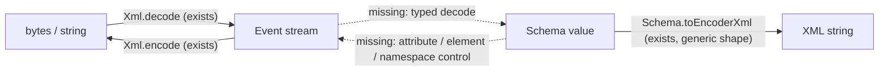
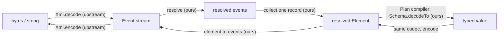

# Onboarding

`effect-xml` is an Effect-native library for reading and writing XML. This page records what Effect already provides, where things live, which design decisions are settled and why, and what is still open. The library is implemented through milestone 4 and unpublished; what a consumer relies on (install, the first call, the round-trip exclusions, positions, limits) is the root [`README.md`](../README.md).

## What Effect already provides

Checked against `effect@4.1.2`, the pinned version. Read the installed source before relying on any detail here.

### `effect/encoding/Xml` (experimental, since 4.0.6)

A streaming, event-based XML 1.0 codec built on `Channel`. Source: `node_modules/effect/src/encoding/Xml.ts`.

- `decode` / `decodeString`: UTF-8 bytes or text in, `Event` values out. Events are `Declaration`, `Doctype`, `ProcessingInstruction`, `Comment`, `StartElement`, `EndElement`, and `Text`.
- `encode` / `encodeString`: events in, XML out.
- `elements`: collects repeated elements (such as feed items) into small `Element` trees, so a large document can be processed one record at a time.
- `DecodeOptions`: `maxTokenSize` and `maxDepth` limits. `maxElementSize` is an `ElementsOptions` field (`Xml.ts:272-274`) that caps one collected element in `elements`, counted in UTF-16 code units of names, attribute names and values, and text.
- Failures are `XmlError`, with `kind` set to `Syntax`, `Unsupported`, `Limit`, or `InvalidEvent`. Decode errors carry a one-based `line` and `column`.
- It checks well-formedness and never reads external resources or expands DOCTYPE entities, so XXE and entity-expansion attacks do not apply.
- It does **not** resolve namespaces (names are reported as written), validate against a DTD or schema, or accept encodings other than UTF-8.

`test/upstream-xml.test.ts` pins the upstream behavior this library relies on, so an Effect upgrade that changes it fails there first.

### `Schema.toEncoderXml(codec, options)` (stable, since 4.0.0)

Encodes a Schema value to an XML string through Schema's generic `StringTree` representation. Options: `rootName`, `arrayItemName`, `pretty`, `indent`, and `sortKeys`. The root name falls back to the schema's identifier or title, then `root`; arrays use `item` children.

It works in one direction only: there is no matching decoder. It also has no control over attributes vs. child elements, names, or namespaces.

## The gap



Solid arrows exist upstream; dashed arrows do not. This library supplies the dashed edges.

## Goal

The owner's goal, in their words: "Zod for XML". A typed way to define XML so existing documents decode into an Effect-typed TypeScript value, and that value encodes back to XML.

- **One definition, both directions.** A single declaration describes elements, attributes, and content, and yields both the decoder and the encoder.
- **Typed, validated attributes.** Every attribute, including `data-*` attributes, is a string on the wire and a Schema-validated value in TypeScript. An attribute `foo` declared as a UUID fails with a Schema error when it is not one.
- **General library.** This repository ships the codec, not ready-made definitions for any vocabulary.
- **QTI is the proving ground.** Real QTI documents are the primary use case. QTI definitions belong to consuming projects, though QTI samples can serve as test fixtures here.
- **Out of scope for now:** non-well-formed HTML. Effect's parser accepts only well-formed XML, which QTI (including its XHTML item bodies) is.

QTI raises the two problems JSON-style schemas never face: **mixed content** (ordered text interleaved with elements, as in `<p>Choose <strong>one</strong> answer.</p>`) and **namespaces** (`xmlns`, `xml:lang`), which the upstream parser does not resolve.

## Source map

| Path                        | Role                                                                                                                                                                                              |
| --------------------------- | ------------------------------------------------------------------------------------------------------------------------------------------------------------------------------------------------- |
| `src/canonical.ts`          | The internal comparator `canonicalize` behind `equivalence`: the canonical form two element trees compare by                                                                                      |
| `src/channel.ts`            | The streaming channels `decodeSchemaString` and `decodeSchema`: record selection by path, per-record decode, positions, and their spans                                                           |
| `src/codec.ts`              | The internal whole-document pipeline behind `fromString` and `ElementFromString` (parse, resolve, collect the root, decode or encode it, attach positions), and the limit and encode option types |
| `src/compile.ts`            | `Plan` to codec: one `Schema.decodeTo` per element, the `open` member, and the element-to-events walk for encode                                                                                  |
| `src/document.ts`           | The document codecs `fromString` and `ElementFromString`, and `decodeErrorOf` and `encodeErrorOf`, which read their errors back out of a `Schema.SchemaError` issue                               |
| `src/dsl.ts`                | The consumer constructors `Element`, `suspend`, and `namespaces`, and the decoded-type helpers under `Element`                                                                                    |
| `src/element.ts`            | Clark names and the resolved element model                                                                                                                                                        |
| `src/equivalence.ts`        | `equivalence`, the round-trip equivalence on resolved elements under a root definition                                                                                                            |
| `src/index.ts`              | The single published entry point, which exports the `XmlSchema` namespace                                                                                                                         |
| `src/issue.ts`              | Translation of Schema issues to XPath-like paths, and the public decode and encode errors                                                                                                         |
| `src/plan.ts`               | The closed `Plan` IR and the object-form DSL (`text`, `elements`, `mixed`, and the slots published as `Array` and `optionalKey`) that produces it                                                 |
| `src/positions.ts`          | Post-hoc `locate` and the opt-in position channel                                                                                                                                                 |
| `src/record-path.ts`        | The check that a record path's steps are Clark names or `"*"` and end at the record element                                                                                                       |
| `src/resolve.ts`            | The namespace resolver channel, the per-record collector, and its budgets                                                                                                                         |
| `src/tokenizer.ts`          | The `Tokenizer` service, its contract, and its default backed by `effect/encoding/Xml`                                                                                                            |
| `src/xml-schema.ts`         | The `XmlSchema` namespace: the published surface, re-exported from the modules above                                                                                                              |
| `test/`                     | Cross-module and upstream-contract tests (Vitest + `@effect/vitest`)                                                                                                                              |
| `test/qti/`                 | Benchmark vocabulary and acceptance suites; never exported                                                                                                                                        |
| `test/round-trip.test.ts`   | Round-trip canonical-equivalence tests over the fixture corpus                                                                                                                                    |
| `test/readme.test.ts`       | Tests that run the README examples                                                                                                                                                                |
| `test/upstream-xml.test.ts` | Pins the upstream `effect/encoding/Xml` behavior this library relies on                                                                                                                           |
| `docs/rd/`                  | Design corpus: branches, criteria, spike plan, Effect substrate map, the decision record, the strategic review of the planning set, and the upstream feature-request draft                        |
| `docs/goals/`               | Goal documents; `xml-schema-codec/GOAL.md` is the codec goal lowered from the decisions                                                                                                           |
| `spikes/`                   | Throwaway R&D against real QTI fixtures; seven `RESULT.md` files are the evidence behind `docs/rd/decisions.md`                                                                                   |
| `tools/lint/`               | Repository lint rules (kebab-case directories, no built-in try/catch) and their `bun test` suites                                                                                                 |
| `vite.config.ts`            | Vite Plus config: format, lint, test, and `pack` (library build)                                                                                                                                  |
| `.agents/skills/`           | Repo-local skills: effect-design, trace-effect, error-messages, document-code, conventional-commits                                                                                               |
| `.vite-hooks/pre-push`      | Runs check, test, and build before every push                                                                                                                                                     |
| `.github/workflows/ci.yml`  | The same checks on push to main and on pull requests                                                                                                                                              |

## Workflows

```sh
bun run check   # format check, lint, type-aware rules, and type check (warnings fail)
bun run fix     # apply formatter and lint fixes
bun run build   # vp pack: src/index.ts -> dist/index.js + dist/index.d.ts
bun run test    # bun test tools, then vp test
```

## Decisions

Each entry is the ruling in brief, with the spike that decided it. The full reasoning, the facts not yet verified, the fact that would reopen each call, and the recorded risks are in [`docs/rd/decisions.md`](rd/decisions.md). Spike ids follow `docs/rd/spike-plan.md`.

- **Mixed content.** Every element has a content mode: `empty`, `text`, `elements`, or `mixed`. Only the child-bearing modes `elements` and `mixed` take an `open` option for unknown children; `empty` and `text` have no child slot, so an open element with no declared children is `elements({}, { open })` or `mixed([], { open })` (`docs/rd/decisions.md` D3, `docs/rd/strategic-review.md` ruling (a) and C8). `mixed` content is an ordered array over a discriminated union of text and element members, indexed by each member's literal element name so one bad member yields one issue; `elements` content is plain named fields. Text content decodes under the reserved key `$text` and `mixed` content under `$children`, and a text run in `mixed` is tagged `"$text"`; `$` is not an XML name character, so neither key can meet an attribute. Whitespace-only text is kept in `mixed` and dropped in `elements`. Evidence: SPIKE-01, `spikes/mixed-content/RESULT.md` (the named-field shape could not hold order without a second copy); SPIKE-05 for the name-indexed union. Ruling D3, T3.
- **Namespaces.** Decode resolves names to expanded form in a library Channel over `Xml.Event`, between `Xml.decode` and collection; definitions carry a prefix map for authoring and encode; unprefixed attributes have no namespace; attribute keys on a resolved element are Clark strings (`{uri}local`). `xsi:type` is deferred. Evidence: SPIKE-02, `spikes/namespaces/RESULT.md` (`bpig-mathml.xml` re-binds the default namespace with no prefix change, so prefix-as-written confuses two vocabularies); SPIKE-04 for why resolution must happen on events rather than on collected records. Ruling D2, T4.
- **Round trip.** The promise is canonical equivalence, defined by an executable comparator, not byte identity. Attribute order, quote style, entity forms, self-closing form, inter-element whitespace in `elements` mode, and attribute-value whitespace normalisation are outside the promise. Evidence: SPIKE-03, `spikes/round-trip/RESULT.md` (byte identity 0/16 fixtures on both paths; comparator green 16/16 and a fixed point after one pass). Ruling D1.
- **Tree vs. streaming, and limits.** Per-record streaming is the mechanism and a whole document is the single-record case. An in-house collector over resolved events materialises one record at a time; `Xml.elements` stays available for raw unresolved trees but the core does not route through it. Limits are the inherited `maxTokenSize` and `maxDepth` at the parser, plus two per-record budgets in the collector: `maxElementSize` (upstream semantics) and a node count, because character count and retained memory diverged by 122x on real input. Event-driven Schema decode is parked. Evidence: SPIKE-04, `spikes/streaming/RESULT.md`. Ruling D4, T5.
- **Declaration surface.** An object-form DSL that returns ordinary `Schema.Codec`s is the public surface. Decoded attribute keys are wire names (`"max-choices"`), with no rename map, and content sits under the reserved `$text` and `$children` keys beside them; optional attributes use `Schema.optionalKey`; `optionalKey` wraps child elements only. The annotated-Struct surface is a want, not shipped first. Evidence: SPIKE-05, `spikes/declaration-dsl/RESULT.md` (scores tied; the DSL rejects a non-element child at the type level and annotations landed on the wrong AST node). Ruling D5; the `$` keys replace O6's text-run tag and lift O7's refusal of an attribute named `text` or `children`, while an attribute that equals a slot key is still a `DefinitionError` (`docs/goals/effect-native-api/GOAL.md`).
- **Layering mechanism.** The DSL lowers each definition once to a closed `Plan`, and one compiler generates exactly one `Schema.decodeTo` per element from an element schema into a Struct whose attribute and text leaves run through `Schema.toCodecStringTree` and whose child slots are the child codecs. There is no Schema AST rewrite, as core or escape hatch. `Schema.toEncoderXml` stays a generic dump. Evidence: SPIKE-05 (the compiler passes both gates including `data-*`); SPIKE-06, `spikes/schema-layering/RESULT.md` (the rewrite needs `@internal` helpers and cannot reach encoding chains, index signatures, or `Schema.Class`). Ruling D6 reversed to the closed IR, T1.
- **Error paths and positions.** Every decode failure names an XPath-like path with one-based same-named-sibling indices (`/qti-assessment-item/qti-item-body/p[2]/@data-foo`), translated from the struct-keyed Schema issue through the same `Plan`. Line and column come from a post-hoc locate over the retained text by default, or from an opt-in position channel (`positions: true`) when input is streamed and the text is gone; the agreement test between the two sources over the fixture corpus is a required member of the library suite. The public failure is a library error that wraps the translated `Schema.SchemaError`; `XmlError` stays the cause for well-formedness failures. Evidence: SPIKE-07, `spikes/error-positions/RESULT.md` (416/416 start tags agree; tracking inside the parser costs 2.5x to 3.6x); SPIKE-06 for why paths are struct-keyed in every mechanism. Ruling D7 reversed, T2.
- **Lexical nodes.** Comments, processing instructions, and the DOCTYPE are not in the model; CDATA is text; the XML declaration is emitted by default. Evidence: SPIKE-03 loss table, `spikes/round-trip/RESULT.md` (`Xml.elements` already drops comments and the declaration, and CDATA is indistinguishable after decode). Ruling D8; the owner confirmed on 2026-11-04 that no consumer needs comment or PI preservation.
- **Entities.** Upstream rules only: the five predefined entities and character references; undeclared named entities fail as upstream reports them. Evidence: the SPIKE-00 corpus, `spikes/fixtures/qti/SOURCES.md`, has no undeclared named entities. Ruling D9; the owner confirmed on 2026-11-04: entities stay strict, upstream rules only, with no lenient or HTML-entity mode.
- **Module layout.** `src/index.ts` is the single entry. Internal kebab-case modules follow the seams the spikes produced: `plan` (IR types and the DSL), `compile` (`Plan` to codec), `resolve` (event resolver, collector, budgets), `positions` (locate and the opt-in channel), `issue` (translation and the public error), `canonical` (the internal comparator `canonicalize`, behind the public `equivalence`). Names may shift; the boundaries are the ruling. Evidence: follows from T1 and T4, no spike of its own. Ruling D11.

### The decided pipeline



Decode runs left to right, encode right to left through the same definition.

## Open decisions

The owner answered the held items from `docs/rd/decisions.md` on 2026-11-04; that file records the answers. What is settled and what still moves:

- **Package name (D10): settled.** The project name stays `effect-xml`. `package.json` now carries the scoped name `@aidenzepp/effect-xml` (the unscoped `effect-xml` on npm belongs to someone else). The package stays `private` and unpublished; nothing is published in this campaign.
- **Upstream feature request for positions on `StartElement` (D7).** Approved for drafting; the owner approves the exact draft before anything is filed; see `docs/rd/upstream-feature-request.md` (being drafted). Upstream positions remain a reversal condition only; the plan does not depend on the outcome.
- **Single package vs. workspace.** The repository is one package today. Split it only when a second publishable unit exists.

## Design corpus

The evidence trail lives in two places. `docs/rd/` holds the R&D corpus: `README.md` (seed, current read, branch index, provisional ledger), `criteria.md` (ten weighted criteria, three gates), `branches/` (one file per design question with its approaches), `spike-plan.md` (SPIKE-01 to SPIKE-07), `effect-substrate.md` (the verified map of what `effect@4.1.2` provides), `decisions.md` (the rulings this page summarises, with recorded risks and corpus corrections), `strategic-review.md` (the strategic review of the planning set: Mind rulings confirmed or overruled, concerns C1 to C11, and the follow-up table), and `upstream-feature-request.md` (the draft request for positions on `StartElement`, D7). `spikes/` holds the fixtures under `fixtures/qti/` and the seven spike directories, each with a `RESULT.md`; that code is evidence, not library code, and `src/` never imports it. The goal lowered from these decisions is [`docs/goals/xml-schema-codec/GOAL.md`](goals/xml-schema-codec/GOAL.md).
