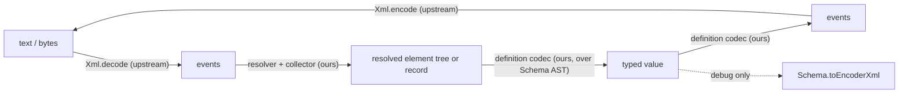

# effect-xml R&D corpus

Big Bang run at Expansion level, upstream of goal-forge. This directory holds the design branches, the comparison criteria, the spike plan, and the decision ledger for an Effect-native "Zod for XML". Nothing here is a goal document or an implementation plan; the spikes produce the evidence that turns the ledger's provisional calls into a goal.

Produced by the Planner on handle f62ff795 for the Mind. Consumer: the Mind (to file spike Hands) and the Planner's later goal-forge pass. `docs/rd/effect-substrate.md`, if present, is the head-cto's verified capability map and is owned by that seat.

Status: the spikes have reported and `decisions.md` (commit `1e68713`) rules on every call below. The ledger keeps the provisional text for the record and adds each call's final disposition; where the two disagree, `decisions.md` wins. The goal lowered from the rulings is `docs/goals/xml-schema-codec/GOAL.md`.

## Seed (owner's words)

"Zod for XML" on Effect Schema. One definition yields decode and encode. Every attribute, including `data-*`, is Schema-validated. General library; QTI is the proving ground and QTI definitions belong to consumers. Non-well-formed HTML is out of scope. Build on `effect/encoding/Xml` and `Schema.toEncoderXml`. Package name is the owner's hold.

## Current read

The center of gravity is a **Schema codec whose encoded side is an XML element model**, not a new parser and not a new validation engine. Upstream already owns tokenizing (`effect/encoding/Xml`, events with bounded memory, well-formedness, limits) and leaf stringification (`Schema.toCodecStringTree`, which `toEncoderXml` is built on). What is missing, and what this library is, sits between them:

Four facts shape everything (all verified against `effect@4.1.2` source; file:line in the branch files):

1. Events and `Element` carry no positions; only `XmlError` does. Line/column on Schema failures needs a position source this library supplies.
2. `Xml.elements` drops comments and PIs, keeps whitespace, merges CDATA into text, and reports names as written with `xmlns` as ordinary attributes. Namespace resolution is ours.
3. `Xml.encode` never self-closes and normalizes escaping; `Text` normalizes line endings and loses entity forms. Byte-identical round trip is unreachable on the upstream codec; equivalent XML is the honest promise.
4. `Schema.toEncoderXml` cannot express attributes, namespaces, order, or mixed content, and has no decoder. `Config.schema` demonstrates an AST rewrite with `SchemaAST.decodeTo` over a lazy cursor, but only through `@internal` helpers (`applyToSelfOrLastLinkEncoding`, `replaceEncoding`, `Objects.recur`, `getIndexSignatureKeys`; SPIKE-06 stability table), so the library does not adopt the mechanism: D6 is reversed to a closed IR (`decisions.md` T1).

## Branches

| File                            | Question                                                         | Approaches                                                                                                   | Provisional call                                                                    |
| ------------------------------- | ---------------------------------------------------------------- | ------------------------------------------------------------------------------------------------------------ | ----------------------------------------------------------------------------------- |
| `branches/mixed-content.md`     | Mixed content and ordered children                               | Ordered array with discriminated union; named fields plus text channel; tree with order index                | Ordered array with per-element content modes                                        |
| `branches/namespaces.md`        | Namespaces, `xml:lang`, `xsi:type`, `xsi:schemaLocation`         | Expanded names at decode; prefix-as-written; schema-declared namespace map; ordinary attributes vs built-ins | Expanded names, schema prefix map for authoring and encode, no language inheritance |
| `branches/round-trip.md`        | Byte-identical vs equivalent                                     | Canonical equivalence; byte identity via lexical sidecar; tiered                                             | Canonical equivalence defined by an executable comparator                           |
| `branches/tree-vs-streaming.md` | Tree, event-driven, hybrid; large-document limits                | Full tree; event-driven Schema; `Xml.elements` per record; inherit limits vs library budget                  | Hybrid with tree as the single-record case; upstream limits                         |
| `branches/declaration-dsl.md`   | How attributes, elements, text are declared                      | Field annotations; object-form DSL; fluent builder; naming conventions                                       | Object-form DSL producing real Schema codecs, annotations as internal carrier       |
| `branches/schema-layering.md`   | How decode and encode run over Schema; what `toEncoderXml` gives | `Element` transformation; Config-style AST walker; closed IR                                                 | AST walker, IR as DSL carrier if the walk grows                                     |
| `branches/error-reporting.md`   | Line and column on failures                                      | Path only; in-house position tracking; post-hoc locate; upstream change                                      | Path always, position tracking as the source                                        |
| `branches/lexical-nodes.md`     | CDATA, comments, PIs, declaration, DOCTYPE, entities             | Not in the model vs opt-in passthrough; inherit entities vs pre-decode substitution                          | Not in the model; inherit upstream entity rules                                     |
| `branches/consumer-story.md`    | How a QTI package defines `qti-assessment-item`                  | Vocabulary package of plain definitions; XSD generator                                                       | Plain definitions; generator is a shaping pressure only                             |

Every must-cover item from the task appears in one of these files with at least two approaches.

## Decision ledger

Provisional calls made to keep the corpus moving. Each names the evidence that reverses it. None is operator approval.

| Id  | Decision point                  | Provisional choice                                                                                                                                                                                                                                                             | Reverses when                                                                                                                       | Final disposition (`decisions.md`)                                                                                                                                                                                                                                                                                                                                                                                                                                                                                                                             |
| --- | ------------------------------- | ------------------------------------------------------------------------------------------------------------------------------------------------------------------------------------------------------------------------------------------------------------------------------ | ----------------------------------------------------------------------------------------------------------------------------------- | -------------------------------------------------------------------------------------------------------------------------------------------------------------------------------------------------------------------------------------------------------------------------------------------------------------------------------------------------------------------------------------------------------------------------------------------------------------------------------------------------------------------------------------------------------------- |
| D1  | Round-trip promise              | Canonical-equivalent XML, defined by the SPIKE-03 comparator; attribute order, prefixes, quotes, entity forms, self-closing form, inter-element whitespace in `elements` mode are not preserved                                                                                | Owner names a consumer that needs diff-clean re-serialization of edited files (would justify a custom writer, not a tokenizer)      | **Kept.** Exclusions gain attribute-value whitespace normalisation; attribute order survived on all 16 fixtures but is not promised. Evidence: SPIKE-03 comparator 16/16, byte identity 0/16 (`spikes/round-trip/RESULT.md`). Row D1.                                                                                                                                                                                                                                                                                                                          |
| D2  | Namespaces                      | Resolve to expanded names at decode; definitions carry a prefix map for authoring and encode; unprefixed attributes have no namespace                                                                                                                                          | SPIKE-02 shows the resolver dominates code outside Effect primitives and the corpus never varies prefixes                           | **Kept.** The cost half of the condition fired (233 lines) but the corpus half is false: `bpig-mathml.xml` re-binds the default namespace with no prefix change (SPIKE-02 C4 A = 5, B = 0). Resolver is a library Channel over `Xml.Event`; attribute keys are Clark strings. T4, row D2.                                                                                                                                                                                                                                                                      |
| D3  | Mixed content                   | Ordered children array with discriminated union; content mode per element (`empty`, `text`, `elements`, `mixed`, each with an `open` option; narrowed in `decisions.md` D3, commit `79c370f`: only `elements` and `mixed` take `open`); derived named view for `elements` mode | SPIKE-01 scores named-fields higher on C3 and C7 without losing order                                                               | **Kept, wording amended.** "Derived named view" is struck: `elements` mode is named fields directly. `open` is narrowed to the child-bearing modes `elements` and `mixed`; `empty` and `text` have no child slot, so an open element with no declared children is `elements({}, { open })` or `mixed([], { open })` (`decisions.md` D3 as corrected in `79c370f`; `strategic-review.md` ruling (a), C8). Union members are indexed by their literal element name (name dispatch). Evidence: SPIKE-01 A 203 vs B 165 (B C3 = 0 on bg010); SPIKE-05. T3, row D3. |
| D4  | Tree vs streaming               | Hybrid: `Xml.elements` per repeated record, tree for single documents; event-driven Schema decode parked with a recorded capability gap; upstream limits inherited                                                                                                             | SPIKE-04 shows ancestor namespace scope cannot reach records cheaply, or memory diverges from `maxElementSize` by over 10x          | **Superseded.** Hybrid kept; the collector is in-house over resolved events (records from `Xml.elements` carry no ancestor scope); the limits sub-call is reversed to inherited `maxElementSize` plus a per-record node budget (memory diverged 122x). Evidence: SPIKE-04 (`spikes/streaming/RESULT.md`). T4, T5, row D4.                                                                                                                                                                                                                                      |
| D5  | Declaration surface             | Object-form DSL returning ordinary `Schema.Codec`s; annotations carried internally so a Struct-plus-annotation path remains possible                                                                                                                                           | SPIKE-05 shows annotations alone reach equal C7 and better C8 with no silent misclassification                                      | **Kept, carrier amended.** The `Plan` is the carrier, not annotations; the annotated-Struct surface is a second producer onto the same `Plan` and a want, not shipped first. Decoded keys are wire names. Evidence: SPIKE-05 tie 185/265 broken by evidence 1 and 3 (`spikes/declaration-dsl/RESULT.md`). Row D5.                                                                                                                                                                                                                                              |
| D6  | Layering mechanism              | Config-style AST rewrite with an XML cursor for decode and a mirror walk emitting events for encode; `toEncoderXml` kept only as a generic dump; leaves via `toCodecStringTree`                                                                                                | SPIKE-06 finds the rewrite primitives unstable or the walk needing more AST kinds than listed in the branch file (then a closed IR) | **Reversed to branch C.** Closed IR (`Plan`) and one compiler generating one `Schema.decodeTo` per element; no AST rewrite as core or escape hatch. Evidence: SPIKE-05 compiler C1 = 5, C2 = 5 incl. `data-*`; SPIKE-06 `@internal` table and unsupported set (`spikes/schema-layering/RESULT.md`). T1, row D6.                                                                                                                                                                                                                                                |
| D7  | Error positions                 | XML path in every Schema issue; line and column from an in-house position-tracking channel, optional if its cost exceeds 2x                                                                                                                                                    | SPIKE-07 shows post-hoc locate agrees exactly and is cheaper, or upstream adds positions to events                                  | **Reversed.** Path always; post-hoc locate is the default source when the text is retained; the position channel is opt-in (`positions: true`) for streamed input; the locate-versus-channel agreement test over the corpus is a required suite member. Owner, 2026-11-04: kept as ruled; drafting the upstream feature request is approved, and the owner approves the draft before filing. Evidence: SPIKE-07 416/416 agreement, channel 2.5x to 3.6x (`spikes/error-positions/RESULT.md`). T2, row D7.                                                      |
| D8  | Comments, PIs, CDATA            | Not represented; CDATA is text; declaration emitted by default                                                                                                                                                                                                                 | A consumer needs comment preservation (promotes `round-trip.md` C)                                                                  | **Kept**; owner confirmed 2026-11-04: no consumer needs comment or PI preservation. Evidence: SPIKE-03 loss table. Row D8.                                                                                                                                                                                                                                                                                                                                                                                                                                     |
| D9  | Entities                        | Upstream rules only (five predefined plus character references; DOCTYPE entities fail)                                                                                                                                                                                         | SPIKE-00 corpus or a consumer shows undeclared named entities (`&nbsp;`) in documents that must be accepted                         | **Kept**; owner confirmed 2026-11-04: strict, upstream rules only, no lenient or HTML-entity mode. Evidence: no undeclared named entities in the corpus (`spikes/fixtures/qti/SOURCES.md`). Row D9.                                                                                                                                                                                                                                                                                                                                                            |
| D10 | Package name                    | Open; owner's hold; package stays `private`                                                                                                                                                                                                                                    | Owner decides                                                                                                                       | **Settled**, owner 2026-11-04: name stays `effect-xml`; published later as the scoped `@aidenzepp/effect-xml`; `private` until then.                                                                                                                                                                                                                                                                                                                                                                                                                           |
| D11 | Module layout inside `src/`     | Open until the layering spike settles the pieces                                                                                                                                                                                                                               | Goal-forge after spikes                                                                                                             | **Settled from T1 and T4**: `plan`, `compile`, `resolve`, `positions`, `issue`, `canonical` under a single `src/index.ts` entry. Row D11.                                                                                                                                                                                                                                                                                                                                                                                                                      |
| D12 | Content model for unknown XHTML | `open` content mode admits unknown elements as generic resolved elements                                                                                                                                                                                                       | SPIKE-05 shows the benchmark subset is writable without it (unlikely)                                                               | **Kept.** The condition fired on its letter (SPIKE-05 wrote the subset with closed unions) and does not reverse a general library's need; schedule is the goal's (first milestone only if its acceptance fixtures need it). Row D12.                                                                                                                                                                                                                                                                                                                           |

## Open questions (with defaults)

1. Does any consumer need comment or PI preservation? Default: no (D8). Disposition: owner decision 3 in `decisions.md`.
2. Do real QTI 3 producers emit undeclared named entities? Default: no. SPIKE-00's fifteen-file corpus has none (`spikes/fixtures/qti/SOURCES.md`); the question stays open only for producers outside that corpus (D9). Disposition: owner decision 3 in `decisions.md`.
3. Should `xsi:type` dispatch be a first-class union combinator in the first milestone? Default: yes, as a plain union keyed by an attribute, since QTI's `qti-*-interaction` family does not need it but XHTML-adjacent vocabularies do; cheap to defer if SPIKE-05 does not need it. Disposition: deferred as a want; the resolved element carries its in-scope prefix map so a QName attribute codec is additive (`decisions.md` T4, risk R10).
4. Is a feature request to upstream for event positions worth filing? Default: decide after SPIKE-07 measures the in-house cost. Disposition: recommended yes (2.5x to 3.6x measured); go/no-go is owner decision 2.
5. Is a 2x throughput cost for positions acceptable by default? Default: yes for documents under 1 MB, opt-in above; SPIKE-07 measures. Disposition: superseded by the D7 reversal; the channel is opt-in at any size and post-hoc locate is the default when the text is retained.

## Spike plan and criteria

- `criteria.md`: ten weighted criteria, three of them gates, each with how it is measured.
- `spike-plan.md`: SPIKE-01 to SPIKE-07, disjoint directories, independent, each one sitting.

## Handoff read

Done: the spikes reported, `decisions.md` ruled, `docs/onboarding.md` records each decision (commit `a234642`), and `docs/goals/xml-schema-codec/GOAL.md` carries the rulings as architecture locks with the benchmark subset as the first milestone's acceptance fixture. Next: goal-check on the goal, then delivery lowering after a READY verdict.
