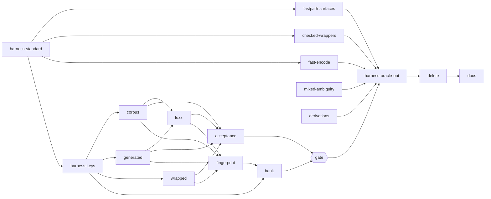

# Plan: delete `test/oracle/` and keep the coverage it bought (perf3-oracle-removal)

This is the committed record of the plan that removed the frozen oracle. The planner wrote it as `work/perf3/oracle-plan.md` (gitignored, task `9f4423aa`), cut against `9e03057`; every line number in the plan body refers to that commit. The body is the plan as written, except the notes marked **Revised**. The rulings, revisions, and losses below are what was decided and what landed.

## Rulings and revisions

- **O1** (Mind memo `321181ff`, 2026-11-08): retarget the suites to `standardOf(<src root>)` instead of deleting them. This supersedes gap D3 of `docs/goals/performance/phase-3.slices.md`.
- **O2** (same memo): pin the derivation outputs in a committed file snapshot.
- **O2 revised** (Mind mail `ac13cc7f`): pin a SHA-256 digest of each observation's canonical JSON, keyed `<subject>/<derivation>`, in an inline snapshot in `test/differential/derivations.test.ts`. No snapshot file and no `vite.config.ts` change. A 4 MB snapshot plus a formatter exception was too heavy for a guard whose phase-3 purpose had ended. Landed in `a620c4d`: the file went from 14 tests (1 plus 13 per subject) to 2, and the 260 keys (13 subjects by 20 derivations) match the full-JSON snapshot taken at the base commit. `DERIVATIONS_DUMP=<key>` prints one observation for review.
- **O3** (same memo): fold `perf3-orc-harness-keys` into `perf3-orc-corpus`, one unit on the cluster branch. The keys commit `609d6e3` landed on that branch.
- **O4** (same memo): accept loss L1. Ordinary unit tests cover public behavior.

## What landed

| Unit                                                                                                                 | Commit                                                                                                      |
| -------------------------------------------------------------------------------------------------------------------- | ----------------------------------------------------------------------------------------------------------- |
| `harness-standard`                                                                                                   | `2f7c732`                                                                                                   |
| `mixed-ambiguity`                                                                                                    | `212e711`                                                                                                   |
| `fast-encode`                                                                                                        | `d20c413`                                                                                                   |
| `checked-wrappers`                                                                                                   | `eace202`                                                                                                   |
| `derivations` (O2 revised)                                                                                           | `a620c4d`                                                                                                   |
| `fastpath-surfaces`                                                                                                  | `11985ba`                                                                                                   |
| cluster on branch `perf3-orc-cluster`: harness keys, corpus, wrapped, generated, fuzz, fingerprint, acceptance, bank | `609d6e3`, `dc9f558`, `3236c0e`, `c146c97`, `7efd129`, `482ee00`, `8b4dee0`, `389245c`; merged in `049265d` |
| `harness-oracle-out`                                                                                                 | `3b2cb50`                                                                                                   |
| `delete`                                                                                                             | `e35151d`                                                                                                   |
| `docs`                                                                                                               | `7474d56`                                                                                                   |

## Losses

The plan's section 6 names five losses. As landed:

- **L1, the drift guard for the standard path.** Accepted (O4). It is wider than section 6 states: every surface that never takes the fast path, and every fallback outcome, now compares the standard path with itself. `docs/goals/performance/phase-3.slices.md` gap D3 lists those surfaces (final audit `4705e240`, R1).
- **L2, the "exactly these deltas" contract.** The `D1` and `D2` deltas, which fired on every eligible input and nowhere else when measured against the old code, became plain pins of the `fromString` shape on representative rows in `test/differential/harness.test.ts` (`3b2cb50`).
- **L3, the mixed-ambiguity contrast assertions.** The assertions that the old code wrote a different text, and the `reparsed` flag, were removed in `212e711`. `docs/rd/decisions.md` keeps the before and after.
- **L4, copy fidelity and frozen hashes.** Obsolete with their subjects (`e35151d`).
- **L5, vocabulary-scale derivation pins.** Did not occur: O2 kept a pin, as digests.

Also recorded: section 5 calls the piped `resolveEvents` and `collect` pair "the last independent reference for the fused resolver". It is not independent of the resolver rewrite `07240f0`: both arrangements run the post-rewrite machine. No reference to the pre-rewrite resolver remains (final audit `4705e240`, R2; `phase-3.slices.md` gap D3).

## The plan

- task: `9f4423aa` (planner, delivery lowering; planning only, no code)
- owner ruling 2026-11-08: phase 3 stops; delete `test/oracle/`, the frozen copy of `src/` at `a7a93d5`.
- cut against: `9e03057` (`effect@4.1.2`). Every count and line number below was read there. A unit re-reads its files first.
- prior ruling this plan replaces: `phase-3.slices.md` gap D3 ("`test/oracle/`, `test/differential/vocabulary/`, and the suites that import them are deleted in one commit"). The task asks to keep the coverage, so the suites are retargeted instead of deleted. The Mind confirms the supersession (open question O1).

## 1. Theme

The oracle is the second side of every phase-3 differential comparison. Deleting it without a replacement would delete the only checks that the fast path (builder, structural codec, writer) gives the same outcome as the standard decode and encode on real, generated, fuzzed, and wrapped inputs.

The library still has the standard path. `decodeString`, `encodeString`, `fromString`, and both record channels run the standard path whenever `structuralPlan(root)` is `undefined` (`src/codec.ts:258-317`, `:445-496`, `src/channel.ts:324-336`). So the second side can be `src` itself, forced onto its standard path.

## 2. Normalized outcome

After the units land:

- Every differential suite compares the `src` fast path against the `src` standard path at the same commit.
- Behavior that was only observable against the oracle (the `D1`/`D2` deltas, the mixed-ambiguity changes, the derivation outputs) is pinned as plain assertions of current behavior.
- `test/oracle/`, `test/differential/vocabulary/`, `test/differential/vocabulary.test.ts`, and the `vite.config.ts` override entry are gone. Nothing imports them.
- No `src/` file changes. No public API change. Tests stay Effect-native (`@effect/vitest`, `it.effect`) under the AGENTS.md test layout.

### The forcing mechanism (settled by probe)

`standardOf(root) = root.annotate({ parseOptions: {} })`.

- `structuralPlan` treats a root carrying a `parseOptions` annotation as opaque (`src/structural-slot.ts:29-31`, `:101`). A checked root's annotation lands on its last check, which the same predicate reads, and `src/structural-slot.test.ts:78-81`, `:173` pin both cases.
- Effect 4.1.2 has no runtime reader of a `parseOptions` annotation (`phase-3.slices.md:676`), so `{}` changes no parse behavior. The annotated root runs the `"element"` branch, which is the same `standard` effect the fallback runs.
- Probe (scratch, not committed): `work/perf3/oracle-probe/probe2.test.ts` compares `fromString(root)` with `fromString(standardOf(root))` (decode, re-encode of each decoded value) over `itemInputs`, `wrappedInputs`, `documentInputs`, and `fuzzInputs`, every `encodeInputs` value, and `decodeSchemaString` over `channelInputs` and every fuzz input with a record path, positions off and on. All outcomes are strictly equal:

```text
$ bun x vitest run --root work/perf3/oracle-probe probe2 --silent=false 2>&1 | grep -E "COUNTS|Tests "
COUNTS {"dec":782,"enc":320,"ch":1664,"fail":611,"structural":779,"opaqueStd":782}
      Tests  1 passed (1)
```

`structural` 779 means the fast side really took the fast path for 779 of 782 roots. `opaqueStd` 782 means every `standardOf` root was opaque.

The probe also shows the comparison is not vacuous only when the fast side is structural. Every retargeted suite must count its structural roots (standing rule R-live below).

## 3. Repo baseline

### Inventory (command-derived)

```text
$ git grep -c -i oracle | sort
docs/goals/effect-native-api/slices.md:26
docs/goals/performance/GOAL.md:2
docs/goals/performance/phase-1.slices.md:1
docs/goals/performance/phase-2.slices.md:1
docs/goals/performance/phase-3.md:11
docs/goals/performance/phase-3.slices.md:85
docs/rd/branches/round-trip.md:1
docs/rd/decisions.md:4
docs/rd/perf3b-spikes/stream-records.md:1
spikes/round-trip/canonical.ts:1
src/canonical.ts:1
test/bench/bank-acceptance.test.ts:37
test/bench/bank-differential.test.ts:16
test/bench/bank-fingerprint.ts:10
test/channel-fast-path.test.ts:19
test/checked-wrappers.test.ts:25
test/decode-string-fast-path.test.ts:18
test/differential/acceptance.test.ts:53
test/differential/corpus.cases.ts:9
test/differential/corpus.test.ts:14
test/differential/derivations.test.ts:40
test/differential/features.ts:2
test/differential/fingerprint.ts:38
test/differential/fuzz.cases.ts:11
test/differential/fuzz.test.ts:16
test/differential/generated.cases.ts:19
test/differential/generated.test.ts:33
test/differential/harness.test.ts:21
test/differential/harness.ts:32
test/differential/jit-parity.test.ts:1
test/differential/vocabulary.test.ts:6
test/differential/vocabulary/bank.ts:1
test/differential/vocabulary/qti.ts:1
test/differential/vocabulary/streaming.ts:1
test/differential/wrapped.cases.ts:24
test/differential/wrapped.test.ts:26
test/encode-string-fast-path.test.ts:27
test/fast-encode.test.ts:8
test/mixed-ambiguity.test.ts:47
test/oracle/canonical.ts:1
test/oracle/frozen.test.ts:7
vite.config.ts:2
```

`git grep -c` skips files without the word, so the 15 other files under `test/oracle/` do not appear. All 17:

```text
$ git ls-files test/oracle
test/oracle/canonical.ts
test/oracle/channel.ts
test/oracle/codec.ts
test/oracle/compile.ts
test/oracle/document.ts
test/oracle/dsl.ts
test/oracle/element.ts
test/oracle/equivalence.ts
test/oracle/frozen.test.ts
test/oracle/index.ts
test/oracle/issue.ts
test/oracle/plan.ts
test/oracle/positions.ts
test/oracle/record-path.ts
test/oracle/resolve.ts
test/oracle/tokenizer.ts
test/oracle/xml-schema.ts
```

Files that import the oracle directly:

```text
$ git grep -l -E 'from "[^"]*oracle/' -- src test bench
test/bench/bank-acceptance.test.ts
test/bench/bank-differential.test.ts
test/bench/bank-fingerprint.ts
test/channel-fast-path.test.ts
test/checked-wrappers.test.ts
test/decode-string-fast-path.test.ts
test/differential/acceptance.test.ts
test/differential/corpus.cases.ts
test/differential/corpus.test.ts
test/differential/derivations.test.ts
test/differential/fingerprint.ts
test/differential/fuzz.test.ts
test/differential/generated.cases.ts
test/differential/generated.test.ts
test/differential/harness.test.ts
test/differential/harness.ts
test/differential/vocabulary/bank.ts
test/differential/vocabulary/qti.ts
test/differential/vocabulary/streaming.ts
test/differential/wrapped.cases.ts
test/differential/wrapped.test.ts
test/encode-string-fast-path.test.ts
test/fast-encode.test.ts
test/mixed-ambiguity.test.ts
```

Files that import the harness, a cases module, `features.ts`, `fingerprint.ts`, or a vocabulary copy. A unit that changes one of those modules must keep these importers working:

```text
$ git grep -l -E 'from "[^"]*differential/(harness|[a-z]+\.cases|features|fingerprint|vocabulary/[a-z]+)\.ts"|from "\./(harness|[a-z]+\.cases|features|fingerprint|vocabulary/[a-z]+)\.ts"' -- src test bench
test/bench/bank-acceptance.test.ts
test/bench/bank-differential.test.ts
test/bench/bank-fingerprint.ts
test/bench/bank-jit-parity.test.ts
test/channel-fast-path.test.ts
test/checked-wrappers.test.ts
test/decode-string-fast-path.test.ts
test/differential/acceptance.test.ts
test/differential/corpus.cases.ts
test/differential/corpus.test.ts
test/differential/derivations.test.ts
test/differential/fingerprint.ts
test/differential/fuzz.cases.ts
test/differential/fuzz.test.ts
test/differential/generated.cases.ts
test/differential/generated.test.ts
test/differential/harness.test.ts
test/differential/jit-parity.test.ts
test/differential/wrapped.cases.ts
test/differential/wrapped.test.ts
test/encode-string-fast-path.test.ts
test/fast-decode.test.ts
test/fast-encode.test.ts
test/mixed-ambiguity.test.ts
```

`test/fast-decode.test.ts` and `test/fast-encode.test.ts` import `corpus` from `corpus.cases.ts`. `test/bench/bank-jit-parity.test.ts` imports `decodeFingerprint` and `runFingerprint` from `fingerprint.ts`. Those exports keep their names and shapes.

### Test baseline (per file, at `9e03057`)

```text
test/bench/bank-acceptance.test.ts 5/5
test/bench/bank-differential.test.ts 10/10
test/bench/bank-jit-parity.test.ts 1/1
test/channel-fast-path.test.ts 10/10
test/checked-wrappers.test.ts 17/17
test/decode-string-fast-path.test.ts 5/5
test/differential/acceptance.test.ts 4/4
test/differential/corpus.test.ts 5/5
test/differential/derivations.test.ts 14/14
test/differential/fuzz.test.ts 3/3
test/differential/generated.test.ts 31/31
test/differential/harness.test.ts 7/7
test/differential/jit-parity.test.ts 1/1
test/differential/vocabulary.test.ts 3/3
test/differential/wrapped.test.ts 48/48
test/encode-string-fast-path.test.ts 8/8
test/fast-encode.test.ts 15/15
test/mixed-ambiguity.test.ts 50/50
test/oracle/frozen.test.ts 2/2
```

`bun x vp test test/differential test/bench` at `9e03057`: 33 files, 257 tests passed (9 files and 116 tests under `test/differential`; 24 files and 141 tests under `test/bench`).

## 4. Per-file disposition

`a` = retarget to the `src` standard path. `b` = convert to pinned expectations of current behavior. `c` = delete. `d` = unrelated use of the word; leave.

### Code and tests

| File                                                                                                   | Disposition     | What changes                                                                                                                                                                                                                                                                                                                                                                                                                                                                                                                                                                                             | Unit                                                                                   |
| ------------------------------------------------------------------------------------------------------ | --------------- | -------------------------------------------------------------------------------------------------------------------------------------------------------------------------------------------------------------------------------------------------------------------------------------------------------------------------------------------------------------------------------------------------------------------------------------------------------------------------------------------------------------------------------------------------------------------------------------------------------- | -------------------------------------------------------------------------------------- |
| `test/oracle/*.ts` (16 modules)                                                                        | c               | Deleted once nothing imports them.                                                                                                                                                                                                                                                                                                                                                                                                                                                                                                                                                                       | `perf3-orc-delete`                                                                     |
| `test/oracle/frozen.test.ts`                                                                           | c               | Pins the copy's hashes; nothing left to pin.                                                                                                                                                                                                                                                                                                                                                                                                                                                                                                                                                             | `perf3-orc-delete`                                                                     |
| `vite.config.ts:36-39`                                                                                 | c (one entry)   | Remove `"test/oracle/issue.ts"` from the `unicorn/throw-new-error` override's `files` and the comment's clause about the oracle copy. `src/issue.ts` stays.                                                                                                                                                                                                                                                                                                                                                                                                                                              | `perf3-orc-delete`                                                                     |
| `test/differential/vocabulary/{qti,streaming,bank}.ts`                                                 | c               | Oracle-side copies. The standard side builds from the source vocabularies (`test/qti/vocabulary.ts`, `test/streaming/vocabulary.ts`, `bench/vocabulary.ts`).                                                                                                                                                                                                                                                                                                                                                                                                                                             | `perf3-orc-delete`                                                                     |
| `test/differential/vocabulary.test.ts`                                                                 | c               | Checks copy fidelity; no copies remain.                                                                                                                                                                                                                                                                                                                                                                                                                                                                                                                                                                  | `perf3-orc-delete`                                                                     |
| `test/differential/harness.ts`                                                                         | a               | Adds the `standard` side and `standardOf`. Renames the `Sides` keys `oracle` to `standard`. Later removes the `oracle` side and the `D1`/`D2` delta machinery, which cannot fire between two `src` sides.                                                                                                                                                                                                                                                                                                                                                                                                | `perf3-orc-harness-standard`, `perf3-orc-harness-keys`, `perf3-orc-harness-oracle-out` |
| `test/differential/harness.test.ts`                                                                    | a + b           | Compares fast against standard. The `D1`/`D2` rows become plain assertions of `src`'s `fromString` shape.                                                                                                                                                                                                                                                                                                                                                                                                                                                                                                | same three units                                                                       |
| `test/differential/corpus.cases.ts`, `corpus.test.ts`                                                  | a               | Roots `{ src: X, standard: standardOf(X) }`; the `D1` tally goes.                                                                                                                                                                                                                                                                                                                                                                                                                                                                                                                                        | `perf3-orc-corpus`                                                                     |
| `test/differential/features.ts`                                                                        | a (doc only)    | No oracle import; two doc comments name the oracle side.                                                                                                                                                                                                                                                                                                                                                                                                                                                                                                                                                 | `perf3-orc-generated`                                                                  |
| `test/differential/generated.cases.ts`, `generated.test.ts`                                            | a               | Same; the `D2` requirement goes. P1t provides `src`'s `defaultTokenizer` to each side.                                                                                                                                                                                                                                                                                                                                                                                                                                                                                                                   | `perf3-orc-generated`                                                                  |
| `test/differential/fuzz.cases.ts`, `fuzz.test.ts`                                                      | a               | Same; the `D1` requirement goes.                                                                                                                                                                                                                                                                                                                                                                                                                                                                                                                                                                         | `perf3-orc-fuzz`                                                                       |
| `test/differential/wrapped.cases.ts`, `wrapped.test.ts`                                                | a               | Same; the `D1`/`D2` requirements go. The `decodeTo` root is opaque on both sides already, which is expected.                                                                                                                                                                                                                                                                                                                                                                                                                                                                                             | `perf3-orc-wrapped`                                                                    |
| `test/differential/acceptance.test.ts`                                                                 | a               | R1/R2 against the standard path: decode reference `Schema.decodeUnknownExit(root)` over `src`'s own `decodeTree` element (a direct Schema decode runs the standard way, `src/codec.ts:238-240`). Encode reference `encodeString(standardOf(root), options)`.                                                                                                                                                                                                                                                                                                                                             | `perf3-orc-acceptance`                                                                 |
| `test/differential/fingerprint.ts`, `jit-parity.test.ts`                                               | a               | Both sides from `src`. The fingerprint still runs per process, so the cross-process JIT comparison keeps its meaning. `jit-parity.test.ts` changes only its doc comment.                                                                                                                                                                                                                                                                                                                                                                                                                                 | `perf3-orc-fingerprint`                                                                |
| `test/differential/derivations.test.ts`                                                                | b (default; O2) | `standardOf` only adds an annotation, so a fast-against-standard derivation comparison would be empty. Pin each subject's derivation observations at current `src` in one committed file snapshot (`toMatchFileSnapshot`). The five `fromString` derivation deltas disappear. **Revised** (O2, mail `ac13cc7f`): per-key SHA-256 digests in an inline snapshot, no file snapshot (`a620c4d`).                                                                                                                                                                                                            | `perf3-orc-derivations`                                                                |
| `test/bench/bank-differential.test.ts`, `bank-acceptance.test.ts`, `bank-fingerprint.ts`               | a               | Standard side from `bench/vocabulary.ts` (`ItemBank`) and `test/streaming/vocabulary.ts` (`ItemRef`) through `standardOf`. `bank-jit-parity.test.ts` is unchanged.                                                                                                                                                                                                                                                                                                                                                                                                                                       | `perf3-orc-bank`                                                                       |
| `test/decode-string-fast-path.test.ts`, `encode-string-fast-path.test.ts`, `channel-fast-path.test.ts` | a               | Each "equal to the oracle's" row compares with the same surface over `standardOf(<src root>)`. Rows with an always-succeeding leaf use the `src` root built with that leaf. `fromStringDecodeExpectation` is no longer used.                                                                                                                                                                                                                                                                                                                                                                             | `perf3-orc-fastpath-surfaces`                                                          |
| `test/checked-wrappers.test.ts`                                                                        | a + b           | Fast against `standardOf`. The `D1` sentence becomes the plain assertion every refused row already makes (`schema.tree` is `Encoding<Declaration>(InvalidValue)`, `:313`).                                                                                                                                                                                                                                                                                                                                                                                                                               | `perf3-orc-checked-wrappers`                                                           |
| `test/fast-encode.test.ts`                                                                             | a               | "Today" becomes `encodeString`/`decodeString` from `../src/codec.ts` over `standardOf(def)`, and `isEncodeError`/`XmlEncodeError` come from `../src/issue.ts`. The dual-brand `OracleElement` row type goes.                                                                                                                                                                                                                                                                                                                                                                                             | `perf3-orc-fast-encode`                                                                |
| `test/mixed-ambiguity.test.ts`                                                                         | b + c           | The fast path never sees a collision group (`xml.codec` `"element"`), so fast against standard is equal by construction. Each row's expected decode value, encoded text, and error summary become literals captured by running current `src`. Only structured fields are pinned (`_tag`, reason `_tag`, `path`, value, text), never message text. Rows comparing `decodeSchemaString` or `fromString` decode with `decodeString` stay as `src` self-consistency checks. The `reparsed` flag and the "oracle writes a different text" assertions describe only the oracle's behavior and are deleted (c). | `perf3-orc-mixed-ambiguity`                                                            |
| `src/canonical.ts:73`                                                                                  | d               | "the round-trip comparison oracle" names the canonical comparator.                                                                                                                                                                                                                                                                                                                                                                                                                                                                                                                                       | none                                                                                   |
| `spikes/round-trip/canonical.ts:3`                                                                     | d               | Same sense, in a spike.                                                                                                                                                                                                                                                                                                                                                                                                                                                                                                                                                                                  | none                                                                                   |

### Docs

| File:line at `9e03057`                                                                | Disposition | Edit                                                                                                                                                                                                                                                                                                                                                                          | Unit                                     |
| ------------------------------------------------------------------------------------- | ----------- | ----------------------------------------------------------------------------------------------------------------------------------------------------------------------------------------------------------------------------------------------------------------------------------------------------------------------------------------------------------------------------- | ---------------------------------------- |
| `docs/goals/effect-native-api/slices.md` (26 lines)                                   | d           | "bug-9 oracle", "R9 oracle", "option oracle", "the type checker is the oracle": check commands, not `test/oracle/`.                                                                                                                                                                                                                                                           | none                                     |
| `docs/goals/performance/phase-1.slices.md:7`                                          | d           | "Oracle: `git diff ...`" is a check command.                                                                                                                                                                                                                                                                                                                                  | none                                     |
| `docs/goals/performance/phase-2.slices.md:338`                                        | d           | "the oracle is that it still passes" is a check command.                                                                                                                                                                                                                                                                                                                      | none                                     |
| `docs/rd/branches/round-trip.md:41`                                                   | d           | The canonical comparator.                                                                                                                                                                                                                                                                                                                                                     | none                                     |
| `docs/goals/performance/GOAL.md:3`                                                    | edit        | "Deletion of the frozen oracle `test/oracle/` is in progress" becomes done: the commit, and that the suites now compare the fast and standard paths.                                                                                                                                                                                                                          | `perf3-orc-docs` (after the status seat) |
| `docs/goals/performance/GOAL.md:204`                                                  | leave       | Historical: "The guardrail slices (frozen oracle, ...) are cut in ...".                                                                                                                                                                                                                                                                                                       | none                                     |
| `docs/goals/performance/phase-3.md:86`                                                | edit        | The invariant "The frozen oracle ... changes only by a Mind-approved re-freeze" gets "(ended: deleted in `<sha>`)".                                                                                                                                                                                                                                                           | `perf3-orc-docs` (after the status seat) |
| `docs/goals/performance/phase-3.md:148`                                               | edit        | "The oracle and its vocabulary copies are deleted in one commit when the Mind closes phase 3 (gap D3)" becomes what happened: deleted in `<sha>`, suites retargeted to the standard path (this plan).                                                                                                                                                                         | `perf3-orc-docs` (after the status seat) |
| `docs/goals/performance/phase-3.md:56, 64, 137, 152, 153, 154, 165, 289, 301`         | leave       | Historical record of the phase's guardrails and receipts.                                                                                                                                                                                                                                                                                                                     | none                                     |
| `docs/goals/performance/phase-3.slices.md` header bullet `state at 2026-11-08` (`:8`) | edit        | Append: oracle deleted in `<sha>`; differential suites compare fast and standard paths; plan `work/perf3/oracle-plan.md`.                                                                                                                                                                                                                                                     | `perf3-orc-docs`                         |
| `docs/goals/performance/phase-3.slices.md:514` (gap D3)                               | edit        | Append that the suites were retargeted rather than deleted, by the 2026-11-08 ruling (O1).                                                                                                                                                                                                                                                                                    | `perf3-orc-docs`                         |
| `docs/goals/performance/phase-3.slices.md` (other 83 lines)                           | leave       | Historical slice briefs and receipts.                                                                                                                                                                                                                                                                                                                                         | none                                     |
| `docs/rd/decisions.md:308`                                                            | edit        | "Two deltas against the frozen oracle are accepted and named in `test/differential/harness.ts`" becomes: the deltas were accepted against the frozen oracle, and the resulting `fromString` shape (`Encoding<Declaration>` outer tree on a failed decode; `XmlEncodeError` with `EncodeSchemaFailure` on a rejected encode) is pinned in `test/differential/harness.test.ts`. | `perf3-orc-docs`                         |
| `docs/rd/decisions.md:318, 320`                                                       | leave       | "where the oracle wrote ..." records the behavior before the change.                                                                                                                                                                                                                                                                                                          | none                                     |
| `docs/rd/decisions.md:324`                                                            | edit        | The mixed-ambiguity rows now pin literal expectations. The "the oracle writes a different one" assertions were removed with the oracle; this record keeps the before/after.                                                                                                                                                                                                   | `perf3-orc-docs`                         |
| `docs/rd/perf3b-spikes/stream-records.md:161`                                         | leave       | A dated spike record ("Tests, the test oracle and the bench layer ladder still use both").                                                                                                                                                                                                                                                                                    | none                                     |

`docs/goals/performance/GOAL.md` and `phase-3.md` belong to the status seat, which committed `9e03057` (`docs(goals): record the phase-3 stop rule and final status`). `perf3-orc-docs` starts only after the Mind confirms that seat has no pending edit to those two files.

## 5. `resolveEvents` and `collect` (the reference split)

Keep them. No unit.

- The oracle was never their reason to exist. Their callers outside `test/oracle/`:

```text
$ git grep -l -E 'resolveEvents|\bcollect\(' -- src test bench ':!test/oracle'
bench/profile/layers.ts
src/codec.ts
src/resolve.test.ts
src/resolve.ts
test/qti/vocabulary.test.ts
test/resolve-collect.test.ts
test/round-trip.test.ts
test/streaming/node-budget.test.ts
```

(`src/codec.ts` matches in doc comments only.)

- `test/resolve-collect.test.ts` checks the shipped fused `resolveCollect` against the piped pair, and `bench/profile/layers.ts` uses them as ladder rungs.
- Deleting the oracle removes the only other independent reference for the shared pipeline stages (loss L1 below). That makes the piped pair the last independent reference for the fused resolver, so it is worth more after this change, not less. **Revised** (final audit `4705e240`, R2): the pair runs the same post-`07240f0` machine as the fused resolver, so it is not independent of the rewrite.

## 6. Coverage kept and lost

Kept (fast path against the standard path, same commit):

- Every surface of the corpus, generated, fuzz, wrapped, and bank suites: `fromString` decode and encode, direct Schema, both record channels over text and bytes, positions off and on, parse-option variants, budgets and limits. **Revised** (final audit `4705e240`, R1): direct Schema and `ElementFromString` surfaces never take the fast path, so they compare the standard path with itself; see Losses, L1. Probe: 782 decode inputs (611 failures), 320 encodes, 1,664 channel runs, all equal.
- Acceptance R1/R2 in both directions, for the guardrail inputs and the bank.
- JIT parity across processes.
- The fast-path surface tests (fallback counts, spans, retry semantics), checked wrappers, and the encode attempt.

Pinned as current behavior:

- The `fromString` shape that `D1`/`D2` described (`harness.test.ts`).
- The mixed-ambiguity rows (literal values and texts).
- The derivation outputs (file snapshot; O2). **Revised**: inline per-key digests (`a620c4d`).

Lost:

- **L1. The drift guard for the standard path itself.** Before, any change to a stage both paths share (tokenizer, `resolveCollect`, budgets, positions, issue translation, `document.ts`) showed as a divergence from `a7a93d5`. Now it is invisible to the differential suites. Remaining guards: `src/*.test.ts`, `test/resolve-collect.test.ts`, the literal pins in `test/wire-fast-path.test.ts`, round-trip, upstream-xml, and README tests.
- **L2. The "exactly these deltas" contract.** `D1`/`D2` firing on every eligible input and nowhere else, measured against the old code, becomes a pin on representative rows.
- **L3. The mixed-ambiguity contrast assertions** ("the old code wrote a different text") and the `reparsed` flag. `docs/rd/decisions.md` keeps the before/after record.
- **L4. Copy fidelity and frozen hashes.** Obsolete along with their subjects.
- **L5. Vocabulary-scale derivation pins**, only if O2 is ruled "delete".
- Unchanged residual: the native-position path (`positions: "native"`) had no differential coverage before and has none after.

## 7. Standing rules (every unit)

- R-scope: write only the unit's `write_scope`. No `src/` file, no `bench/` file, no public export changes.
- R-test: tests import `{ describe, expect, it } from "@effect/vitest"`, use `it.effect` for effectful cases, and assert structured values (`_tag`, reason `_tag`, `path`, values, encoded text, counts), never message text. The exceptions are `test/wire-fast-path.test.ts` and the derivation snapshot if O2 rules (b).
- R-standard: the second side is always `standardOf(<the src root>)` from `test/differential/harness.ts`. No hand-copied standard path, no `Schema.decodeTo` wrapper (it changes issue trees), no second vocabulary.
- R-live: a retargeted suite asserts a non-zero count of inputs whose `src` root is structural (`structuralPlan(root) !== undefined`), next to its existing compared-case counts. `standardOf` fails when its result is not opaque, so a suite cannot compare standard against standard by accident.
- R-proof: before committing, show that each retargeted comparison can fail. In a private worktree under `work/`, removed afterward, sabotage the fast path (for example, make `src/builder.ts` drop the first attribute it writes, or make `src/writer.ts` swap two attributes). The unit's suite must fail. Report the sabotage, the failing count, and the compared-case counts of the clean run. Never sabotage the shared checkout.
- R-count: report the unit's per-file test counts against the baseline in section 3. A removed test is named in the commit body with its disposition (c).
- R-commit: `test(<area>): ...` per `.agents/skills/conventional-commits/SKILL.md`; docs unit `docs(...)`.

## 8. Unit graph



Units inside the non-integrable cluster (`harness-keys` through `bank`) land on one integration branch and reach main only through the gate. Everything else is integrable alone. All ids take the prefix `perf3-orc-`.

Waves at full width: (1) `harness-standard`, `mixed-ambiguity`, `derivations`; (2) `fastpath-surfaces`, `checked-wrappers`, `fast-encode`, `harness-keys`; (3) `corpus`, `generated`, `wrapped`; (4) `fuzz`; (5) `acceptance`, `fingerprint`; (6) `bank`; gate; (7) `harness-oracle-out`; (8) `delete`; (9) `docs`. Write scopes inside a wave are disjoint files.

### perf3-orc-harness-standard

- outcome: the harness gains the standard side. Nothing is removed.
  - `standard: Side`: `src`'s functions with `name: "standard"`. `Side["name"]` becomes `"src" | "oracle" | "standard"`.
  - `standardOf(root)`: returns `root.annotate({ parseOptions: {} })` with the root's `Rebuild` type, and throws an `Error` naming the root when `structuralPlan(result) !== undefined` (import `structuralPlan` from `../../src/structural-slot.ts`).
  - `harness.test.ts` gains rows for its small item and record: `standardOf` of a plain, a `.check`ed, and a `suspend` root is opaque; and `fromString` decode and encode plus `decodeSchemaString` give strictly equal summaries for the root and its `standardOf`, on a valid and a rejected input.
- write_scope: `test/differential/harness.ts`, `test/differential/harness.test.ts`
- done_when: the new rows pass, the 7 existing rows still pass, and `bun x vp test test/differential` still runs 116 or more tests, all passing.
- depends_on: none
- sanity: `bun x vp test test/differential/harness.test.ts && bun x vp check test/differential/harness.ts test/differential/harness.test.ts`
- non_goals: renaming `Sides` keys; removing `oracle` or the delta helpers; touching any consumer.
- risk: low. Additive.
- integrable: yes

### perf3-orc-fastpath-surfaces

- outcome: the three fast-path surface tests compare the fast path with `standardOf(<src root>)` through the same surface and the `standard` (or `src`) side. The `OracleXml` twins and the `fromStringDecodeExpectation` import go. Fallback, span, and retry assertions stay as they are.
- write_scope: `test/decode-string-fast-path.test.ts`, `test/encode-string-fast-path.test.ts`, `test/channel-fast-path.test.ts`
- done_when: `git grep -c -i oracle -- test/decode-string-fast-path.test.ts test/encode-string-fast-path.test.ts test/channel-fast-path.test.ts` prints nothing; 5, 8, and 10 tests pass (or fewer, with each removal named); R-live and R-proof are reported.
- depends_on: `perf3-orc-harness-standard`
- sanity: `bun x vp test test/decode-string-fast-path.test.ts test/encode-string-fast-path.test.ts test/channel-fast-path.test.ts && bun x vp check test/decode-string-fast-path.test.ts test/encode-string-fast-path.test.ts test/channel-fast-path.test.ts`
- non_goals: new fast-path rows; edits to `src/`.
- risk: medium. Rows like "value equal to the oracle's decode with an always-succeeding leaf" need the `src` root built with that leaf, then `standardOf`.
- integrable: yes

### perf3-orc-checked-wrappers

- outcome: every row compares the fast path with `standardOf(<checked src root>)`. The `D1` pass-through goes, and each refused row asserts `schema.tree` is `Encoding<Declaration>(InvalidValue)` directly. The module comment is updated to match.
- write_scope: `test/checked-wrappers.test.ts`
- done_when: no `oracle` match in the file; 17 tests pass; R-live and R-proof are reported.
- depends_on: `perf3-orc-harness-standard`
- sanity: `bun x vp test test/checked-wrappers.test.ts && bun x vp check test/checked-wrappers.test.ts`
- non_goals: new wrapper kinds.
- risk: low
- integrable: yes

### perf3-orc-fast-encode

- outcome: the "today" side is `src`'s standard path: `decodeString` and `encodeString` from `../src/codec.ts` over `standardOf(def)`, with `isEncodeError` and `XmlEncodeError` from `../src/issue.ts`. The dual-brand row type becomes the `src` `XmlElement` alone. The `corpus` import is unchanged.
- write_scope: `test/fast-encode.test.ts`
- done_when: no `oracle` match in the file; 15 tests pass; R-proof is reported (sabotage `src/writer.ts`).
- depends_on: `perf3-orc-harness-standard`
- sanity: `bun x vp test test/fast-encode.test.ts && bun x vp check test/fast-encode.test.ts`
- non_goals: `test/fast-decode.test.ts`, which does not use the oracle.
- risk: low
- integrable: yes

### perf3-orc-mixed-ambiguity

- outcome: the oracle vocabulary goes.
  - Every row's expected `decodeString` outcome, `encodeString` text or error, and `fromString` encode outcome becomes a literal in the row, captured by running current `src` at the unit's base commit and pasted in, never hand-written. Literals are structured values and texts, not messages.
  - `fromString` decode and `decodeSchemaString` (positions off and on) assert equality with `src`'s own `decodeString` value.
  - The `reparsed` flag, its suite assertion, and the "the oracle writes a different text" assertions are deleted.
  - The collision-group rows stay. "still strips an excess key outside a group, as the oracle does" pins its literal text.
  - The module comment drops the oracle framing and keeps the `xml.codec` `"element"` facts.
- write_scope: `test/mixed-ambiguity.test.ts`
- done_when: no `oracle` match in the file; tests pass, at the 50-test baseline minus the named removals; each removed assertion is listed in the commit body.
- depends_on: none
- sanity: `bun x vp test test/mixed-ambiguity.test.ts && bun x vp check test/mixed-ambiguity.test.ts`
- non_goals: changing the collision-group behavior or `src/issue.ts` messages.
- risk: medium. Capture discipline: a hand-typed literal could pin a wrong value.
- integrable: yes

### perf3-orc-derivations (default per O2)

**Revised** (O2, mail `ac13cc7f`): the outcome, write scope, and checks below describe the file snapshot that was not built. What landed in `a620c4d`: each observation's canonical JSON is digested with SHA-256, and the map keyed `<subject>/<derivation>` is asserted with an inline snapshot in `test/differential/derivations.test.ts`, the only file written. `DERIVATIONS_DUMP=<key>` prints one observation, and `-u` updates the digests after review.

- outcome: each subject is built once on `src`. Its derivation observations, the same set the file computes today, serialize to JSON and compare against one committed file snapshot via vitest's `toMatchFileSnapshot` (inside `Effect.promise`).
  - The snapshot is generated at the unit's base commit, where `src` derivations equal the oracle's up to the five named `fromString` deltas, which the current suite asserts.
  - `fromStringDeltas` and the oracle vocabulary imports go.
  - A module comment states that this file asserts derivation output text, as `test/wire-fast-path.test.ts` does, and how to regenerate (`bun x vp test test/differential/derivations.test.ts -u`) after a reviewed change.
- write_scope: `test/differential/derivations.test.ts`, `test/differential/derivations.snapshot.json` (new)
- done_when: no `oracle` match in the test; it passes, failing when any one observation changes (R-proof: edit one value in a private copy of the snapshot); it fails rather than writes in CI mode when the snapshot is missing.
- depends_on: none
- sanity: `bun x vp test test/differential/derivations.test.ts && bun x vp check test/differential/derivations.test.ts`
- non_goals: new subjects or derivations.
- risk: medium. Snapshot size and serialization of thrown-derivation messages need checking. If the snapshot exceeds about 1 MB, report before committing.
- integrable: yes

### perf3-orc-harness-keys (cluster)

- outcome: the cluster's shared contract moves to the standard side.
  - `Sides<Src, Standard = Src>` has keys `{ src, standard }`, and `DocumentInput` and `EncodeInput` take that generic.
  - The module comment describes the fast/standard comparison.
  - The `oracle` side, the delta helpers, and the `OracleXml` import stay for now; `perf3-orc-harness-oracle-out` removes them.
- write_scope: `test/differential/harness.ts`
- done_when: the harness type-checks alone (`bun x vp check test/differential/harness.ts`), and `harness.test.ts` still passes. Consumers break until their units land, which is expected.
- depends_on: `perf3-orc-harness-standard`
- sanity: `bun x vp test test/differential/harness.test.ts && bun x vp check test/differential/harness.ts`
- non_goals: any consumer file.
- risk: low
- integrable: no (cluster)

### perf3-orc-corpus (cluster)

- outcome: `corpus.cases.ts` builds every input's roots as `{ src: X, standard: standardOf(X) }` from `test/qti/vocabulary.ts` and `src`'s `ElementFromString`.
  - `ItemRoots` keeps its `{ item, tree }` shape, with `standardOf` applied to each codec.
  - `corpus.test.ts` compares `src` against `standard`, drops the `D1` tally, and adds the R-live count.
  - Exports `corpus`, `prefixesOf`, `recordPath`, `textChunks`, `byteChunks`, `pieceOffsets`, `parseVariants`, and `pieceSize` keep their names and shapes.
- write_scope: `test/differential/corpus.cases.ts`, `test/differential/corpus.test.ts`
- done_when: no `oracle` match in either file; 5 tests pass with non-zero compared, error, channel-record, per-variant, and structural counts; R-proof is reported.
- depends_on: `perf3-orc-harness-keys`
- sanity: `bun x vp test test/differential/corpus.test.ts test/fast-decode.test.ts test/fast-encode.test.ts && bun x vp check test/differential/corpus.cases.ts test/differential/corpus.test.ts`
- non_goals: new fixtures.
- risk: low
- integrable: no (cluster)

### perf3-orc-generated (cluster)

- outcome: `features.ts` builds once on `src`, and its doc comments drop the oracle side.
  - `generated.cases.ts` builds `standard` roots with `standardOf`, keeps `SrcRoot`, and removes `OracleRoot`.
  - `generated.test.ts` compares `src` with `standard`, provides `src`'s `defaultTokenizer` copy per side in P1t, drops the `D2` requirement, keeps the pinned reason of every sample corruption as a plain assertion, and adds the R-live count.
- write_scope: `test/differential/features.ts`, `test/differential/generated.cases.ts`, `test/differential/generated.test.ts`
- done_when: no `oracle` match in the three files; 31 tests pass (or fewer, with the removed `D2`-only tests named); feature and reason counts stay non-zero; R-proof is reported.
- depends_on: `perf3-orc-harness-keys`
- sanity: `bun x vp test test/differential/generated.test.ts && bun x vp check test/differential/features.ts test/differential/generated.cases.ts test/differential/generated.test.ts`
- non_goals: seed, run, or size changes.
- risk: medium. The sample-corruption reason pins must survive the `D2` removal.
- integrable: no (cluster)

### perf3-orc-wrapped (cluster)

- outcome: `wrapped.cases.ts` builds each wrapper once on `src`, with standard roots via `standardOf`. `wrapped.test.ts` compares `src` with `standard`, keeps the per-side meaning assertions (the check rejects, the transformation changes the value), drops the `D1`/`D2` requirements and the per-row `D2` library-error pins, and adds the R-live count.
- write_scope: `test/differential/wrapped.cases.ts`, `test/differential/wrapped.test.ts`
- done_when: no `oracle` match in either file; 48 tests pass (or fewer, with each removal named); R-proof is reported.
- depends_on: `perf3-orc-harness-keys`
- sanity: `bun x vp test test/differential/wrapped.test.ts && bun x vp check test/differential/wrapped.cases.ts test/differential/wrapped.test.ts`
- non_goals: new wrappers or placements.
- risk: low
- integrable: no (cluster)

### perf3-orc-fuzz (cluster)

- outcome: `fuzz.cases.ts` builds roots and record definitions from `test/qti/vocabulary.ts` and `test/streaming/vocabulary.ts` with `standardOf`, and imports `SrcRoot` only. `fuzz.test.ts` compares `src` with `standard`, drops `D1` from `expectedOf` and the two delta requirements, keeps the outcome-kind counts, and adds the R-live count.
- write_scope: `test/differential/fuzz.cases.ts`, `test/differential/fuzz.test.ts`
- done_when: no `oracle` match in either file; 3 tests pass with every outcome kind still counted non-zero; R-proof is reported.
- depends_on: `perf3-orc-corpus`, `perf3-orc-generated`
- sanity: `bun x vp test test/differential/fuzz.test.ts && bun x vp check test/differential/fuzz.cases.ts test/differential/fuzz.test.ts`
- non_goals: seed or mutant-count changes.
- risk: low
- integrable: no (cluster)

### perf3-orc-acceptance (cluster)

- outcome: R1/R2 and their encode mirrors hold the attempts against `src`'s standard path.
  - Decode reference: `Schema.decodeUnknownExit(<src root or record>)` over `src`'s `decodeTree` element.
  - Encode reference: `encodeString(standardOf(root), options)`.
  - The opaque-root counting and the false-reject listing stay. The module comment is updated.
- write_scope: `test/differential/acceptance.test.ts`
- done_when: no `oracle` match; 4 tests pass with non-zero accepted counts, and non-zero rejected counts where today's are; R-proof is reported (a builder that accepts a document the standard path rejects must trip R2).
- depends_on: `perf3-orc-corpus`, `perf3-orc-generated`, `perf3-orc-fuzz`, `perf3-orc-wrapped`
- sanity: `bun x vp test test/differential/acceptance.test.ts && bun x vp check test/differential/acceptance.test.ts`
- non_goals: changing R1/R2 themselves.
- risk: medium. This is the one guard against a false accept.
- integrable: no (cluster)

### perf3-orc-fingerprint (cluster)

- outcome: `fingerprint.ts` runs every listed surface with `src` and `standard` sides, using `src`'s `defaultTokenizer` for both. Exported names and types used by `test/bench/` and the parity tests keep their shapes (`countConstructions`, `ledger`, `printFingerprint`, `decodeFingerprint`, `runFingerprint`, `Fingerprint`, `SuiteFingerprint`). The `jit-parity.test.ts` doc comment drops "the oracle in the same process".
- write_scope: `test/differential/fingerprint.ts`, `test/differential/jit-parity.test.ts`
- done_when: no `oracle` match in either file; `node test/differential/fingerprint.ts` prints one JSON line; `jit-parity.test.ts` passes and still reports compiled functions in the JIT run.
- depends_on: `perf3-orc-corpus`, `perf3-orc-generated`, `perf3-orc-fuzz`, `perf3-orc-wrapped`
- sanity: `bun x vp test test/differential/jit-parity.test.ts && bun x vp check test/differential/fingerprint.ts test/differential/jit-parity.test.ts`
- non_goals: new surfaces.
- risk: low
- integrable: no (cluster)

### perf3-orc-bank (cluster)

- outcome: the three bank files build the standard side from `bench/vocabulary.ts` (`ItemBank`) and `test/streaming/vocabulary.ts` (`ItemRef`) with `standardOf`, compare `src` with `standard`, drop the bad-last `D1` delta, and add the R-live count.
- write_scope: `test/bench/bank-differential.test.ts`, `test/bench/bank-acceptance.test.ts`, `test/bench/bank-fingerprint.ts`
- done_when: no `oracle` match in the three files; 10 and 5 tests pass; `bank-jit-parity.test.ts` (unchanged) passes; R-proof is reported.
- depends_on: `perf3-orc-harness-keys`, `perf3-orc-fingerprint`
- sanity: `bun x vp test test/bench/bank-differential.test.ts test/bench/bank-acceptance.test.ts test/bench/bank-jit-parity.test.ts && bun x vp check test/bench/bank-differential.test.ts test/bench/bank-acceptance.test.ts test/bench/bank-fingerprint.ts`
- non_goals: `bench/` itself; `bank-64m`.
- risk: low
- integrable: no (cluster)

### Gate: perf3-orc-gate (merge seat)

Members: `harness-keys`, `corpus`, `generated`, `wrapped`, `fuzz`, `acceptance`, `fingerprint`, `bank`, landed together on one integration branch. The gate checks in section 9 pass on that branch, and the R-live counts reported by the members are non-zero. Then the branch reaches main as one merge.

### perf3-orc-harness-oracle-out

- outcome: the harness loses the oracle.
  - `harness.ts` drops the `oracle` side, the `OracleXml` import, `FromStringDelta`, `FromStringExpectation`, `fromStringDecodeExpectation`, `fromStringEncodeExpectation`, `DeltaTally`, `deltaTally`, `tallied`, and the three carrier constants. `Side["name"]` becomes `"src" | "standard"`.
  - `harness.test.ts` compares `src` with `standard` throughout, and replaces the delta rows with plain pins of `src`'s `fromString` shape: a failed decode's outer tree is `Encoding<Declaration>(InvalidValue)` and carries the stored `XmlDecodeError` (reason `_tag` and `path`), for each of `SchemaFailure`, `WellFormedness`, `UndeclaredPrefix`, and `Limit`; and a value the root rejects fails `fromString` encode under `Encoding<String>(InvalidValue)` carrying an `XmlEncodeError` with reason `EncodeSchemaFailure`, equal to `encodeString`'s error summary.
- write_scope: `test/differential/harness.ts`, `test/differential/harness.test.ts`
- done_when:
  - Before the edit, this prints nothing (every consumer has migrated):
    `git grep -l -i -E 'oracle|fromString(De|En)codeExpectation|deltaTally|tallied|FromStringDelta' -- test ':!test/oracle' ':!test/differential/harness.ts' ':!test/differential/harness.test.ts' ':!test/differential/vocabulary.test.ts' ':!test/differential/vocabulary'`
  - After the edit, neither file matches `oracle`, and `harness.test.ts` passes.
- depends_on: `perf3-orc-gate`, `perf3-orc-fastpath-surfaces`, `perf3-orc-checked-wrappers`, `perf3-orc-fast-encode`, `perf3-orc-mixed-ambiguity`, `perf3-orc-derivations` (every file the pre-edit check reads)
- sanity: `bun x vp test test/differential && bun x vp check test/differential/harness.ts test/differential/harness.test.ts`
- non_goals: deleting `test/oracle/`.
- risk: low
- integrable: yes

### perf3-orc-delete

- outcome: delete `test/oracle/` (all 17 files), `test/differential/vocabulary/` (3 files), and `test/differential/vocabulary.test.ts`. In `vite.config.ts`, remove `"test/oracle/issue.ts"` from the `unicorn/throw-new-error` override's `files` and the comment clause naming "its frozen phase-3 oracle copy".
- write_scope: `test/oracle/` (delete), `test/differential/vocabulary/` (delete), `test/differential/vocabulary.test.ts` (delete), `vite.config.ts`
- done_when:
  - Before the delete, `git grep -l -E 'from "[^"]*(oracle|differential/vocabulary)/' -- src test bench ':!test/oracle' ':!test/differential/vocabulary'` prints nothing.
  - After it, `git grep -n -i oracle -- src test bench vite.config.ts` prints exactly one line: `src/canonical.ts:73: * Print a resolved element in canonical form, the round-trip comparison oracle.`
- depends_on: `perf3-orc-harness-oracle-out`
- sanity: `bun x vp check vite.config.ts && bun x vp test test/differential test/bench`
- non_goals: `src/issue.ts`'s own override entry.
- risk: low. Deletion after the import check.
- integrable: yes

### perf3-orc-docs

- outcome: the doc edits in the Docs table of section 4. Line numbers come from re-running `git grep -n -i oracle -- docs` on the unit's base, because the status seat may have moved them.
- write_scope: `docs/goals/performance/GOAL.md`, `docs/goals/performance/phase-3.md`, `docs/goals/performance/phase-3.slices.md`, `docs/rd/decisions.md`
- done_when: each "edit" row is applied with the deletion commit's sha; no "leave" or "d" row is touched.
- depends_on: `perf3-orc-delete`, and the Mind's confirmation that the status seat has nothing pending on `GOAL.md` or `phase-3.md`
- sanity: `git show --stat --format= HEAD` lists only the four doc files. Formatting is checked by the gate's `bun run check`.
- non_goals: rewriting the historical phase-3 record.
- risk: low
- integrable: yes

## 9. Gate-owned validation (lint, test, and merge seats; named once)

On the cluster's integration branch at the gate, and on main after `perf3-orc-delete`:

- `bun run check`
- `bun run build`
- `bun run test`
- `bun x vp test test/differential test/bench`

Expected after `perf3-orc-delete`: the `test/differential` file count drops by one (`vocabulary.test.ts`), `test/oracle/frozen.test.ts` is gone, and every other file listed in section 3 runs its baseline count minus removals named in commits.

## 10. Open questions for the Mind

- O1. Supersede gap D3. `phase-3.slices.md:514` ruled the suites deleted with the oracle. This plan retargets them, per the task. Default: retarget, and record the supersession in `perf3-orc-docs`.
- O2. Derivations. (b) a committed file snapshot of current `src` derivation output (default; it asserts output text, so it needs the same scoped exception as `test/wire-fast-path.test.ts`), or (c) delete `derivations.test.ts`, accepting loss L5. The wire-fast-path pins still cover all derivations of seven direct codecs.
- O3. `perf3-orc-harness-keys` is a small seam unit. The Mind may fold it into `perf3-orc-corpus`, which then becomes the dependency of `generated` and `wrapped`.
- O4. Loss L1 is the material loss. If the Mind wants a historical reference kept, the alternative is recorded golden outputs at the deletion commit. `phase-3.slices.md:159-168` rejected that for open-ended inputs. Default: accept L1.
