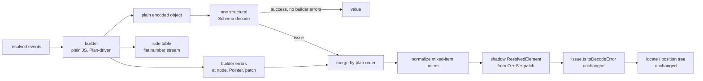

# Spike perf3-sp-errors: error and position parity through one structural decode

Unit `perf3-sp-errors`, phase 3 brief Step 1 item 5, guardrail "same errors (reason, message, path) and same positions".

## Verdict

**Parity is achievable, with the exceptions listed below.** The prototype reproduced the caller-facing error of today's decode on all 33 failing inputs. It matched reason, path, the full message text, `reason.elementPath`, and `position`, byte for byte. It also matched which error wins, under the interpreter and under the JIT. All 6 succeeding inputs decoded to the same values.

The exceptions:

1. The raw Schema issue tree in `reason.cause` is not the same.
2. A direct `Schema.decode` of a `ResolvedElement` through the element codec must keep today's codec.

Neither exception touches reason, message, path or position.

Recommendation: build the translation as a **shadow rebuild on the failure path that feeds today's `src/issue.ts` unchanged**. Keep one flat side table outside the plain object. The design and its cost follow.

## Translation design

The success path builds the plain object and the side table and runs one decode. Every other step runs only on failure.

### What the plain object loses

The structural codec uses the same keys as today's per-element target Struct: attribute keys, slot keys, `$text`, `$children`, `*`, `data-*`. Schema `Pointer` paths over the plain object are therefore already the paths `issue.ts` walks today.

Only one fact needed by the error contract is lost: an element's **index among all element children of its parent**. `reason.elementPath` and the position lookup both use that index. Grouping children into slots erases the document order across slots.

- A plan with fewer than two element-bearing slots (slots plus open `*`) can recover that order from the slot array.
- A plan with two or more cannot. Cases c08, c09, c19, c24, c25 and c33 return a wrong `elementPath` and position when the side table is off.
- Mixed content keeps document order in `$children`, so it needs nothing.

### Side table

The side table is one flat `number[]` that sits outside the plain object. It is written in document pre-order:

- before each element child of a multi-slot node, that child's slot index;
- when such a node closes, an `END` marker.

The shadow rebuild reads the table in the same pre-order. It builds each child's shadow lazily, when the child is placed.

On bank-4m the table holds 62,652 entries for 62,653 elements. The table must stay **off** the object. Any key placed on the object, including a symbol or a non-enumerable key, makes `onExcessProperty: "error"` fail: Schema checks excess keys with `Reflect.ownKeys` (`SchemaAST.ts` ~3037). This is measured below. A `WeakMap` is correct but costs twice as much.

### Builder errors

The getter-level failures move from `compile.ts` into the builder with their message text unchanged:

- undeclared attribute;
- unknown child;
- a second `one` or `optional` child;
- text in `elements` content;
- an element in `text` content;
- a non-blank `empty` element;
- a misnamed root.

Each failure is recorded as `{ at: object path of the node, local: Pointer path, issue }`. A small **patch** carries what the shadow needs and the plain object lacks:

- the undeclared attribute's raw value, for `attribute @foo="1"`;
- a duplicate stub, so `admits at most one` prints `[1]`;
- the actual root name, for `expected 
 but found <pp>`.

The builder stops filling a node after that node's first failure, which is what today's getter does.

An unknown member of closed `mixed` content is not a builder error. The builder emits a placeholder item that holds the element. The Schema union then fails at `$children[i]` in its own order, and `resolveItem` produces today's `unmatched` leaf.

### Which error wins

Today the getter of element E runs before E's target Struct. Attributes decode in declaration order, then text, slots, open `*` and mixed items, and the `data-*` rest comes last. `many` children decode by index. This order is a function of the Plan.

Each candidate gets a rank vector from that order. A builder error at node N ranks as `rank(N) ++ [-1]`. The steps:

1. Drop every candidate under a node that has a builder error, because today nothing under a failed getter runs.
2. Sort the rest.
3. Under `errors: "first"`, the first candidate is the error.
4. Under `errors: "all"`, all survivors form the cause, and the first one gives the path, message and position, as `walk` does today.

Cases c25 to c29 and c31 to c33 cover this. They include a failure later in the document that wins because its slot is declared first (c25), and a structural failure in a parent that beats an earlier leaf failure in a child (c27).

### Normalization

The structural codec's mixed item is `Struct({ value, _tag: Literal(wire) })`, discriminated by `_tag`. Schema reports a member failure as `AnyOf<Union>(Composite(Pointer(["value"], X)))`. Today it reports one through the item's `decodeTo`.

A pass of about ten lines rewrites that issue to `Pointer(["value"], X)`. The existing walk already reads that shape at an `item` cursor (`step`, `ITEM_VALUE`). Without the pass, c16, c17 and c18 print the wrong path. Item fields must also be declared in the order `{ value, _tag }`, today's key order, or the decoded values compare equal but serialize with a different key order.

## Case-by-case diff

`today` is `decodeString(def)` from `src/codec.ts`. `proto` is `decodeTree`, then the builder, the structural decode, and the translation above. Each row compares `reason._tag`, `path`, the full `message`, `position`, `reason.elementPath`, and the count of leaves in `reason.cause`. The `Diff` column covers both the interpreter and `SchemaJITCompiler/enable` runs, with the `stream` side table.

| Id  | Category                                                | Analog in today's tests                          | Reason        | Path                                                | Position | elementPath              | Diff                            |
| --- | ------------------------------------------------------- | ------------------------------------------------ | ------------- | --------------------------------------------------- | -------- | ------------------------ | ------------------------------- |
| c01 | leaf: attribute value (README)                          | readme errors, issue.test "bad attribute"        | SchemaFailure | `/qti-choice-interaction/@max-choices`              | 1:1      | qti-choice-interaction#0 | same                            |
| c02 | missing attribute                                       | issue.test missing key                           | SchemaFailure | `/qti-choice-interaction`                           | 1:1      | qti-choice-interaction#0 | same                            |
| c03 | undeclared attribute (root)                             | qti/errors "undeclared root attribute"           | SchemaFailure | `/qti-choice-interaction/@foo`                      | 1:1      | qti-choice-interaction#0 | same                            |
| c04 | undeclared attribute (nested, many[2])                  | issue.test undeclared                            | SchemaFailure | `/qti-choice-interaction/qti-simple-choice[2]/@bar` | 4:3      | …/qti-simple-choice#2    | same                            |
| c05 | missing child (one)                                     | issue.test "missing child"                       | SchemaFailure | `/qti-choice-interaction`                           | 1:1      | qti-choice-interaction#0 | same                            |
| c06 | unexpected child (closed elements)                      | issue.test "unknown child"                       | SchemaFailure | `/qti-choice-interaction`                           | 1:1      | qti-choice-interaction#0 | same                            |
| c07 | too many of a one slot                                  | compile.test at most one                         | SchemaFailure | `/qti-choice-interaction/qti-prompt[1]`             | 2:3      | …/qti-prompt#0           | same                            |
| c08 | many[2] attribute leaf                                  | issue.test "second of two many"                  | SchemaFailure | `/qti-choice-interaction/qti-simple-choice[2]/@n`   | 4:3      | …/qti-simple-choice#2    | same                            |
| c09 | sole many child, no index                               | issue.test "sole many child"                     | SchemaFailure | `/qti-choice-interaction/qti-simple-choice/@n`      | 3:3      | …/qti-simple-choice#1    | same                            |
| c10 | leaf: text schema                                       | wire-fast-path `V`                               | SchemaFailure | `/v`                                                | 1:1      | v#0                      | same                            |
| c11 | element inside text content                             | compile.test text mode                           | SchemaFailure | `/p/t`                                              | 1:22     | p#0/t#1                  | same                            |
| c12 | text inside elements content                            | compile.test elements mode                       | SchemaFailure | `/p`                                                | 1:1      | p#0                      | same                            |
| c13 | empty element with content                              | compile.test empty mode                          | SchemaFailure | `/p/e`                                              | 2:3      | p#0/e#0                  | same                            |
| c14 | root name mismatch                                      | issue.test "root element name mismatch"          | SchemaFailure | `/pp`                                               | 1:1      | pp#0                     | same                            |
| c15 | mixed: unknown member (closed)                          | issue.test "unknown element and the member set"  | SchemaFailure | `/m/video`                                          | 2:2      | m#0/video#1              | same                            |
| c16 | mixed: second same-named member fails                   | issue.test "second of two same-named members"    | SchemaFailure | `/div/p[2]/@n`                                      | 2:1      | div#0/p#1                | same                            |
| c17 | suspend recursion div > blockquote > p                  | issue.test "drops the suspend branch"            | SchemaFailure | `/div/blockquote/p/@n`                              | 2:3      | div#0/blockquote#0/p#0   | same fields; cause leaves 2 → 1 |
| c18 | open mixed: declared member fails                       | issue.test "open mixed body"                     | SchemaFailure | `/om/e`                                             | 2:2      | om#0/e#1                 | same fields; cause leaves 2 → 1 |
| c19 | open elements: declared optional fails                  | wire-fast-path `OE`                              | SchemaFailure | `/oe/e`                                             | 1:10     | oe#0/e#1                 | same                            |
| c20 | `data-*` value fails                                    | compile.test data                                | SchemaFailure | `/d/@data-k`                                        | 1:1      | d#0                      | same                            |
| c21 | undeclared attribute when `data-*` is declared          | compile.test data                                | SchemaFailure | `/d/@other`                                         | 1:1      | d#0                      | same                            |
| c22 | namespace: child differs only by namespace              | namespace.test                                   | SchemaFailure | `/qti-assessment-item`                              | 1:1      | qti-assessment-item#0    | same                            |
| c23 | namespace: undeclared `xsi:` attribute                  | issue.test "namespaced attribute"                | SchemaFailure | `/qti-assessment-item/@xsi:foo`                     | 1:1      | qti-assessment-item#0    | same                            |
| c24 | two slots: elementPath needs the side table             | issue.test "positional and same-name indices"    | SchemaFailure | `/q/b[2]/@n`                                        | 4:1      | q#0/b#2                  | same                            |
| c25 | two slots: Schema field order beats document order      | (new)                                            | SchemaFailure | `/q/a/@n`                                           | 2:1      | q#0/a#1                  | same                            |
| c26 | order: attribute leaf beats child structural failure    | (new)                                            | SchemaFailure | `/r/@n`                                             | 1:1      | r#0                      | same                            |
| c27 | order: node structural failure beats earlier child leaf | (new)                                            | SchemaFailure | `/r`                                                | 1:1      | r#0                      | same                            |
| c28 | order: c[1] leaf beats c[2] structural failure          | (new)                                            | SchemaFailure | `/r/c[1]/@n`                                        | 1:10     | r#0/c#0                  | same                            |
| c29 | order: c[1] structural failure beats c[2] leaf          | (new)                                            | SchemaFailure | `/r/c[1]`                                           | 1:10     | r#0/c#0                  | same                            |
| c30 | leaf with a check (`NumberFromString` + `isBetween`)    | (new)                                            | SchemaFailure | `/score`                                            | 1:1      | score#0                  | same                            |
| c31 | `errors: "all"`: two attribute leaves                   | codec.test "every schema issue under errors all" | SchemaFailure | `/pair/@a`                                          | 1:1      | pair#0                   | same, leaf count included       |
| c32 | `errors: "all"`: structural failure plus leaves         | (new)                                            | SchemaFailure | `/r/@n`                                             | 1:1      | r#0                      | same, leaf count included       |
| c33 | `errors: "all"`: many leaves under two slots            | (new)                                            | SchemaFailure | `/q/a[1]/@n`                                        | 1:14     | q#0/a#1                  | same, leaf count included       |

Succeeding inputs decoded to equal values, with the same key order: the README, mixed div/blockquote recursion, open mixed, open elements, `data-*`, two slots, and bank-4m.

With the side table set to `symbol` or `weakmap` every row is also `same`. With the side table off, 5 failing inputs diverge: c08, c09, c19, c25 and c33 return a wrong `elementPath` and position. The other rows still match.

## Cost

### Method

- Runtimes: Bun 1.4.2 and Node v26.13.0, with effect 4.1.2, on macOS arm64 (Darwin 27.2.0).
- Input: synthetic `bank-4m`, 4,194,472 bytes and 62,653 elements, with the `ItemBank` vocabulary. `qti-assessment-item-ref` has two slots, so every record needs side-table entries.
- Each measurement ran 3 warm-up iterations, then 15 timed ones; the failure path ran 2 and 7. Medians are in milliseconds.
- Scripts are in `work/spikes/perf3-errors/`: `cost.ts` for cost, `cases.ts` for the diff, `proto.ts` for the prototype.
- The machine was heavily loaded by other seats. `uptime` load averages were 14.5 to 58 during the runs, so treat differences under about 2 ms as noise.

### Success-path cost of the side table

The `build` rows time the prototype builder only, starting from an already collected `ResolvedElement` root.

| Median, ms                                                                            | Bun interp. | Bun JIT | Node interp. | Node JIT |
| ------------------------------------------------------------------------------------- | ----------- | ------- | ------------ | -------- |
| build, no side table                                                                  | 8.25        | 6.39    | 11.73        | 9.56     |
| build + **stream** side table                                                         | 8.70        | 7.73    | 12.79        | 10.03    |
| build + symbol key on the node (breaks `onExcessProperty: "error"`)                   | 9.37        | 8.95    | 12.42        | 10.71    |
| build + `WeakMap`                                                                     | 17.87       | 18.37   | 18.45        | 15.64    |
| build + stream + a `[line, column, offset]` tuple per element (positions-on stand-in) | 11.80       | 17.99   | 16.87        | 15.12    |
| reference: today's Schema decode of the `ResolvedElement` root                        | 73.48       | 56.40   | 70.39        | 49.27    |

- **Positions off:** the side table costs about 0.5 to 1.3 ms on 62,653 elements, which is within noise at this load. Positions themselves cost nothing on success. As today, the failure path runs one `locate` scan of the text over the identical `elementPath`.
- **Positions on:** with the native-positions tokenizer, or streaming with positions, the builder must keep a start position per element, which today's `recordPositions` tree also does. The stand-in, a separate pass that allocates one tuple per element, adds about 3 to 10 ms. It overstates the inline cost; a flat `number[]` written in the same pre-order would be close to the stream's cost. The inline version was not measured.

### Failure-path cost

The input is bank-4m with `required="maybe"` on the last record.

| Median, ms                                               | Bun interp. | Bun JIT | Node interp. | Node JIT |
| -------------------------------------------------------- | ----------- | ------- | ------------ | -------- |
| today: `decodeString`, which fails                       | 131.83      | 112.97  | 161.18       | 124.96   |
| proto: tree, build, decode, shadow, translate and locate | 102.36      | 85.27   | 118.70       | 108.22   |
| of which `decodeTree`                                    | 32.34       | 40.71   | 47.84        | 48.40    |
| of which the shadow rebuild of the whole tree            | 22.22       | 27.96   | 23.47        | 21.89    |

The failure path stays cheaper than today's. The whole-tree shadow could be limited to the spine of the failing path plus its siblings, because that is all `walk` reads. That work is not needed.

Outside this unit's scope: on the same plain object, one structural decode took 3 to 8 ms, against 49 to 73 ms for today's Schema stage, with equal values. That number belongs to the codec spike. It excludes event-to-object building and was taken from a tree, not from events.

## Exceptions and what cannot be translated

1. **The `reason.cause` tree shape changes.** The SchemaError a `SchemaFailure` reason carries has different AST nodes and no per-element `Encoding` wrappers. It also loses the fallback branches today's unions add: the `suspend` member tried as a fallback, and the open-mixed guard. The StandardSchemaV1 leaf count drops from 2 to 1 on c17 and c18, and was unchanged on the other 31 cases.
   - This is not a translation gap; it is a different Schema run. Tests that count leaves stay green, because they assert one leaf or at least N: `test/qti/errors.test.ts`, `src/codec.test.ts` (errors all), and `document.test.ts`.
   - Faking today's tree is not recommended. If the owner treats `cause` as part of "same errors", this is the one open item.
2. **A direct ResolvedElement decode must keep today's codec.** `Schema.decodeUnknown(Element)(resolvedElement)` returns raw Schema issues with no translation, and `test/wire-fast-path.test.ts` pins those issue trees. The structural fast path must therefore be internal to `decodeString`, `fromString` and the channel decoders. Alternatively, the public codec's direct-decode path must keep today's getter.
   - This constrains the codec-shape spike. The builder already carries the getter messages, so the two paths share one copy of the text.
3. **An on-object side table breaks `onExcessProperty: "error"`.** Measured, not inferred. The side table must stay outside the object, as the stream does.
4. **The plain object's key set must equal the Struct's.** `onExcessProperty: "error"` from the caller reaches the structural decode. Today's getter emits exactly the target keys, and the builder must too. The prototype does.

Nothing that Schema's structural decode reported was found to be untranslatable for path, message, `elementPath` or position.

## What was not measured, and why

- **An event-driven builder.** The prototype builds from a collected `ResolvedElement` to isolate the translation. The side-table and patch contents do not depend on the builder's input; the event builder belongs to the builder spike.
  - One extra need for that builder: an unknown member of closed mixed content needs only the element's name for `unmatched`.
  - The undeclared attribute's raw value is available at the start tag.
- **The streaming channels** (`decodeSchema`, `decodeSchemaString`): record ordinals and native position trees. `toDecodeError` takes `record` unchanged, so this is expected to be a pass-through. It was not run.
- **Encode errors** (`toEncodeError`). The structural encode has the same keys, and the walk already runs over bare elements for encode. Not run.
- **Leaf schemas that need services**, and user transformations that are effectful. c30 covers a check plus a transformation. The JIT behavior around custom transformations is a separate brief item, item 8.
- **The fuzz and property corpus, and the QTI corpus.** Out of a spike's budget. The differential test the guardrail requires should reuse `cases.ts`'s summary function as its comparator.
- **An inline positions-on side table.** Only the separate-pass stand-in was measured.

## Open questions for the Mind

1. Does "same errors" include the raw `reason.cause` issue tree, which is exception 1? If yes, parity is not achievable without keeping today's codec on the failure path. That fallback would re-decode the failing document through the old codec. It is exact and costs only on failure, but it keeps two decoders.
2. Should the codec-shape spike confine the structural fast path to the library entry points, which is exception 2?
